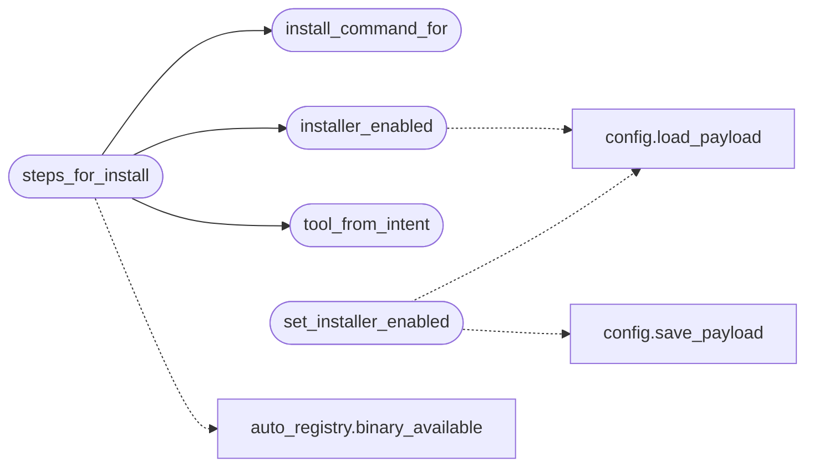

# `modules.lazy_installer`

> Source: [modules/lazy_installer.py:1](../../modules/lazy_installer.py#L1) | language `py` | coverage 100.0% | [API index](../index.md)

Capability installer for the Lazy autonomous loop.

Ports the installer-agent idea with Lazy safety semantics: the loop never
invents install commands. A fixed allowlist maps missing tool binaries to
reviewed one-line install recipes; anything off-list yields no intent.
Install intents only resolve when the payload flag `[`installer_enabled`](#installer_enabled)`
is set (default off), and every install still crosses the normal Guard
and intercept path, so pairing this with an ask-rule
(``lazy_guard rule-add "apt-get install" ask installs-write-to-host``)
keeps host mutation operator-gated.

Stdlib only.

## Contents

- **Functions:** [`installer_enabled`](#installer_enabled), [`set_installer_enabled`](#set_installer_enabled), [`install_command_for`](#install_command_for), [`intent_for`](#intent_for), [`tool_from_intent`](#tool_from_intent), [`steps_for_install`](#steps_for_install)
- **Constants:** [`INSTALL_INTENT_PREFIX`](#install_intent_prefix), [`TOOL_INSTALL`](#tool_install)

## Call Graph

Solid arrows stay in this module, dashed arrows leave it.



## Functions

<a id="installer_enabled"></a>

### `installer_enabled`

`function` | [modules/lazy_installer.py:41](../../modules/lazy_installer.py#L41)

```python
def installer_enabled() -> bool
```

Return whether the loop may resolve install intents.

Reads ``payload.json`` -> ``orchestrator`` -> ``installer``. Defaults
to off so host mutation stays an explicit operator decision. The flag
lives under the free-form orchestrator section so enabling it never
adds a top-level payload key (the schema-coverage contract).

**Returns:** `bool`

*Calls:* [`load_payload`](core.config.py.md#load_payload)

*Called by:* [`LazyCommandSet.do_lazy_install`](cli.commands.lazyops.py.md#lazycommandset-do_lazy_install), [`steps_for_install`](#steps_for_install)

---

<a id="set_installer_enabled"></a>

### `set_installer_enabled`

`function` | [modules/lazy_installer.py:58](../../modules/lazy_installer.py#L58)

```python
def set_installer_enabled(enabled: bool) -> bool
```

Persist the installer flag and return the stored value.

**Parameters**

| Name | Type | Default | Description |
|---|---|---|---|
| `enabled` | `bool` |  |  |

**Returns:** `bool`

*Calls:* [`load_payload`](core.config.py.md#load_payload), [`save_payload`](core.config.py.md#save_payload)

*Called by:* [`LazyCommandSet.do_lazy_install`](cli.commands.lazyops.py.md#lazycommandset-do_lazy_install)

---

<a id="install_command_for"></a>

### `install_command_for`

`function` | [modules/lazy_installer.py:70](../../modules/lazy_installer.py#L70)

```python
def install_command_for(tool: str) -> str | None
```

Return the allowlisted install recipe for one tool, or None.

**Parameters**

| Name | Type | Default | Description |
|---|---|---|---|
| `tool` | `str` |  |  |

**Returns:** `str | None`

*Called by:* [`LazyCommandSet.do_lazy_install`](cli.commands.lazyops.py.md#lazycommandset-do_lazy_install), [`steps_for_install`](#steps_for_install)

---

<a id="intent_for"></a>

### `intent_for`

`function` | [modules/lazy_installer.py:75](../../modules/lazy_installer.py#L75)

```python
def intent_for(tool: str) -> str
```

Build the canonical install intent summary for one tool.

**Parameters**

| Name | Type | Default | Description |
|---|---|---|---|
| `tool` | `str` |  |  |

**Returns:** `str`

---

<a id="tool_from_intent"></a>

### `tool_from_intent`

`function` | [modules/lazy_installer.py:80](../../modules/lazy_installer.py#L80)

```python
def tool_from_intent(text: str) -> str
```

Extract the tool name from an install intent, else empty string.

**Parameters**

| Name | Type | Default | Description |
|---|---|---|---|
| `text` | `str` |  |  |

**Returns:** `str`

*Called by:* [`steps_for_install`](#steps_for_install)

---

<a id="steps_for_install"></a>

### `steps_for_install`

`function` | [modules/lazy_installer.py:88](../../modules/lazy_installer.py#L88)

```python
def steps_for_install(text: str) -> list[str] | None
```

Resolve an install intent to its recipe, or None.

Returns None when the installer is disabled, the tool is already
present, or the tool has no allowlisted recipe.

**Parameters**

| Name | Type | Default | Description |
|---|---|---|---|
| `text` | `str` |  |  |

**Returns:** `list[str] | None`

*Calls:* [`binary_available`](modules.auto_registry.py.md#binary_available), [`install_command_for`](#install_command_for), [`installer_enabled`](#installer_enabled), [`tool_from_intent`](#tool_from_intent)

---

## Constants

<a id="install_intent_prefix"></a>

### `INSTALL_INTENT_PREFIX`

`constant` | [modules/lazy_installer.py:17](../../modules/lazy_installer.py#L17)

```python
INSTALL_INTENT_PREFIX = 'install capability '
```

---

<a id="tool_install"></a>

### `TOOL_INSTALL`

`constant` | [modules/lazy_installer.py:19](../../modules/lazy_installer.py#L19)

```python
TOOL_INSTALL: dict[str, str]
```

---
