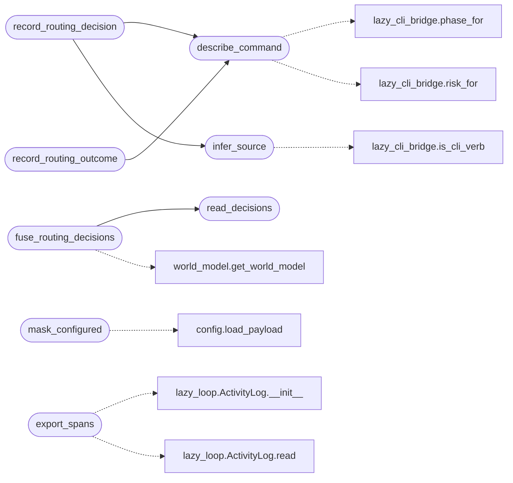

# `modules.lazy_intel`

> Source: [modules/lazy_intel.py:1](../../modules/lazy_intel.py#L1) | language `py` | coverage 100.0% | [API index](../index.md)

Intel feed from the Lazy autonomous loop.

Every routing decision the loop makes (which shell verb, for which intent,
with what outcome) is recorded as JSONL under ``sessions/lazy/`` and fused
into the [`WorldModel`](modules.world_model.py.md#worldmodel) on sync. The intel graph
(`[`modules.intel_fusion.build_intel_graph`](modules.intel_fusion.py.md#build_intel_graph)`) and the attack graph
(`[`modules.attack_surface3d.build_attack_graph`](modules.attack_surface3d.py.md#build_attack_graph)`) are derived views over
``sessions/`` artefacts, so feeding the world model feeds both graphs and
everything the orchestrator reads.

The same records back the TopoSwarm orchestrator dataset, see
`modules.lazy_orchestrator_dataset`.

Stdlib only. Never raises; all entry points degrade to no-ops on error.

## Contents

- **Functions:** [`infer_source`](#infer_source), [`describe_command`](#describe_command), [`record_routing_decision`](#record_routing_decision), [`record_routing_outcome`](#record_routing_outcome), [`read_decisions`](#read_decisions), [`mask_configured`](#mask_configured), [`stack_signature`](#stack_signature), [`fuse_routing_decisions`](#fuse_routing_decisions), [`export_spans`](#export_spans)

## Call Graph

Solid arrows stay in this module, dashed arrows leave it.



## Functions

<a id="infer_source"></a>

### `infer_source`

`function` | [modules/lazy_intel.py:79](../../modules/lazy_intel.py#L79)

```python
def infer_source(command: str, intent_text: str = '') -> str
```

Classify where a resolved step likely came from.

**Parameters**

| Name | Type | Default | Description |
|---|---|---|---|
| `command` | `str` |  | Resolved shell command line. |
| `intent_text` | `str` | `''` | Original intent summary. |

**Returns:** `str` - One of auto, cli, heuristic.

*Calls:* [`is_cli_verb`](modules.lazy_cli_bridge.py.md#is_cli_verb)

*Called by:* [`record_routing_decision`](#record_routing_decision)

---

<a id="describe_command"></a>

### `describe_command`

`function` | [modules/lazy_intel.py:105](../../modules/lazy_intel.py#L105)

```python
def describe_command(command: str) -> dict
```

Describe a command with phase and risk.

Never raises.

**Parameters**

| Name | Type | Default | Description |
|---|---|---|---|
| `command` | `str` |  |  |

**Returns:** `dict`

*Calls:* [`phase_for`](modules.lazy_cli_bridge.py.md#phase_for), [`risk_for`](modules.lazy_cli_bridge.py.md#risk_for)

*Called by:* [`record_routing_decision`](#record_routing_decision), [`record_routing_outcome`](#record_routing_outcome)

---

<a id="record_routing_decision"></a>

### `record_routing_decision`

`function` | [modules/lazy_intel.py:120](../../modules/lazy_intel.py#L120)

```python
def record_routing_decision(task_id: str, intent_id: int, command: str, intent_text: str = '', target: str = '', stack: str = '') -> dict
```

Record which verb the loop chose for one intent.

**Parameters**

| Name | Type | Default | Description |
|---|---|---|---|
| `task_id` | `str` |  | Loop task identifier. |
| `intent_id` | `int` |  | Exploration node the command serves. |
| `command` | `str` |  | Resolved shell command line. |
| `intent_text` | `str` | `''` | Original intent summary for source inference. |
| `target` | `str` | `''` | Bound target, if any. |
| `stack` | `str` | `''` | Target stack fingerprint for cross-task priors. |

**Returns:** `dict` - The stored record.

*Calls:* [`describe_command`](#describe_command), [`infer_source`](#infer_source)

---

<a id="record_routing_outcome"></a>

### `record_routing_outcome`

`function` | [modules/lazy_intel.py:160](../../modules/lazy_intel.py#L160)

```python
def record_routing_outcome(task_id: str, intent_id: int, command: str, state: str = '', facts: int = 0, findings: int = 0, stack: str = '') -> dict
```

Record the terminal outcome of one executed command.

**Parameters**

| Name | Type | Default | Description |
|---|---|---|---|
| `task_id` | `str` |  | Loop task identifier. |
| `intent_id` | `int` |  | Exploration node the command served. |
| `command` | `str` |  | Executed shell command line. |
| `state` | `str` | `''` | Terminal intent state (done, blocked, exhausted, stopped). |
| `facts` | `int` | `0` | Facts persisted by the intent. |
| `findings` | `int` | `0` | Findings reported by the intent. |
| `stack` | `str` | `''` | Target stack fingerprint for cross-task priors. |

**Returns:** `dict` - The stored record.

*Calls:* [`describe_command`](#describe_command)

*Called by:* [`record_outcome`](modules.atomic_exploit_bridge.py.md#record_outcome)

---

<a id="read_decisions"></a>

### `read_decisions`

`function` | [modules/lazy_intel.py:202](../../modules/lazy_intel.py#L202)

```python
def read_decisions(task_id: str = '', limit: int = 2000) -> list[dict]
```

Read routing records, optionally filtered by task.

**Parameters**

| Name | Type | Default | Description |
|---|---|---|---|
| `task_id` | `str` | `''` | Only return records for this task when set. |
| `limit` | `int` | `2000` | Max records from the tail. |

**Returns:** `list[dict]` - Parsed record list, oldest first.

*Called by:* [`fuse_routing_decisions`](#fuse_routing_decisions), [`adjust_from_usage`](modules.lazy_orchestrator_feedback.py.md#adjust_from_usage), [`export_dataset`](modules.lazy_orchestrator_feedback.py.md#export_dataset)

---

<a id="mask_configured"></a>

### `mask_configured`

`function` | [modules/lazy_intel.py:228](../../modules/lazy_intel.py#L228)

```python
def mask_configured(text: str) -> str
```

Mask only operator-configured credential values in live text.

Unlike `_mask` (defense in depth for stored records), this keeps
discovered loot (hashes, target creds) visible to the model — the loop
needs them for cracking and reuse reasoning — while configured secrets
never reach cloud backends. Mirrors the secret-patterns approach of
only masking known-configured values in transit.

**Parameters**

| Name | Type | Default | Description |
|---|---|---|---|
| `text` | `str` |  |  |

**Returns:** `str`

*Calls:* [`load_payload`](core.config.py.md#load_payload)

---

<a id="stack_signature"></a>

### `stack_signature`

`function` | [modules/lazy_intel.py:254](../../modules/lazy_intel.py#L254)

```python
def stack_signature(assets=None) -> str
```

Fingerprint the target stack from service assets.

Sorted service values joined short, so equal stacks share priors
across engagements (the cross-task learning query) while unseen
stacks fall back to global priors.

**Parameters**

| Name | Type | Default | Description |
|---|---|---|---|
| `assets` |  | `None` | Object exposing ``list("service")`` with ``.value``. |

**Returns:** `str` - Stack fingerprint, empty when unknowable. Never raises.

---

<a id="fuse_routing_decisions"></a>

### `fuse_routing_decisions`

`function` | [modules/lazy_intel.py:285](../../modules/lazy_intel.py#L285)

```python
def fuse_routing_decisions(task_id: str = '') -> dict
```

Fuse routing records into the world model as host notes.

Only decisions bound to IP-literal targets write notes, so the world
model gains per-host evidence of what the loop already tried. The
intel and attack graphs rebuild from the world model, hence from
these notes as well.

**Parameters**

| Name | Type | Default | Description |
|---|---|---|---|
| `task_id` | `str` | `''` | Fuse only this task when set, else everything recent. |

**Returns:** `dict` - Summary with fused count. Never raises.

*Calls:* [`read_decisions`](#read_decisions), [`get_world_model`](modules.world_model.py.md#get_world_model)

---

<a id="export_spans"></a>

### `export_spans`

`function` | [modules/lazy_intel.py:324](../../modules/lazy_intel.py#L324)

```python
def export_spans(task_id: str, out: str | Path | None = None) -> dict
```

Export activity records as trace spans for observability.

Maps the existing trace fields onto span semantics: `[`task`](lazyc2.py.md#task)` is the
trace id, ``tool_use_id`` (or a synthetic ``kind:index`` id) is the
span id, ``intent_id`` is the parent, and ``tool``/``result`` pairs
sharing a ``tool_use_id`` join into one span with duration. Point
records without a pair become single-event spans.

**Parameters**

| Name | Type | Default | Description |
|---|---|---|---|
| `task_id` | `str` |  | Loop task identifier. |
| `out` | `str \| Path \| None` | `None` | Destination path. Defaults to ``spans_<task>.jsonl``. |

**Returns:** `dict` - Summary with spans written and destination. Never raises.

*Calls:* [`ActivityLog.__init__`](modules.lazy_loop.py.md#activitylog-__init__), [`ActivityLog.read`](modules.lazy_loop.py.md#activitylog-read)

---
