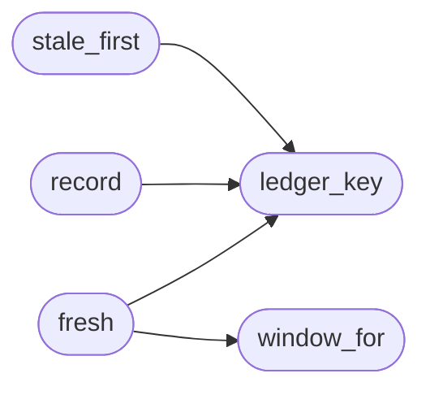

# `modules.lazy_ledger`

> Source: [modules/lazy_ledger.py:1](../../modules/lazy_ledger.py#L1) | language `py` | coverage 100.0% | [API index](../index.md)

Freshness ledger: TTL windows per verb and target for the loop worker.

CVEngine doctrine, adapted: recurring windows are ledger windows, not
schedules. A tool that already answered for one target within its
freshness TTL skips the repeat; rows that never ran or waited the
longest come first (`[`stale_first`](#stale_first)`). Claims are bounding, never
blocking — a missing store file, a malformed row or any failure around
the ledger degrades to "not fresh" so the loop keeps working.

State: ``sessions/lazy/verb_ledger.json`` — ``{key: {"ts", "ok"}}``.

## Contents

- **Functions:** [`window_for`](#window_for), [`ledger_key`](#ledger_key), [`fresh`](#fresh), [`record`](#record), [`stale_first`](#stale_first)
- **Constants:** [`LEDGER_FILENAME`](#ledger_filename), [`DEFAULT_TTL_SEC`](#default_ttl_sec)

## Call Graph

Solid arrows stay in this module, dashed arrows leave it.



## Functions

<a id="window_for"></a>

### `window_for`

`function` | [modules/lazy_ledger.py:32](../../modules/lazy_ledger.py#L32)

```python
def window_for(verb: str) -> float
```

Return the freshness window for one verb identity.

Exact table entries win; derived addon identities
(``lazy_<name>``) share the addon window; everything else takes
the default day.

**Parameters**

| Name | Type | Default | Description |
|---|---|---|---|
| `verb` | `str` |  | Recorded verb identity. |

**Returns:** `float` - Window length in seconds.

*Called by:* [`fresh`](#fresh)

---

<a id="ledger_key"></a>

### `ledger_key`

`function` | [modules/lazy_ledger.py:53](../../modules/lazy_ledger.py#L53)

```python
def ledger_key(verb: str, target: str) -> str
```

Return the identity key of one verb/target pair.

**Parameters**

| Name | Type | Default | Description |
|---|---|---|---|
| `verb` | `str` |  |  |
| `target` | `str` |  |  |

**Returns:** `str`

*Called by:* [`fresh`](#fresh), [`record`](#record), [`stale_first`](#stale_first)

---

<a id="fresh"></a>

### `fresh`

`function` | [modules/lazy_ledger.py:140](../../modules/lazy_ledger.py#L140)

```python
def fresh(verb: str, target: str, now: float | None = None, sessions_dir: str | Path | None = None) -> bool
```

Return True when one verb/target pair already ran inside its TTL.

**Parameters**

| Name | Type | Default | Description |
|---|---|---|---|
| `verb` | `str` |  | Command verb (``lazynmap``, ``lazyaddon``, ...). |
| `target` | `str` |  | Target value. |
| `now` | `float \| None` | `None` | Reference epoch; defaults to current time. |
| `sessions_dir` | `str \| Path \| None` | `None` | Optional sessions directory override. |

**Returns:** `bool` - True fresh, when the last recorded row is inside the window.

*Calls:* [`ledger_key`](#ledger_key), [`window_for`](#window_for)

---

<a id="record"></a>

### `record`

`function` | [modules/lazy_ledger.py:164](../../modules/lazy_ledger.py#L164)

```python
def record(verb: str, target: str, ok: bool = True, now: float | None = None, sessions_dir: str | Path | None = None) -> None
```

Upsert one completed run so the pair stops being stale.

**Parameters**

| Name | Type | Default | Description |
|---|---|---|---|
| `verb` | `str` |  | Command verb. |
| `target` | `str` |  | Target value. |
| `ok` | `bool` | `True` | Whether the run completed usefully at all. |
| `now` | `float \| None` | `None` | Reference epoch; defaults to current time. |
| `sessions_dir` | `str \| Path \| None` | `None` | Optional sessions directory override. |

*Calls:* [`ledger_key`](#ledger_key)

---

<a id="stale_first"></a>

### `stale_first`

`function` | [modules/lazy_ledger.py:191](../../modules/lazy_ledger.py#L191)

```python
def stale_first(catalog: list[tuple[str, str]], now: float | None = None, sessions_dir: str | Path | None = None) -> list[tuple[str, str]]
```

Order verb/target pairs: never-run first, then longest-waiting.

**Parameters**

| Name | Type | Default | Description |
|---|---|---|---|
| `catalog` | `list[tuple[str, str]]` |  | ``[(verb, target), ...]`` candidate pairs. |
| `now` | `float \| None` | `None` | Reference epoch; defaults to current time. |
| `sessions_dir` | `str \| Path \| None` | `None` | Optional sessions directory override. |

**Returns:** `list[tuple[str, str]]` - Reordered candidate list.

*Calls:* [`ledger_key`](#ledger_key)

---

## Constants

<a id="ledger_filename"></a>

### `LEDGER_FILENAME`

`constant` | [modules/lazy_ledger.py:19](../../modules/lazy_ledger.py#L19)

```python
LEDGER_FILENAME = 'verb_ledger.json'
```

---

<a id="default_ttl_sec"></a>

### `DEFAULT_TTL_SEC`

`constant` | [modules/lazy_ledger.py:21](../../modules/lazy_ledger.py#L21)

```python
DEFAULT_TTL_SEC
```

---
