# `modules.lazy_loop`

> Source: [modules/lazy_loop.py:1](../../modules/lazy_loop.py#L1) | language `py` | coverage 100.0% | [API index](../index.md)

Lazy autonomous loop for LazyOwn.

Double-graph engine without external services.

Semantics:
    AssetGraph is global shared truth, ExplorationGraph is per-task,
    anchors join them, Planner is the sole intent generator emitting
    0..N intents per wakeup, each Worker claims exactly ONE intent and
    writes facts back, Guard gates every tool call, Enrich completes
    DNS/HTTP asynchronously, Traffic records every execution, Retester
    replays findings to a verdict, cold compaction folds stale nodes.

Persistence:
    JSON files under ``sessions/lazy/`` so every state survives
    restarts and stays inspectable from the CLI. Legacy ``sessions/lazy/``
    files are migrated automatically on first use.

Usage:
    from modules.lazy_loop import LazyLoopEngine
    engine = LazyLoopEngine()
    task = engine.create_task("gain initial access on 10.10.11.5")
    engine.run(task.task_id)

## Contents

- **Classes:** [`AssetGraph`](#assetgraph), [`ExplorationGraph`](#explorationgraph), [`Frontier`](#frontier), [`ActivityLog`](#activitylog), [`TrafficLog`](#trafficlog), [`Guard`](#guard), [`AssetGate`](#assetgate), [`Budget`](#budget), [`RuntimeTracker`](#runtimetracker), [`InterceptQueue`](#interceptqueue), [`TodoStore`](#todostore), [`TaskStore`](#taskstore), [`Planner`](#planner), [`Worker`](#worker), [`Retester`](#retester), [`ColdCompactor`](#coldcompactor), [`FindingService`](#findingservice), [`EvidenceStore`](#evidencestore), [`Notifier`](#notifier), [`LlmPool`](#llmpool), [`ToolCatalog`](#toolcatalog), [`SideQuestions`](#sidequestions), [`CompanyScope`](#companyscope), [`TaskArchive`](#taskarchive), [`TaskTemplate`](#tasktemplate), [`TaskCategory`](#taskcategory), [`TaskChat`](#taskchat), [`LazyLoopEngine`](#lazyloopengine)
- **Functions:** [`extract_scope_items`](#extract_scope_items), [`extract_constraint_items`](#extract_constraint_items), [`load_intel_scores`](#load_intel_scores), [`resolve_target`](#resolve_target), [`decompose_goals`](#decompose_goals), [`enrich_asset`](#enrich_asset), [`constraint_block`](#constraint_block), [`finding_severity`](#finding_severity)
- **Constants:** [`TOOL_DEFAULTS`](#tool_defaults), [`EVIDENCE_ROLES`](#evidence_roles)

## Type Diagram

```mermaid
classDiagram
    direction LR
    class AssetGraph
    AssetGraph : __init__()
    AssetGraph : dedupe_key()
    AssetGraph : insert()
    AssetGraph : get()
    AssetGraph : list()
    AssetGraph : mark_tested()
    AssetGraph : coverage()
    AssetGraph : scoped()
    AssetGraph : coverage_for()
    AssetGraph : untested_for()
    class ExplorationGraph
    ExplorationGraph : __init__()
    ExplorationGraph : add_node()
    ExplorationGraph : remove_nodes()
    ExplorationGraph : get()
    ExplorationGraph : persist()
    ExplorationGraph : set_state()
    ExplorationGraph : add_edge()
    ExplorationGraph : anchor()
    ExplorationGraph : anchors_for()
    ExplorationGraph : anchored_nodes()
    ExplorationGraph : list()
    ExplorationGraph : children()
    ExplorationGraph : parents()
    ExplorationGraph : overview()
    ExplorationGraph : reload()
    ExplorationGraph : compare_and_claim()
    ExplorationGraph : finding_signature()
    ExplorationGraph : has_finding()
    ExplorationGraph : node_detail()
    ExplorationGraph : list_facts()
    ExplorationGraph : record_fact()
    class Frontier
    Frontier : __init__()
    Frontier : pending()
    Frontier : claim_next()
    class ActivityLog
    ActivityLog : __init__()
    ActivityLog : emit()
    ActivityLog : read()
    ActivityLog : for_intent()
    ActivityLog : trace()
    ActivityLog : search_all()
    ActivityLog : search()
    class TrafficLog
    TrafficLog : digest_of()
    TrafficLog : __init__()
    TrafficLog : record()
    TrafficLog : wire()
    TrafficLog : read()
    TrafficLog : search()
    TrafficLog : search_host()
    TrafficLog : get()
    TrafficLog : recorder_body()
    TrafficLog : recorder_blob()
    TrafficLog : templates()
    TrafficLog : by_template()
    TrafficLog : bind()
    TrafficLog : evidence()
    TrafficLog : reorder_evidence()
    TrafficLog : export()
    TrafficLog : archive()
    TrafficLog : clear()
    class Guard
    Guard : __init__()
    Guard : add_rule()
    Guard : remove_rule()
    Guard : set_judge()
    Guard : check()
    Guard : audit()
    Guard : lookup()
    Guard : stats()
    class AssetGate
    AssetGate : __init__()
    AssetGate : add()
    AssetGate : remove()
    AssetGate : list()
    AssetGate : evaluate()
    class Budget
    Budget : __init__()
    Budget : limits()
    Budget : set_limits()
    Budget : usage()
    Budget : record_toolcall()
    Budget : record_round()
    Budget : check()
    class RuntimeTracker
    RuntimeTracker : __init__()
    RuntimeTracker : heartbeat()
    RuntimeTracker : beat()
    RuntimeTracker : abort()
    RuntimeTracker : note_trigger()
    class InterceptQueue
    InterceptQueue : __init__()
    InterceptQueue : request()
    InterceptQueue : pending()
    InterceptQueue : history()
    InterceptQueue : decide()
    InterceptQueue : wait()
    class TodoStore
    TodoStore : __init__()
    TodoStore : add()
    TodoStore : complete()
    TodoStore : next_pending()
    TodoStore : as_list()
    class TaskStore
    TaskStore : __init__()
    TaskStore : create()
    TaskStore : get()
    TaskStore : list()
    TaskStore : set_status()
    TaskStore : pause()
    TaskStore : resume()
    TaskStore : delete()
    TaskStore : active_count()
    TaskStore : queue()
    TaskStore : enqueue()
    TaskStore : dequeue_next()
    TaskStore : set_llm_chain()
    TaskStore : llm_state()
    TaskStore : advance_llm()
    TaskStore : set_skills()
    TaskStore : set_deadline()
    TaskStore : expired()
    TaskStore : add_constraint()
    TaskStore : add_scope()
    TaskStore : steer()
    TaskStore : kill()
    TaskStore : steer_for()
    TaskStore : clear_steer()
    class Planner
    Planner : __init__()
    Planner : plan()
    Planner : refine()
    Planner : finalize()
    class Worker
    Worker : __init__()
    Worker : rebind()
    Worker : close()
    Worker : execute()
    class Retester
    Retester : __init__()
    Retester : retest()
    Retester : retest_context()
    class ColdCompactor
    ColdCompactor : __init__()
    ColdCompactor : noa_archives()
    ColdCompactor : hot_set()
    ColdCompactor : structural_cold()
    ColdCompactor : covered_members()
    ColdCompactor : on_planner_round()
    ColdCompactor : compact()
    ColdCompactor : expand()
    ColdCompactor : cold_index()
    ColdCompactor : unfolded()
    ColdCompactor : digest_overview()
    class FindingService
    FindingService : __init__()
    FindingService : report()
    FindingService : apply_drafts()
    FindingService : set_status()
    FindingService : update_report()
    FindingService : ranked()
    class EvidenceStore
    EvidenceStore : __init__()
    EvidenceStore : add()
    EvidenceStore : verify()
    EvidenceStore : gc()
    EvidenceStore : for_finding()
    EvidenceStore : read()
    EvidenceStore : export()
    class Notifier
    Notifier : __init__()
    Notifier : channels()
    Notifier : add_channel()
    Notifier : remove_channel()
    Notifier : emit()
    class LlmPool
    LlmPool : DEFAULT_MEMBERS
    LlmPool : __init__()
    LlmPool : members()
    LlmPool : add_member()
    LlmPool : remove_member()
    LlmPool : set_priority()
    LlmPool : usage()
    LlmPool : record_call()
    LlmPool : complete()
    LlmPool : health()
    LlmPool : context_budget()
    LlmPool : record_raw()
    LlmPool : set_record_raw()
    LlmPool : raw_entries()
    LlmPool : raw_entries_for_task()
    LlmPool : set_context_budget()
    class ToolCatalog
    ToolCatalog : __init__()
    ToolCatalog : bindings()
    ToolCatalog : bind()
    ToolCatalog : unbind()
    class SideQuestions
    SideQuestions : BUDGET_CHARS
    SideQuestions : ask()
    SideQuestions : history()
    SideQuestions : sessions()
    class CompanyScope
    CompanyScope : __init__()
    CompanyScope : add()
    CompanyScope : list()
    CompanyScope : match()
    class TaskArchive
    TaskArchive : save()
    TaskArchive : list()
    TaskArchive : restore()
    TaskArchive : stats()
    class WorkerAgenticMixin
    WorkerAgenticMixin <|-- Worker
    class WorkerExecutionMixin
    WorkerExecutionMixin <|-- Worker
    class WorkerGatingMixin
    WorkerGatingMixin <|-- Worker
    class WorkerMemoryMixin
    WorkerMemoryMixin <|-- Worker
```



## Call Graph

Solid arrows stay in this module, dashed arrows leave it.

```mermaid
flowchart LR
    n_modules_lazy_loop_py__AssetGraph_insert(["AssetGraph.insert"])
    n_modules_lazy_loop_py__AssetGate___init__(["AssetGate.__init__"])
    n_modules_lazy_loop_py__AssetGraph_dedupe_key(["AssetGraph.dedupe_key"])
    n_modules_lazy_loop_py__ExplorationGraph_compare_and_claim(["ExplorationGraph.compare_and_claim"])
    n_modules_lazy_loop_py__ExplorationGraph_reload(["ExplorationGraph.reload"])
    n_modules_lazy_loop_py__ExplorationGraph_set_state(["ExplorationGraph.set_state"])
    n_modules_lazy_loop_py__ExplorationGraph_has_finding(["ExplorationGraph.has_finding"])
    n_modules_lazy_loop_py__ExplorationGraph_finding_signature(["ExplorationGraph.finding_signature"])
    n_modules_lazy_loop_py__ExplorationGraph_node_detail(["ExplorationGraph.node_detail"])
    n_modules_lazy_loop_py__ExplorationGraph_anchors_for(["ExplorationGraph.anchors_for"])
    n_modules_lazy_loop_py__ExplorationGraph_children(["ExplorationGraph.children"])
    n_modules_lazy_loop_py__ExplorationGraph_get(["ExplorationGraph.get"])
    n_modules_lazy_loop_py__ExplorationGraph_record_fact(["ExplorationGraph.record_fact"])
    n_modules_lazy_loop_py__ExplorationGraph_add_edge(["ExplorationGraph.add_edge"])
    n_modules_lazy_loop_py__ExplorationGraph_add_node(["ExplorationGraph.add_node"])
    n_modules_lazy_loop_py__ExplorationGraph_anchor(["ExplorationGraph.anchor"])
    n_modules_lazy_loop_py__Frontier_claim_next(["Frontier.claim_next"])
    n_modules_lazy_loop_py__Frontier_pending(["Frontier.pending"])
    n_modules_lazy_loop_py__ActivityLog_for_intent(["ActivityLog.for_intent"])
    n_modules_lazy_loop_py__ActivityLog_read(["ActivityLog.read"])
    n_modules_lazy_loop_py__ActivityLog_trace(["ActivityLog.trace"])
    n_modules_lazy_loop_py__ActivityLog_search_all(["ActivityLog.search_all"])
    n_modules_lazy_loop_py__ActivityLog_search(["ActivityLog.search"])
    n_modules_lazy_loop_py__TrafficLog_record(["TrafficLog.record"])
    n_modules_lazy_loop_py__TrafficLog_digest_of(["TrafficLog.digest_of"])
    n_modules_lazy_loop_py__TrafficLog_wire(["TrafficLog.wire"])
    n_modules_lazy_loop_py__TrafficLog_get(["TrafficLog.get"])
    n_modules_lazy_loop_py__TrafficLog_read(["TrafficLog.read"])
    n_modules_lazy_loop_py__TrafficLog_search(["TrafficLog.search"])
    n_modules_lazy_loop_py__TrafficLog_search_host(["TrafficLog.search_host"])
    n_modules_lazy_loop_py__TrafficLog_recorder_body(["TrafficLog.recorder_body"])
    n_modules_lazy_loop_py__TrafficLog_recorder_blob(["TrafficLog.recorder_blob"])
    n_modules_lazy_loop_py__AssetGraph_insert --> n_modules_lazy_loop_py__AssetGate___init__
    n_modules_lazy_loop_py__AssetGraph_insert --> n_modules_lazy_loop_py__AssetGraph_dedupe_key
    n_modules_lazy_loop_py__ExplorationGraph_compare_and_claim --> n_modules_lazy_loop_py__ExplorationGraph_reload
    n_modules_lazy_loop_py__ExplorationGraph_compare_and_claim --> n_modules_lazy_loop_py__ExplorationGraph_set_state
    n_modules_lazy_loop_py__ExplorationGraph_has_finding --> n_modules_lazy_loop_py__ExplorationGraph_finding_signature
    n_modules_lazy_loop_py__ExplorationGraph_node_detail --> n_modules_lazy_loop_py__ExplorationGraph_anchors_for
    n_modules_lazy_loop_py__ExplorationGraph_node_detail --> n_modules_lazy_loop_py__ExplorationGraph_children
    n_modules_lazy_loop_py__ExplorationGraph_node_detail --> n_modules_lazy_loop_py__ExplorationGraph_get
    n_modules_lazy_loop_py__ExplorationGraph_record_fact --> n_modules_lazy_loop_py__ExplorationGraph_add_edge
    n_modules_lazy_loop_py__ExplorationGraph_record_fact --> n_modules_lazy_loop_py__ExplorationGraph_add_node
    n_modules_lazy_loop_py__ExplorationGraph_record_fact --> n_modules_lazy_loop_py__ExplorationGraph_anchor
    n_modules_lazy_loop_py__Frontier_claim_next --> n_modules_lazy_loop_py__Frontier_pending
    n_modules_lazy_loop_py__ActivityLog_for_intent --> n_modules_lazy_loop_py__ActivityLog_read
    n_modules_lazy_loop_py__ActivityLog_trace --> n_modules_lazy_loop_py__ActivityLog_for_intent
    n_modules_lazy_loop_py__ActivityLog_search_all --> n_modules_lazy_loop_py__ActivityLog_read
    n_modules_lazy_loop_py__ActivityLog_search --> n_modules_lazy_loop_py__ActivityLog_read
    n_modules_lazy_loop_py__TrafficLog_record --> n_modules_lazy_loop_py__TrafficLog_digest_of
    n_modules_lazy_loop_py__TrafficLog_wire --> n_modules_lazy_loop_py__TrafficLog_get
    n_modules_lazy_loop_py__TrafficLog_wire --> n_modules_lazy_loop_py__TrafficLog_read
    n_modules_lazy_loop_py__TrafficLog_search --> n_modules_lazy_loop_py__TrafficLog_read
    n_modules_lazy_loop_py__TrafficLog_search_host --> n_modules_lazy_loop_py__TrafficLog_read
    n_modules_lazy_loop_py__TrafficLog_get --> n_modules_lazy_loop_py__TrafficLog_read
    n_modules_lazy_loop_py__TrafficLog_recorder_body --> n_modules_lazy_loop_py__TrafficLog_get
    n_modules_lazy_loop_py__TrafficLog_recorder_blob --> n_modules_lazy_loop_py__TrafficLog_get
```



## Classes

<a id="assetgraph"></a>

### `AssetGraph`

`class` | [modules/lazy_loop.py:1385](../../modules/lazy_loop.py#L1385)

```python
class AssetGraph
```

Global shared asset truth across tasks.

**Members**

| Member | Kind | Summary |
|---|---|---|
| [`__init__`](#assetgraph-__init__) | constructor | Load persisted assets or start empty. |
| [`dedupe_key`](#assetgraph-dedupe_key) | method | Compute program-owned dedupe key for an asset. |
| [`insert`](#assetgraph-insert) | method | Insert asset or return existing node with same dedupe key. |
| [`get`](#assetgraph-get) | method | Return asset by id or None. |
| [`list`](#assetgraph-list) | method | List assets optionally filtered by kind. |
| [`mark_tested`](#assetgraph-mark_tested) | method | Flag asset as tested by a worker intent. |
| [`coverage`](#assetgraph-coverage) | method | Compute tested/total coverage, optionally scoped. |
| [`scoped`](#assetgraph-scoped) | method | List assets owned by the task scope via ownership matching. |
| [`coverage_for`](#assetgraph-coverage_for) | method | Compute task-scoped coverage like the planner graph_overview. |
| [`untested_for`](#assetgraph-untested_for) | method | Return scope-filtered assets not yet covered by this task. |

<a id="assetgraph-__init__"></a>

#### `AssetGraph.__init__`

`constructor` | [modules/lazy_loop.py:1388](../../modules/lazy_loop.py#L1388)

```python
def __init__(self) -> None
```

Load persisted assets or start empty.

*Called by:* [`host_os_for_target`](modules.lazy_osinfer.py.md#host_os_for_target), [`remember_host_os`](modules.lazy_osinfer.py.md#remember_host_os)

<a id="assetgraph-dedupe_key"></a>

#### `AssetGraph.dedupe_key`

`method` | [modules/lazy_loop.py:1406](../../modules/lazy_loop.py#L1406)

```python
def dedupe_key(self, kind: str, value: str, parent_id: int = 0) -> str
```

Compute program-owned dedupe key for an asset.

**Parameters**

| Name | Type | Default | Description |
|---|---|---|---|
| `kind` | `str` |  |  |
| `value` | `str` |  |  |
| `parent_id` | `int` | `0` |  |

**Returns:** `str`

*Called by:* [`AssetGraph.insert`](#assetgraph-insert)

<a id="assetgraph-insert"></a>

#### `AssetGraph.insert`

`method` | [modules/lazy_loop.py:1410](../../modules/lazy_loop.py#L1410)

```python
def insert(self, kind: str, value: str, parent_id: int = 0, meta: dict | None = None, task_id: str = '') -> AssetNode
```

Insert asset or return existing node with same dedupe key.

When ``task_id`` is given, the per-task block/allow asset gate
applies in addition to the global blocklist.

**Parameters**

| Name | Type | Default | Description |
|---|---|---|---|
| `kind` | `str` |  |  |
| `value` | `str` |  |  |
| `parent_id` | `int` | `0` |  |
| `meta` | `dict \| None` | `None` |  |
| `task_id` | `str` | `''` |  |

**Returns:** `AssetNode`

**Raises**

- `ValueError`: (raised in the body, not documented)

*Calls:* [`AssetGate.__init__`](#assetgate-__init__), [`AssetGraph.dedupe_key`](#assetgraph-dedupe_key)

<a id="assetgraph-get"></a>

#### `AssetGraph.get`

`method` | [modules/lazy_loop.py:1440](../../modules/lazy_loop.py#L1440)

```python
def get(self, asset_id: int) -> AssetNode | None
```

Return asset by id or None.

**Parameters**

| Name | Type | Default | Description |
|---|---|---|---|
| `asset_id` | `int` |  |  |

**Returns:** `AssetNode | None`

<a id="assetgraph-list"></a>

#### `AssetGraph.list`

`method` | [modules/lazy_loop.py:1444](../../modules/lazy_loop.py#L1444)

```python
def list(self, kind: str = '') -> list[AssetNode]
```

List assets optionally filtered by kind.

**Parameters**

| Name | Type | Default | Description |
|---|---|---|---|
| `kind` | `str` | `''` |  |

**Returns:** `list[AssetNode]`

<a id="assetgraph-mark_tested"></a>

#### `AssetGraph.mark_tested`

`method` | [modules/lazy_loop.py:1451](../../modules/lazy_loop.py#L1451)

```python
def mark_tested(self, asset_id: int) -> bool
```

Flag asset as tested by a worker intent.

**Parameters**

| Name | Type | Default | Description |
|---|---|---|---|
| `asset_id` | `int` |  |  |

**Returns:** `bool`

<a id="assetgraph-coverage"></a>

#### `AssetGraph.coverage`

`method` | [modules/lazy_loop.py:1461](../../modules/lazy_loop.py#L1461)

```python
def coverage(self, scope: list[dict] | None = None) -> dict
```

Compute tested/total coverage, optionally scoped.

**Parameters**

| Name | Type | Default | Description |
|---|---|---|---|
| `scope` | `list[dict] \| None` | `None` |  |

**Returns:** `dict`

<a id="assetgraph-scoped"></a>

#### `AssetGraph.scoped`

`method` | [modules/lazy_loop.py:1477](../../modules/lazy_loop.py#L1477)

```python
def scoped(self, scope: list[dict] | None = None, kind: str = '') -> list[AssetNode]
```

List assets owned by the task scope via ownership matching.

A root domain in scope returns its subdomains, services and urls;
a CIDR returns its hosts; an ip returns itself and its urls. With
no scope the global list returns (non-task contexts stay unfiltered).

**Parameters**

| Name | Type | Default | Description |
|---|---|---|---|
| `scope` | `list[dict] \| None` | `None` |  |
| `kind` | `str` | `''` |  |

**Returns:** `list[AssetNode]`

<a id="assetgraph-coverage_for"></a>

#### `AssetGraph.coverage_for`

`method` | [modules/lazy_loop.py:1490](../../modules/lazy_loop.py#L1490)

```python
def coverage_for(self, graph=None, scope: list[dict] | None = None) -> dict
```

Compute task-scoped coverage like the planner graph_overview.

Tested means anchored to a terminal intent of THIS task, not the
global flag polluted by other tasks on the same target.

**Parameters**

| Name | Type | Default | Description |
|---|---|---|---|
| `graph` |  | `None` |  |
| `scope` | `list[dict] \| None` | `None` |  |

**Returns:** `dict`

<a id="assetgraph-untested_for"></a>

#### `AssetGraph.untested_for`

`method` | [modules/lazy_loop.py:1518](../../modules/lazy_loop.py#L1518)

```python
def untested_for(self, graph=None, scope: list[dict] | None = None, limit: int = 20) -> list[AssetNode]
```

Return scope-filtered assets not yet covered by this task.

Lazy list_untested_assets is per-task: global tested flag from
other tasks must not starve a new task on the same target.
An asset counts as covered only when this task already anchored
it to a terminal intent.

**Parameters**

| Name | Type | Default | Description |
|---|---|---|---|
| `graph` |  | `None` |  |
| `scope` | `list[dict] \| None` | `None` |  |
| `limit` | `int` | `20` |  |

**Returns:** `list[AssetNode]`

---

<a id="explorationgraph"></a>

### `ExplorationGraph`

`class` | [modules/lazy_loop.py:1543](../../modules/lazy_loop.py#L1543)

```python
class ExplorationGraph
```

Per-task exploration graph with anchors into the asset graph.

**Members**

| Member | Kind | Summary |
|---|---|---|
| [`__init__`](#explorationgraph-__init__) | constructor | Load task graph or start empty. |
| [`add_node`](#explorationgraph-add_node) | method | Append node and return it. |
| [`remove_nodes`](#explorationgraph-remove_nodes) | method | Delete a set of nodes and their incident edges/anchors atomically. |
| [`get`](#explorationgraph-get) | method | Return node by id or None. |
| [`persist`](#explorationgraph-persist) | method | Persist in-memory node/edge state to disk (public write path). |
| [`set_state`](#explorationgraph-set_state) | method | Transition node state and persist. |
| [`add_edge`](#explorationgraph-add_edge) | method | Link two existing nodes. |
| [`anchor`](#explorationgraph-anchor) | method | Anchor exploration node to a concrete asset. |
| [`anchors_for`](#explorationgraph-anchors_for) | method | Return asset ids anchored to node. |
| [`anchored_nodes`](#explorationgraph-anchored_nodes) | method | Return exploration node ids anchored to asset. |
| [`list`](#explorationgraph-list) | method | List nodes optionally filtered by kind/state. |
| [`children`](#explorationgraph-children) | method | Return destination ids of outgoing edges. |
| [`parents`](#explorationgraph-parents) | method | Return source ids of incoming edges. |
| [`overview`](#explorationgraph-overview) | method | Return planner-facing state summary like graph overview. |
| [`reload`](#explorationgraph-reload) | method | Reload graph from disk, discarding in-memory state. |
| [`compare_and_claim`](#explorationgraph-compare_and_claim) | method | CAS claim: reload, verify still open, then mark running. |
| [`finding_signature`](#explorationgraph-finding_signature) | method | Normalize finding text into dedupe signature. |
| [`has_finding`](#explorationgraph-has_finding) | method | Return existing finding with same signature or None. |
| [`node_detail`](#explorationgraph-node_detail) | method | Full node view: text, state, meta, edges, anchors, trace tail. |
| [`list_facts`](#explorationgraph-list_facts) | method | Keyword-filtered facts like list_facts. |
| [`record_fact`](#explorationgraph-record_fact) | method | Worker fact write like recordFact: deduped, anchored, done. |

<a id="explorationgraph-__init__"></a>

#### `ExplorationGraph.__init__`

`constructor` | [modules/lazy_loop.py:1546](../../modules/lazy_loop.py#L1546)

```python
def __init__(self, task_id: str) -> None
```

Load task graph or start empty.

**Parameters**

| Name | Type | Default | Description |
|---|---|---|---|
| `task_id` | `str` |  |  |

*Called by:* [`LazyQueueCommandSet.do_lazy_findings`](cli.commands.lazyloop.py.md#lazyqueuecommandset-do_lazy_findings), [`LazyQueueCommandSet.do_lazy_intents`](cli.commands.lazyloop.py.md#lazyqueuecommandset-do_lazy_intents), [`LazyCommandSet.do_lazy_asset`](cli.commands.lazyops.py.md#lazycommandset-do_lazy_asset), [`LazyCommandSet.do_lazy_compact`](cli.commands.lazyops.py.md#lazycommandset-do_lazy_compact), [`LazyCommandSet.do_lazy_context`](cli.commands.lazyops.py.md#lazycommandset-do_lazy_context), [`LazyCommandSet.do_lazy_fact`](cli.commands.lazyops.py.md#lazycommandset-do_lazy_fact), [`LazyCommandSet.do_lazy_finding`](cli.commands.lazyops.py.md#lazycommandset-do_lazy_finding), [`LazyCommandSet.do_lazy_frontier`](cli.commands.lazyops.py.md#lazycommandset-do_lazy_frontier), [`LazyCommandSet.do_lazy_goal`](cli.commands.lazyops.py.md#lazycommandset-do_lazy_goal), [`LazyCommandSet.do_lazy_node`](cli.commands.lazyops.py.md#lazycommandset-do_lazy_node), [`LazyCommandSet.do_lazy_planner`](cli.commands.lazyops.py.md#lazycommandset-do_lazy_planner), [`LazyCommandSet.do_lazy_retest`](cli.commands.lazyops.py.md#lazycommandset-do_lazy_retest) and 7 more

<a id="explorationgraph-add_node"></a>

#### `ExplorationGraph.add_node`

`method` | [modules/lazy_loop.py:1652](../../modules/lazy_loop.py#L1652)

```python
def add_node(self, kind: str, text: str, state: str = 'pending', priority: int = DEFAULT_PRIORITY, meta: dict | None = None) -> ExplorationNode
```

Append node and return it.

Text is scrubbed of secrets before persistence so graph stores
never hold credentials; sealed credential stores stay the only
home for secrets. The id is allocated inside the commit lock, after any
concurrent writer's nodes are merged, so parallel adds never collide.

**Parameters**

| Name | Type | Default | Description |
|---|---|---|---|
| `kind` | `str` |  |  |
| `text` | `str` |  |  |
| `state` | `str` | `'pending'` |  |
| `priority` | `int` | `DEFAULT_PRIORITY` |  |
| `meta` | `dict \| None` | `None` |  |

**Returns:** `ExplorationNode`

**Raises**

- `ValueError`: (raised in the body, not documented)

*Called by:* [`build_intel_graph`](modules.intel_fusion.py.md#build_intel_graph), [`ExplorationGraph.record_fact`](#explorationgraph-record_fact), [`apply`](modules.sinks.chain_feed.py.md#apply)

<a id="explorationgraph-remove_nodes"></a>

#### `ExplorationGraph.remove_nodes`

`method` | [modules/lazy_loop.py:1684](../../modules/lazy_loop.py#L1684)

```python
def remove_nodes(self, ids) -> int
```

Delete a set of nodes and their incident edges/anchors atomically.

The removal runs inside the commit lock after the on-disk state has
been merged in, so a concurrent writer's additions are preserved while
the requested nodes are still deleted; doing the removal after the merge
is what stops a just-deleted node from being resurrected from disk.

**Parameters**

| Name | Type | Default | Description |
|---|---|---|---|
| `ids` |  |  | An iterable of node ids to remove. |

**Returns:** `int` - The number of nodes removed from the in-memory graph.

<a id="explorationgraph-get"></a>

#### `ExplorationGraph.get`

`method` | [modules/lazy_loop.py:1711](../../modules/lazy_loop.py#L1711)

```python
def get(self, node_id: int) -> ExplorationNode | None
```

Return node by id or None.

**Parameters**

| Name | Type | Default | Description |
|---|---|---|---|
| `node_id` | `int` |  |  |

**Returns:** `ExplorationNode | None`

*Called by:* [`LazyCommandSet.do_lazy_worker`](cli.commands.lazyops.py.md#lazycommandset-do_lazy_worker), [`ExplorationGraph.node_detail`](#explorationgraph-node_detail)

<a id="explorationgraph-persist"></a>

#### `ExplorationGraph.persist`

`method` | [modules/lazy_loop.py:1715](../../modules/lazy_loop.py#L1715)

```python
def persist(self) -> None
```

Persist in-memory node/edge state to disk (public write path).

<a id="explorationgraph-set_state"></a>

#### `ExplorationGraph.set_state`

`method` | [modules/lazy_loop.py:1719](../../modules/lazy_loop.py#L1719)

```python
def set_state(self, node_id: int, state: str) -> bool
```

Transition node state and persist.

**Parameters**

| Name | Type | Default | Description |
|---|---|---|---|
| `node_id` | `int` |  |  |
| `state` | `str` |  |  |

**Returns:** `bool`

*Called by:* [`LazyCommandSet.do_lazy_worker`](cli.commands.lazyops.py.md#lazycommandset-do_lazy_worker), [`ExplorationGraph.compare_and_claim`](#explorationgraph-compare_and_claim)

<a id="explorationgraph-add_edge"></a>

#### `ExplorationGraph.add_edge`

`method` | [modules/lazy_loop.py:1730](../../modules/lazy_loop.py#L1730)

```python
def add_edge(self, src: int, dst: int, kind: str) -> bool
```

Link two existing nodes.

**Parameters**

| Name | Type | Default | Description |
|---|---|---|---|
| `src` | `int` |  |  |
| `dst` | `int` |  |  |
| `kind` | `str` |  |  |

**Returns:** `bool`

**Raises**

- `ValueError`: (raised in the body, not documented)

*Called by:* [`build_attack_graph`](modules.attack_surface3d.py.md#build_attack_graph), [`build_intel_graph`](modules.intel_fusion.py.md#build_intel_graph), [`ExplorationGraph.record_fact`](#explorationgraph-record_fact)

<a id="explorationgraph-anchor"></a>

#### `ExplorationGraph.anchor`

`method` | [modules/lazy_loop.py:1743](../../modules/lazy_loop.py#L1743)

```python
def anchor(self, node_id: int, asset_id: int) -> bool
```

Anchor exploration node to a concrete asset.

**Parameters**

| Name | Type | Default | Description |
|---|---|---|---|
| `node_id` | `int` |  |  |
| `asset_id` | `int` |  |  |

**Returns:** `bool`

*Called by:* [`ExplorationGraph.record_fact`](#explorationgraph-record_fact)

<a id="explorationgraph-anchors_for"></a>

#### `ExplorationGraph.anchors_for`

`method` | [modules/lazy_loop.py:1754](../../modules/lazy_loop.py#L1754)

```python
def anchors_for(self, node_id: int) -> list[int]
```

Return asset ids anchored to node.

**Parameters**

| Name | Type | Default | Description |
|---|---|---|---|
| `node_id` | `int` |  |  |

**Returns:** `list[int]`

*Called by:* [`LazyCommandSet.do_lazy_finding`](cli.commands.lazyops.py.md#lazycommandset-do_lazy_finding), [`ExplorationGraph.node_detail`](#explorationgraph-node_detail)

<a id="explorationgraph-anchored_nodes"></a>

#### `ExplorationGraph.anchored_nodes`

`method` | [modules/lazy_loop.py:1758](../../modules/lazy_loop.py#L1758)

```python
def anchored_nodes(self, asset_id: int) -> list[int]
```

Return exploration node ids anchored to asset.

**Parameters**

| Name | Type | Default | Description |
|---|---|---|---|
| `asset_id` | `int` |  |  |

**Returns:** `list[int]`

<a id="explorationgraph-list"></a>

#### `ExplorationGraph.list`

`method` | [modules/lazy_loop.py:1762](../../modules/lazy_loop.py#L1762)

```python
def list(self, kind: str = '', state: str = '') -> list[ExplorationNode]
```

List nodes optionally filtered by kind/state.

**Parameters**

| Name | Type | Default | Description |
|---|---|---|---|
| `kind` | `str` | `''` |  |
| `state` | `str` | `''` |  |

**Returns:** `list[ExplorationNode]`

<a id="explorationgraph-children"></a>

#### `ExplorationGraph.children`

`method` | [modules/lazy_loop.py:1771](../../modules/lazy_loop.py#L1771)

```python
def children(self, node_id: int, kind: str = '') -> list[int]
```

Return destination ids of outgoing edges.

**Parameters**

| Name | Type | Default | Description |
|---|---|---|---|
| `node_id` | `int` |  |  |
| `kind` | `str` | `''` |  |

**Returns:** `list[int]`

*Called by:* [`ExplorationGraph.node_detail`](#explorationgraph-node_detail)

<a id="explorationgraph-parents"></a>

#### `ExplorationGraph.parents`

`method` | [modules/lazy_loop.py:1778](../../modules/lazy_loop.py#L1778)

```python
def parents(self, node_id: int, kind: str = '') -> list[int]
```

Return source ids of incoming edges.

**Parameters**

| Name | Type | Default | Description |
|---|---|---|---|
| `node_id` | `int` |  |  |
| `kind` | `str` | `''` |  |

**Returns:** `list[int]`

<a id="explorationgraph-overview"></a>

#### `ExplorationGraph.overview`

`method` | [modules/lazy_loop.py:1785](../../modules/lazy_loop.py#L1785)

```python
def overview(self) -> dict
```

Return planner-facing state summary like graph overview.

**Returns:** `dict`

<a id="explorationgraph-reload"></a>

#### `ExplorationGraph.reload`

`method` | [modules/lazy_loop.py:1808](../../modules/lazy_loop.py#L1808)

```python
def reload(self) -> None
```

Reload graph from disk, discarding in-memory state.

*Called by:* [`ExplorationGraph.compare_and_claim`](#explorationgraph-compare_and_claim)

<a id="explorationgraph-compare_and_claim"></a>

#### `ExplorationGraph.compare_and_claim`

`method` | [modules/lazy_loop.py:1832](../../modules/lazy_loop.py#L1832)

```python
def compare_and_claim(self, node_id: int) -> bool
```

CAS claim: reload, verify still open, then mark running.

Cross-process safe.

**Parameters**

| Name | Type | Default | Description |
|---|---|---|---|
| `node_id` | `int` |  |  |

**Returns:** `bool`

*Calls:* [`ExplorationGraph.reload`](#explorationgraph-reload), [`ExplorationGraph.set_state`](#explorationgraph-set_state)

<a id="explorationgraph-finding_signature"></a>

#### `ExplorationGraph.finding_signature`

`method` | [modules/lazy_loop.py:1860](../../modules/lazy_loop.py#L1860)

```python
def finding_signature(self, text: str) -> str
```

Normalize finding text into dedupe signature.

**Parameters**

| Name | Type | Default | Description |
|---|---|---|---|
| `text` | `str` |  |  |

**Returns:** `str`

*Called by:* [`ExplorationGraph.has_finding`](#explorationgraph-has_finding)

<a id="explorationgraph-has_finding"></a>

#### `ExplorationGraph.has_finding`

`method` | [modules/lazy_loop.py:1866](../../modules/lazy_loop.py#L1866)

```python
def has_finding(self, text: str) -> ExplorationNode | None
```

Return existing finding with same signature or None.

**Parameters**

| Name | Type | Default | Description |
|---|---|---|---|
| `text` | `str` |  |  |

**Returns:** `ExplorationNode | None`

*Calls:* [`ExplorationGraph.finding_signature`](#explorationgraph-finding_signature)

<a id="explorationgraph-node_detail"></a>

#### `ExplorationGraph.node_detail`

`method` | [modules/lazy_loop.py:1876](../../modules/lazy_loop.py#L1876)

```python
def node_detail(self, node_id: int) -> dict
```

Full node view: text, state, meta, edges, anchors, trace tail.

**Parameters**

| Name | Type | Default | Description |
|---|---|---|---|
| `node_id` | `int` |  |  |

**Returns:** `dict`

**Raises**

- `KeyError`: (raised in the body, not documented)

*Calls:* [`ExplorationGraph.anchors_for`](#explorationgraph-anchors_for), [`ExplorationGraph.children`](#explorationgraph-children), [`ExplorationGraph.get`](#explorationgraph-get)

*Called by:* [`LazyCommandSet.do_lazy_node`](cli.commands.lazyops.py.md#lazycommandset-do_lazy_node)

<a id="explorationgraph-list_facts"></a>

#### `ExplorationGraph.list_facts`

`method` | [modules/lazy_loop.py:1892](../../modules/lazy_loop.py#L1892)

```python
def list_facts(self, query: str = '', limit: int = 50, hot_full: bool = False) -> list[ExplorationNode]
```

Keyword-filtered facts like list_facts.

Hot facts are never truncated when ``hot_full`` is set: the full
hot set returns regardless of ``limit`` (cold views stay capped).

**Parameters**

| Name | Type | Default | Description |
|---|---|---|---|
| `query` | `str` | `''` |  |
| `limit` | `int` | `50` |  |
| `hot_full` | `bool` | `False` |  |

**Returns:** `list[ExplorationNode]`

*Called by:* [`LazyCommandSet.do_lazy_fact`](cli.commands.lazyops.py.md#lazycommandset-do_lazy_fact)

<a id="explorationgraph-record_fact"></a>

#### `ExplorationGraph.record_fact`

`method` | [modules/lazy_loop.py:1908](../../modules/lazy_loop.py#L1908)

```python
def record_fact(self, text: str, evidence: str = '', confidence: str = 'observed', intent_id: int = 0, asset_ids: list[int] | None = None) -> ExplorationNode
```

Worker fact write like recordFact: deduped, anchored, done.

**Parameters**

| Name | Type | Default | Description |
|---|---|---|---|
| `text` | `str` |  |  |
| `evidence` | `str` | `''` |  |
| `confidence` | `str` | `'observed'` |  |
| `intent_id` | `int` | `0` |  |
| `asset_ids` | `list[int] \| None` | `None` |  |

**Returns:** `ExplorationNode`

*Calls:* [`ExplorationGraph.add_edge`](#explorationgraph-add_edge), [`ExplorationGraph.add_node`](#explorationgraph-add_node), [`ExplorationGraph.anchor`](#explorationgraph-anchor)

---

<a id="frontier"></a>

### `Frontier`

`class` | [modules/lazy_loop.py:1930](../../modules/lazy_loop.py#L1930)

```python
class Frontier
```

Pending-intent queue; workers claim exactly one intent each.

**Members**

| Member | Kind | Summary |
|---|---|---|
| [`__init__`](#frontier-__init__) | constructor | Bind frontier to a task graph. |
| [`pending`](#frontier-pending) | method | Return pending intents ordered by priority then id. |
| [`claim_next`](#frontier-claim_next) | method | Atomically claim highest-priority pending intent (cross-process CAS). |

<a id="frontier-__init__"></a>

#### `Frontier.__init__`

`constructor` | [modules/lazy_loop.py:1933](../../modules/lazy_loop.py#L1933)

```python
def __init__(self, graph: ExplorationGraph) -> None
```

Bind frontier to a task graph.

**Parameters**

| Name | Type | Default | Description |
|---|---|---|---|
| `graph` | `ExplorationGraph` |  |  |

*Called by:* [`LazyCommandSet.do_lazy_frontier`](cli.commands.lazyops.py.md#lazycommandset-do_lazy_frontier), [`LazyCommandSet.do_lazy_worker`](cli.commands.lazyops.py.md#lazycommandset-do_lazy_worker), [`SessionOpsCommandSet.do_frontier`](cli.commands.session_ops.py.md#sessionopscommandset-do_frontier)

<a id="frontier-pending"></a>

#### `Frontier.pending`

`method` | [modules/lazy_loop.py:1938](../../modules/lazy_loop.py#L1938)

```python
def pending(self) -> list[ExplorationNode]
```

Return pending intents ordered by priority then id.

**Returns:** `list[ExplorationNode]`

*Called by:* [`LazyCommandSet.do_lazy_frontier`](cli.commands.lazyops.py.md#lazycommandset-do_lazy_frontier), [`Frontier.claim_next`](#frontier-claim_next)

<a id="frontier-claim_next"></a>

#### `Frontier.claim_next`

`method` | [modules/lazy_loop.py:1943](../../modules/lazy_loop.py#L1943)

```python
def claim_next(self) -> ExplorationNode | None
```

Atomically claim highest-priority pending intent (cross-process CAS).

**Returns:** `ExplorationNode | None`

*Calls:* [`Frontier.pending`](#frontier-pending)

*Called by:* [`LazyCommandSet.do_lazy_worker`](cli.commands.lazyops.py.md#lazycommandset-do_lazy_worker)

---

<a id="activitylog"></a>

### `ActivityLog`

`class` | [modules/lazy_loop.py:1958](../../modules/lazy_loop.py#L1958)

```python
class ActivityLog
```

Per-step worker/planner trace, backing trace exchange.

**Members**

| Member | Kind | Summary |
|---|---|---|
| [`__init__`](#activitylog-__init__) | constructor | Bind log to task. |
| [`emit`](#activitylog-emit) | method | Append one activity record and return it. |
| [`read`](#activitylog-read) | method | Return most recent records up to limit. |
| [`for_intent`](#activitylog-for_intent) | method | Return records for one intent. |
| [`trace`](#activitylog-trace) | method | Work-scoped trace view like get_worker_trace. |
| [`search_all`](#activitylog-search_all) | method | Global keyword search across every work in this task. |
| [`search`](#activitylog-search) | method | Search worker traces by keyword, excluding one intent like the planner. |

<a id="activitylog-__init__"></a>

#### `ActivityLog.__init__`

`constructor` | [modules/lazy_loop.py:1961](../../modules/lazy_loop.py#L1961)

```python
def __init__(self, task_id: str) -> None
```

Bind log to task.

**Parameters**

| Name | Type | Default | Description |
|---|---|---|---|
| `task_id` | `str` |  |  |

*Called by:* [`LazyCommandSet.do_lazy_compact`](cli.commands.lazyops.py.md#lazycommandset-do_lazy_compact), [`LazyCommandSet.do_lazy_finding`](cli.commands.lazyops.py.md#lazycommandset-do_lazy_finding), [`LazyCommandSet.do_lazy_planner`](cli.commands.lazyops.py.md#lazycommandset-do_lazy_planner), [`LazyCommandSet.do_lazy_retest`](cli.commands.lazyops.py.md#lazycommandset-do_lazy_retest), [`LazyCommandSet.do_lazy_scheduler`](cli.commands.lazyops.py.md#lazycommandset-do_lazy_scheduler), [`LazyCommandSet.do_lazy_trace`](cli.commands.lazyops.py.md#lazycommandset-do_lazy_trace), [`LazyCommandSet.do_lazy_worker`](cli.commands.lazyops.py.md#lazycommandset-do_lazy_worker), [`drain`](modules.lazy_drafts.py.md#drain), [`Guard.lookup`](#guard-lookup), [`EngineProxyMixin.ingest_proxy_traffic`](modules.loop.engine_proxy.py.md#engineproxymixin-ingest_proxy_traffic), [`IntelMediator.activity_records`](modules.mediation.intel_mediator.py.md#intelmediator-activity_records), [`apply`](modules.sinks.chain_feed.py.md#apply) and 3 more

<a id="activitylog-emit"></a>

#### `ActivityLog.emit`

`method` | [modules/lazy_loop.py:1966](../../modules/lazy_loop.py#L1966)

```python
def emit(self, worker: str, kind: str, text: str, intent_id: int = 0, tool_use_id: str = '') -> dict
```

Append one activity record and return it.

**Parameters**

| Name | Type | Default | Description |
|---|---|---|---|
| `worker` | `str` |  |  |
| `kind` | `str` |  |  |
| `text` | `str` |  |  |
| `intent_id` | `int` | `0` |  |
| `tool_use_id` | `str` | `''` |  |

**Returns:** `dict`

*Called by:* [`require_mfa_socket`](lazyc2.py.md#require_mfa_socket), [`drain`](modules.lazy_drafts.py.md#drain), [`EngineProxyMixin.ingest_proxy_traffic`](modules.loop.engine_proxy.py.md#engineproxymixin-ingest_proxy_traffic), [`apply`](modules.sinks.chain_feed.py.md#apply), [`FakeEngine.orchestrate`](modules.tools.loop_smoke.py.md#fakeengine-orchestrate), [`run`](modules.tools.monitor_smoke.py.md#run)

<a id="activitylog-read"></a>

#### `ActivityLog.read`

`method` | [modules/lazy_loop.py:1990](../../modules/lazy_loop.py#L1990)

```python
def read(self, limit: int = 200) -> list[dict]
```

Return most recent records up to limit.

**Parameters**

| Name | Type | Default | Description |
|---|---|---|---|
| `limit` | `int` | `200` |  |

**Returns:** `list[dict]`

*Called by:* [`LazyCommandSet.do_lazy_trace`](cli.commands.lazyops.py.md#lazycommandset-do_lazy_trace), [`ActivityLog.for_intent`](#activitylog-for_intent), [`ActivityLog.search`](#activitylog-search), [`ActivityLog.search_all`](#activitylog-search_all), [`Guard.lookup`](#guard-lookup), [`IntelMediator.activity_records`](modules.mediation.intel_mediator.py.md#intelmediator-activity_records)

<a id="activitylog-for_intent"></a>

#### `ActivityLog.for_intent`

`method` | [modules/lazy_loop.py:1994](../../modules/lazy_loop.py#L1994)

```python
def for_intent(self, intent_id: int) -> list[dict]
```

Return records for one intent.

**Parameters**

| Name | Type | Default | Description |
|---|---|---|---|
| `intent_id` | `int` |  |  |

**Returns:** `list[dict]`

*Calls:* [`ActivityLog.read`](#activitylog-read)

*Called by:* [`LazyCommandSet.do_lazy_trace`](cli.commands.lazyops.py.md#lazycommandset-do_lazy_trace), [`ActivityLog.trace`](#activitylog-trace)

<a id="activitylog-trace"></a>

#### `ActivityLog.trace`

`method` | [modules/lazy_loop.py:1998](../../modules/lazy_loop.py#L1998)

```python
def trace(self, intent_id: int, query: str = '', step_id: int = 0, limit: int = 50) -> dict
```

Work-scoped trace view like get_worker_trace.

Steps are 1-based positions in the intent's own stream. With
``step_id`` set, returns that step's full record; otherwise the
step flow, optionally filtered inline by ``query``.

**Parameters**

| Name | Type | Default | Description |
|---|---|---|---|
| `intent_id` | `int` |  | Work (intent) to lock onto. |
| `query` | `str` | `''` | Inline keyword filter over step text. |
| `step_id` | `int` | `0` | 1-based step to fetch in full (0 means list). |
| `limit` | `int` | `50` | Max steps to list. |

**Returns:** `dict` - Dict with intent_id, steps/total or the single step.

**Raises**

- `KeyError`: (raised in the body, not documented)

*Calls:* [`ActivityLog.for_intent`](#activitylog-for_intent)

*Called by:* [`LazyCommandSet.do_lazy_trace`](cli.commands.lazyops.py.md#lazycommandset-do_lazy_trace)

<a id="activitylog-search_all"></a>

#### `ActivityLog.search_all`

`method` | [modules/lazy_loop.py:2036](../../modules/lazy_loop.py#L2036)

```python
def search_all(self, query: str, limit: int = 50) -> list[dict]
```

Global keyword search across every work in this task.

Unlike `search`, hits keep their work attribution
(intent + step) so a worker reuses observations another work
saw but never wrote into a fact.

**Parameters**

| Name | Type | Default | Description |
|---|---|---|---|
| `query` | `str` |  |  |
| `limit` | `int` | `50` |  |

**Returns:** `list[dict]`

*Calls:* [`ActivityLog.read`](#activitylog-read)

*Called by:* [`LazyCommandSet.do_lazy_trace`](cli.commands.lazyops.py.md#lazycommandset-do_lazy_trace), [`handle`](skills.mcp_tools.lazy_trace.py.md#handle)

<a id="activitylog-search"></a>

#### `ActivityLog.search`

`method` | [modules/lazy_loop.py:2066](../../modules/lazy_loop.py#L2066)

```python
def search(self, query: str, exclude_intent: int = 0) -> list[dict]
```

Search worker traces by keyword, excluding one intent like the planner.

**Parameters**

| Name | Type | Default | Description |
|---|---|---|---|
| `query` | `str` |  |  |
| `exclude_intent` | `int` | `0` |  |

**Returns:** `list[dict]`

*Calls:* [`ActivityLog.read`](#activitylog-read)

*Called by:* [`LazyCommandSet.do_lazy_trace`](cli.commands.lazyops.py.md#lazycommandset-do_lazy_trace)

---

<a id="trafficlog"></a>

### `TrafficLog`

`class` | [modules/lazy_loop.py:2080](../../modules/lazy_loop.py#L2080)

```python
class TrafficLog
```

Append-only record of every tool execution like the Lazy MITM proxy.

**Members**

| Member | Kind | Summary |
|---|---|---|
| [`digest_of`](#trafficlog-digest_of) | staticmethod | Deterministic digest binding a command to its exact output. |
| [`__init__`](#trafficlog-__init__) | constructor | Bind log to task or global stream. |
| [`record`](#trafficlog-record) | method | Append one traffic record and return it. |
| [`wire`](#trafficlog-wire) | method | Return the full raw output for a digest, reconstructed if needed. |
| [`read`](#trafficlog-read) | method | Return most recent traffic records. |
| [`search`](#trafficlog-search) | method | Full-text search over command/output like traffic_search. |
| [`search_host`](#trafficlog-search_host) | method | Port-aware host search: same-host/different-port rows never mix. |
| [`get`](#trafficlog-get) | method | Fetch one exchange by digest like traffic_get. |
| [`recorder_body`](#trafficlog-recorder_body) | method | Return stored request/response bodies for one proxy exchange. |
| [`recorder_blob`](#trafficlog-recorder_blob) | method | Read a proxy body in ranges like the blob API. |
| [`templates`](#trafficlog-templates) | method | Group exchanges by URL-template with counts like the proxy index. |
| [`by_template`](#trafficlog-by_template) | method | Return exchanges matching one template substring. |
| [`bind`](#trafficlog-bind) | method | Attach traffic digest to a finding like bind_finding_traffic. |
| [`evidence`](#trafficlog-evidence) | method | Return a finding's traffic evidences in display order. |
| [`reorder_evidence`](#trafficlog-reorder_evidence) | method | Sort a finding's evidences; unlisted ones keep their tail order. |
| [`export`](#trafficlog-export) | method | Dump recent exchanges to a JSON file like traffic archive export. |
| [`archive`](#trafficlog-archive) | method | Snapshot traffic stream into sessions/lazy/traffic_archive_*. |
| [`clear`](#trafficlog-clear) | method | Drop the traffic stream, returning the discarded record count. |

<a id="trafficlog-digest_of"></a>

#### `TrafficLog.digest_of`

`staticmethod` | [modules/lazy_loop.py:2086](../../modules/lazy_loop.py#L2086)

Decorators: `@staticmethod`

```python
def digest_of(command: str, output: str = '') -> str
```

Deterministic digest binding a command to its exact output.

Repeated commands with different results digest differently, so
re-tests and their re-verdicts bind to their own exchange while
true duplicates stay byte-equal.

**Parameters**

| Name | Type | Default | Description |
|---|---|---|---|
| `command` | `str` |  | Executed command line. |
| `output` | `str` | `''` | Captured command output. |

**Returns:** `str` - First 16 hex chars of the sha256 of ``command + seed + output``.

*Called by:* [`TrafficLog.record`](#trafficlog-record)

<a id="trafficlog-__init__"></a>

#### `TrafficLog.__init__`

`constructor` | [modules/lazy_loop.py:2103](../../modules/lazy_loop.py#L2103)

```python
def __init__(self, task_id: str = '') -> None
```

Bind log to task or global stream.

**Parameters**

| Name | Type | Default | Description |
|---|---|---|---|
| `task_id` | `str` | `''` |  |

*Called by:* [`LazyCommandSet.do_lazy_finding`](cli.commands.lazyops.py.md#lazycommandset-do_lazy_finding), [`LazyCommandSet.do_lazy_retest`](cli.commands.lazyops.py.md#lazycommandset-do_lazy_retest), [`LazyCommandSet.do_lazy_traffic`](cli.commands.lazyops.py.md#lazycommandset-do_lazy_traffic), [`LazyCommandSet.do_lazy_worker`](cli.commands.lazyops.py.md#lazycommandset-do_lazy_worker), [`Guard.lookup`](#guard-lookup), [`EngineProxyMixin.ingest_proxy_traffic`](modules.loop.engine_proxy.py.md#engineproxymixin-ingest_proxy_traffic), [`EngineProxyMixin.search_proxy_body`](modules.loop.engine_proxy.py.md#engineproxymixin-search_proxy_body)

<a id="trafficlog-record"></a>

#### `TrafficLog.record`

`method` | [modules/lazy_loop.py:2123](../../modules/lazy_loop.py#L2123)

```python
def record(self, kind: str, command: str, output: str = '', meta: dict | None = None) -> dict
```

Append one traffic record and return it.

**Parameters**

| Name | Type | Default | Description |
|---|---|---|---|
| `kind` | `str` |  |  |
| `command` | `str` |  |  |
| `output` | `str` | `''` |  |
| `meta` | `dict \| None` | `None` |  |

**Returns:** `dict`

*Calls:* [`TrafficLog.digest_of`](#trafficlog-digest_of)

*Called by:* [`EngineProxyMixin.ingest_proxy_traffic`](modules.loop.engine_proxy.py.md#engineproxymixin-ingest_proxy_traffic)

<a id="trafficlog-wire"></a>

#### `TrafficLog.wire`

`method` | [modules/lazy_loop.py:2181](../../modules/lazy_loop.py#L2181)

```python
def wire(self, digest: str) -> str | None
```

Return the full raw output for a digest, reconstructed if needed.

A small exchange still lives untruncated in its record; a large one is
read from the raw wire store, and a rotated-out one falls back to the
durable evidence snapshot. The result is the byte-for-byte output when
any layer still holds it, otherwise None.

**Parameters**

| Name | Type | Default | Description |
|---|---|---|---|
| `digest` | `str` |  | The traffic digest to retrieve. |

**Returns:** `str | None` - The full raw output, or None when no layer retains it.

*Calls:* [`TrafficLog.get`](#trafficlog-get), [`TrafficLog.read`](#trafficlog-read)

<a id="trafficlog-read"></a>

#### `TrafficLog.read`

`method` | [modules/lazy_loop.py:2213](../../modules/lazy_loop.py#L2213)

```python
def read(self, limit: int = 100) -> list[dict]
```

Return most recent traffic records.

**Parameters**

| Name | Type | Default | Description |
|---|---|---|---|
| `limit` | `int` | `100` |  |

**Returns:** `list[dict]`

*Called by:* [`LazyCommandSet.do_lazy_traffic`](cli.commands.lazyops.py.md#lazycommandset-do_lazy_traffic), [`Guard.lookup`](#guard-lookup), [`TrafficLog.archive`](#trafficlog-archive), [`TrafficLog.by_template`](#trafficlog-by_template), [`TrafficLog.clear`](#trafficlog-clear), [`TrafficLog.export`](#trafficlog-export), [`TrafficLog.get`](#trafficlog-get), [`TrafficLog.search`](#trafficlog-search), [`TrafficLog.search_host`](#trafficlog-search_host), [`TrafficLog.templates`](#trafficlog-templates), [`TrafficLog.wire`](#trafficlog-wire), [`EngineProxyMixin.search_proxy_body`](modules.loop.engine_proxy.py.md#engineproxymixin-search_proxy_body)

<a id="trafficlog-search"></a>

#### `TrafficLog.search`

`method` | [modules/lazy_loop.py:2217](../../modules/lazy_loop.py#L2217)

```python
def search(self, query: str, limit: int = 50) -> list[dict]
```

Full-text search over command/output like traffic_search.

**Parameters**

| Name | Type | Default | Description |
|---|---|---|---|
| `query` | `str` |  |  |
| `limit` | `int` | `50` |  |

**Returns:** `list[dict]`

*Calls:* [`TrafficLog.read`](#trafficlog-read)

*Called by:* [`LazyCommandSet.do_lazy_traffic`](cli.commands.lazyops.py.md#lazycommandset-do_lazy_traffic)

<a id="trafficlog-search_host"></a>

#### `TrafficLog.search_host`

`method` | [modules/lazy_loop.py:2228](../../modules/lazy_loop.py#L2228)

```python
def search_host(self, host: str, port: str = '', limit: int = 50) -> list[dict]
```

Port-aware host search: same-host/different-port rows never mix.

With ``port`` set, only ``host:port`` rows match. Without it, the
host matches as a token on any port, but ``10.0.0.1`` never hits
``10.0.0.10`` and ``example.com`` never hits ``notexample.com``.

**Parameters**

| Name | Type | Default | Description |
|---|---|---|---|
| `host` | `str` |  |  |
| `port` | `str` | `''` |  |
| `limit` | `int` | `50` |  |

**Returns:** `list[dict]`

*Calls:* [`TrafficLog.read`](#trafficlog-read)

*Called by:* [`LazyCommandSet.do_lazy_traffic`](cli.commands.lazyops.py.md#lazycommandset-do_lazy_traffic)

<a id="trafficlog-get"></a>

#### `TrafficLog.get`

`method` | [modules/lazy_loop.py:2256](../../modules/lazy_loop.py#L2256)

```python
def get(self, digest: str) -> dict | None
```

Fetch one exchange by digest like traffic_get.

The live traffic window is searched first; when the exchange has
rotated out of it, a durable evidence snapshot (written when the
exchange was bound to a finding) answers instead, so a finding's proof
stays retrievable for the life of the campaign.

**Parameters**

| Name | Type | Default | Description |
|---|---|---|---|
| `digest` | `str` |  |  |

**Returns:** `dict | None`

*Calls:* [`TrafficLog.read`](#trafficlog-read)

*Called by:* [`LazyCommandSet.do_lazy_traffic`](cli.commands.lazyops.py.md#lazycommandset-do_lazy_traffic), [`Guard.lookup`](#guard-lookup), [`TrafficLog.recorder_blob`](#trafficlog-recorder_blob), [`TrafficLog.recorder_body`](#trafficlog-recorder_body), [`TrafficLog.wire`](#trafficlog-wire)

<a id="trafficlog-recorder_body"></a>

#### `TrafficLog.recorder_body`

`method` | [modules/lazy_loop.py:2277](../../modules/lazy_loop.py#L2277)

```python
def recorder_body(self, digest: str) -> dict
```

Return stored request/response bodies for one proxy exchange.

**Parameters**

| Name | Type | Default | Description |
|---|---|---|---|
| `digest` | `str` |  | Traffic record digest. |

**Returns:** `dict` - Body document from the recorder (empty when not a proxy row).

**Raises**

- `KeyError`: Unknown digest.

*Calls:* [`TrafficLog.get`](#trafficlog-get), [`TrafficRecorder.__init__`](modules.traffic_recorder.py.md#trafficrecorder-__init__), [`TrafficRecorder.get_body`](modules.traffic_recorder.py.md#trafficrecorder-get_body)

*Called by:* [`LazyCommandSet.do_lazy_traffic`](cli.commands.lazyops.py.md#lazycommandset-do_lazy_traffic)

<a id="trafficlog-recorder_blob"></a>

#### `TrafficLog.recorder_blob`

`method` | [modules/lazy_loop.py:2306](../../modules/lazy_loop.py#L2306)

```python
def recorder_blob(self, digest: str, part: str = 'resp', offset: int = 0, length: int = 8192) -> dict
```

Read a proxy body in ranges like the blob API.

**Parameters**

| Name | Type | Default | Description |
|---|---|---|---|
| `digest` | `str` |  | Traffic record digest. |
| `part` | `str` | `'resp'` | ``resp`` (default) or ``req``. |
| `offset` | `int` | `0` | Byte offset. |
| `length` | `int` | `8192` | Max bytes per read. |

**Returns:** `dict` - Range dict with data/offset/length/total/eof.

**Raises**

- `KeyError`: Unknown digest or no recorder body.

*Calls:* [`TrafficLog.get`](#trafficlog-get), [`TrafficRecorder.__init__`](modules.traffic_recorder.py.md#trafficrecorder-__init__), [`TrafficRecorder.read_body`](modules.traffic_recorder.py.md#trafficrecorder-read_body)

*Called by:* [`LazyCommandSet.do_lazy_traffic`](cli.commands.lazyops.py.md#lazycommandset-do_lazy_traffic)

<a id="trafficlog-templates"></a>

#### `TrafficLog.templates`

`method` | [modules/lazy_loop.py:2337](../../modules/lazy_loop.py#L2337)

```python
def templates(self, limit: int = 50) -> list[dict]
```

Group exchanges by URL-template with counts like the proxy index.

**Parameters**

| Name | Type | Default | Description |
|---|---|---|---|
| `limit` | `int` | `50` |  |

**Returns:** `list[dict]`

*Calls:* [`TrafficLog.read`](#trafficlog-read)

*Called by:* [`LazyCommandSet.do_lazy_traffic`](cli.commands.lazyops.py.md#lazycommandset-do_lazy_traffic)

<a id="trafficlog-by_template"></a>

#### `TrafficLog.by_template`

`method` | [modules/lazy_loop.py:2346](../../modules/lazy_loop.py#L2346)

```python
def by_template(self, template: str, limit: int = 50) -> list[dict]
```

Return exchanges matching one template substring.

**Parameters**

| Name | Type | Default | Description |
|---|---|---|---|
| `template` | `str` |  |  |
| `limit` | `int` | `50` |  |

**Returns:** `list[dict]`

*Calls:* [`TrafficLog.read`](#trafficlog-read)

*Called by:* [`LazyCommandSet.do_lazy_traffic`](cli.commands.lazyops.py.md#lazycommandset-do_lazy_traffic)

<a id="trafficlog-bind"></a>

#### `TrafficLog.bind`

`method` | [modules/lazy_loop.py:2351](../../modules/lazy_loop.py#L2351)

```python
def bind(self, finding_id: int, digest: str, graph=None, role: str = 'supporting', note: str = '') -> bool
```

Attach traffic digest to a finding like bind_finding_traffic.

A finding holds many evidences, each with a role (baseline,
proof, verification or supporting; legacy request/response
accepted), an operator note and a stable position. Legacy
plain-string refs read back as supporting.

**Parameters**

| Name | Type | Default | Description |
|---|---|---|---|
| `finding_id` | `int` |  |  |
| `digest` | `str` |  |  |
| `graph` |  | `None` |  |
| `role` | `str` | `'supporting'` |  |
| `note` | `str` | `''` |  |

**Returns:** `bool`

**Raises**

- `ValueError`: (raised in the body, not documented)

*Called by:* [`LazyCommandSet.do_lazy_traffic`](cli.commands.lazyops.py.md#lazycommandset-do_lazy_traffic), [`main`](modules.backdoor.server.c.md#main), [`main`](modules.rootkit.mr.c.md#main), [`main`](modules.win_rootkit.backup.c.md#main), [`main`](modules.win_rootkit.win_ring3_rootkit.c.md#main)

<a id="trafficlog-evidence"></a>

#### `TrafficLog.evidence`

`method` | [modules/lazy_loop.py:2441](../../modules/lazy_loop.py#L2441)

```python
def evidence(self, finding_id: int, graph=None) -> list[dict]
```

Return a finding's traffic evidences in display order.

**Parameters**

| Name | Type | Default | Description |
|---|---|---|---|
| `finding_id` | `int` |  |  |
| `graph` |  | `None` |  |

**Returns:** `list[dict]`

**Raises**

- `KeyError`: (raised in the body, not documented)

*Called by:* [`LazyCommandSet.do_lazy_finding`](cli.commands.lazyops.py.md#lazycommandset-do_lazy_finding), [`LazyCommandSet.do_lazy_traffic`](cli.commands.lazyops.py.md#lazycommandset-do_lazy_traffic)

<a id="trafficlog-reorder_evidence"></a>

#### `TrafficLog.reorder_evidence`

`method` | [modules/lazy_loop.py:2450](../../modules/lazy_loop.py#L2450)

```python
def reorder_evidence(self, finding_id: int, digests: list[str], graph=None) -> bool
```

Sort a finding's evidences; unlisted ones keep their tail order.

**Parameters**

| Name | Type | Default | Description |
|---|---|---|---|
| `finding_id` | `int` |  |  |
| `digests` | `list[str]` |  |  |
| `graph` |  | `None` |  |

**Returns:** `bool`

<a id="trafficlog-export"></a>

#### `TrafficLog.export`

`method` | [modules/lazy_loop.py:2464](../../modules/lazy_loop.py#L2464)

```python
def export(self, path: str, limit: int = 500) -> str
```

Dump recent exchanges to a JSON file like traffic archive export.

**Parameters**

| Name | Type | Default | Description |
|---|---|---|---|
| `path` | `str` |  |  |
| `limit` | `int` | `500` |  |

**Returns:** `str`

*Calls:* [`TrafficLog.read`](#trafficlog-read)

*Called by:* [`LazyCommandSet.do_lazy_traffic`](cli.commands.lazyops.py.md#lazycommandset-do_lazy_traffic)

<a id="trafficlog-archive"></a>

#### `TrafficLog.archive`

`method` | [modules/lazy_loop.py:2471](../../modules/lazy_loop.py#L2471)

```python
def archive(self, label: str = '') -> str
```

Snapshot traffic stream into sessions/lazy/traffic_archive_*.

**Parameters**

| Name | Type | Default | Description |
|---|---|---|---|
| `label` | `str` | `''` |  |

**Returns:** `str`

*Calls:* [`TrafficLog.read`](#trafficlog-read)

*Called by:* [`LazyCommandSet.do_lazy_traffic`](cli.commands.lazyops.py.md#lazycommandset-do_lazy_traffic)

<a id="trafficlog-clear"></a>

#### `TrafficLog.clear`

`method` | [modules/lazy_loop.py:2477](../../modules/lazy_loop.py#L2477)

```python
def clear(self) -> int
```

Drop the traffic stream, returning the discarded record count.

**Returns:** `int`

*Calls:* [`TrafficLog.read`](#trafficlog-read)

*Called by:* [`LazyCommandSet.do_lazy_traffic`](cli.commands.lazyops.py.md#lazycommandset-do_lazy_traffic)

---

<a id="guard"></a>

### `Guard`

`class` | [modules/lazy_loop.py:2487](../../modules/lazy_loop.py#L2487)

```python
class Guard
```

Safety boundary: audit log plus user-configured intercept rules.

**Members**

| Member | Kind | Summary |
|---|---|---|
| [`__init__`](#guard-__init__) | constructor | Load rules and audit trail. |
| [`add_rule`](#guard-add_rule) | method | Register an intercept rule; higher priority evaluates first. |
| [`remove_rule`](#guard-remove_rule) | method | Delete rules matching pattern exactly. |
| [`set_judge`](#guard-set_judge) | method | Enable/disable the LLM judge fallback for unmatched commands. |
| [`check`](#guard-check) | method | Evaluate tool call and audit it, returning allow/ask/deny. |
| [`audit`](#guard-audit) | method | Return recent audit entries with optional status/source/text filters. |
| [`lookup`](#guard-lookup) | method | Jump to the exact execution behind an approval row. |
| [`stats`](#guard-stats) | method | Attribution counters over the audit trail. |

<a id="guard-__init__"></a>

#### `Guard.__init__`

`constructor` | [modules/lazy_loop.py:2490](../../modules/lazy_loop.py#L2490)

```python
def __init__(self, task_id: str = '') -> None
```

Load rules and audit trail.

**Parameters**

| Name | Type | Default | Description |
|---|---|---|---|
| `task_id` | `str` | `''` |  |

*Called by:* [`LazyCommandSet.do_lazy_guard`](cli.commands.lazyops.py.md#lazycommandset-do_lazy_guard), [`LazyCommandSet.do_lazy_worker`](cli.commands.lazyops.py.md#lazycommandset-do_lazy_worker)

<a id="guard-add_rule"></a>

#### `Guard.add_rule`

`method` | [modules/lazy_loop.py:2516](../../modules/lazy_loop.py#L2516)

```python
def add_rule(self, pattern: str, action: str, reason: str = '', priority: int = 0) -> dict
```

Register an intercept rule; higher priority evaluates first.

**Parameters**

| Name | Type | Default | Description |
|---|---|---|---|
| `pattern` | `str` |  |  |
| `action` | `str` |  |  |
| `reason` | `str` | `''` |  |
| `priority` | `int` | `0` |  |

**Returns:** `dict`

**Raises**

- `ValueError`: (raised in the body, not documented)

*Called by:* [`LazyCommandSet.do_lazy_guard`](cli.commands.lazyops.py.md#lazycommandset-do_lazy_guard), [`OrchestratorAssetsMixin.add_guard_rule`](cli.orchestrator_assets_tabs.py.md#orchestratorassetsmixin-add_guard_rule)

<a id="guard-remove_rule"></a>

#### `Guard.remove_rule`

`method` | [modules/lazy_loop.py:2527](../../modules/lazy_loop.py#L2527)

```python
def remove_rule(self, pattern: str) -> bool
```

Delete rules matching pattern exactly.

**Parameters**

| Name | Type | Default | Description |
|---|---|---|---|
| `pattern` | `str` |  |  |

**Returns:** `bool`

*Called by:* [`LazyCommandSet.do_lazy_guard`](cli.commands.lazyops.py.md#lazycommandset-do_lazy_guard), [`OrchestratorAssetsMixin.remove_guard_rule`](cli.orchestrator_assets_tabs.py.md#orchestratorassetsmixin-remove_guard_rule)

<a id="guard-set_judge"></a>

#### `Guard.set_judge`

`method` | [modules/lazy_loop.py:2536](../../modules/lazy_loop.py#L2536)

```python
def set_judge(self, enabled: bool, fail_action: str = 'deny') -> dict
```

Enable/disable the LLM judge fallback for unmatched commands.

**Parameters**

| Name | Type | Default | Description |
|---|---|---|---|
| `enabled` | `bool` |  | Whether the judge consults the pool on rule misses. |
| `fail_action` | `str` | `'deny'` | `[`allow`](modules.goals.py.md#taskconstraints-allow)` or `[`deny`](modules.goals.py.md#taskconstraints-deny)` when the judge is unusable; defaults to `[`deny`](modules.goals.py.md#taskconstraints-deny)` so the guard fails closed. |

**Returns:** `dict` - Persisted judge config.

**Raises**

- `ValueError`: Unknown fail action.

*Called by:* [`LazyCommandSet.do_lazy_guard`](cli.commands.lazyops.py.md#lazycommandset-do_lazy_guard)

<a id="guard-check"></a>

#### `Guard.check`

`method` | [modules/lazy_loop.py:2559](../../modules/lazy_loop.py#L2559)

```python
def check(self, tool: str, command: str, tool_use_id: str = '', source: str = '', intent_id: int = 0) -> dict
```

Evaluate tool call and audit it, returning allow/ask/deny.

Every call mints a stable ``tool_use_id`` (``tu_<12hex>``) shared
with the intercept queue, traffic record and activity trace so an
approval row jumps back to the exact execution.

**Parameters**

| Name | Type | Default | Description |
|---|---|---|---|
| `tool` | `str` |  |  |
| `command` | `str` |  |  |
| `tool_use_id` | `str` | `''` |  |
| `source` | `str` | `''` |  |
| `intent_id` | `int` | `0` |  |

**Returns:** `dict`

<a id="guard-audit"></a>

#### `Guard.audit`

`method` | [modules/lazy_loop.py:2610](../../modules/lazy_loop.py#L2610)

```python
def audit(self, limit: int = 100, action: str = '', source: str = '', query: str = '') -> list[dict]
```

Return recent audit entries with optional status/source/text filters.

**Parameters**

| Name | Type | Default | Description |
|---|---|---|---|
| `limit` | `int` | `100` |  |
| `action` | `str` | `''` |  |
| `source` | `str` | `''` |  |
| `query` | `str` | `''` |  |

**Returns:** `list[dict]`

*Called by:* [`LazyQueueCommandSet.do_lazy_approve`](cli.commands.lazyloop.py.md#lazyqueuecommandset-do_lazy_approve), [`LazyCommandSet.do_lazy_guard`](cli.commands.lazyops.py.md#lazycommandset-do_lazy_guard), [`Guard.lookup`](#guard-lookup), [`Guard.stats`](#guard-stats)

<a id="guard-lookup"></a>

#### `Guard.lookup`

`method` | [modules/lazy_loop.py:2629](../../modules/lazy_loop.py#L2629)

```python
def lookup(self, tool_use_id: str) -> dict
```

Jump to the exact execution behind an approval row.

Returns the audit entry plus linked intercept, traffic and
activity rows sharing the same ``tool_use_id`` (traffic falls
back to command-digest matching for rows recorded before ids).

**Parameters**

| Name | Type | Default | Description |
|---|---|---|---|
| `tool_use_id` | `str` |  |  |

**Returns:** `dict`

**Raises**

- `KeyError`: (raised in the body, not documented)

*Calls:* [`ActivityLog.__init__`](#activitylog-__init__), [`ActivityLog.read`](#activitylog-read), [`Guard.audit`](#guard-audit), [`TrafficLog.__init__`](#trafficlog-__init__), [`TrafficLog.get`](#trafficlog-get), [`TrafficLog.read`](#trafficlog-read)

*Called by:* [`LazyCommandSet.do_lazy_guard`](cli.commands.lazyops.py.md#lazycommandset-do_lazy_guard), [`name_resolves`](modules.lazy_world_diff.py.md#name_resolves), [`lab_state_for`](modules.loop_preflight.py.md#lab_state_for)

<a id="guard-stats"></a>

#### `Guard.stats`

`method` | [modules/lazy_loop.py:2671](../../modules/lazy_loop.py#L2671)

```python
def stats(self) -> dict
```

Attribution counters over the audit trail.

**Returns:** `dict`

*Calls:* [`Guard.audit`](#guard-audit)

*Called by:* [`LazyCommandSet.do_lazy_guard`](cli.commands.lazyops.py.md#lazycommandset-do_lazy_guard)

---

<a id="assetgate"></a>

### `AssetGate`

`class` | [modules/lazy_loop.py:2819](../../modules/lazy_loop.py#L2819)

```python
class AssetGate
```

Target-asset gate: global blocklist + per-task block/allow lists.

Enforcement order: global block hit denies; task block hit denies;
non-empty task allow-list without hit denies (closed whitelist);
otherwise allows. Checked on asset insert, intent inject and every
worker target before tools run.

**Members**

| Member | Kind | Summary |
|---|---|---|
| [`__init__`](#assetgate-__init__) | constructor | Bind global list plus optional per-task lists. |
| [`add`](#assetgate-add) | method | Register a block (global or task) or allow (task only) rule. |
| [`remove`](#assetgate-remove) | method | Delete a rule by id; returns True when something was removed. |
| [`list`](#assetgate-list) | method | Return global block plus per-task block/allow rules. |
| [`evaluate`](#assetgate-evaluate) | method | Gate one target: allowed flag plus human-readable reason. |

<a id="assetgate-__init__"></a>

#### `AssetGate.__init__`

`constructor` | [modules/lazy_loop.py:2828](../../modules/lazy_loop.py#L2828)

```python
def __init__(self, task_id: str = '') -> None
```

Bind global list plus optional per-task lists.

**Parameters**

| Name | Type | Default | Description |
|---|---|---|---|
| `task_id` | `str` | `''` |  |

*Called by:* [`LazyCommandSet.do_lazy_gate`](cli.commands.lazyops.py.md#lazycommandset-do_lazy_gate), [`AssetGraph.insert`](#assetgraph-insert)

<a id="assetgate-add"></a>

#### `AssetGate.add`

`method` | [modules/lazy_loop.py:2855](../../modules/lazy_loop.py#L2855)

```python
def add(self, kind: str, pattern: str, note: str = '', action: str = 'block') -> dict
```

Register a block (global or task) or allow (task only) rule.

**Parameters**

| Name | Type | Default | Description |
|---|---|---|---|
| `kind` | `str` |  |  |
| `pattern` | `str` |  |  |
| `note` | `str` | `''` |  |
| `action` | `str` | `'block'` |  |

**Returns:** `dict`

**Raises**

- `ValueError`: (raised in the body, not documented)

*Called by:* [`LazyCommandSet.do_lazy_gate`](cli.commands.lazyops.py.md#lazycommandset-do_lazy_gate)

<a id="assetgate-remove"></a>

#### `AssetGate.remove`

`method` | [modules/lazy_loop.py:2876](../../modules/lazy_loop.py#L2876)

```python
def remove(self, rule_id: int, action: str = 'block') -> bool
```

Delete a rule by id; returns True when something was removed.

**Parameters**

| Name | Type | Default | Description |
|---|---|---|---|
| `rule_id` | `int` |  |  |
| `action` | `str` | `'block'` |  |

**Returns:** `bool`

*Called by:* [`LazyCommandSet.do_lazy_gate`](cli.commands.lazyops.py.md#lazycommandset-do_lazy_gate)

<a id="assetgate-list"></a>

#### `AssetGate.list`

`method` | [modules/lazy_loop.py:2894](../../modules/lazy_loop.py#L2894)

```python
def list(self) -> dict
```

Return global block plus per-task block/allow rules.

**Returns:** `dict`

<a id="assetgate-evaluate"></a>

#### `AssetGate.evaluate`

`method` | [modules/lazy_loop.py:2898](../../modules/lazy_loop.py#L2898)

```python
def evaluate(self, target: str) -> dict
```

Gate one target: allowed flag plus human-readable reason.

**Parameters**

| Name | Type | Default | Description |
|---|---|---|---|
| `target` | `str` |  |  |

**Returns:** `dict`

*Called by:* [`LazyCommandSet.do_lazy_gate`](cli.commands.lazyops.py.md#lazycommandset-do_lazy_gate)

---

<a id="budget"></a>

### `Budget`

`class` | [modules/lazy_loop.py:2913](../../modules/lazy_loop.py#L2913)

```python
class Budget
```

Three-level budget: rounds, toolcalls, findings, task deadline.

**Members**

| Member | Kind | Summary |
|---|---|---|
| [`__init__`](#budget-__init__) | constructor | Bind budget counters to task store. |
| [`limits`](#budget-limits) | method | Return effective limits for task. |
| [`set_limits`](#budget-set_limits) | method | Persist budget limits for task. |
| [`usage`](#budget-usage) | method | Return consumed toolcalls/findings/rounds. |
| [`record_toolcall`](#budget-record_toolcall) | method | Count one executed tool call. |
| [`record_round`](#budget-record_round) | method | Count one orchestrator round. |
| [`check`](#budget-check) | method | Return ok/exceeded decision with reason. |

<a id="budget-__init__"></a>

#### `Budget.__init__`

`constructor` | [modules/lazy_loop.py:2916](../../modules/lazy_loop.py#L2916)

```python
def __init__(self, store=None) -> None
```

Bind budget counters to task store.

**Parameters**

| Name | Type | Default | Description |
|---|---|---|---|
| `store` |  | `None` |  |

*Called by:* [`RuntimeTracker.heartbeat`](#runtimetracker-heartbeat), [`Worker.execute`](#worker-execute)

<a id="budget-limits"></a>

#### `Budget.limits`

`method` | [modules/lazy_loop.py:2920](../../modules/lazy_loop.py#L2920)

```python
def limits(self, task_id: str) -> dict
```

Return effective limits for task.

**Parameters**

| Name | Type | Default | Description |
|---|---|---|---|
| `task_id` | `str` |  |  |

**Returns:** `dict`

*Called by:* [`Budget.check`](#budget-check), [`Budget.set_limits`](#budget-set_limits), [`RuntimeTracker.heartbeat`](#runtimetracker-heartbeat)

<a id="budget-set_limits"></a>

#### `Budget.set_limits`

`method` | [modules/lazy_loop.py:2931](../../modules/lazy_loop.py#L2931)

```python
def set_limits(self, task_id: str, **kwargs) -> dict
```

Persist budget limits for task.

**Parameters**

| Name | Type | Default | Description |
|---|---|---|---|
| `task_id` | `str` |  |  |
| `**kwargs` |  |  |  |

**Returns:** `dict`

*Calls:* [`Budget.limits`](#budget-limits)

<a id="budget-usage"></a>

#### `Budget.usage`

`method` | [modules/lazy_loop.py:2944](../../modules/lazy_loop.py#L2944)

```python
def usage(self, task_id: str) -> dict
```

Return consumed toolcalls/findings/rounds.

**Parameters**

| Name | Type | Default | Description |
|---|---|---|---|
| `task_id` | `str` |  |  |

**Returns:** `dict`

*Called by:* [`Budget.check`](#budget-check), [`RuntimeTracker.heartbeat`](#runtimetracker-heartbeat)

<a id="budget-record_toolcall"></a>

#### `Budget.record_toolcall`

`method` | [modules/lazy_loop.py:2954](../../modules/lazy_loop.py#L2954)

```python
def record_toolcall(self, task_id: str, intent_id: int = 0) -> None
```

Count one executed tool call.

**Parameters**

| Name | Type | Default | Description |
|---|---|---|---|
| `task_id` | `str` |  |  |
| `intent_id` | `int` | `0` |  |

<a id="budget-record_round"></a>

#### `Budget.record_round`

`method` | [modules/lazy_loop.py:2966](../../modules/lazy_loop.py#L2966)

```python
def record_round(self, task_id: str) -> None
```

Count one orchestrator round.

**Parameters**

| Name | Type | Default | Description |
|---|---|---|---|
| `task_id` | `str` |  |  |

*Calls:* [`ExplorationGraph.__init__`](#explorationgraph-__init__)

<a id="budget-check"></a>

#### `Budget.check`

`method` | [modules/lazy_loop.py:2984](../../modules/lazy_loop.py#L2984)

```python
def check(self, task_id: str) -> dict
```

Return ok/exceeded decision with reason.

**Parameters**

| Name | Type | Default | Description |
|---|---|---|---|
| `task_id` | `str` |  |  |

**Returns:** `dict`

*Calls:* [`Budget.limits`](#budget-limits), [`Budget.usage`](#budget-usage)

*Called by:* [`Worker.execute`](#worker-execute)

---

<a id="runtimetracker"></a>

### `RuntimeTracker`

`class` | [modules/lazy_loop.py:2997](../../modules/lazy_loop.py#L2997)

```python
class RuntimeTracker
```

Observable runtime: abort cause, workers, heartbeat, watermarks.

**Members**

| Member | Kind | Summary |
|---|---|---|
| [`__init__`](#runtimetracker-__init__) | constructor | Bind runtime to task store. |
| [`heartbeat`](#runtimetracker-heartbeat) | method | Return live runtime snapshot. |
| [`beat`](#runtimetracker-beat) | method | Stamp heartbeat. |
| [`abort`](#runtimetracker-abort) | method | Stamp abort cause like typed AbortCause. |
| [`note_trigger`](#runtimetracker-note_trigger) | method | Advance scheduler watermark so restarts never re-fire. |

<a id="runtimetracker-__init__"></a>

#### `RuntimeTracker.__init__`

`constructor` | [modules/lazy_loop.py:3000](../../modules/lazy_loop.py#L3000)

```python
def __init__(self, store=None) -> None
```

Bind runtime to task store.

**Parameters**

| Name | Type | Default | Description |
|---|---|---|---|
| `store` |  | `None` |  |

*Called by:* [`Worker.execute`](#worker-execute), [`FakeEngine.__init__`](modules.tools.loop_smoke.py.md#fakeengine-__init__)

<a id="runtimetracker-heartbeat"></a>

#### `RuntimeTracker.heartbeat`

`method` | [modules/lazy_loop.py:3004](../../modules/lazy_loop.py#L3004)

```python
def heartbeat(self, task_id: str) -> dict
```

Return live runtime snapshot.

**Parameters**

| Name | Type | Default | Description |
|---|---|---|---|
| `task_id` | `str` |  |  |

**Returns:** `dict`

*Calls:* [`Budget.__init__`](#budget-__init__), [`Budget.limits`](#budget-limits), [`Budget.usage`](#budget-usage)

<a id="runtimetracker-beat"></a>

#### `RuntimeTracker.beat`

`method` | [modules/lazy_loop.py:3022](../../modules/lazy_loop.py#L3022)

```python
def beat(self, task_id: str, workers: int = 0) -> None
```

Stamp heartbeat.

**Parameters**

| Name | Type | Default | Description |
|---|---|---|---|
| `task_id` | `str` |  |  |
| `workers` | `int` | `0` |  |

<a id="runtimetracker-abort"></a>

#### `RuntimeTracker.abort`

`method` | [modules/lazy_loop.py:3037](../../modules/lazy_loop.py#L3037)

```python
def abort(self, task_id: str, cause: str, detail: str = '') -> bool
```

Stamp abort cause like typed AbortCause.

**Parameters**

| Name | Type | Default | Description |
|---|---|---|---|
| `task_id` | `str` |  |  |
| `cause` | `str` |  |  |
| `detail` | `str` | `''` |  |

**Returns:** `bool`

**Raises**

- `ValueError`: (raised in the body, not documented)

*Called by:* [`decoy`](lazyc2.py.md#decoy), [`download_files`](lazyc2.py.md#download_files), [`redirect_to_file`](lazyc2.py.md#redirect_to_file), [`track_interaction`](lazyc2.py.md#track_interaction), [`webserver_report`](lazyc2.py.md#webserver_report), [`download_files`](lazyc2.blueprints.phishing.py.md#download_files), [`redirect_to_file`](lazyc2.blueprints.phishing.py.md#redirect_to_file), [`track_interaction`](lazyc2.blueprints.phishing.py.md#track_interaction), [`webserver_report`](lazyc2.blueprints.phishing.py.md#webserver_report), [`Worker.execute`](#worker-execute), [`require_mfa`](modules.lazy_rbac.py.md#require_mfa), [`require_permission`](modules.lazy_rbac.py.md#require_permission) and 1 more

<a id="runtimetracker-note_trigger"></a>

#### `RuntimeTracker.note_trigger`

`method` | [modules/lazy_loop.py:3053](../../modules/lazy_loop.py#L3053)

```python
def note_trigger(self, task_id: str, trigger_id: int) -> None
```

Advance scheduler watermark so restarts never re-fire.

**Parameters**

| Name | Type | Default | Description |
|---|---|---|---|
| `task_id` | `str` |  |  |
| `trigger_id` | `int` |  |  |

---

<a id="interceptqueue"></a>

### `InterceptQueue`

`class` | [modules/lazy_loop.py:3065](../../modules/lazy_loop.py#L3065)

```python
class InterceptQueue
```

Pending ask-queue with decide + timeout, priority ordered.

**Members**

| Member | Kind | Summary |
|---|---|---|
| [`__init__`](#interceptqueue-__init__) | constructor | Bind queue to task. |
| [`request`](#interceptqueue-request) | method | Enqueue one ask decision and return pending entry. |
| [`pending`](#interceptqueue-pending) | method | Return pending entries ordered by id. |
| [`history`](#interceptqueue-history) | method | Paginated intercept history; pending stays fully visible. |
| [`decide`](#interceptqueue-decide) | method | Approve or deny one pending entry and wake its waiter. |
| [`wait`](#interceptqueue-wait) | method | Block until decided or timeout; timeout denies safely. |

<a id="interceptqueue-__init__"></a>

#### `InterceptQueue.__init__`

`constructor` | [modules/lazy_loop.py:3094](../../modules/lazy_loop.py#L3094)

```python
def __init__(self, task_id: str = '') -> None
```

Bind queue to task.

**Parameters**

| Name | Type | Default | Description |
|---|---|---|---|
| `task_id` | `str` | `''` |  |

*Called by:* [`LazyCommandSet.do_lazy_guard`](cli.commands.lazyops.py.md#lazycommandset-do_lazy_guard), [`Worker.execute`](#worker-execute)

<a id="interceptqueue-request"></a>

#### `InterceptQueue.request`

`method` | [modules/lazy_loop.py:3108](../../modules/lazy_loop.py#L3108)

```python
def request(self, tool: str, command: str, reason: str = '', tool_use_id: str = '') -> dict
```

Enqueue one ask decision and return pending entry.

**Parameters**

| Name | Type | Default | Description |
|---|---|---|---|
| `tool` | `str` |  |  |
| `command` | `str` |  |  |
| `reason` | `str` | `''` |  |
| `tool_use_id` | `str` | `''` |  |

**Returns:** `dict`

<a id="interceptqueue-pending"></a>

#### `InterceptQueue.pending`

`method` | [modules/lazy_loop.py:3126](../../modules/lazy_loop.py#L3126)

```python
def pending(self) -> list[dict]
```

Return pending entries ordered by id.

**Returns:** `list[dict]`

*Called by:* [`LazyCommandSet.do_lazy_guard`](cli.commands.lazyops.py.md#lazycommandset-do_lazy_guard)

<a id="interceptqueue-history"></a>

#### `InterceptQueue.history`

`method` | [modules/lazy_loop.py:3130](../../modules/lazy_loop.py#L3130)

```python
def history(self, page: int = 1, per_page: int = 20, states: list[str] | None = None, query: str = '') -> dict
```

Paginated intercept history; pending stays fully visible.

Pending requests are never hidden by history pagination: the
response always carries the full pending list alongside the
requested history page (lazy 0.3.12 #133 parity). History rows
filter by decision state and keyword (lazy #139 parity).

**Parameters**

| Name | Type | Default | Description |
|---|---|---|---|
| `page` | `int` | `1` | 1-based history page number. |
| `per_page` | `int` | `20` | History rows per page (1..100). |
| `states` | `list[str] \| None` | `None` | Decision states to keep (empty means all). |
| `query` | `str` | `''` | Keyword over tool/command/reason/tool_use_id. |

**Returns:** `dict` - Dict with history items, total, page, per_page, has_more
plus the complete pending list and its count.

<a id="interceptqueue-decide"></a>

#### `InterceptQueue.decide`

`method` | [modules/lazy_loop.py:3182](../../modules/lazy_loop.py#L3182)

```python
def decide(self, item_id: int, verdict: str) -> bool
```

Approve or deny one pending entry and wake its waiter.

**Parameters**

| Name | Type | Default | Description |
|---|---|---|---|
| `item_id` | `int` |  |  |
| `verdict` | `str` |  |  |

**Returns:** `bool`

**Raises**

- `ValueError`: (raised in the body, not documented)

*Called by:* [`LazyCommandSet.do_lazy_guard`](cli.commands.lazyops.py.md#lazycommandset-do_lazy_guard)

<a id="interceptqueue-wait"></a>

#### `InterceptQueue.wait`

`method` | [modules/lazy_loop.py:3196](../../modules/lazy_loop.py#L3196)

```python
def wait(self, item_id: int, timeout_sec: float = INTERCEPT_TIMEOUT_SEC) -> str
```

Block until decided or timeout; timeout denies safely.

In-process decisions wake the waiter immediately through the
shared event registry; a 0.2 s file poll stays as the fallback
for decisions made by another process (monitor TUI, second
shell), which cannot signal this process's events.

**Parameters**

| Name | Type | Default | Description |
|---|---|---|---|
| `item_id` | `int` |  |  |
| `timeout_sec` | `float` | `INTERCEPT_TIMEOUT_SEC` |  |

**Returns:** `str`

---

<a id="todostore"></a>

### `TodoStore`

`class` | [modules/lazy_loop.py:3225](../../modules/lazy_loop.py#L3225)

```python
class TodoStore
```

Per-task shared planner scratchpad for serial exploit chains.

**Members**

| Member | Kind | Summary |
|---|---|---|
| [`__init__`](#todostore-__init__) | constructor | Load persisted todos. |
| [`add`](#todostore-add) | method | Append a serial step and return it. |
| [`complete`](#todostore-complete) | method | Mark step done. |
| [`next_pending`](#todostore-next_pending) | method | Return first pending step. |
| [`as_list`](#todostore-as_list) | method | Return all steps. |

<a id="todostore-__init__"></a>

#### `TodoStore.__init__`

`constructor` | [modules/lazy_loop.py:3228](../../modules/lazy_loop.py#L3228)

```python
def __init__(self, task_id: str) -> None
```

Load persisted todos.

**Parameters**

| Name | Type | Default | Description |
|---|---|---|---|
| `task_id` | `str` |  |  |

*Called by:* [`LazyCommandSet.do_lazy_todo`](cli.commands.lazyops.py.md#lazycommandset-do_lazy_todo), [`Planner.__init__`](#planner-__init__)

<a id="todostore-add"></a>

#### `TodoStore.add`

`method` | [modules/lazy_loop.py:3239](../../modules/lazy_loop.py#L3239)

```python
def add(self, text: str) -> dict
```

Append a serial step and return it.

**Parameters**

| Name | Type | Default | Description |
|---|---|---|---|
| `text` | `str` |  |  |

**Returns:** `dict`

*Called by:* [`LazyCommandSet.do_lazy_todo`](cli.commands.lazyops.py.md#lazycommandset-do_lazy_todo)

<a id="todostore-complete"></a>

#### `TodoStore.complete`

`method` | [modules/lazy_loop.py:3246](../../modules/lazy_loop.py#L3246)

```python
def complete(self, item_id: int) -> bool
```

Mark step done.

**Parameters**

| Name | Type | Default | Description |
|---|---|---|---|
| `item_id` | `int` |  |  |

**Returns:** `bool`

*Called by:* [`LazyCommandSet.do_lazy_todo`](cli.commands.lazyops.py.md#lazycommandset-do_lazy_todo)

<a id="todostore-next_pending"></a>

#### `TodoStore.next_pending`

`method` | [modules/lazy_loop.py:3255](../../modules/lazy_loop.py#L3255)

```python
def next_pending(self) -> dict | None
```

Return first pending step.

**Returns:** `dict | None`

<a id="todostore-as_list"></a>

#### `TodoStore.as_list`

`method` | [modules/lazy_loop.py:3262](../../modules/lazy_loop.py#L3262)

```python
def as_list(self) -> list[dict]
```

Return all steps.

**Returns:** `list[dict]`

*Called by:* [`LazyCommandSet.do_lazy_todo`](cli.commands.lazyops.py.md#lazycommandset-do_lazy_todo)

---

<a id="taskstore"></a>

### `TaskStore`

`class` | [modules/lazy_loop.py:3267](../../modules/lazy_loop.py#L3267)

```python
class TaskStore
```

Registry of tasks, goals, constraints, hints, scope, findings.

**Members**

| Member | Kind | Summary |
|---|---|---|
| [`__init__`](#taskstore-__init__) | constructor | Load task registry. |
| [`create`](#taskstore-create) | method | Create task record and return it. |
| [`get`](#taskstore-get) | method | Return raw task record or None. |
| [`list`](#taskstore-list) | method | Return all task records. |
| [`set_status`](#taskstore-set_status) | method | Update task status. |
| [`pause`](#taskstore-pause) | method | Pause planner and workers like the planner Engine.Pause. |
| [`resume`](#taskstore-resume) | method | Resume a paused task back to running like the planner resumeTask. |
| [`delete`](#taskstore-delete) | method | Remove task record; per-task graph files are cleaned by caller. |
| [`active_count`](#taskstore-active_count) | method | Return how many tasks are currently running. |
| [`queue`](#taskstore-queue) | method | Return queued tasks in FIFO arrival order. |
| [`enqueue`](#taskstore-enqueue) | method | Mark a task queued with its arrival stamp. |
| [`dequeue_next`](#taskstore-dequeue_next) | method | Pop one queued task, mark it running and return it. |
| [`set_llm_chain`](#taskstore-set_llm_chain) | method | Bind a per-task LLM chain with a failover cursor. |
| [`llm_state`](#taskstore-llm_state) | method | Return the task LLM chain state (empty when unbound). |
| [`advance_llm`](#taskstore-advance_llm) | method | Advance the per-task active member after quota exhaustion. |
| [`set_skills`](#taskstore-set_skills) | method | Pin skills for prompt injection and optionally toggle auto-match. |
| [`set_deadline`](#taskstore-set_deadline) | method | Stamp absolute deadline like the planner deadline coordinator. |
| [`expired`](#taskstore-expired) | method | Report whether task deadline passed. |
| [`add_constraint`](#taskstore-add_constraint) | method | Register allow/deny operation constraint like the planner set_constraints. |
| [`add_scope`](#taskstore-add_scope) | method | Register authorized asset scope like the planner add_task_scope. |
| [`steer`](#taskstore-steer) | method | Attach mid-run correction to a running intent like steer_work. |
| [`kill`](#taskstore-kill) | method | Flag a running intent for termination like kill_work. |
| [`steer_for`](#taskstore-steer_for) | method | Return pending steer message for intent if any. |
| [`clear_steer`](#taskstore-clear_steer) | method | Drop the pending steer message for an intent after delivery. |
| [`killed`](#taskstore-killed) | method | Report whether intent was flagged for termination. |

<a id="taskstore-__init__"></a>

#### `TaskStore.__init__`

`constructor` | [modules/lazy_loop.py:3270](../../modules/lazy_loop.py#L3270)

```python
def __init__(self) -> None
```

Load task registry.

*Called by:* [`LazyMonitorApp.action_kill`](cli.lazy_monitor.py.md#lazymonitorapp-action_kill), [`LazyMonitorApp.action_next_task`](cli.lazy_monitor.py.md#lazymonitorapp-action_next_task), [`LazyMonitorApp.action_pause`](cli.lazy_monitor.py.md#lazymonitorapp-action_pause), [`LazyMonitorApp.action_resume`](cli.lazy_monitor.py.md#lazymonitorapp-action_resume), [`LazyMonitorApp.action_steer`](cli.lazy_monitor.py.md#lazymonitorapp-action_steer), [`last_loop_task`](cli.retry_support.py.md#last_loop_task), [`fetch_task_rows`](cli.session_brief.py.md#fetch_task_rows), [`FakeEngine.__init__`](modules.tools.loop_smoke.py.md#fakeengine-__init__)

<a id="taskstore-create"></a>

#### `TaskStore.create`

`method` | [modules/lazy_loop.py:3279](../../modules/lazy_loop.py#L3279)

```python
def create(self, goal: str, description: str = '') -> LazyTask
```

Create task record and return it.

**Parameters**

| Name | Type | Default | Description |
|---|---|---|---|
| `goal` | `str` |  |  |
| `description` | `str` | `''` |  |

**Returns:** `LazyTask`

*Called by:* [`FakeEngine.create_task`](modules.tools.loop_smoke.py.md#fakeengine-create_task)

<a id="taskstore-get"></a>

#### `TaskStore.get`

`method` | [modules/lazy_loop.py:3290](../../modules/lazy_loop.py#L3290)

```python
def get(self, task_id: str) -> dict | None
```

Return raw task record or None.

**Parameters**

| Name | Type | Default | Description |
|---|---|---|---|
| `task_id` | `str` |  |  |

**Returns:** `dict | None`

*Called by:* [`TaskStore.add_constraint`](#taskstore-add_constraint), [`TaskStore.add_scope`](#taskstore-add_scope), [`TaskStore.advance_llm`](#taskstore-advance_llm), [`TaskStore.clear_steer`](#taskstore-clear_steer), [`TaskStore.enqueue`](#taskstore-enqueue), [`TaskStore.expired`](#taskstore-expired), [`TaskStore.kill`](#taskstore-kill), [`TaskStore.killed`](#taskstore-killed), [`TaskStore.llm_state`](#taskstore-llm_state), [`TaskStore.resume`](#taskstore-resume), [`TaskStore.set_deadline`](#taskstore-set_deadline), [`TaskStore.set_llm_chain`](#taskstore-set_llm_chain) and 4 more

<a id="taskstore-list"></a>

#### `TaskStore.list`

`method` | [modules/lazy_loop.py:3294](../../modules/lazy_loop.py#L3294)

```python
def list(self) -> list[dict]
```

Return all task records.

**Returns:** `list[dict]`

<a id="taskstore-set_status"></a>

#### `TaskStore.set_status`

`method` | [modules/lazy_loop.py:3298](../../modules/lazy_loop.py#L3298)

```python
def set_status(self, task_id: str, status: str) -> bool
```

Update task status.

**Parameters**

| Name | Type | Default | Description |
|---|---|---|---|
| `task_id` | `str` |  |  |
| `status` | `str` |  |  |

**Returns:** `bool`

**Raises**

- `ValueError`: (raised in the body, not documented)

*Calls:* [`TaskStore.get`](#taskstore-get)

*Called by:* [`TaskStore.pause`](#taskstore-pause), [`TaskStore.resume`](#taskstore-resume)

<a id="taskstore-pause"></a>

#### `TaskStore.pause`

`method` | [modules/lazy_loop.py:3310](../../modules/lazy_loop.py#L3310)

```python
def pause(self, task_id: str) -> bool
```

Pause planner and workers like the planner Engine.Pause.

**Parameters**

| Name | Type | Default | Description |
|---|---|---|---|
| `task_id` | `str` |  |  |

**Returns:** `bool`

*Calls:* [`TaskStore.set_status`](#taskstore-set_status)

*Called by:* [`LazyMonitorApp.action_pause`](cli.lazy_monitor.py.md#lazymonitorapp-action_pause)

<a id="taskstore-resume"></a>

#### `TaskStore.resume`

`method` | [modules/lazy_loop.py:3314](../../modules/lazy_loop.py#L3314)

```python
def resume(self, task_id: str) -> bool
```

Resume a paused task back to running like the planner resumeTask.

**Parameters**

| Name | Type | Default | Description |
|---|---|---|---|
| `task_id` | `str` |  |  |

**Returns:** `bool`

*Calls:* [`TaskStore.get`](#taskstore-get), [`TaskStore.set_status`](#taskstore-set_status)

*Called by:* [`LazyMonitorApp.action_resume`](cli.lazy_monitor.py.md#lazymonitorapp-action_resume)

<a id="taskstore-delete"></a>

#### `TaskStore.delete`

`method` | [modules/lazy_loop.py:3323](../../modules/lazy_loop.py#L3323)

```python
def delete(self, task_id: str) -> bool
```

Remove task record; per-task graph files are cleaned by caller.

**Parameters**

| Name | Type | Default | Description |
|---|---|---|---|
| `task_id` | `str` |  |  |

**Returns:** `bool`

<a id="taskstore-active_count"></a>

#### `TaskStore.active_count`

`method` | [modules/lazy_loop.py:3332](../../modules/lazy_loop.py#L3332)

```python
def active_count(self, exclude: str = '') -> int
```

Return how many tasks are currently running.

**Parameters**

| Name | Type | Default | Description |
|---|---|---|---|
| `exclude` | `str` | `''` |  |

**Returns:** `int`

<a id="taskstore-queue"></a>

#### `TaskStore.queue`

`method` | [modules/lazy_loop.py:3336](../../modules/lazy_loop.py#L3336)

```python
def queue(self) -> list[dict]
```

Return queued tasks in FIFO arrival order.

**Returns:** `list[dict]`

*Called by:* [`TaskStore.dequeue_next`](#taskstore-dequeue_next)

<a id="taskstore-enqueue"></a>

#### `TaskStore.enqueue`

`method` | [modules/lazy_loop.py:3341](../../modules/lazy_loop.py#L3341)

```python
def enqueue(self, task_id: str) -> bool
```

Mark a task queued with its arrival stamp.

**Parameters**

| Name | Type | Default | Description |
|---|---|---|---|
| `task_id` | `str` |  |  |

**Returns:** `bool`

*Calls:* [`TaskStore.get`](#taskstore-get)

<a id="taskstore-dequeue_next"></a>

#### `TaskStore.dequeue_next`

`method` | [modules/lazy_loop.py:3352](../../modules/lazy_loop.py#L3352)

```python
def dequeue_next(self, order=None) -> dict | None
```

Pop one queued task, mark it running and return it.

**Parameters**

| Name | Type | Default | Description |
|---|---|---|---|
| `order` |  | `None` | Optional callable taking the FIFO-ordered queue and returning it reordered; the first element is dequeued. When None the oldest queued task is popped (FIFO). |

**Returns:** `dict | None` - The dequeued task record, or None when the queue is empty.

*Calls:* [`TaskStore.queue`](#taskstore-queue), [`TriageScheduler.order`](modules.loop.triage_scheduler.py.md#triagescheduler-order)

<a id="taskstore-set_llm_chain"></a>

#### `TaskStore.set_llm_chain`

`method` | [modules/lazy_loop.py:3383](../../modules/lazy_loop.py#L3383)

```python
def set_llm_chain(self, task_id: str, members: list[dict], active: int = 0) -> dict
```

Bind a per-task LLM chain with a failover cursor.

**Parameters**

| Name | Type | Default | Description |
|---|---|---|---|
| `task_id` | `str` |  | Task to bind. |
| `members` | `list[dict]` |  | Chain specs (name/model/priority dicts). |
| `active` | `int` | `0` | Starting member index. |

**Returns:** `dict` - Persisted chain state.

**Raises**

- `KeyError`: Unknown task.

*Calls:* [`TaskStore.get`](#taskstore-get)

<a id="taskstore-llm_state"></a>

#### `TaskStore.llm_state`

`method` | [modules/lazy_loop.py:3411](../../modules/lazy_loop.py#L3411)

```python
def llm_state(self, task_id: str) -> dict
```

Return the task LLM chain state (empty when unbound).

**Parameters**

| Name | Type | Default | Description |
|---|---|---|---|
| `task_id` | `str` |  |  |

**Returns:** `dict`

*Calls:* [`TaskStore.get`](#taskstore-get)

*Called by:* [`TaskStore.advance_llm`](#taskstore-advance_llm)

<a id="taskstore-advance_llm"></a>

#### `TaskStore.advance_llm`

`method` | [modules/lazy_loop.py:3417](../../modules/lazy_loop.py#L3417)

```python
def advance_llm(self, task_id: str) -> dict
```

Advance the per-task active member after quota exhaustion.

**Parameters**

| Name | Type | Default | Description |
|---|---|---|---|
| `task_id` | `str` |  | Task whose chain rotates. |

**Returns:** `dict` - Updated chain state (empty when unbound).

*Calls:* [`TaskStore.get`](#taskstore-get), [`TaskStore.llm_state`](#taskstore-llm_state)

<a id="taskstore-set_skills"></a>

#### `TaskStore.set_skills`

`method` | [modules/lazy_loop.py:3441](../../modules/lazy_loop.py#L3441)

```python
def set_skills(self, task_id: str, names: list[str], auto: bool | None = None) -> dict
```

Pin skills for prompt injection and optionally toggle auto-match.

**Parameters**

| Name | Type | Default | Description |
|---|---|---|---|
| `task_id` | `str` |  | Task to update. |
| `names` | `list[str]` |  | Skill names pinned on the record. |
| `auto` | `bool \| None` | `None` | Optional new value for keyword auto-matching. |

**Returns:** `dict` - Dict with the pinned skills and auto flag.

**Raises**

- `KeyError`: Unknown task.

*Calls:* [`TaskStore.get`](#taskstore-get)

<a id="taskstore-set_deadline"></a>

#### `TaskStore.set_deadline`

`method` | [modules/lazy_loop.py:3466](../../modules/lazy_loop.py#L3466)

```python
def set_deadline(self, task_id: str, timeout_sec: float) -> bool
```

Stamp absolute deadline like the planner deadline coordinator.

**Parameters**

| Name | Type | Default | Description |
|---|---|---|---|
| `task_id` | `str` |  |  |
| `timeout_sec` | `float` |  |  |

**Returns:** `bool`

*Calls:* [`TaskStore.get`](#taskstore-get)

<a id="taskstore-expired"></a>

#### `TaskStore.expired`

`method` | [modules/lazy_loop.py:3476](../../modules/lazy_loop.py#L3476)

```python
def expired(self, task_id: str) -> bool
```

Report whether task deadline passed.

**Parameters**

| Name | Type | Default | Description |
|---|---|---|---|
| `task_id` | `str` |  |  |

**Returns:** `bool`

*Calls:* [`TaskStore.get`](#taskstore-get)

<a id="taskstore-add_constraint"></a>

#### `TaskStore.add_constraint`

`method` | [modules/lazy_loop.py:3482](../../modules/lazy_loop.py#L3482)

```python
def add_constraint(self, task_id: str, ctype: str, text: str, scope: str = 'both') -> dict
```

Register allow/deny operation constraint like the planner set_constraints.

Scope selects where the constraint injects: planner, worker or
both (default). Reads take effect immediately each round.

**Parameters**

| Name | Type | Default | Description |
|---|---|---|---|
| `task_id` | `str` |  |  |
| `ctype` | `str` |  |  |
| `text` | `str` |  |  |
| `scope` | `str` | `'both'` |  |

**Returns:** `dict`

**Raises**

- `KeyError`: (raised in the body, not documented)
- `ValueError`: (raised in the body, not documented)

*Calls:* [`TaskStore.get`](#taskstore-get)

<a id="taskstore-add_scope"></a>

#### `TaskStore.add_scope`

`method` | [modules/lazy_loop.py:3501](../../modules/lazy_loop.py#L3501)

```python
def add_scope(self, task_id: str, kind: str, value: str, reason: str = '') -> dict
```

Register authorized asset scope like the planner add_task_scope.

**Parameters**

| Name | Type | Default | Description |
|---|---|---|---|
| `task_id` | `str` |  |  |
| `kind` | `str` |  |  |
| `value` | `str` |  |  |
| `reason` | `str` | `''` |  |

**Returns:** `dict`

**Raises**

- `KeyError`: (raised in the body, not documented)

*Calls:* [`TaskStore.get`](#taskstore-get)

<a id="taskstore-steer"></a>

#### `TaskStore.steer`

`method` | [modules/lazy_loop.py:3512](../../modules/lazy_loop.py#L3512)

```python
def steer(self, task_id: str, intent_id: int, message: str) -> bool
```

Attach mid-run correction to a running intent like steer_work.

**Parameters**

| Name | Type | Default | Description |
|---|---|---|---|
| `task_id` | `str` |  |  |
| `intent_id` | `int` |  |  |
| `message` | `str` |  |  |

**Returns:** `bool`

*Calls:* [`TaskStore.get`](#taskstore-get)

*Called by:* [`LazyMonitorApp.action_steer`](cli.lazy_monitor.py.md#lazymonitorapp-action_steer)

<a id="taskstore-kill"></a>

#### `TaskStore.kill`

`method` | [modules/lazy_loop.py:3521](../../modules/lazy_loop.py#L3521)

```python
def kill(self, task_id: str, intent_id: int) -> bool
```

Flag a running intent for termination like kill_work.

**Parameters**

| Name | Type | Default | Description |
|---|---|---|---|
| `task_id` | `str` |  |  |
| `intent_id` | `int` |  |  |

**Returns:** `bool`

*Calls:* [`TaskStore.get`](#taskstore-get)

*Called by:* [`LazyMonitorApp.action_kill`](cli.lazy_monitor.py.md#lazymonitorapp-action_kill)

<a id="taskstore-steer_for"></a>

#### `TaskStore.steer_for`

`method` | [modules/lazy_loop.py:3532](../../modules/lazy_loop.py#L3532)

```python
def steer_for(self, task_id: str, intent_id: int) -> str
```

Return pending steer message for intent if any.

**Parameters**

| Name | Type | Default | Description |
|---|---|---|---|
| `task_id` | `str` |  |  |
| `intent_id` | `int` |  |  |

**Returns:** `str`

*Calls:* [`TaskStore.get`](#taskstore-get)

<a id="taskstore-clear_steer"></a>

#### `TaskStore.clear_steer`

`method` | [modules/lazy_loop.py:3537](../../modules/lazy_loop.py#L3537)

```python
def clear_steer(self, task_id: str, intent_id: int) -> bool
```

Drop the pending steer message for an intent after delivery.

**Parameters**

| Name | Type | Default | Description |
|---|---|---|---|
| `task_id` | `str` |  |  |
| `intent_id` | `int` |  |  |

**Returns:** `bool`

*Calls:* [`TaskStore.get`](#taskstore-get)

<a id="taskstore-killed"></a>

#### `TaskStore.killed`

`method` | [modules/lazy_loop.py:3550](../../modules/lazy_loop.py#L3550)

```python
def killed(self, task_id: str, intent_id: int) -> bool
```

Report whether intent was flagged for termination.

**Parameters**

| Name | Type | Default | Description |
|---|---|---|---|
| `task_id` | `str` |  |  |
| `intent_id` | `int` |  |  |

**Returns:** `bool`

*Calls:* [`TaskStore.get`](#taskstore-get)

---

<a id="planner"></a>

### `Planner`

`class` | [modules/lazy_loop.py:3854](../../modules/lazy_loop.py#L3854)

```python
class Planner
```

Sole intent generator, woken on every graph change like the planner planner.

**Members**

| Member | Kind | Summary |
|---|---|---|
| [`__init__`](#planner-__init__) | constructor | Bind planner to task collaborators. |
| [`plan`](#planner-plan) | method | Emit 0..N intents from current situation; most wakeups emit zero. |
| [`refine`](#planner-refine) | method | Re-plan pending intents against fresh outcomes, like plan refinement. |
| [`finalize`](#planner-finalize) | method | Final planner round: park open intents and record the wrap-up. |

<a id="planner-__init__"></a>

#### `Planner.__init__`

`constructor` | [modules/lazy_loop.py:3857](../../modules/lazy_loop.py#L3857)

```python
def __init__(self, task_id: str, assets: AssetGraph, graph: ExplorationGraph, activity: ActivityLog, store: TaskStore) -> None
```

Bind planner to task collaborators.

**Parameters**

| Name | Type | Default | Description |
|---|---|---|---|
| `task_id` | `str` |  |  |
| `assets` | `AssetGraph` |  |  |
| `graph` | `ExplorationGraph` |  |  |
| `activity` | `ActivityLog` |  |  |
| `store` | `TaskStore` |  |  |

*Calls:* [`TodoStore.__init__`](#todostore-__init__)

*Called by:* [`LazyCommandSet.do_lazy_planner`](cli.commands.lazyops.py.md#lazycommandset-do_lazy_planner), [`SessionOpsCommandSet.do_frontier`](cli.commands.session_ops.py.md#sessionopscommandset-do_frontier)

<a id="planner-plan"></a>

#### `Planner.plan`

`method` | [modules/lazy_loop.py:3885](../../modules/lazy_loop.py#L3885)

```python
def plan(self, triggers: list[dict] | None = None) -> list[ExplorationNode]
```

Emit 0..N intents from current situation; most wakeups emit zero.

Faithful to Lazy planner: stall-guard forces at least one intent
when goals are unmet and nothing is open/running; goalless tasks
never enter the planner; deny constraints block candidates;
the tool catalog gates intent/goal writing per agent lane.

**Parameters**

| Name | Type | Default | Description |
|---|---|---|---|
| `triggers` | `list[dict] \| None` | `None` |  |

**Returns:** `list[ExplorationNode]`

*Calls:* [`ToolCatalog.__init__`](#toolcatalog-__init__), [`ToolCatalog.bindings`](#toolcatalog-bindings)

*Called by:* [`LazyCommandSet.do_lazy_planner`](cli.commands.lazyops.py.md#lazycommandset-do_lazy_planner)

<a id="planner-refine"></a>

#### `Planner.refine`

`method` | [modules/lazy_loop.py:3967](../../modules/lazy_loop.py#L3967)

```python
def refine(self) -> dict
```

Re-plan pending intents against fresh outcomes, like plan refinement.

Runs after [`plan`](#planner-plan) every round: drops duplicate pending intents,
settles intents covered by terminal work on the same assets, blocks
intents hit by new deny constraints, and caps pending overflow by
lowest priority. Every transition is emitted so the operator and
the dataset see what the re-plan changed.

**Returns:** `dict` - Counts by refine action (dupe, covered, denied, capped).

<a id="planner-finalize"></a>

#### `Planner.finalize`

`method` | [modules/lazy_loop.py:4634](../../modules/lazy_loop.py#L4634)

```python
def finalize(self, reason: str = 'task ending') -> dict
```

Final planner round: park open intents and record the wrap-up.

Port of the timeout wrap-up round: nothing new is dispatched,
every open/pending/running intent is parked as stopped so the
frontier is clean, and the reason lands in the activity stream
for the audit trail.

**Parameters**

| Name | Type | Default | Description |
|---|---|---|---|
| `reason` | `str` | `'task ending'` |  |

**Returns:** `dict`

---

<a id="worker"></a>

### `Worker`

`class` | [modules/lazy_loop.py:4755](../../modules/lazy_loop.py#L4755)

```python
class Worker(WorkerAgenticMixin, WorkerExecutionMixin, WorkerGatingMixin, WorkerMemoryMixin)
```

Bases: [`WorkerAgenticMixin`](modules.loop.worker_agentic.py.md#workeragenticmixin), [`WorkerExecutionMixin`](modules.loop.worker_execution.py.md#workerexecutionmixin), [`WorkerGatingMixin`](modules.loop.worker_gating.py.md#workergatingmixin), [`WorkerMemoryMixin`](modules.loop.worker_memory.py.md#workermemorymixin)

Executes exactly ONE claimed intent with real tools.

**Members**

| Member | Kind | Summary |
|---|---|---|
| [`__init__`](#worker-__init__) | constructor | Bind worker to task collaborators. |
| [`rebind`](#worker-rebind) | method | Point a pooled worker at the collaborators of the current round. |
| [`close`](#worker-close) | method | Release the worker's shell session and shutdown registration. |
| [`execute`](#worker-execute) | method | Run one intent to completion and write facts back. |

<a id="worker-__init__"></a>

#### `Worker.__init__`

`constructor` | [modules/lazy_loop.py:4758](../../modules/lazy_loop.py#L4758)

```python
def __init__(self, name: str, task_id: str, assets: AssetGraph, graph: ExplorationGraph, activity: ActivityLog, traffic: TrafficLog, guard: Guard, store: TaskStore, shell=None, ephemeral: bool = True) -> None
```

Bind worker to task collaborators.

**Parameters**

| Name | Type | Default | Description |
|---|---|---|---|
| `name` | `str` |  | Worker identity used in every activity line. |
| `task_id` | `str` |  | Task the worker serves. |
| `assets` | `AssetGraph` |  | Asset graph shared with the engine. |
| `graph` | `ExplorationGraph` |  | Exploration graph shared with the engine. |
| `activity` | `ActivityLog` |  | Activity log for the task. |
| `traffic` | `TrafficLog` |  | Traffic log for the task. |
| `guard` | `Guard` |  | Command guard for the task. |
| `store` | `TaskStore` |  | Task store for pause/kill/budget signals. |
| `shell` |  | `None` | Optional live shell handle for steering. |
| `ephemeral` | `bool` | `True` | When True the worker closes its shell and unregisters itself in ``_finish`` (one-shot use). Pool workers pass False and live until `[`close`](#worker-close)`. |

*Calls:* [`EdrPacer.from_config`](modules.loop_guardrails.py.md#edrpacer-from_config), [`ListingNoiseDetector`](modules.loop_guardrails.py.md#listingnoisedetector), [`RepeatDetector.__init__`](modules.loop_guardrails.py.md#repeatdetector-__init__)

*Called by:* [`LazyCommandSet.do_lazy_worker`](cli.commands.lazyops.py.md#lazycommandset-do_lazy_worker)

<a id="worker-rebind"></a>

#### `Worker.rebind`

`method` | [modules/lazy_loop.py:4807](../../modules/lazy_loop.py#L4807)

```python
def rebind(self, assets: AssetGraph, graph: ExplorationGraph, activity: ActivityLog, traffic: TrafficLog, guard: Guard, store: TaskStore, shell=None) -> None
```

Point a pooled worker at the collaborators of the current round.

Long-lived workers keep identity and shell sessions across rounds;
each round hands them freshly loaded graph/log views so a stale
in-memory generation never leaks between rounds.

**Parameters**

| Name | Type | Default | Description |
|---|---|---|---|
| `assets` | `AssetGraph` |  |  |
| `graph` | `ExplorationGraph` |  |  |
| `activity` | `ActivityLog` |  |  |
| `traffic` | `TrafficLog` |  |  |
| `guard` | `Guard` |  |  |
| `store` | `TaskStore` |  |  |
| `shell` |  | `None` |  |

<a id="worker-close"></a>

#### `Worker.close`

`method` | [modules/lazy_loop.py:4831](../../modules/lazy_loop.py#L4831)

```python
def close(self) -> None
```

Release the worker's shell session and shutdown registration.

<a id="worker-execute"></a>

#### `Worker.execute`

`method` | [modules/lazy_loop.py:4866](../../modules/lazy_loop.py#L4866)

```python
def execute(self, intent: ExplorationNode, executor=None, timeout_sec: float = 0.0) -> dict
```

Run one intent to completion and write facts back.

**Parameters**

| Name | Type | Default | Description |
|---|---|---|---|
| `intent` | `ExplorationNode` |  |  |
| `executor` |  | `None` |  |
| `timeout_sec` | `float` | `0.0` |  |

**Returns:** `dict`

*Calls:* [`Budget.__init__`](#budget-__init__), [`Budget.check`](#budget-check), [`InterceptQueue.__init__`](#interceptqueue-__init__), [`LlmPool.__init__`](#llmpool-__init__), [`LlmPool.complete`](#llmpool-complete), [`LlmPool.members`](#llmpool-members), [`RuntimeTracker.__init__`](#runtimetracker-__init__), [`RuntimeTracker.abort`](#runtimetracker-abort), [`ToolCatalog.__init__`](#toolcatalog-__init__), [`ToolCatalog.bindings`](#toolcatalog-bindings), [`ListingNoiseDetector.observe`](modules.loop_guardrails.py.md#listingnoisedetector-observe), [`RepeatDetector.last_commands`](modules.loop_guardrails.py.md#repeatdetector-last_commands) and 1 more

*Called by:* [`LazyCommandSet.do_lazy_worker`](cli.commands.lazyops.py.md#lazycommandset-do_lazy_worker)

---

<a id="retester"></a>

### `Retester`

`class` | [modules/lazy_loop.py:6031](../../modules/lazy_loop.py#L6031)

```python
class Retester
```

Replay finding evidence to a verdict like the Lazy retester agent.

**Members**

| Member | Kind | Summary |
|---|---|---|
| [`__init__`](#retester-__init__) | constructor | Bind retester to task collaborators. |
| [`retest`](#retester-retest) | method | Re-execute finding evidence to reproduced/fixed/inconclusive. |
| [`retest_context`](#retester-retest_context) | method | Return finding + PoC + assets + constraints like get_finding_retest_context. |

<a id="retester-__init__"></a>

#### `Retester.__init__`

`constructor` | [modules/lazy_loop.py:6034](../../modules/lazy_loop.py#L6034)

```python
def __init__(self, graph: ExplorationGraph, activity: ActivityLog, traffic: TrafficLog) -> None
```

Bind retester to task collaborators.

**Parameters**

| Name | Type | Default | Description |
|---|---|---|---|
| `graph` | `ExplorationGraph` |  |  |
| `activity` | `ActivityLog` |  |  |
| `traffic` | `TrafficLog` |  |  |

*Called by:* [`LazyCommandSet.do_lazy_finding`](cli.commands.lazyops.py.md#lazycommandset-do_lazy_finding), [`LazyCommandSet.do_lazy_retest`](cli.commands.lazyops.py.md#lazycommandset-do_lazy_retest)

<a id="retester-retest"></a>

#### `Retester.retest`

`method` | [modules/lazy_loop.py:6040](../../modules/lazy_loop.py#L6040)

```python
def retest(self, finding_id: int, executor=None, note: str = '') -> dict
```

Re-execute finding evidence to reproduced/fixed/inconclusive.

Faithful to the reference retester: minimal targeted replay of the stored
PoC, inconclusive when the environment blocks a decision (auth, WAF,
unreachable, thin evidence) — one failed request never proves fixed.

**Parameters**

| Name | Type | Default | Description |
|---|---|---|---|
| `finding_id` | `int` |  |  |
| `executor` |  | `None` |  |
| `note` | `str` | `''` |  |

**Returns:** `dict`

**Raises**

- `KeyError`: (raised in the body, not documented)

*Called by:* [`LazyCommandSet.do_lazy_retest`](cli.commands.lazyops.py.md#lazycommandset-do_lazy_retest)

<a id="retester-retest_context"></a>

#### `Retester.retest_context`

`method` | [modules/lazy_loop.py:6204](../../modules/lazy_loop.py#L6204)

```python
def retest_context(self, finding_id: int) -> dict
```

Return finding + PoC + assets + constraints like get_finding_retest_context.

**Parameters**

| Name | Type | Default | Description |
|---|---|---|---|
| `finding_id` | `int` |  |  |

**Returns:** `dict`

**Raises**

- `KeyError`: (raised in the body, not documented)

*Called by:* [`LazyCommandSet.do_lazy_finding`](cli.commands.lazyops.py.md#lazycommandset-do_lazy_finding)

---

<a id="coldcompactor"></a>

### `ColdCompactor`

`class` | [modules/lazy_loop.py:6218](../../modules/lazy_loop.py#L6218)

```python
class ColdCompactor
```

Fold stale exploration nodes into digests faithful to coldgraph.

Hot rule: ancestors of live intents stay hot, live intents stay hot,
direct children of live intents stay hot. Cold needs R consecutive
planner rounds plus connectivity grouping with same-parent rescue.

**Members**

| Member | Kind | Summary |
|---|---|---|
| [`__init__`](#coldcompactor-__init__) | constructor | Bind compactor to task graph. |
| [`noa_archives`](#coldcompactor-noa_archives) | method | List NOA raw archives for this task (newest first). |
| [`hot_set`](#coldcompactor-hot_set) | method | Compute hot nodes by reverse reachability from live intents. |
| [`structural_cold`](#coldcompactor-structural_cold) | method | Return foldable non-hot nodes before debounce. |
| [`covered_members`](#coldcompactor-covered_members) | method | Return node ids already folded under active digests. |
| [`on_planner_round`](#coldcompactor-on_planner_round) | method | Advance round, maintain stamps, trigger background compaction. |
| [`compact`](#coldcompactor-compact) | method | Fold cold facts into digests like coldgraph minor/major. |
| [`expand`](#coldcompactor-expand) | method | Restore digest members like expandDigest. |
| [`cold_index`](#coldcompactor-cold_index) | method | Group active digests by anchored asset. |
| [`unfolded`](#coldcompactor-unfolded) | method | Return cold facts unfolded up to cap with a truncated flag. |
| [`digest_overview`](#coldcompactor-digest_overview) | method | Digest index: every digest with expandable members plus cold index. |

<a id="coldcompactor-__init__"></a>

#### `ColdCompactor.__init__`

`constructor` | [modules/lazy_loop.py:6226](../../modules/lazy_loop.py#L6226)

```python
def __init__(self, graph: ExplorationGraph, activity: ActivityLog) -> None
```

Bind compactor to task graph.

**Parameters**

| Name | Type | Default | Description |
|---|---|---|---|
| `graph` | `ExplorationGraph` |  |  |
| `activity` | `ActivityLog` |  |  |

*Called by:* [`LazyCommandSet.do_lazy_compact`](cli.commands.lazyops.py.md#lazycommandset-do_lazy_compact)

<a id="coldcompactor-noa_archives"></a>

#### `ColdCompactor.noa_archives`

`method` | [modules/lazy_loop.py:6336](../../modules/lazy_loop.py#L6336)

```python
def noa_archives(self, limit: int = 50) -> list[dict]
```

List NOA raw archives for this task (newest first).

**Parameters**

| Name | Type | Default | Description |
|---|---|---|---|
| `limit` | `int` | `50` |  |

**Returns:** `list[dict]`

*Called by:* [`LazyCommandSet.do_lazy_compact`](cli.commands.lazyops.py.md#lazycommandset-do_lazy_compact)

<a id="coldcompactor-hot_set"></a>

#### `ColdCompactor.hot_set`

`method` | [modules/lazy_loop.py:6395](../../modules/lazy_loop.py#L6395)

```python
def hot_set(self) -> set[int]
```

Compute hot nodes by reverse reachability from live intents.

**Returns:** `set[int]`

<a id="coldcompactor-structural_cold"></a>

#### `ColdCompactor.structural_cold`

`method` | [modules/lazy_loop.py:6417](../../modules/lazy_loop.py#L6417)

```python
def structural_cold(self, hot: set[int]) -> set[int]
```

Return foldable non-hot nodes before debounce.

**Parameters**

| Name | Type | Default | Description |
|---|---|---|---|
| `hot` | `set[int]` |  |  |

**Returns:** `set[int]`

<a id="coldcompactor-covered_members"></a>

#### `ColdCompactor.covered_members`

`method` | [modules/lazy_loop.py:6502](../../modules/lazy_loop.py#L6502)

```python
def covered_members(self) -> set[int]
```

Return node ids already folded under active digests.

**Returns:** `set[int]`

<a id="coldcompactor-on_planner_round"></a>

#### `ColdCompactor.on_planner_round`

`method` | [modules/lazy_loop.py:6514](../../modules/lazy_loop.py#L6514)

```python
def on_planner_round(self) -> dict
```

Advance round, maintain stamps, trigger background compaction.

**Returns:** `dict`

<a id="coldcompactor-compact"></a>

#### `ColdCompactor.compact`

`method` | [modules/lazy_loop.py:6555](../../modules/lazy_loop.py#L6555)

```python
def compact(self, threshold: int = DEFAULT_COLD_THRESHOLD, mode: str = 'minor', debounce_sec: float = DEFAULT_COLD_DEBOUNCE_SEC) -> dict
```

Fold cold facts into digests like coldgraph minor/major.

Minor folds only uncovered eligible nodes, major re-derives all
eligible groupings and reuses unchanged bodies by signature.
Time-old nodes without stamps stay eligible for backward
compatibility, fresh nodes inside the debounce window stay hot.

**Parameters**

| Name | Type | Default | Description |
|---|---|---|---|
| `threshold` | `int` | `DEFAULT_COLD_THRESHOLD` |  |
| `mode` | `str` | `'minor'` |  |
| `debounce_sec` | `float` | `DEFAULT_COLD_DEBOUNCE_SEC` |  |

**Returns:** `dict`

*Called by:* [`LazyCommandSet.do_lazy_compact`](cli.commands.lazyops.py.md#lazycommandset-do_lazy_compact)

<a id="coldcompactor-expand"></a>

#### `ColdCompactor.expand`

`method` | [modules/lazy_loop.py:6682](../../modules/lazy_loop.py#L6682)

```python
def expand(self, digest_id: int, role: str = 'planner') -> list[int]
```

Restore digest members like expandDigest.

**Parameters**

| Name | Type | Default | Description |
|---|---|---|---|
| `digest_id` | `int` |  |  |
| `role` | `str` | `'planner'` |  |

**Returns:** `list[int]`

**Raises**

- `KeyError`: (raised in the body, not documented)
- [`PermissionError`](core.errors.py.md#permissionerror): (raised in the body, not documented)

*Called by:* [`LazyCommandSet.do_lazy_compact`](cli.commands.lazyops.py.md#lazycommandset-do_lazy_compact)

<a id="coldcompactor-cold_index"></a>

#### `ColdCompactor.cold_index`

`method` | [modules/lazy_loop.py:6706](../../modules/lazy_loop.py#L6706)

```python
def cold_index(self) -> list[dict]
```

Group active digests by anchored asset.

**Returns:** `list[dict]`

<a id="coldcompactor-unfolded"></a>

#### `ColdCompactor.unfolded`

`method` | [modules/lazy_loop.py:6724](../../modules/lazy_loop.py#L6724)

```python
def unfolded(self, limit: int = 60) -> dict
```

Return cold facts unfolded up to cap with a truncated flag.

Restores the un-nerfed view: the operator sees real cold members
(not just digest counts); ``truncated`` tells whether the cap hid
the tail.

**Parameters**

| Name | Type | Default | Description |
|---|---|---|---|
| `limit` | `int` | `60` |  |

**Returns:** `dict`

<a id="coldcompactor-digest_overview"></a>

#### `ColdCompactor.digest_overview`

`method` | [modules/lazy_loop.py:6740](../../modules/lazy_loop.py#L6740)

```python
def digest_overview(self) -> dict
```

Digest index: every digest with expandable members plus cold index.

``expandable`` lists digests that still hold exhausted members
(revivable via expand); ``covered`` counts cold facts already
folded under a digest (lineage coverage).

**Returns:** `dict`

---

<a id="findingservice"></a>

### `FindingService`

`class` | [modules/lazy_loop.py:7034](../../modules/lazy_loop.py#L7034)

```python
class FindingService
```

Finding lifecycle: report/status/bind like finding_workflow.

**Members**

| Member | Kind | Summary |
|---|---|---|
| [`__init__`](#findingservice-__init__) | constructor | Bind service to task collaborators. |
| [`report`](#findingservice-report) | method | Register a finding with severity/evidence/dedupe like report_finding. |
| [`apply_drafts`](#findingservice-apply_drafts) | method | Commit finished background reporter drafts onto their findings. |
| [`set_status`](#findingservice-set_status) | method | Transition finding status like the workflow disposition. |
| [`update_report`](#findingservice-update_report) | method | Write the narrative report and bump the evidence version. |
| [`ranked`](#findingservice-ranked) | method | Findings ordered critical-first like the Markdown renderer. |

<a id="findingservice-__init__"></a>

#### `FindingService.__init__`

`constructor` | [modules/lazy_loop.py:7037](../../modules/lazy_loop.py#L7037)

```python
def __init__(self, task_id: str, graph: ExplorationGraph, activity: ActivityLog, store=None) -> None
```

Bind service to task collaborators.

**Parameters**

| Name | Type | Default | Description |
|---|---|---|---|
| `task_id` | `str` |  |  |
| `graph` | `ExplorationGraph` |  |  |
| `activity` | `ActivityLog` |  |  |
| `store` |  | `None` |  |

*Called by:* [`LazyCommandSet.do_lazy_finding`](cli.commands.lazyops.py.md#lazycommandset-do_lazy_finding), [`handle`](skills.mcp_tools.lazy_finding.py.md#handle)

<a id="findingservice-report"></a>

#### `FindingService.report`

`method` | [modules/lazy_loop.py:7070](../../modules/lazy_loop.py#L7070)

```python
def report(self, name: str, summary: str = '', poc: str = '', severity: str = '', vulnclass: str = '', intent_id: int = 0, asset_ids: list[int] | None = None, traffic_refs: list[str] | None = None) -> ExplorationNode
```

Register a finding with severity/evidence/dedupe like report_finding.

**Parameters**

| Name | Type | Default | Description |
|---|---|---|---|
| `name` | `str` |  |  |
| `summary` | `str` | `''` |  |
| `poc` | `str` | `''` |  |
| `severity` | `str` | `''` |  |
| `vulnclass` | `str` | `''` |  |
| `intent_id` | `int` | `0` |  |
| `asset_ids` | `list[int] \| None` | `None` |  |
| `traffic_refs` | `list[str] \| None` | `None` |  |

**Returns:** `ExplorationNode`

**Raises**

- `ValueError`: (raised in the body, not documented)

*Called by:* [`LazyCommandSet.do_lazy_finding`](cli.commands.lazyops.py.md#lazycommandset-do_lazy_finding), [`handle`](skills.mcp_tools.lazy_finding.py.md#handle)

<a id="findingservice-apply_drafts"></a>

#### `FindingService.apply_drafts`

`method` | [modules/lazy_loop.py:7270](../../modules/lazy_loop.py#L7270)

```python
def apply_drafts(self) -> int
```

Commit finished background reporter drafts onto their findings.

Called once per planner round; only drafts whose evidence
version still matches the finding are applied, so an updated
finding never inherits a stale report.

**Returns:** `int`

<a id="findingservice-set_status"></a>

#### `FindingService.set_status`

`method` | [modules/lazy_loop.py:7307](../../modules/lazy_loop.py#L7307)

```python
def set_status(self, finding_id: int, status: str) -> bool
```

Transition finding status like the workflow disposition.

**Parameters**

| Name | Type | Default | Description |
|---|---|---|---|
| `finding_id` | `int` |  |  |
| `status` | `str` |  |  |

**Returns:** `bool`

**Raises**

- `ValueError`: (raised in the body, not documented)

*Called by:* [`LazyCommandSet.do_lazy_finding`](cli.commands.lazyops.py.md#lazycommandset-do_lazy_finding)

<a id="findingservice-update_report"></a>

#### `FindingService.update_report`

`method` | [modules/lazy_loop.py:7324](../../modules/lazy_loop.py#L7324)

```python
def update_report(self, finding_id: int, report: str) -> int
```

Write the narrative report and bump the evidence version.

**Parameters**

| Name | Type | Default | Description |
|---|---|---|---|
| `finding_id` | `int` |  | Finding node id. |
| `report` | `str` |  | Markdown report body. |

**Returns:** `int` - New evidence version, or 0 when the finding is unknown/empty.

*Called by:* [`LazyCommandSet.do_lazy_finding`](cli.commands.lazyops.py.md#lazycommandset-do_lazy_finding)

<a id="findingservice-ranked"></a>

#### `FindingService.ranked`

`method` | [modules/lazy_loop.py:7346](../../modules/lazy_loop.py#L7346)

```python
def ranked(self) -> list[ExplorationNode]
```

Findings ordered critical-first like the Markdown renderer.

**Returns:** `list[ExplorationNode]`

*Called by:* [`LazyCommandSet.do_lazy_finding`](cli.commands.lazyops.py.md#lazycommandset-do_lazy_finding)

---

<a id="evidencestore"></a>

### `EvidenceStore`

`class` | [modules/lazy_loop.py:7353](../../modules/lazy_loop.py#L7353)

```python
class EvidenceStore
```

Durable PoC/evidence vault per task like evidence/store.

**Members**

| Member | Kind | Summary |
|---|---|---|
| [`__init__`](#evidencestore-__init__) | constructor | Bind vault to task. |
| [`add`](#evidencestore-add) | method | Attach evidence to a finding and return the record. |
| [`verify`](#evidencestore-verify) | method | Return ids whose body fails the sha256 integrity check. |
| [`gc`](#evidencestore-gc) | method | Drop evidence for findings no longer present; returns removed. |
| [`for_finding`](#evidencestore-for_finding) | method | Return evidence attached to one finding. |
| [`read`](#evidencestore-read) | method | Read one evidence body in bounded byte ranges. |
| [`export`](#evidencestore-export) | method | Dump vault to a file for the report pipeline. |

<a id="evidencestore-__init__"></a>

#### `EvidenceStore.__init__`

`constructor` | [modules/lazy_loop.py:7356](../../modules/lazy_loop.py#L7356)

```python
def __init__(self, task_id: str) -> None
```

Bind vault to task.

**Parameters**

| Name | Type | Default | Description |
|---|---|---|---|
| `task_id` | `str` |  |  |

*Called by:* [`LazyCommandSet.do_lazy_evidence`](cli.commands.lazyops.py.md#lazycommandset-do_lazy_evidence)

<a id="evidencestore-add"></a>

#### `EvidenceStore.add`

`method` | [modules/lazy_loop.py:7365](../../modules/lazy_loop.py#L7365)

```python
def add(self, finding_id: int, kind: str, body: str) -> dict
```

Attach evidence to a finding and return the record.

The ``sha256`` binds the full source output (provenance), the
``sha256_stored`` binds the retained inline copy so `[`verify`](#evidencestore-verify)`
can re-check the artefact on disk.

**Parameters**

| Name | Type | Default | Description |
|---|---|---|---|
| `finding_id` | `int` |  |  |
| `kind` | `str` |  |  |
| `body` | `str` |  |  |

**Returns:** `dict`

*Called by:* [`LazyCommandSet.do_lazy_evidence`](cli.commands.lazyops.py.md#lazycommandset-do_lazy_evidence)

<a id="evidencestore-verify"></a>

#### `EvidenceStore.verify`

`method` | [modules/lazy_loop.py:7389](../../modules/lazy_loop.py#L7389)

```python
def verify(self) -> list[int]
```

Return ids whose body fails the sha256 integrity check.

A stored copy may legitimately be the truncated view of a larger
source output: it verifies against ``sha256_stored`` (its own
retained paper) while ``sha256`` stays available for full-text
provenance binding. Only copies matching neither persist as bad.

**Returns:** `list[int]`

*Called by:* [`LazyCommandSet.do_lazy_evidence`](cli.commands.lazyops.py.md#lazycommandset-do_lazy_evidence)

<a id="evidencestore-gc"></a>

#### `EvidenceStore.gc`

`method` | [modules/lazy_loop.py:7409](../../modules/lazy_loop.py#L7409)

```python
def gc(self, valid_findings: set[int] | None = None) -> int
```

Drop evidence for findings no longer present; returns removed.

**Parameters**

| Name | Type | Default | Description |
|---|---|---|---|
| `valid_findings` | `set[int] \| None` | `None` |  |

**Returns:** `int`

<a id="evidencestore-for_finding"></a>

#### `EvidenceStore.for_finding`

`method` | [modules/lazy_loop.py:7425](../../modules/lazy_loop.py#L7425)

```python
def for_finding(self, finding_id: int) -> list[dict]
```

Return evidence attached to one finding.

**Parameters**

| Name | Type | Default | Description |
|---|---|---|---|
| `finding_id` | `int` |  |  |

**Returns:** `list[dict]`

*Called by:* [`LazyCommandSet.do_lazy_evidence`](cli.commands.lazyops.py.md#lazycommandset-do_lazy_evidence)

<a id="evidencestore-read"></a>

#### `EvidenceStore.read`

`method` | [modules/lazy_loop.py:7429](../../modules/lazy_loop.py#L7429)

```python
def read(self, evidence_id: int, offset: int = 0, length: int = 8192) -> dict
```

Read one evidence body in bounded byte ranges.

Port of the ranged evidence download: large PoCs and captured
bodies are served in chunks so a report or an operator can page
through them without loading everything at once.

**Parameters**

| Name | Type | Default | Description |
|---|---|---|---|
| `evidence_id` | `int` |  | Evidence record id. |
| `offset` | `int` | `0` | Byte offset to start from (clamped to >= 0). |
| `length` | `int` | `8192` | Maximum bytes returned (clamped to 1..8192). |

**Returns:** `dict` - Dict with id, finding_id, kind, sha256, total, offset,
length and chunk.

**Raises**

- `KeyError`: Unknown evidence id.

<a id="evidencestore-export"></a>

#### `EvidenceStore.export`

`method` | [modules/lazy_loop.py:7466](../../modules/lazy_loop.py#L7466)

```python
def export(self, path: str) -> str
```

Dump vault to a file for the report pipeline.

**Parameters**

| Name | Type | Default | Description |
|---|---|---|---|
| `path` | `str` |  |  |

**Returns:** `str`

*Called by:* [`LazyCommandSet.do_lazy_evidence`](cli.commands.lazyops.py.md#lazycommandset-do_lazy_evidence)

---

<a id="notifier"></a>

### `Notifier`

`class` | [modules/lazy_loop.py:7474](../../modules/lazy_loop.py#L7474)

```python
class Notifier
```

Finding event fan-out like notify/ (log + webhook, stateless).

**Members**

| Member | Kind | Summary |
|---|---|---|
| [`__init__`](#notifier-__init__) | constructor | Bind optional channel config from task store. |
| [`channels`](#notifier-channels) | method | Return configured channels (empty = log only). |
| [`add_channel`](#notifier-add_channel) | method | Register a channel: log\|webhook\|file\|slack\|email with severity floor. |
| [`remove_channel`](#notifier-remove_channel) | method | Remove one channel by its 1-based list position. |
| [`emit`](#notifier-emit) | method | Fan out finding/status/task events; returns deliveries. |

<a id="notifier-__init__"></a>

#### `Notifier.__init__`

`constructor` | [modules/lazy_loop.py:7477](../../modules/lazy_loop.py#L7477)

```python
def __init__(self, store=None) -> None
```

Bind optional channel config from task store.

**Parameters**

| Name | Type | Default | Description |
|---|---|---|---|
| `store` |  | `None` |  |

*Called by:* [`LazyCommandSet.do_lazy_notify`](cli.commands.lazyops.py.md#lazycommandset-do_lazy_notify)

<a id="notifier-channels"></a>

#### `Notifier.channels`

`method` | [modules/lazy_loop.py:7481](../../modules/lazy_loop.py#L7481)

```python
def channels(self) -> list[dict]
```

Return configured channels (empty = log only).

**Returns:** `list[dict]`

*Called by:* [`LazyCommandSet.do_lazy_notify`](cli.commands.lazyops.py.md#lazycommandset-do_lazy_notify)

<a id="notifier-add_channel"></a>

#### `Notifier.add_channel`

`method` | [modules/lazy_loop.py:7489](../../modules/lazy_loop.py#L7489)

```python
def add_channel(self, kind: str, target: str, min_severity: str = '', extra: dict | None = None) -> dict
```

Register a channel: log|webhook|file|slack|email with severity floor.

**Parameters**

| Name | Type | Default | Description |
|---|---|---|---|
| `kind` | `str` |  | Channel type. |
| `target` | `str` |  | URL, file path, ``smtp-host:port`` or log label. |
| `min_severity` | `str` | `''` | Skip events below this severity. |
| `extra` | `dict \| None` | `None` | Optional email/slack fields (to, from_addr, user, password, tls). |

**Returns:** `dict` - Stored channel dict.

**Raises**

- `ValueError`: Unknown channel kind.

*Called by:* [`LazyCommandSet.do_lazy_notify`](cli.commands.lazyops.py.md#lazycommandset-do_lazy_notify)

<a id="notifier-remove_channel"></a>

#### `Notifier.remove_channel`

`method` | [modules/lazy_loop.py:7536](../../modules/lazy_loop.py#L7536)

```python
def remove_channel(self, index: int) -> bool
```

Remove one channel by its 1-based list position.

**Parameters**

| Name | Type | Default | Description |
|---|---|---|---|
| `index` | `int` |  |  |

**Returns:** `bool`

*Called by:* [`LazyCommandSet.do_lazy_notify`](cli.commands.lazyops.py.md#lazycommandset-do_lazy_notify)

<a id="notifier-emit"></a>

#### `Notifier.emit`

`method` | [modules/lazy_loop.py:7587](../../modules/lazy_loop.py#L7587)

```python
def emit(self, task_id: str, event: str, data: dict) -> int
```

Fan out finding/status/task events; returns deliveries.

Channels: log (always), webhook, slack (text payload), file and
email (SMTP with optional STARTTLS/login).

**Parameters**

| Name | Type | Default | Description |
|---|---|---|---|
| `task_id` | `str` |  |  |
| `event` | `str` |  |  |
| `data` | `dict` |  |  |

**Returns:** `int`

*Called by:* [`LazyCommandSet.do_lazy_notify`](cli.commands.lazyops.py.md#lazycommandset-do_lazy_notify)

---

<a id="llmpool"></a>

### `LlmPool`

`class` | [modules/lazy_loop.py:7643](../../modules/lazy_loop.py#L7643)

```python
class LlmPool
```

Optional LLM chain with failover + usage ledger like llmpool/llmrec.

Members resolve through modules.llm_factory when configured; with no
members the planner/worker keep the heuristic path (never a hard error).
Failures trip a shared health registry with tiered backoff so a dead
head member is skipped instead of retried every round.

**Attributes**

| Name | Type | Default | Description |
|---|---|---|---|
| [`DEFAULT_MEMBERS`](#llmpool-default_members) |  | `({'name': 'llamacpp-local', 'model': 'llamacpp:local-model', 'priority': 10}, {'name': 'groq-cloud', 'model': 'groq:llama-3.3-70b-versatile', 'priority': 7}, {'name': 'pi-qwen', 'model': 'pi:local-model', 'priority': 6}, {'name': 'ollama-local', 'model': 'ollama:deepseek-r1:1.5b', 'priority': 5}, {'name': 'toposwarm-agent', 'model': 'toposwarm:router', 'priority': 1})` |  |

**Members**

| Member | Kind | Summary |
|---|---|---|
| [`__init__`](#llmpool-__init__) | constructor | Load member list and usage ledger paths. |
| [`members`](#llmpool-members) | method | Return configured chain in order, seeding defaults on first use. |
| [`add_member`](#llmpool-add_member) | method | Append a chain member backed by llm_factory at call time. |
| [`remove_member`](#llmpool-remove_member) | method | Drop a chain member. |
| [`set_priority`](#llmpool-set_priority) | method | Change one member's failover rank, keeping the rest untouched. |
| [`usage`](#llmpool-usage) | method | Return per-member call ledger like llm_usage. |
| [`record_call`](#llmpool-record_call) | method | Append one ledger row for external failover callers. |
| [`complete`](#llmpool-complete) | method | Fail over across members; empty string when no backend answers. |
| [`health`](#llmpool-health) | method | Return per-member health state for lazy_llm health. |
| [`context_budget`](#llmpool-context_budget) | method | Return the prompt context character budget (default 2000). |
| [`record_raw`](#llmpool-record_raw) | method | Return whether raw prompt/response recording is enabled. |
| [`set_record_raw`](#llmpool-set_record_raw) | method | Toggle raw prompt/response recording in the pool ledger. |
| [`raw_entries`](#llmpool-raw_entries) | method | Return the most recent raw LLM exchanges. |
| [`raw_entries_for_task`](#llmpool-raw_entries_for_task) | method | Return the most recent raw LLM exchanges recorded for one task. |
| [`set_context_budget`](#llmpool-set_context_budget) | method | Persist the prompt context character budget. |

<a id="llmpool-__init__"></a>

#### `LlmPool.__init__`

`constructor` | [modules/lazy_loop.py:7660](../../modules/lazy_loop.py#L7660)

```python
def __init__(self) -> None
```

Load member list and usage ledger paths.

*Called by:* [`LazyCommandSet.do_lazy_ask`](cli.commands.lazyops.py.md#lazycommandset-do_lazy_ask), [`LazyCommandSet.do_lazy_chat`](cli.commands.lazyops.py.md#lazycommandset-do_lazy_chat), [`LazyCommandSet.do_lazy_commander`](cli.commands.lazyops.py.md#lazycommandset-do_lazy_commander), [`LazyCommandSet.do_lazy_llm`](cli.commands.lazyops.py.md#lazycommandset-do_lazy_llm), [`LazyOrchestratorApp.action_edit_item`](cli.lazy_orchestrator.py.md#lazyorchestratorapp-action_edit_item), [`OrchestratorAssetsMixin.add_model_member`](cli.orchestrator_assets_tabs.py.md#orchestratorassetsmixin-add_model_member), [`OrchestratorAssetsMixin.remove_model_member`](cli.orchestrator_assets_tabs.py.md#orchestratorassetsmixin-remove_model_member), [`OrchestratorAssetsMixin.set_model_priority`](cli.orchestrator_assets_tabs.py.md#orchestratorassetsmixin-set_model_priority), [`resolve_agentic_model`](modules.lazy_agent.py.md#resolve_agentic_model), [`Worker.execute`](#worker-execute), [`conformance`](modules.lazy_roles.py.md#conformance), [`pool_chain`](modules.llm_orchestrator.py.md#pool_chain) and 2 more

<a id="llmpool-members"></a>

#### `LlmPool.members`

`method` | [modules/lazy_loop.py:7695](../../modules/lazy_loop.py#L7695)

```python
def members(self) -> list[dict]
```

Return configured chain in order, seeding defaults on first use.

**Returns:** `list[dict]`

*Called by:* [`LazyCommandSet.do_lazy_commander`](cli.commands.lazyops.py.md#lazycommandset-do_lazy_commander), [`LazyCommandSet.do_lazy_llm`](cli.commands.lazyops.py.md#lazycommandset-do_lazy_llm), [`LazyOrchestratorApp.action_edit_item`](cli.lazy_orchestrator.py.md#lazyorchestratorapp-action_edit_item), [`resolve_agentic_model`](modules.lazy_agent.py.md#resolve_agentic_model), [`Worker.execute`](#worker-execute), [`conformance`](modules.lazy_roles.py.md#conformance), [`pool_chain`](modules.llm_orchestrator.py.md#pool_chain), [`LlmPoolPort.has_members`](modules.mediation.chain_mediator.py.md#llmpoolport-has_members)

<a id="llmpool-add_member"></a>

#### `LlmPool.add_member`

`method` | [modules/lazy_loop.py:7700](../../modules/lazy_loop.py#L7700)

```python
def add_member(self, name: str, model: str = '', priority: int = 0) -> dict
```

Append a chain member backed by llm_factory at call time.

**Parameters**

| Name | Type | Default | Description |
|---|---|---|---|
| `name` | `str` |  |  |
| `model` | `str` | `''` |  |
| `priority` | `int` | `0` |  |

**Returns:** `dict`

*Called by:* [`LazyCommandSet.do_lazy_llm`](cli.commands.lazyops.py.md#lazycommandset-do_lazy_llm), [`OrchestratorAssetsMixin.add_model_member`](cli.orchestrator_assets_tabs.py.md#orchestratorassetsmixin-add_model_member)

<a id="llmpool-remove_member"></a>

#### `LlmPool.remove_member`

`method` | [modules/lazy_loop.py:7709](../../modules/lazy_loop.py#L7709)

```python
def remove_member(self, name: str) -> bool
```

Drop a chain member.

**Parameters**

| Name | Type | Default | Description |
|---|---|---|---|
| `name` | `str` |  |  |

**Returns:** `bool`

*Called by:* [`LazyCommandSet.do_lazy_llm`](cli.commands.lazyops.py.md#lazycommandset-do_lazy_llm), [`OrchestratorAssetsMixin.remove_model_member`](cli.orchestrator_assets_tabs.py.md#orchestratorassetsmixin-remove_model_member)

<a id="llmpool-set_priority"></a>

#### `LlmPool.set_priority`

`method` | [modules/lazy_loop.py:7719](../../modules/lazy_loop.py#L7719)

```python
def set_priority(self, name: str, priority: int) -> bool
```

Change one member's failover rank, keeping the rest untouched.

**Parameters**

| Name | Type | Default | Description |
|---|---|---|---|
| `name` | `str` |  |  |
| `priority` | `int` |  |  |

**Returns:** `bool`

*Called by:* [`LazyCommandSet.do_lazy_llm`](cli.commands.lazyops.py.md#lazycommandset-do_lazy_llm), [`OrchestratorAssetsMixin.set_model_priority`](cli.orchestrator_assets_tabs.py.md#orchestratorassetsmixin-set_model_priority)

<a id="llmpool-usage"></a>

#### `LlmPool.usage`

`method` | [modules/lazy_loop.py:7732](../../modules/lazy_loop.py#L7732)

```python
def usage(self) -> dict
```

Return per-member call ledger like llm_usage.

**Returns:** `dict`

*Called by:* [`LazyCommandSet.do_lazy_llm`](cli.commands.lazyops.py.md#lazycommandset-do_lazy_llm)

<a id="llmpool-record_call"></a>

#### `LlmPool.record_call`

`method` | [modules/lazy_loop.py:7742](../../modules/lazy_loop.py#L7742)

```python
def record_call(self, member: str, ok: bool, text: str = '') -> None
```

Append one ledger row for external failover callers.

Public entry point so modules outside the loop (the orchestrator
chain executor, the C2 bots) record outcomes into the same
``llm_usage.json`` ledger without touching private state.

**Parameters**

| Name | Type | Default | Description |
|---|---|---|---|
| `member` | `str` |  | Chain member name. |
| `ok` | `bool` |  | True when the member answered with content. |
| `text` | `str` | `''` | Reply preview or error text. |

<a id="llmpool-complete"></a>

#### `LlmPool.complete`

`method` | [modules/lazy_loop.py:7847](../../modules/lazy_loop.py#L7847)

```python
def complete(self, prompt: str, max_tokens: int = 800, empty_retries: int = LLM_EMPTY_RETRIES, members: list[dict] | None = None, task_id: str = '', on_delta=None, temperature: float | None = None) -> str
```

Fail over across members; empty string when no backend answers.

A model that connects yet yields nothing gets ``empty_retries``
bounded replays before the pool moves on: a completed call with
no produced content answers the same question as an empty turn,
only the verdict differs. Misses and empties feed the shared
health registry, so a dead head is cooled down, not hammered.

**Parameters**

| Name | Type | Default | Description |
|---|---|---|---|
| `prompt` | `str` |  | User prompt text. |
| `max_tokens` | `int` | `800` | Response cap. |
| `empty_retries` | `int` | `LLM_EMPTY_RETRIES` | Bounded replays for empty turns. |
| `members` | `list[dict] \| None` | `None` | Optional chain override (per-task chain). |
| `task_id` | `str` | `''` | When set, the task's persisted chain drives member order and explicit quota exhaustion advances its cursor. |
| `on_delta` |  | `None` |  |
| `temperature` | `float \| None` | `None` | Sampling temperature forwarded to each leg; ``None`` keeps backend defaults, while a pinned value (the planner passes `PLANNER_TEMPERATURE`) makes the next action reproducible for the decision ledger. |

**Returns:** `str` - Response text, empty when every member failed.

*Called by:* [`LazyCommandSet.do_lazy_commander`](cli.commands.lazyops.py.md#lazycommandset-do_lazy_commander), [`Worker.execute`](#worker-execute), [`conformance`](modules.lazy_roles.py.md#conformance), [`LlmPoolPort.complete`](modules.mediation.chain_mediator.py.md#llmpoolport-complete)

<a id="llmpool-health"></a>

#### `LlmPool.health`

`method` | [modules/lazy_loop.py:8023](../../modules/lazy_loop.py#L8023)

```python
def health(self) -> dict
```

Return per-member health state for lazy_llm health.

**Returns:** `dict`

*Called by:* [`LazyCommandSet.do_lazy_llm`](cli.commands.lazyops.py.md#lazycommandset-do_lazy_llm)

<a id="llmpool-context_budget"></a>

#### `LlmPool.context_budget`

`method` | [modules/lazy_loop.py:8034](../../modules/lazy_loop.py#L8034)

```python
def context_budget(self) -> int
```

Return the prompt context character budget (default 2000).

**Returns:** `int`

*Called by:* [`LazyCommandSet.do_lazy_llm`](cli.commands.lazyops.py.md#lazycommandset-do_lazy_llm)

<a id="llmpool-record_raw"></a>

#### `LlmPool.record_raw`

`method` | [modules/lazy_loop.py:8039](../../modules/lazy_loop.py#L8039)

```python
def record_raw(self) -> bool
```

Return whether raw prompt/response recording is enabled.

**Returns:** `bool`

*Called by:* [`LazyCommandSet.do_lazy_llm`](cli.commands.lazyops.py.md#lazycommandset-do_lazy_llm)

<a id="llmpool-set_record_raw"></a>

#### `LlmPool.set_record_raw`

`method` | [modules/lazy_loop.py:8044](../../modules/lazy_loop.py#L8044)

```python
def set_record_raw(self, enabled: bool) -> bool
```

Toggle raw prompt/response recording in the pool ledger.

**Parameters**

| Name | Type | Default | Description |
|---|---|---|---|
| `enabled` | `bool` |  |  |

**Returns:** `bool`

*Called by:* [`LazyCommandSet.do_lazy_llm`](cli.commands.lazyops.py.md#lazycommandset-do_lazy_llm)

<a id="llmpool-raw_entries"></a>

#### `LlmPool.raw_entries`

`method` | [modules/lazy_loop.py:8051](../../modules/lazy_loop.py#L8051)

```python
def raw_entries(self, limit: int = 10) -> list[dict]
```

Return the most recent raw LLM exchanges.

**Parameters**

| Name | Type | Default | Description |
|---|---|---|---|
| `limit` | `int` | `10` |  |

**Returns:** `list[dict]`

*Called by:* [`LazyCommandSet.do_lazy_llm`](cli.commands.lazyops.py.md#lazycommandset-do_lazy_llm)

<a id="llmpool-raw_entries_for_task"></a>

#### `LlmPool.raw_entries_for_task`

`method` | [modules/lazy_loop.py:8055](../../modules/lazy_loop.py#L8055)

```python
def raw_entries_for_task(self, task_id: str, limit: int = RAW_LOG_TASK_LIMIT) -> list[dict]
```

Return the most recent raw LLM exchanges recorded for one task.

Replay/debugging aid: the shared raw ledger interleaves every
concurrent engagement, so a planner decision trail for one task
is only reconstructible by filtering on ``task_id``. Scans at
most the last ``RAW_LOG_SCAN_LINES`` ledger lines, oldest-first
in the returned list.

**Parameters**

| Name | Type | Default | Description |
|---|---|---|---|
| `task_id` | `str` |  | Loop task identifier to filter on. |
| `limit` | `int` | `RAW_LOG_TASK_LIMIT` | Maximum matching entries returned. |

**Returns:** `list[dict]` - Matching entries, oldest first, newest-filtered order.

<a id="llmpool-set_context_budget"></a>

#### `LlmPool.set_context_budget`

`method` | [modules/lazy_loop.py:8106](../../modules/lazy_loop.py#L8106)

```python
def set_context_budget(self, chars: int) -> int
```

Persist the prompt context character budget.

**Parameters**

| Name | Type | Default | Description |
|---|---|---|---|
| `chars` | `int` |  | Budget clamped to 200..20000 characters. |

**Returns:** `int` - The stored budget.

*Called by:* [`LazyCommandSet.do_lazy_llm`](cli.commands.lazyops.py.md#lazycommandset-do_lazy_llm)

---

<a id="toolcatalog"></a>

### `ToolCatalog`

`class` | [modules/lazy_loop.py:8121](../../modules/lazy_loop.py#L8121)

```python
class ToolCatalog
```

Per-agent tool bindings like agent/toolcatalog (DB-overridable).

**Members**

| Member | Kind | Summary |
|---|---|---|
| [`__init__`](#toolcatalog-__init__) | constructor | Load binding table. |
| [`bindings`](#toolcatalog-bindings) | method | Return bindings for one agent or the whole table. |
| [`bind`](#toolcatalog-bind) | method | Opt a tool into an agent lane. |
| [`unbind`](#toolcatalog-unbind) | method | Remove a tool from an agent lane. |

<a id="toolcatalog-__init__"></a>

#### `ToolCatalog.__init__`

`constructor` | [modules/lazy_loop.py:8124](../../modules/lazy_loop.py#L8124)

```python
def __init__(self) -> None
```

Load binding table.

*Called by:* [`LazyCommandSet.do_lazy_tool`](cli.commands.lazyops.py.md#lazycommandset-do_lazy_tool), [`Planner.plan`](#planner-plan), [`Worker.execute`](#worker-execute)

<a id="toolcatalog-bindings"></a>

#### `ToolCatalog.bindings`

`method` | [modules/lazy_loop.py:8141](../../modules/lazy_loop.py#L8141)

```python
def bindings(self, agent: str = '') -> dict
```

Return bindings for one agent or the whole table.

**Parameters**

| Name | Type | Default | Description |
|---|---|---|---|
| `agent` | `str` | `''` |  |

**Returns:** `dict`

*Called by:* [`LazyCommandSet.do_lazy_tool`](cli.commands.lazyops.py.md#lazycommandset-do_lazy_tool), [`Planner.plan`](#planner-plan), [`Worker.execute`](#worker-execute)

<a id="toolcatalog-bind"></a>

#### `ToolCatalog.bind`

`method` | [modules/lazy_loop.py:8146](../../modules/lazy_loop.py#L8146)

```python
def bind(self, agent: str, tool: str) -> list[str]
```

Opt a tool into an agent lane.

**Parameters**

| Name | Type | Default | Description |
|---|---|---|---|
| `agent` | `str` |  |  |
| `tool` | `str` |  |  |

**Returns:** `list[str]`

*Called by:* [`LazyCommandSet.do_lazy_tool`](cli.commands.lazyops.py.md#lazycommandset-do_lazy_tool)

<a id="toolcatalog-unbind"></a>

#### `ToolCatalog.unbind`

`method` | [modules/lazy_loop.py:8155](../../modules/lazy_loop.py#L8155)

```python
def unbind(self, agent: str, tool: str) -> list[str]
```

Remove a tool from an agent lane.

**Parameters**

| Name | Type | Default | Description |
|---|---|---|---|
| `agent` | `str` |  |  |
| `tool` | `str` |  |  |

**Returns:** `list[str]`

*Called by:* [`LazyCommandSet.do_lazy_tool`](cli.commands.lazyops.py.md#lazycommandset-do_lazy_tool)

---

<a id="sidequestions"></a>

### `SideQuestions`

`class` | [modules/lazy_loop.py:8165](../../modules/lazy_loop.py#L8165)

```python
class SideQuestions
```

Bounded side-question Q&A over task context like sidequestion/.

Every exchange persists to ``sidequestions_<task>.json`` under its
session (default ``btw``) so side threads survive restarts and stay
out of the mainline transcript.

**Attributes**

| Name | Type | Default | Description |
|---|---|---|---|
| [`BUDGET_CHARS`](#sidequestions-budget_chars) |  | `6000` |  |

**Members**

| Member | Kind | Summary |
|---|---|---|
| [`ask`](#sidequestions-ask) | method | Answer from graph overview + recent trace within a char budget. |
| [`history`](#sidequestions-history) | method | Return persisted side exchanges, optionally one session only. |
| [`sessions`](#sidequestions-sessions) | method | Return side-question session names for a task. |

<a id="sidequestions-ask"></a>

#### `SideQuestions.ask`

`method` | [modules/lazy_loop.py:8175](../../modules/lazy_loop.py#L8175)

```python
def ask(self, task_id: str, question: str, pool: LlmPool | None = None, session: str = 'btw') -> dict
```

Answer from graph overview + recent trace within a char budget.

**Parameters**

| Name | Type | Default | Description |
|---|---|---|---|
| `task_id` | `str` |  |  |
| `question` | `str` |  |  |
| `pool` | `LlmPool \| None` | `None` |  |
| `session` | `str` | `'btw'` |  |

**Returns:** `dict`

*Called by:* [`LazyCommandSet.do_lazy_ask`](cli.commands.lazyops.py.md#lazycommandset-do_lazy_ask)

<a id="sidequestions-history"></a>

#### `SideQuestions.history`

`method` | [modules/lazy_loop.py:8221](../../modules/lazy_loop.py#L8221)

```python
def history(self, task_id: str, session: str = '', limit: int = 50) -> list[dict]
```

Return persisted side exchanges, optionally one session only.

**Parameters**

| Name | Type | Default | Description |
|---|---|---|---|
| `task_id` | `str` |  |  |
| `session` | `str` | `''` |  |
| `limit` | `int` | `50` |  |

**Returns:** `list[dict]`

*Called by:* [`LazyCommandSet.do_lazy_ask`](cli.commands.lazyops.py.md#lazycommandset-do_lazy_ask)

<a id="sidequestions-sessions"></a>

#### `SideQuestions.sessions`

`method` | [modules/lazy_loop.py:8229](../../modules/lazy_loop.py#L8229)

```python
def sessions(self, task_id: str) -> list[str]
```

Return side-question session names for a task.

**Parameters**

| Name | Type | Default | Description |
|---|---|---|---|
| `task_id` | `str` |  |  |

**Returns:** `list[str]`

---

<a id="companyscope"></a>

### `CompanyScope`

`class` | [modules/lazy_loop.py:8239](../../modules/lazy_loop.py#L8239)

```python
class CompanyScope
```

Company asset-range registry like db/companies + company_scope.

**Members**

| Member | Kind | Summary |
|---|---|---|
| [`__init__`](#companyscope-__init__) | constructor | Load company table. |
| [`add`](#companyscope-add) | method | Register a company with an optional scope pattern. |
| [`list`](#companyscope-list) | method | Return companies with asset counts. |
| [`match`](#companyscope-match) | method | Return companies whose scope substring hits the value. |

<a id="companyscope-__init__"></a>

#### `CompanyScope.__init__`

`constructor` | [modules/lazy_loop.py:8242](../../modules/lazy_loop.py#L8242)

```python
def __init__(self) -> None
```

Load company table.

*Called by:* [`LazyCommandSet.do_lazy_company`](cli.commands.lazyops.py.md#lazycommandset-do_lazy_company)

<a id="companyscope-add"></a>

#### `CompanyScope.add`

`method` | [modules/lazy_loop.py:8250](../../modules/lazy_loop.py#L8250)

```python
def add(self, name: str, scope: str = '') -> dict
```

Register a company with an optional scope pattern.

**Parameters**

| Name | Type | Default | Description |
|---|---|---|---|
| `name` | `str` |  |  |
| `scope` | `str` | `''` |  |

**Returns:** `dict`

*Called by:* [`LazyCommandSet.do_lazy_company`](cli.commands.lazyops.py.md#lazycommandset-do_lazy_company)

<a id="companyscope-list"></a>

#### `CompanyScope.list`

`method` | [modules/lazy_loop.py:8259](../../modules/lazy_loop.py#L8259)

```python
def list(self) -> list[dict]
```

Return companies with asset counts.

**Returns:** `list[dict]`

<a id="companyscope-match"></a>

#### `CompanyScope.match`

`method` | [modules/lazy_loop.py:8263](../../modules/lazy_loop.py#L8263)

```python
def match(self, value: str) -> list[dict]
```

Return companies whose scope substring hits the value.

**Parameters**

| Name | Type | Default | Description |
|---|---|---|---|
| `value` | `str` |  |  |

**Returns:** `list[dict]`

*Called by:* [`LazyCommandSet.do_lazy_company`](cli.commands.lazyops.py.md#lazycommandset-do_lazy_company)

---

<a id="taskarchive"></a>

### `TaskArchive`

`class` | [modules/lazy_loop.py:8269](../../modules/lazy_loop.py#L8269)

```python
class TaskArchive
```

Task snapshot vault like task_archives: save/list/restore/stats.

**Members**

| Member | Kind | Summary |
|---|---|---|
| [`save`](#taskarchive-save) | method | Snapshot task record + graph + activity tail into one archive. |
| [`list`](#taskarchive-list) | method | Return archive snapshots with task + node counts. |
| [`restore`](#taskarchive-restore) | method | Restore one archive as a NEW task; returns the new task id. |
| [`stats`](#taskarchive-stats) | method | Aggregate counts across archives like archive aggregate stats. |

<a id="taskarchive-save"></a>

#### `TaskArchive.save`

`method` | [modules/lazy_loop.py:8272](../../modules/lazy_loop.py#L8272)

```python
def save(self, task_id: str) -> dict
```

Snapshot task record + graph + activity tail into one archive.

**Parameters**

| Name | Type | Default | Description |
|---|---|---|---|
| `task_id` | `str` |  |  |

**Returns:** `dict`

*Called by:* [`LazyCommandSet.do_lazy_archive`](cli.commands.lazyops.py.md#lazycommandset-do_lazy_archive)

<a id="taskarchive-list"></a>

#### `TaskArchive.list`

`method` | [modules/lazy_loop.py:8293](../../modules/lazy_loop.py#L8293)

```python
def list(self) -> list[dict]
```

Return archive snapshots with task + node counts.

**Returns:** `list[dict]`

<a id="taskarchive-restore"></a>

#### `TaskArchive.restore`

`method` | [modules/lazy_loop.py:8315](../../modules/lazy_loop.py#L8315)

```python
def restore(self, path: str) -> str
```

Restore one archive as a NEW task; returns the new task id.

Nodes, edges, anchors, scope and constraints all come back, so a
restored task keeps the exact exploration structure and
authorization surface of the archived one (nothing is dropped).

**Parameters**

| Name | Type | Default | Description |
|---|---|---|---|
| `path` | `str` |  |  |

**Returns:** `str`

*Called by:* [`LazyCommandSet.do_lazy_archive`](cli.commands.lazyops.py.md#lazycommandset-do_lazy_archive)

<a id="taskarchive-stats"></a>

#### `TaskArchive.stats`

`method` | [modules/lazy_loop.py:8382](../../modules/lazy_loop.py#L8382)

```python
def stats(self) -> dict
```

Aggregate counts across archives like archive aggregate stats.

**Returns:** `dict`

*Called by:* [`LazyCommandSet.do_lazy_archive`](cli.commands.lazyops.py.md#lazycommandset-do_lazy_archive)

---

<a id="tasktemplate"></a>

### `TaskTemplate`

`class` | [modules/lazy_loop.py:8388](../../modules/lazy_loop.py#L8388)

```python
class TaskTemplate
```

Named goal templates like task_templates: list/add/use/remove.

**Members**

| Member | Kind | Summary |
|---|---|---|
| [`__init__`](#tasktemplate-__init__) | constructor | Bind template table. |
| [`list`](#tasktemplate-list) | method | Return all templates. |
| [`add`](#tasktemplate-add) | method | Register a template; names are unique (overwrite on clash). |
| [`remove`](#tasktemplate-remove) | method | Delete a template by name. |
| [`get`](#tasktemplate-get) | method | Return one template by name or None. |

<a id="tasktemplate-__init__"></a>

#### `TaskTemplate.__init__`

`constructor` | [modules/lazy_loop.py:8391](../../modules/lazy_loop.py#L8391)

```python
def __init__(self) -> None
```

Bind template table.

*Called by:* [`LazyCommandSet.do_lazy_template`](cli.commands.lazyops.py.md#lazycommandset-do_lazy_template)

<a id="tasktemplate-list"></a>

#### `TaskTemplate.list`

`method` | [modules/lazy_loop.py:8399](../../modules/lazy_loop.py#L8399)

```python
def list(self) -> list[dict]
```

Return all templates.

**Returns:** `list[dict]`

<a id="tasktemplate-add"></a>

#### `TaskTemplate.add`

`method` | [modules/lazy_loop.py:8403](../../modules/lazy_loop.py#L8403)

```python
def add(self, name: str, goal: str) -> dict
```

Register a template; names are unique (overwrite on clash).

**Parameters**

| Name | Type | Default | Description |
|---|---|---|---|
| `name` | `str` |  |  |
| `goal` | `str` |  |  |

**Returns:** `dict`

*Called by:* [`LazyCommandSet.do_lazy_template`](cli.commands.lazyops.py.md#lazycommandset-do_lazy_template)

<a id="tasktemplate-remove"></a>

#### `TaskTemplate.remove`

`method` | [modules/lazy_loop.py:8413](../../modules/lazy_loop.py#L8413)

```python
def remove(self, name: str) -> bool
```

Delete a template by name.

**Parameters**

| Name | Type | Default | Description |
|---|---|---|---|
| `name` | `str` |  |  |

**Returns:** `bool`

*Called by:* [`LazyCommandSet.do_lazy_template`](cli.commands.lazyops.py.md#lazycommandset-do_lazy_template)

<a id="tasktemplate-get"></a>

#### `TaskTemplate.get`

`method` | [modules/lazy_loop.py:8423](../../modules/lazy_loop.py#L8423)

```python
def get(self, name: str) -> dict | None
```

Return one template by name or None.

**Parameters**

| Name | Type | Default | Description |
|---|---|---|---|
| `name` | `str` |  |  |

**Returns:** `dict | None`

*Called by:* [`LazyCommandSet.do_lazy_template`](cli.commands.lazyops.py.md#lazycommandset-do_lazy_template)

---

<a id="taskcategory"></a>

### `TaskCategory`

`class` | [modules/lazy_loop.py:8431](../../modules/lazy_loop.py#L8431)

```python
class TaskCategory
```

Per-task labels like task_categories: set/list.

**Members**

| Member | Kind | Summary |
|---|---|---|
| [`__init__`](#taskcategory-__init__) | constructor | Bind optional task store. |
| [`set`](#taskcategory-set) | method | Label a task; returns the mapping. |
| [`get`](#taskcategory-get) | method | Return the category for a task or empty string. |
| [`list`](#taskcategory-list) | method | Return task->category rows, optionally filtered. |

<a id="taskcategory-__init__"></a>

#### `TaskCategory.__init__`

`constructor` | [modules/lazy_loop.py:8434](../../modules/lazy_loop.py#L8434)

```python
def __init__(self, store=None) -> None
```

Bind optional task store.

**Parameters**

| Name | Type | Default | Description |
|---|---|---|---|
| `store` |  | `None` |  |

*Called by:* [`LazyCommandSet.do_lazy_category`](cli.commands.lazyops.py.md#lazycommandset-do_lazy_category)

<a id="taskcategory-set"></a>

#### `TaskCategory.set`

`method` | [modules/lazy_loop.py:8439](../../modules/lazy_loop.py#L8439)

```python
def set(self, task_id: str, category: str) -> dict
```

Label a task; returns the mapping.

**Parameters**

| Name | Type | Default | Description |
|---|---|---|---|
| `task_id` | `str` |  |  |
| `category` | `str` |  |  |

**Returns:** `dict`

<a id="taskcategory-get"></a>

#### `TaskCategory.get`

`method` | [modules/lazy_loop.py:8446](../../modules/lazy_loop.py#L8446)

```python
def get(self, task_id: str) -> str
```

Return the category for a task or empty string.

**Parameters**

| Name | Type | Default | Description |
|---|---|---|---|
| `task_id` | `str` |  |  |

**Returns:** `str`

<a id="taskcategory-list"></a>

#### `TaskCategory.list`

`method` | [modules/lazy_loop.py:8450](../../modules/lazy_loop.py#L8450)

```python
def list(self, category: str = '') -> list[dict]
```

Return task->category rows, optionally filtered.

**Parameters**

| Name | Type | Default | Description |
|---|---|---|---|
| `category` | `str` | `''` |  |

**Returns:** `list[dict]`

---

<a id="taskchat"></a>

### `TaskChat`

`class` | [modules/lazy_loop.py:8458](../../modules/lazy_loop.py#L8458)

```python
class TaskChat
```

Persistent per-task conversation like conversation/: say/log/clear.

Turns carry a session name (default ``main``) so one task holds many
independent dialogue sessions that never interleave.

**Members**

| Member | Kind | Summary |
|---|---|---|
| [`say`](#taskchat-say) | method | Append a human turn and answer from task context; returns both. |
| [`log`](#taskchat-log) | method | Return recent conversation turns, optionally one session only. |
| [`sessions`](#taskchat-sessions) | method | Return session names active in a task. |
| [`clear`](#taskchat-clear) | method | Drop one session's turns, or the whole log when session is empty. |

<a id="taskchat-say"></a>

#### `TaskChat.say`

`method` | [modules/lazy_loop.py:8465](../../modules/lazy_loop.py#L8465)

```python
def say(self, task_id: str, text: str, pool=None, session: str = 'main') -> dict
```

Append a human turn and answer from task context; returns both.

**Parameters**

| Name | Type | Default | Description |
|---|---|---|---|
| `task_id` | `str` |  |  |
| `text` | `str` |  |  |
| `pool` |  | `None` |  |
| `session` | `str` | `'main'` |  |

**Returns:** `dict`

**Raises**

- `ValueError`: (raised in the body, not documented)

*Called by:* [`LazyCommandSet.do_lazy_chat`](cli.commands.lazyops.py.md#lazycommandset-do_lazy_chat), [`handle_message`](slack_c2_bot.py.md#handle_message), [`mentioned`](slack_c2_bot.py.md#mentioned)

<a id="taskchat-log"></a>

#### `TaskChat.log`

`method` | [modules/lazy_loop.py:8508](../../modules/lazy_loop.py#L8508)

```python
def log(self, task_id: str, limit: int = 20, session: str = '') -> list[dict]
```

Return recent conversation turns, optionally one session only.

**Parameters**

| Name | Type | Default | Description |
|---|---|---|---|
| `task_id` | `str` |  |  |
| `limit` | `int` | `20` |  |
| `session` | `str` | `''` |  |

**Returns:** `list[dict]`

*Called by:* [`LazyCommandSet.do_lazy_chat`](cli.commands.lazyops.py.md#lazycommandset-do_lazy_chat)

<a id="taskchat-sessions"></a>

#### `TaskChat.sessions`

`method` | [modules/lazy_loop.py:8515](../../modules/lazy_loop.py#L8515)

```python
def sessions(self, task_id: str) -> list[str]
```

Return session names active in a task.

**Parameters**

| Name | Type | Default | Description |
|---|---|---|---|
| `task_id` | `str` |  |  |

**Returns:** `list[str]`

*Called by:* [`LazyCommandSet.do_lazy_chat`](cli.commands.lazyops.py.md#lazycommandset-do_lazy_chat)

<a id="taskchat-clear"></a>

#### `TaskChat.clear`

`method` | [modules/lazy_loop.py:8524](../../modules/lazy_loop.py#L8524)

```python
def clear(self, task_id: str, session: str = '') -> bool
```

Drop one session's turns, or the whole log when session is empty.

**Parameters**

| Name | Type | Default | Description |
|---|---|---|---|
| `task_id` | `str` |  |  |
| `session` | `str` | `''` |  |

**Returns:** `bool`

*Called by:* [`LazyCommandSet.do_lazy_chat`](cli.commands.lazyops.py.md#lazycommandset-do_lazy_chat)

---

<a id="lazyloopengine"></a>

### `LazyLoopEngine`

`class` | [modules/lazy_loop.py:8581](../../modules/lazy_loop.py#L8581)

```python
class LazyLoopEngine(EngineProxyMixin)
```

Bases: [`EngineProxyMixin`](modules.loop.engine_proxy.py.md#engineproxymixin)

Subclasses: [`LazyEngine`](modules.lazy_engine.py.md#lazyengine)

Single event-driven orchestrator: planner, workers, guard, enrich, retest.

One human command (lazy_loop / auto_loop) invokes every operator-visible
step internally: scope, asset, enrich, planner, frontier claim, worker
tools, traffic, finding, retest, compaction, trace, report.

**Attributes**

| Name | Type | Default | Description |
|---|---|---|---|
| [`ORCHESTRATOR_CHAIN`](#lazyloopengine-orchestrator_chain) |  | `('lazy_task', 'lazy_scope', 'lazy_asset', 'lazy_enrich', 'lazy_planner', 'lazy_frontier', 'lazy_worker', 'lazy_guard', 'lazy_traffic', 'lazy_finding', 'lazy_retest', 'lazy_compact', 'lazy_trace', 'lazy_report')` |  |

**Members**

| Member | Kind | Summary |
|---|---|---|
| [`__init__`](#lazyloopengine-__init__) | constructor | Load shared stores. |
| [`apply_profile`](#lazyloopengine-apply_profile) | method | Apply one orchestrator profile to this engine. |
| [`bind_shell`](#lazyloopengine-bind_shell) | method | Attach the live shell so workers route auto/addon verbs via it. |
| [`ensure_target`](#lazyloopengine-ensure_target) | method | Register scope + asset for target like lazy_scope/lazy_asset. |
| [`orchestrate`](#lazyloopengine-orchestrate) | method | Single entry for lazy_loop + auto_loop: create, scope, run, report. |
| [`create_task`](#lazyloopengine-create_task) | method | Create task, decompose goals, register scope, return summary. |
| [`spawn_task`](#lazyloopengine-spawn_task) | method | Create a task read-only inheriting assets and findings. |
| [`list_tasks`](#lazyloopengine-list_tasks) | method | Fleet view: every task with live intent/fact/finding counters. |
| [`pause_task`](#lazyloopengine-pause_task) | method | Pause another task from here (cross-task control). |
| [`resume_task`](#lazyloopengine-resume_task) | method | Resume a paused task from here (cross-task control). |
| [`task_graph`](#lazyloopengine-task_graph) | method | Graph overview of another task (get_task_graph parity). |
| [`task_findings`](#lazyloopengine-task_findings) | method | Findings of another task with severity, status and report size. |
| [`task_traces`](#lazyloopengine-task_traces) | method | Worker traces of another task, keyword-filtered when asked. |
| [`task_node_detail`](#lazyloopengine-task_node_detail) | method | Full node view of another task (get_task_node_detail parity). |
| [`update_finding_report`](#lazyloopengine-update_finding_report) | method | Write the narrative report of another task's finding. |
| [`broadcast_events`](#lazyloopengine-broadcast_events) | method | Return activity records after a line cursor (SSE resume parity). |
| [`add_hint`](#lazyloopengine-add_hint) | method | Inject human steering hint read by the next planner round. |
| [`blindspot_review`](#lazyloopengine-blindspot_review) | method | Run one blindspot review over the task and apply findings as hints. |
| [`add_intent`](#lazyloopengine-add_intent) | method | Directly inject high-priority intent like the planner main-agent add_intent. |
| [`set_goals`](#lazyloopengine-set_goals) | method | Replace/append decomposed objectives like set_goals; wakes the task. |
| [`edit_goal`](#lazyloopengine-edit_goal) | method | Edit a goal node like the goals manager. |
| [`delete_goal`](#lazyloopengine-delete_goal) | method | Delete a goal node; done tasks with no goals left stay done. |
| [`preview_delete_intent`](#lazyloopengine-preview_delete_intent) | method | Estimate hard-delete cascade without mutating anything. |
| [`delete_intent`](#lazyloopengine-delete_intent) | method | Delete an intent in soft (fake) or hard (true) mode. |
| [`goal_met`](#lazyloopengine-goal_met) | method | Declare the whole task complete like goal_met (weighted, audited). |
| [`record_fact`](#lazyloopengine-record_fact) | method | Operator-visible fact write like recordFact. |
| [`record_verdict`](#lazyloopengine-record_verdict) | method | Record an operator retest verdict on one finding. |
| [`run_round`](#lazyloopengine-run_round) | method | Run one orchestrated round invoking every subsystem in order. |
| [`run`](#lazyloopengine-run) | method | Drive rounds until goals met, frontier drains, or budget exhausts. |
| [`prove_goal`](#lazyloopengine-prove_goal) | method | Mark goal met with finding/fact evidence like the planner prove_goal. |
| [`delete_task`](#lazyloopengine-delete_task) | method | Delete a task record plus every store file scoped to it. |
| [`set_concurrency`](#lazyloopengine-set_concurrency) | method | Cap concurrently running tasks; 0 disables admission control. |
| [`admission_check`](#lazyloopengine-admission_check) | method | Return whether a task may run now, queueing it when capped. |
| [`drain_queue`](#lazyloopengine-drain_queue) | method | Run queued tasks while the concurrency cap allows. |
| [`export_task_traffic`](#lazyloopengine-export_task_traffic) | method | Export the task's proxy exchanges next to its archive. |
| [`export_evidence`](#lazyloopengine-export_evidence) | method | Freeze every task artefact into a hash-manifested zip package. |
| [`export_findings_report`](#lazyloopengine-export_findings_report) | method | Render the severity-ranked report to Markdown, JSON or CSV. |
| [`status`](#lazyloopengine-status) | method | Return full inspectable state for one task. |
| [`graph_overview`](#lazyloopengine-graph_overview) | method | Return planner-facing overview plus coverage and scope. |
| [`broadcast`](#lazyloopengine-broadcast) | method | Paginated exploration timeline like the lazy broadcast board. |
| [`loop_graph`](#lazyloopengine-loop_graph) | method | Return task graphs as ForceGraph-ready nodes/links. |
| [`graph_context`](#lazyloopengine-graph_context) | method | Rank exploration topology to steer planner actions. |

<a id="lazyloopengine-__init__"></a>

#### `LazyLoopEngine.__init__`

`constructor` | [modules/lazy_loop.py:8606](../../modules/lazy_loop.py#L8606)

```python
def __init__(self, shell=None) -> None
```

Load shared stores.

**Parameters**

| Name | Type | Default | Description |
|---|---|---|---|
| `shell` |  | `None` |  |

<a id="lazyloopengine-apply_profile"></a>

#### `LazyLoopEngine.apply_profile`

`method` | [modules/lazy_loop.py:8667](../../modules/lazy_loop.py#L8667)

```python
def apply_profile(self, name: str = '') -> dict
```

Apply one orchestrator profile to this engine.

**Parameters**

| Name | Type | Default | Description |
|---|---|---|---|
| `name` | `str` | `''` | Profile name; empty selects the active profile. |

**Returns:** `dict` - The resolved profile mapping.

*Called by:* [`run_loop`](modules.lazy_runner.py.md#run_loop)

<a id="lazyloopengine-bind_shell"></a>

#### `LazyLoopEngine.bind_shell`

`method` | [modules/lazy_loop.py:8744](../../modules/lazy_loop.py#L8744)

```python
def bind_shell(self, shell) -> None
```

Attach the live shell so workers route auto/addon verbs via it.

**Parameters**

| Name | Type | Default | Description |
|---|---|---|---|
| `shell` |  |  |  |

<a id="lazyloopengine-ensure_target"></a>

#### `LazyLoopEngine.ensure_target`

`method` | [modules/lazy_loop.py:8828](../../modules/lazy_loop.py#L8828)

```python
def ensure_target(self, task_id: str, target: str, reason: str = '') -> dict
```

Register scope + asset for target like lazy_scope/lazy_asset.

**Parameters**

| Name | Type | Default | Description |
|---|---|---|---|
| `task_id` | `str` |  |  |
| `target` | `str` |  |  |
| `reason` | `str` | `''` |  |

**Returns:** `dict`

*Called by:* [`run_loop`](modules.lazy_runner.py.md#run_loop), [`handle`](skills.mcp_tools.loop_smoke.py.md#handle)

<a id="lazyloopengine-orchestrate"></a>

#### `LazyLoopEngine.orchestrate`

`method` | [modules/lazy_loop.py:8855](../../modules/lazy_loop.py#L8855)

```python
def orchestrate(self, goal: str = '', task_id: str = '', target: str = '', max_rounds: int = ENGINE_DEFAULT_MAX_ROUNDS, workers: int = ENGINE_DEFAULT_WORKERS, timeout_sec: float = 0.0, executor=None) -> dict
```

Single entry for lazy_loop + auto_loop: create, scope, run, report.

**Parameters**

| Name | Type | Default | Description |
|---|---|---|---|
| `goal` | `str` | `''` |  |
| `task_id` | `str` | `''` |  |
| `target` | `str` | `''` |  |
| `max_rounds` | `int` | `ENGINE_DEFAULT_MAX_ROUNDS` |  |
| `workers` | `int` | `ENGINE_DEFAULT_WORKERS` |  |
| `timeout_sec` | `float` | `0.0` |  |
| `executor` |  | `None` |  |

**Returns:** `dict`

<a id="lazyloopengine-create_task"></a>

#### `LazyLoopEngine.create_task`

`method` | [modules/lazy_loop.py:8883](../../modules/lazy_loop.py#L8883)

```python
def create_task(self, goal: str, description: str = '') -> dict
```

Create task, decompose goals, register scope, return summary.

**Parameters**

| Name | Type | Default | Description |
|---|---|---|---|
| `goal` | `str` |  |  |
| `description` | `str` | `''` |  |

**Returns:** `dict`

*Called by:* [`run_loop`](modules.lazy_runner.py.md#run_loop), [`run`](modules.tools.monitor_smoke.py.md#run), [`handle`](skills.mcp_tools.loop_smoke.py.md#handle)

<a id="lazyloopengine-spawn_task"></a>

#### `LazyLoopEngine.spawn_task`

`method` | [modules/lazy_loop.py:8922](../../modules/lazy_loop.py#L8922)

```python
def spawn_task(self, goal: str, source_task_ids: list[str] | None = None, description: str = '') -> dict
```

Create a task read-only inheriting assets and findings.

Scope rules copy over verbatim and each source finding lands as
a fact stamped with its origin, so the child reads everything
without ever mutating the parents.

**Parameters**

| Name | Type | Default | Description |
|---|---|---|---|
| `goal` | `str` |  |  |
| `source_task_ids` | `list[str] \| None` | `None` |  |
| `description` | `str` | `''` |  |

**Returns:** `dict`

<a id="lazyloopengine-list_tasks"></a>

#### `LazyLoopEngine.list_tasks`

`method` | [modules/lazy_loop.py:8972](../../modules/lazy_loop.py#L8972)

```python
def list_tasks(self) -> list[dict]
```

Fleet view: every task with live intent/fact/finding counters.

Cross-task parity with the orchestration list_tasks tool: one
call yields the operator view of the whole campaign without
touching each task's store by hand.

**Returns:** `list[dict]`

<a id="lazyloopengine-pause_task"></a>

#### `LazyLoopEngine.pause_task`

`method` | [modules/lazy_loop.py:9000](../../modules/lazy_loop.py#L9000)

```python
def pause_task(self, task_id: str, reason: str = 'operator') -> bool
```

Pause another task from here (cross-task control).

**Parameters**

| Name | Type | Default | Description |
|---|---|---|---|
| `task_id` | `str` |  |  |
| `reason` | `str` | `'operator'` |  |

**Returns:** `bool`

**Raises**

- `KeyError`: (raised in the body, not documented)

<a id="lazyloopengine-resume_task"></a>

#### `LazyLoopEngine.resume_task`

`method` | [modules/lazy_loop.py:9011](../../modules/lazy_loop.py#L9011)

```python
def resume_task(self, task_id: str) -> bool
```

Resume a paused task from here (cross-task control).

**Parameters**

| Name | Type | Default | Description |
|---|---|---|---|
| `task_id` | `str` |  |  |

**Returns:** `bool`

**Raises**

- `KeyError`: (raised in the body, not documented)

<a id="lazyloopengine-task_graph"></a>

#### `LazyLoopEngine.task_graph`

`method` | [modules/lazy_loop.py:9021](../../modules/lazy_loop.py#L9021)

```python
def task_graph(self, task_id: str) -> dict
```

Graph overview of another task (get_task_graph parity).

**Parameters**

| Name | Type | Default | Description |
|---|---|---|---|
| `task_id` | `str` |  |  |

**Returns:** `dict`

**Raises**

- `KeyError`: (raised in the body, not documented)

<a id="lazyloopengine-task_findings"></a>

#### `LazyLoopEngine.task_findings`

`method` | [modules/lazy_loop.py:9027](../../modules/lazy_loop.py#L9027)

```python
def task_findings(self, task_id: str) -> list[dict]
```

Findings of another task with severity, status and report size.

**Parameters**

| Name | Type | Default | Description |
|---|---|---|---|
| `task_id` | `str` |  |  |

**Returns:** `list[dict]`

**Raises**

- `KeyError`: (raised in the body, not documented)

<a id="lazyloopengine-task_traces"></a>

#### `LazyLoopEngine.task_traces`

`method` | [modules/lazy_loop.py:9046](../../modules/lazy_loop.py#L9046)

```python
def task_traces(self, task_id: str, query: str = '', limit: int = 50) -> list[dict]
```

Worker traces of another task, keyword-filtered when asked.

**Parameters**

| Name | Type | Default | Description |
|---|---|---|---|
| `task_id` | `str` |  |  |
| `query` | `str` | `''` |  |
| `limit` | `int` | `50` |  |

**Returns:** `list[dict]`

**Raises**

- `KeyError`: (raised in the body, not documented)

<a id="lazyloopengine-task_node_detail"></a>

#### `LazyLoopEngine.task_node_detail`

`method` | [modules/lazy_loop.py:9055](../../modules/lazy_loop.py#L9055)

```python
def task_node_detail(self, task_id: str, node_id: int) -> dict
```

Full node view of another task (get_task_node_detail parity).

**Parameters**

| Name | Type | Default | Description |
|---|---|---|---|
| `task_id` | `str` |  |  |
| `node_id` | `int` |  |  |

**Returns:** `dict`

**Raises**

- `KeyError`: (raised in the body, not documented)

<a id="lazyloopengine-update_finding_report"></a>

#### `LazyLoopEngine.update_finding_report`

`method` | [modules/lazy_loop.py:9061](../../modules/lazy_loop.py#L9061)

```python
def update_finding_report(self, task_id: str, finding_id: int, report: str) -> int
```

Write the narrative report of another task's finding.

**Parameters**

| Name | Type | Default | Description |
|---|---|---|---|
| `task_id` | `str` |  |  |
| `finding_id` | `int` |  |  |
| `report` | `str` |  |  |

**Returns:** `int`

**Raises**

- `KeyError`: (raised in the body, not documented)

<a id="lazyloopengine-broadcast_events"></a>

#### `LazyLoopEngine.broadcast_events`

`method` | [modules/lazy_loop.py:9073](../../modules/lazy_loop.py#L9073)

```python
def broadcast_events(self, task_id: str, cursor: int = 0, batch: int = 500) -> dict
```

Return activity records after a line cursor (SSE resume parity).

The cursor is a 0-based line index over the task activity JSONL,
which only ever appends, so an SSE client that reconnects with
``id``/``cursor`` resumes exactly where it stopped.

**Parameters**

| Name | Type | Default | Description |
|---|---|---|---|
| `task_id` | `str` |  | Task whose activity stream is read. |
| `cursor` | `int` | `0` | Line index to resume from (0 = beginning). |
| `batch` | `int` | `500` | Maximum records returned per call. |

**Returns:** `dict` - Dict with ``items``, the next ``cursor`` and current ``total``.

<a id="lazyloopengine-add_hint"></a>

#### `LazyLoopEngine.add_hint`

`method` | [modules/lazy_loop.py:9106](../../modules/lazy_loop.py#L9106)

```python
def add_hint(self, task_id: str, text: str) -> ExplorationNode
```

Inject human steering hint read by the next planner round.

Beyond the hint node, records an explicit planner trigger naming
the new hint so the round is visibly fired by it instead of
leaving the planner to discover the hint inside the overview.

**Parameters**

| Name | Type | Default | Description |
|---|---|---|---|
| `task_id` | `str` |  |  |
| `text` | `str` |  |  |

**Returns:** `ExplorationNode`

*Called by:* [`handle`](skills.mcp_tools.lazy_hint.py.md#handle)

<a id="lazyloopengine-blindspot_review"></a>

#### `LazyLoopEngine.blindspot_review`

`method` | [modules/lazy_loop.py:9124](../../modules/lazy_loop.py#L9124)

```python
def blindspot_review(self, task_id: str) -> dict
```

Run one blindspot review over the task and apply findings as hints.

The review is one LLM pass over the task goal and bounded graph
context (modules.lazy_blindspot). Every parsed finding becomes a
hint through `[`add_hint`](#lazyloopengine-add_hint)`, so the planner reads it the round
after; goals and intents are never mutated. Never raises.

**Parameters**

| Name | Type | Default | Description |
|---|---|---|---|
| `task_id` | `str` |  | Task to review. |

**Returns:** `dict` - Dict with ``findings`` (applied findings as dicts) and a
short ``summary`` line; empty findings when the pool has no
members, the reply does not parse or nothing is missing.

<a id="lazyloopengine-add_intent"></a>

#### `LazyLoopEngine.add_intent`

`method` | [modules/lazy_loop.py:9184](../../modules/lazy_loop.py#L9184)

```python
def add_intent(self, task_id: str, summary: str, asset_ids: list[int] | None = None, parent_ids: list[int] | None = None, priority: int = DEFAULT_PRIORITY) -> ExplorationNode
```

Directly inject high-priority intent like the planner main-agent add_intent.

**Parameters**

| Name | Type | Default | Description |
|---|---|---|---|
| `task_id` | `str` |  |  |
| `summary` | `str` |  |  |
| `asset_ids` | `list[int] \| None` | `None` |  |
| `parent_ids` | `list[int] \| None` | `None` |  |
| `priority` | `int` | `DEFAULT_PRIORITY` |  |

**Returns:** `ExplorationNode`

**Raises**

- `ValueError`: (raised in the body, not documented)

<a id="lazyloopengine-set_goals"></a>

#### `LazyLoopEngine.set_goals`

`method` | [modules/lazy_loop.py:9209](../../modules/lazy_loop.py#L9209)

```python
def set_goals(self, task_id: str, specs: list[dict]) -> list[ExplorationNode]
```

Replace/append decomposed objectives like set_goals; wakes the task.

**Parameters**

| Name | Type | Default | Description |
|---|---|---|---|
| `task_id` | `str` |  |  |
| `specs` | `list[dict]` |  |  |

**Returns:** `list[ExplorationNode]`

<a id="lazyloopengine-edit_goal"></a>

#### `LazyLoopEngine.edit_goal`

`method` | [modules/lazy_loop.py:9226](../../modules/lazy_loop.py#L9226)

```python
def edit_goal(self, task_id: str, goal_id: int, text: str) -> bool
```

Edit a goal node like the goals manager.

**Parameters**

| Name | Type | Default | Description |
|---|---|---|---|
| `task_id` | `str` |  |  |
| `goal_id` | `int` |  |  |
| `text` | `str` |  |  |

**Returns:** `bool`

<a id="lazyloopengine-delete_goal"></a>

#### `LazyLoopEngine.delete_goal`

`method` | [modules/lazy_loop.py:9238](../../modules/lazy_loop.py#L9238)

```python
def delete_goal(self, task_id: str, goal_id: int) -> bool
```

Delete a goal node; done tasks with no goals left stay done.

**Parameters**

| Name | Type | Default | Description |
|---|---|---|---|
| `task_id` | `str` |  |  |
| `goal_id` | `int` |  |  |

**Returns:** `bool`

<a id="lazyloopengine-preview_delete_intent"></a>

#### `LazyLoopEngine.preview_delete_intent`

`method` | [modules/lazy_loop.py:9249](../../modules/lazy_loop.py#L9249)

```python
def preview_delete_intent(self, task_id: str, intent_id: int) -> dict
```

Estimate hard-delete cascade without mutating anything.

**Parameters**

| Name | Type | Default | Description |
|---|---|---|---|
| `task_id` | `str` |  | Task owning the intent. |
| `intent_id` | `int` |  | Intent node id. |

**Returns:** `dict` - Dict with intent_id, removable ids, shared (kept) ids.

**Raises**

- `KeyError`: (raised in the body, not documented)

<a id="lazyloopengine-delete_intent"></a>

#### `LazyLoopEngine.delete_intent`

`method` | [modules/lazy_loop.py:9272](../../modules/lazy_loop.py#L9272)

```python
def delete_intent(self, task_id: str, intent_id: int, mode: str = 'soft', reason: str = '') -> dict
```

Delete an intent in soft (fake) or hard (true) mode.

Soft keeps the node and all outputs/lineage, marking it deleted
with the reason. Hard physically removes the intent plus its
exclusively-owned descendants, keeps shared nodes and goals,
archives the usage snapshot by date and notifies the planner
to replan without it.

**Parameters**

| Name | Type | Default | Description |
|---|---|---|---|
| `task_id` | `str` |  | Task owning the intent. |
| `intent_id` | `int` |  | Intent node id. |
| `mode` | `str` | `'soft'` | ``soft`` (default) or ``hard``. |
| `reason` | `str` | `''` | Operator reason (required). |

**Returns:** `dict` - Dict with mode, intent_id, removed/shared ids and reason.

**Raises**

- `KeyError`: (raised in the body, not documented)
- `ValueError`: (raised in the body, not documented)

<a id="lazyloopengine-goal_met"></a>

#### `LazyLoopEngine.goal_met`

`method` | [modules/lazy_loop.py:9413](../../modules/lazy_loop.py#L9413)

```python
def goal_met(self, task_id: str, reason: str = '') -> bool
```

Declare the whole task complete like goal_met (weighted, audited).

**Parameters**

| Name | Type | Default | Description |
|---|---|---|---|
| `task_id` | `str` |  |  |
| `reason` | `str` | `''` |  |

**Returns:** `bool`

<a id="lazyloopengine-record_fact"></a>

#### `LazyLoopEngine.record_fact`

`method` | [modules/lazy_loop.py:9423](../../modules/lazy_loop.py#L9423)

```python
def record_fact(self, task_id: str, text: str, evidence: str = '', intent_id: int = 0) -> ExplorationNode
```

Operator-visible fact write like recordFact.

**Parameters**

| Name | Type | Default | Description |
|---|---|---|---|
| `task_id` | `str` |  |  |
| `text` | `str` |  |  |
| `evidence` | `str` | `''` |  |
| `intent_id` | `int` | `0` |  |

**Returns:** `ExplorationNode`

<a id="lazyloopengine-record_verdict"></a>

#### `LazyLoopEngine.record_verdict`

`method` | [modules/lazy_loop.py:9430](../../modules/lazy_loop.py#L9430)

```python
def record_verdict(self, task_id: str, finding_id: int, verdict: str, note: str = '') -> dict
```

Record an operator retest verdict on one finding.

**Parameters**

| Name | Type | Default | Description |
|---|---|---|---|
| `task_id` | `str` |  | Task owning the finding. |
| `finding_id` | `int` |  | Finding node id. |
| `verdict` | `str` |  | One of `[`reproduced`](modules.progress_ledger.py.md#roundsignals-reproduced)`, ``fixed``, ``inconclusive``. |
| `note` | `str` | `''` | Optional evidence note. |

**Returns:** `dict` - Dict with finding_id and the stored verdict.

**Raises**

- `KeyError`: Unknown finding id.
- `ValueError`: Unsupported verdict.

<a id="lazyloopengine-run_round"></a>

#### `LazyLoopEngine.run_round`

`method` | [modules/lazy_loop.py:9606](../../modules/lazy_loop.py#L9606)

```python
def run_round(self, task_id: str, workers: int = ENGINE_DEFAULT_WORKERS, executor=None, pool: dict[int, Worker] | None = None) -> dict
```

Run one orchestrated round invoking every subsystem in order.

Single path, no parallel loops: scope-check, enrich, triggers/scheduler,
planner (constraint-gated, LLM-assisted), frontier claim, worker tools
(guard+intercept+traffic), finding report, retest, goals, compaction
minor/major, evidence/traffic archive, notify fan-out.

**Parameters**

| Name | Type | Default | Description |
|---|---|---|---|
| `task_id` | `str` |  |  |
| `workers` | `int` | `ENGINE_DEFAULT_WORKERS` |  |
| `executor` |  | `None` |  |
| `pool` | `dict[int, Worker] \| None` | `None` |  |

**Returns:** `dict`

<a id="lazyloopengine-run"></a>

#### `LazyLoopEngine.run`

`method` | [modules/lazy_loop.py:10312](../../modules/lazy_loop.py#L10312)

```python
def run(self, task_id: str, max_rounds: int = ENGINE_DEFAULT_MAX_ROUNDS, workers: int = ENGINE_DEFAULT_WORKERS, executor=None, timeout_sec: float = 0.0) -> dict
```

Drive rounds until goals met, frontier drains, or budget exhausts.

**Parameters**

| Name | Type | Default | Description |
|---|---|---|---|
| `task_id` | `str` |  |  |
| `max_rounds` | `int` | `ENGINE_DEFAULT_MAX_ROUNDS` |  |
| `workers` | `int` | `ENGINE_DEFAULT_WORKERS` |  |
| `executor` |  | `None` |  |
| `timeout_sec` | `float` | `0.0` |  |

**Returns:** `dict`

*Called by:* [`handle`](skills.mcp_tools.loop_smoke.py.md#handle)

<a id="lazyloopengine-prove_goal"></a>

#### `LazyLoopEngine.prove_goal`

`method` | [modules/lazy_loop.py:10590](../../modules/lazy_loop.py#L10590)

```python
def prove_goal(self, task_id: str, goal_id: int, evidence_id: int, reason: str) -> bool
```

Mark goal met with finding/fact evidence like the planner prove_goal.

Refuses quantitative goals (coverage %, N flags) unless the
overview actually satisfies them — never stamp early.

**Parameters**

| Name | Type | Default | Description |
|---|---|---|---|
| `task_id` | `str` |  |  |
| `goal_id` | `int` |  |  |
| `evidence_id` | `int` |  |  |
| `reason` | `str` |  |  |

**Returns:** `bool`

<a id="lazyloopengine-delete_task"></a>

#### `LazyLoopEngine.delete_task`

`method` | [modules/lazy_loop.py:10739](../../modules/lazy_loop.py#L10739)

```python
def delete_task(self, task_id: str) -> dict
```

Delete a task record plus every store file scoped to it.

Matches file names carrying the task id as a full token so
``t0001`` never sweeps files of ``t00010``.

**Parameters**

| Name | Type | Default | Description |
|---|---|---|---|
| `task_id` | `str` |  | Task to remove. |

**Returns:** `dict` - Dict with deleted flag and removed file names.

**Raises**

- `ValueError`: (raised in the body, not documented)

<a id="lazyloopengine-set_concurrency"></a>

#### `LazyLoopEngine.set_concurrency`

`method` | [modules/lazy_loop.py:10773](../../modules/lazy_loop.py#L10773)

```python
def set_concurrency(self, limit: int) -> int
```

Cap concurrently running tasks; 0 disables admission control.

**Parameters**

| Name | Type | Default | Description |
|---|---|---|---|
| `limit` | `int` |  | Max running tasks. |

**Returns:** `int` - The stored cap.

<a id="lazyloopengine-admission_check"></a>

#### `LazyLoopEngine.admission_check`

`method` | [modules/lazy_loop.py:10794](../../modules/lazy_loop.py#L10794)

```python
def admission_check(self, task_id: str) -> dict
```

Return whether a task may run now, queueing it when capped.

**Parameters**

| Name | Type | Default | Description |
|---|---|---|---|
| `task_id` | `str` |  | Task requesting a slot. |

**Returns:** `dict` - Dict with admitted flag; queued tasks carry active/cap counts.

<a id="lazyloopengine-drain_queue"></a>

#### `LazyLoopEngine.drain_queue`

`method` | [modules/lazy_loop.py:10813](../../modules/lazy_loop.py#L10813)

```python
def drain_queue(self, max_tasks: int = 3, deadline_near: bool = False) -> list[dict]
```

Run queued tasks while the concurrency cap allows.

Draining is FIFO by default. When ``loop_triage_enabled`` is set the
difficulty-triage scheduler orders the queue easy-first (salvaging
partials first near a deadline) and abandons targets that hit the
stop-loss limit without progress.

**Parameters**

| Name | Type | Default | Description |
|---|---|---|---|
| `max_tasks` | `int` | `3` | Max queued tasks promoted in one pass. |
| `deadline_near` | `bool` | `False` | When True, the triage scheduler prioritises salvageable partials. |

**Returns:** `list[dict]` - Per-task run summaries.

<a id="lazyloopengine-export_task_traffic"></a>

#### `LazyLoopEngine.export_task_traffic`

`method` | [modules/lazy_loop.py:10898](../../modules/lazy_loop.py#L10898)

```python
def export_task_traffic(self, task_id: str) -> dict
```

Export the task's proxy exchanges next to its archive.

**Parameters**

| Name | Type | Default | Description |
|---|---|---|---|
| `task_id` | `str` |  | Task whose exchanges are exported. |

**Returns:** `dict` - Export summary (``exported`` 0 when the task has no traffic).

<a id="lazyloopengine-export_evidence"></a>

#### `LazyLoopEngine.export_evidence`

`method` | [modules/lazy_loop.py:10927](../../modules/lazy_loop.py#L10927)

```python
def export_evidence(self, task_id: str, dest: str | Path | None = None) -> dict
```

Freeze every task artefact into a hash-manifested zip package.

The package is the audit hand-off: task registry, exploration
graph (goals, intents, facts, findings), activity trace, tool
traffic, rendered report and the per-task traffic archive. Each
file's SHA-256 is recorded in ``manifest.json`` so a reviewer can
prove the package was not altered after export.

**Parameters**

| Name | Type | Default | Description |
|---|---|---|---|
| `task_id` | `str` |  | Task whose artefacts are frozen. |
| `dest` | `str \| Path \| None` | `None` | Optional destination zip path; defaults to ``sessions/lazy/evidence_<task_id>.zip``. |

**Returns:** `dict` - Dict with the package path and the number of frozen files.

*Called by:* [`LazyCommandSet.do_lazy_evidence`](cli.commands.lazyops.py.md#lazycommandset-do_lazy_evidence)

<a id="lazyloopengine-export_findings_report"></a>

#### `LazyLoopEngine.export_findings_report`

`method` | [modules/lazy_loop.py:10986](../../modules/lazy_loop.py#L10986)

```python
def export_findings_report(self, task_id: str, path: str = '', fmt: str = 'md') -> dict
```

Render the severity-ranked report to Markdown, JSON or CSV.

**Parameters**

| Name | Type | Default | Description |
|---|---|---|---|
| `task_id` | `str` |  | Task to render. |
| `path` | `str` | `''` | Destination file (defaults under the lazy store). |
| `fmt` | `str` | `'md'` | ``md`` (default), ``json`` or ``csv``. |

**Returns:** `dict` - Dict with path, findings count and format.

<a id="lazyloopengine-status"></a>

#### `LazyLoopEngine.status`

`method` | [modules/lazy_loop.py:11101](../../modules/lazy_loop.py#L11101)

```python
def status(self, task_id: str) -> dict
```

Return full inspectable state for one task.

**Parameters**

| Name | Type | Default | Description |
|---|---|---|---|
| `task_id` | `str` |  |  |

**Returns:** `dict`

*Called by:* [`LazyCommandSet.do_lazy_sandbox`](cli.commands.lazyops.py.md#lazycommandset-do_lazy_sandbox)

<a id="lazyloopengine-graph_overview"></a>

#### `LazyLoopEngine.graph_overview`

`method` | [modules/lazy_loop.py:11121](../../modules/lazy_loop.py#L11121)

```python
def graph_overview(self, task_id: str) -> dict
```

Return planner-facing overview plus coverage and scope.

Findings ride along in full (they are the highest-value, lowest
volume product) so every round sees every confirmed vuln without
an extra list call; host lists stay collapsed to a count.

**Parameters**

| Name | Type | Default | Description |
|---|---|---|---|
| `task_id` | `str` |  |  |

**Returns:** `dict`

<a id="lazyloopengine-broadcast"></a>

#### `LazyLoopEngine.broadcast`

`method` | [modules/lazy_loop.py:11183](../../modules/lazy_loop.py#L11183)

```python
def broadcast(self, task_id: str, kinds: list[str] | None = None, query: str = '', order: str = 'desc', page: int = 1, per_page: int = 20, states: list[str] | None = None) -> dict
```

Paginated exploration timeline like the lazy broadcast board.

Each row carries its id, upstream/downstream neighbours and
anchored assets inline so expansion needs no extra request.
Search matches text, source and ``#id`` / plain-id forms.

**Parameters**

| Name | Type | Default | Description |
|---|---|---|---|
| `task_id` | `str` |  | Task to read. |
| `kinds` | `list[str] \| None` | `None` | Node kinds to keep (empty means all). |
| `query` | `str` | `''` | Keyword or ``#41`` / ``41`` node-id filter. |
| `order` | `str` | `'desc'` | `[`desc`](modules.toolset.py.md#toolseed-desc)` (newest first, live position) or ``asc``. |
| `page` | `int` | `1` | 1-based page number. |
| `per_page` | `int` | `20` | Rows per page (1..100). |
| `states` | `list[str] \| None` | `None` | Node states to keep (empty means all). |

**Returns:** `dict` - Dict with items, total, page, per_page, has_more and days.

*Called by:* [`handle`](skills.mcp_tools.lazy_board.py.md#handle)

<a id="lazyloopengine-loop_graph"></a>

#### `LazyLoopEngine.loop_graph`

`method` | [modules/lazy_loop.py:11307](../../modules/lazy_loop.py#L11307)

```python
def loop_graph(self, task_id: str) -> dict
```

Return task graphs as ForceGraph-ready nodes/links.

Exploration nodes keep their kind/state/priority; asset nodes
ride along with their kind/value; exploration edges keep their
kind and anchors become `[`anchors`](modules.loop_progress.py.md#loopsnapshot-anchors)` links. The Intel/attack
ForceGraph views and the broadcast board consume this shape
directly, so the operator sees the same topology the planner
ranks on.

**Parameters**

| Name | Type | Default | Description |
|---|---|---|---|
| `task_id` | `str` |  | Task to export. |

**Returns:** `dict` - Dict with ``nodes`` and ``links`` lists.

<a id="lazyloopengine-graph_context"></a>

#### `LazyLoopEngine.graph_context`

`method` | [modules/lazy_loop.py:11376](../../modules/lazy_loop.py#L11376)

```python
def graph_context(self, task_id: str, top: int = 8) -> dict
```

Rank exploration topology to steer planner actions.

Hubs are the most connected exploration nodes (attention
concentrates there); islands are assets no intent anchored yet;
suggested orders untested scoped assets by anchor-degree so the
planner probes the best-connected surface first instead of id
order. Mirrors the ForceGraph hub/island lenses.

**Parameters**

| Name | Type | Default | Description |
|---|---|---|---|
| `task_id` | `str` |  | Task to analyse. |
| `top` | `int` | `8` | Max entries per section. |

**Returns:** `dict` - Dict with ``hubs``, ``islands``, ``suggested`` and `[`stats`](modules.verb_catalog.py.md#stats)`.

---

## Functions

<a id="extract_scope_items"></a>

### `extract_scope_items`

`function` | [modules/lazy_loop.py:3590](../../modules/lazy_loop.py#L3590)

```python
def extract_scope_items(goal_text: str, description: str = '') -> list[dict]
```

Lift explicit asset scope from goal like the planner goalsScopeTail.

Minimal-range principle: only what the operator literally named.
Bare IP/CIDR wins over domains; full hostname wins over root domain.

**Parameters**

| Name | Type | Default | Description |
|---|---|---|---|
| `goal_text` | `str` |  |  |
| `description` | `str` | `''` |  |

**Returns:** `list[dict]`

*Called by:* [`resolve_target`](#resolve_target)

---

<a id="extract_constraint_items"></a>

### `extract_constraint_items`

`function` | [modules/lazy_loop.py:3622](../../modules/lazy_loop.py#L3622)

```python
def extract_constraint_items(goal_text: str, description: str = '') -> list[dict]
```

Lift explicit allow/deny operation bounds like the planner goals decomposer.

**Parameters**

| Name | Type | Default | Description |
|---|---|---|---|
| `goal_text` | `str` |  |  |
| `description` | `str` | `''` |  |

**Returns:** `list[dict]`

---

<a id="load_intel_scores"></a>

### `load_intel_scores`

`function` | [modules/lazy_loop.py:3742](../../modules/lazy_loop.py#L3742)

```python
def load_intel_scores() -> dict
```

Return host exposure scores for plan prioritisation.

Two sources fuse, max per host: the intel fusion view
(``sessions/intel_summary.json``, written on every graph fetch) and
the deterministic heat table (``sessions/lazy/host_scores.json``
from [`modules.lazy_hostscore`](modules.lazy_hostscore.py.md)). Both degrade to nothing.

**Returns:** `dict` - ``{host: score}``; never raises.

*Calls:* [`load_scores`](modules.lazy_hostscore.py.md#load_scores)

---

<a id="resolve_target"></a>

### `resolve_target`

`function` | [modules/lazy_loop.py:3771](../../modules/lazy_loop.py#L3771)

```python
def resolve_target(task_id: str, store=None, graph=None) -> str
```

Resolve concrete target for worker commands from scope, assets, goal.

**Parameters**

| Name | Type | Default | Description |
|---|---|---|---|
| `task_id` | `str` |  |  |
| `store` |  | `None` |  |
| `graph` |  | `None` |  |

**Returns:** `str`

*Calls:* [`extract_scope_items`](#extract_scope_items)

---

<a id="decompose_goals"></a>

### `decompose_goals`

`function` | [modules/lazy_loop.py:3794](../../modules/lazy_loop.py#L3794)

```python
def decompose_goals(goal_text: str, description: str = '') -> list[dict]
```

Split goal text into verifiable objectives like the planner DecomposeGoals.

**Parameters**

| Name | Type | Default | Description |
|---|---|---|---|
| `goal_text` | `str` |  |  |
| `description` | `str` | `''` |  |

**Returns:** `list[dict]`

---

<a id="enrich_asset"></a>

### `enrich_asset`

`function` | [modules/lazy_loop.py:3831](../../modules/lazy_loop.py#L3831)

```python
def enrich_asset(value: str) -> dict
```

Synchronously enrich one asset with DNS and HTTP like the planner enrich.

**Parameters**

| Name | Type | Default | Description |
|---|---|---|---|
| `value` | `str` |  |  |

**Returns:** `dict`

*Called by:* [`LazyCommandSet.do_lazy_enrich`](cli.commands.lazyops.py.md#lazycommandset-do_lazy_enrich)

---

<a id="constraint_block"></a>

### `constraint_block`

`function` | [modules/lazy_loop.py:6787](../../modules/lazy_loop.py#L6787)

```python
def constraint_block(constraints: list[dict], scope: str = '') -> str
```

Render allow/deny bounds as highest-priority prompt block.

Faithful to the reference constraint block: allow/deny grouped, out-of-scope
targets are recorded as facts and skipped, never probed. Scope filters
which constraints inject (planner/worker); empty keeps all (both).

**Parameters**

| Name | Type | Default | Description |
|---|---|---|---|
| `constraints` | `list[dict]` |  |  |
| `scope` | `str` | `''` |  |

**Returns:** `str`

---

<a id="finding_severity"></a>

### `finding_severity`

`function` | [modules/lazy_loop.py:7002](../../modules/lazy_loop.py#L7002)

```python
def finding_severity(text: str, evidence: str = '') -> str
```

Rank finding severity like the report renderer (critical first).

**Parameters**

| Name | Type | Default | Description |
|---|---|---|---|
| `text` | `str` |  |  |
| `evidence` | `str` | `''` |  |

**Returns:** `str`

---

## Constants

<a id="tool_defaults"></a>

### `TOOL_DEFAULTS`

`constant` | [modules/lazy_loop.py:1010](../../modules/lazy_loop.py#L1010)

```python
TOOL_DEFAULTS: dict[str, dict]
```

---

<a id="evidence_roles"></a>

### `EVIDENCE_ROLES`

`constant` | [modules/lazy_loop.py:2683](../../modules/lazy_loop.py#L2683)

```python
EVIDENCE_ROLES = ('baseline', 'proof', 'verification', 'supporting', 'request', 'response')
```

---
