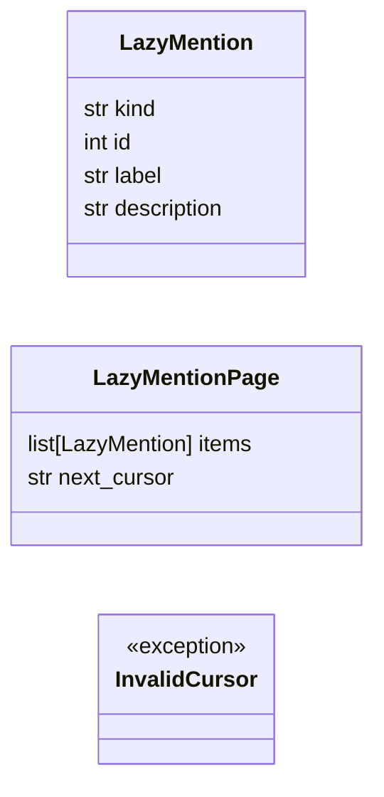
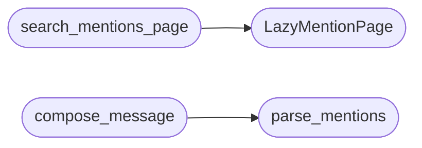

# `modules.lazy_mentions`

> Source: [modules/lazy_mentions.py:1](../../modules/lazy_mentions.py#L1) | language `py` | coverage 100.0% | [API index](../index.md)

LAZY chat mentions with multi-type search and scroll pagination.

Faithful to 0.3.12 chat @ references without Postgres or Go.
Kinds cover findings, companies and asset flavours. Search matches id
exactly first, then label text literally. Pages use an opaque cursor so
scroll loading never re-skips earlier rows. Message tokens use English
labels only and the server trusts type plus numeric id.

## Contents

- **Classes:** [`LazyMention`](#lazymention), [`LazyMentionPage`](#lazymentionpage)
- **Exceptions:** [`InvalidCursor`](#invalidcursor)
- **Functions:** [`search_mentions_page`](#search_mentions_page), [`parse_mentions`](#parse_mentions), [`compose_message`](#compose_message)
- **Constants:** [`VALID_KINDS`](#valid_kinds), [`PAGE_SIZE`](#page_size), [`MAX_MENTIONS`](#max_mentions)

## Type Diagram



## Call Graph

Solid arrows stay in this module, dashed arrows leave it.



## Classes

<a id="lazymention"></a>

### `LazyMention`

`class` `dataclass` | [modules/lazy_mentions.py:35](../../modules/lazy_mentions.py#L35)

Decorators: `@dataclass`

```python
class LazyMention
```

Lightweight search hit, details re-read on send.

**Attributes**

| Name | Type | Default | Description |
|---|---|---|---|
| [`kind`](#lazymention-kind) | `str` |  |  |
| [`id`](#lazymention-id) | `int` |  |  |
| [`label`](#lazymention-label) | `str` |  |  |
| [`description`](#lazymention-description) | `str` |  |  |

---

<a id="lazymentionpage"></a>

### `LazyMentionPage`

`class` `dataclass` | [modules/lazy_mentions.py:45](../../modules/lazy_mentions.py#L45)

Decorators: `@dataclass`

```python
class LazyMentionPage
```

Single scroll page with optional cursor.

**Attributes**

| Name | Type | Default | Description |
|---|---|---|---|
| [`items`](#lazymentionpage-items) | `list[LazyMention]` |  |  |
| [`next_cursor`](#lazymentionpage-next_cursor) | `str` | `''` |  |

---

## Exceptions

<a id="invalidcursor"></a>

### `InvalidCursor`

`exception` | [modules/lazy_mentions.py:52](../../modules/lazy_mentions.py#L52)

```python
class InvalidCursor(ValueError)
```

Bases: `ValueError`

Opaque page position is stale, caller must search again.

---

## Functions

<a id="search_mentions_page"></a>

### `search_mentions_page`

`function` | [modules/lazy_mentions.py:193](../../modules/lazy_mentions.py#L193)

```python
def search_mentions_page(kind: str = '', query: str = '', cursor: str = '') -> LazyMentionPage
```

Search one scroll page of mention candidates.

**Parameters**

| Name | Type | Default | Description |
|---|---|---|---|
| `kind` | `str` | `''` | Optional kind filter, empty means all types. |
| `query` | `str` | `''` | Optional id exact or literal text filter. |
| `cursor` | `str` | `''` | Opaque page position from the previous page. |

**Returns:** `LazyMentionPage` - Page with up to 20 items and a next cursor when more remain.

**Raises**

- `ValueError`: When kind is unsupported or query too long.
- [`InvalidCursor`](#invalidcursor): When cursor is stale.

*Calls:* [`LazyMentionPage`](#lazymentionpage)

*Called by:* [`LazyQueueCommandSet.do_lazy_mention`](cli.commands.lazyloop.py.md#lazyqueuecommandset-do_lazy_mention)

---

<a id="parse_mentions"></a>

### `parse_mentions`

`function` | [modules/lazy_mentions.py:237](../../modules/lazy_mentions.py#L237)

```python
def parse_mentions(message: str) -> list[dict]
```

Parse @[kind#id] tokens trusting type plus numeric id only.

**Parameters**

| Name | Type | Default | Description |
|---|---|---|---|
| `message` | `str` |  | Chat text with mention tokens. |

**Returns:** `list[dict]` - Deduped reference list capped at 10 entries.

**Raises**

- `ValueError`: When an id is invalid or mentions exceed budget.

*Called by:* [`compose_message`](#compose_message)

---

<a id="compose_message"></a>

### `compose_message`

`function` | [modules/lazy_mentions.py:268](../../modules/lazy_mentions.py#L268)

```python
def compose_message(message: str) -> str
```

Append server-read snapshots for referenced records as data.

**Parameters**

| Name | Type | Default | Description |
|---|---|---|---|
| `message` | `str` |  | Chat text with mention tokens. |

**Returns:** `str` - Original text plus a snapshot block, unchanged when no refs.

**Raises**

- `ValueError`: (raised in the body, not documented)

*Calls:* [`parse_mentions`](#parse_mentions)

---

## Constants

<a id="valid_kinds"></a>

### `VALID_KINDS`

`constant` | [modules/lazy_mentions.py:21](../../modules/lazy_mentions.py#L21)

```python
VALID_KINDS
```

---

<a id="page_size"></a>

### `PAGE_SIZE`

`constant` | [modules/lazy_mentions.py:26](../../modules/lazy_mentions.py#L26)

```python
PAGE_SIZE = 20
```

---

<a id="max_mentions"></a>

### `MAX_MENTIONS`

`constant` | [modules/lazy_mentions.py:27](../../modules/lazy_mentions.py#L27)

```python
MAX_MENTIONS = 10
```

---
