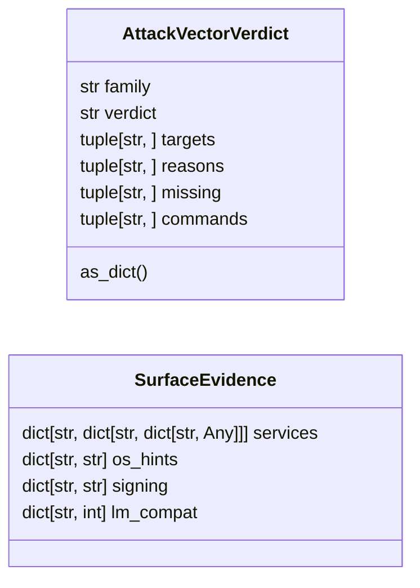

# `modules.lazy_netattack`

> Source: [modules/lazy_netattack.py:1](../../modules/lazy_netattack.py#L1) | language `py` | coverage 100.0% | [API index](../index.md)

Windows network-attack surface adjudicator for mitm6/LLMNR/SMB relay.

Contract: pure decisions from observed evidence. The kinetic steps of this
family (poisoning, WPAD MITM, NTLM relay) run on the operator's listening
interface, never on the target, so this module never decides execution:
it grades viability from world-model evidence and returns verdicts with
the exact command templates and the missing-evidence gaps. The loop turns
viable grades into hint nodes; consent stays with the operator.

## Contents

- **Classes:** [`AttackVectorVerdict`](#attackvectorverdict), [`SurfaceEvidence`](#surfaceevidence)
- **Functions:** [`surface_decision`](#surface_decision), [`hint_text`](#hint_text)
- **Constants:** [`VERDICT_VIABLE`](#verdict_viable), [`VERDICT_NEEDS_EVIDENCE`](#verdict_needs_evidence), [`VERDICT_BLOCKED`](#verdict_blocked), [`VERDICTS`](#verdicts), [`DISCOVERY_COMMANDS`](#discovery_commands)

## Type Diagram



## Call Graph

Solid arrows stay in this module, dashed arrows leave it.


## Classes

<a id="attackvectorverdict"></a>

### `AttackVectorVerdict`

`class` `dataclass` | [modules/lazy_netattack.py:88](../../modules/lazy_netattack.py#L88)

Decorators: `@dataclass(frozen=True)`

```python
class AttackVectorVerdict
```

One family decision with ready-made discovery commands.

**Attributes**

| Name | Type | Default | Description |
|---|---|---|---|
| [`family`](#attackvectorverdict-family) | `str` |  | Vector family key (``llmnr``, ``smb_relay``, ``mitm6``...). |
| [`verdict`](#attackvectorverdict-verdict) | `str` |  | One of [`VERDICTS`](#verdicts). |
| [`targets`](#attackvectorverdict-targets) | `tuple[str, ...]` | `()` | Hosts the verdict applies to (empty when blocked). |
| [`reasons`](#attackvectorverdict-reasons) | `tuple[str, ...]` | `()` | Observed-evidence reasons backing the verdict. |
| [`missing`](#attackvectorverdict-missing) | `tuple[str, ...]` | `()` | Evidence the operator must collect first. |
| [`commands`](#attackvectorverdict-commands) | `tuple[str, ...]` | `()` | Exact command templates; tokens stay for rendering. |

**Members**

| Member | Kind | Summary |
|---|---|---|
| [`as_dict`](#attackvectorverdict-as_dict) | method | Return one JSON-safe view. |

<a id="attackvectorverdict-as_dict"></a>

#### `AttackVectorVerdict.as_dict`

`method` | [modules/lazy_netattack.py:107](../../modules/lazy_netattack.py#L107)

```python
def as_dict(self) -> dict[str, Any]
```

Return one JSON-safe view.

**Returns:** `dict[str, Any]`

---

<a id="surfaceevidence"></a>

### `SurfaceEvidence`

`class` `dataclass` | [modules/lazy_netattack.py:120](../../modules/lazy_netattack.py#L120)

Decorators: `@dataclass`

```python
class SurfaceEvidence
```

Evidence bags consumed by [`surface_decision`](#surface_decision).

**Attributes**

| Name | Type | Default | Description |
|---|---|---|---|
| [`services`](#surfaceevidence-services) | `dict[str, dict[str, dict[str, Any]]]` |  | ``{host: {port: {"name": ...}}}`` service map. |
| [`os_hints`](#surfaceevidence-os_hints) | `dict[str, str]` |  | ``{host: os string}`` from the world model. |
| [`signing`](#surfaceevidence-signing) | `dict[str, str]` |  | ``{host: nmap/nxc output}`` for SMB-security-mode evidence. |
| [`lm_compat`](#surfaceevidence-lm_compat) | `dict[str, int]` |  | ``{host: int level}`` where attested. |

---

## Functions

<a id="surface_decision"></a>

### `surface_decision`

`function` | [modules/lazy_netattack.py:184](../../modules/lazy_netattack.py#L184)

```python
def surface_decision(evidence: SurfaceEvidence) -> dict[str, AttackVectorVerdict]
```

Grade the Windows network-attack families from evidence bags.

Fail-closed rules:
  - ``llmnr``: viable for Windows hosts with live service identity
    (Windows answers LLMNR by default); blocked without them.
  - ``smb_relay``: viable only for hosts with attested
    signing-not-required; ``needs_evidence`` when an AD host exists but
    signing status is unknown; blocked otherwise.
  - ``mitm6``: ``needs_evidence`` unless an LDAP host exists, then
    viable for the LDAP relay path with the consent gap noted.
  - ``ntlmv1_downgrade``: viable for hosts with LM level <= 2 attested;
    ``needs_evidence`` for Windows hosts without the registry read.

**Parameters**

| Name | Type | Default | Description |
|---|---|---|---|
| `evidence` | `SurfaceEvidence` |  | World-model evidence bags (services, os hints, signing). |

**Returns:** `dict[str, AttackVectorVerdict]` - Mapping of family to [`AttackVectorVerdict`](#attackvectorverdict).

*Calls:* [`AttackVectorVerdict`](#attackvectorverdict)

*Called by:* [`TriggerStore.due`](modules.loop_triggers.py.md#triggerstore-due)

---

<a id="hint_text"></a>

### `hint_text`

`function` | [modules/lazy_netattack.py:311](../../modules/lazy_netattack.py#L311)

```python
def hint_text(verdict: AttackVectorVerdict) -> str
```

Shape one loop hint line for a verdict.

**Parameters**

| Name | Type | Default | Description |
|---|---|---|---|
| `verdict` | `AttackVectorVerdict` |  | Family verdict. |

**Returns:** `str` - Bounded operator-facing text for the graph hint node.

*Called by:* [`TriggerStore.due`](modules.loop_triggers.py.md#triggerstore-due)

---

## Constants

<a id="verdict_viable"></a>

### `VERDICT_VIABLE`

`constant` | [modules/lazy_netattack.py:57](../../modules/lazy_netattack.py#L57)

```python
VERDICT_VIABLE = 'viable'
```

---

<a id="verdict_needs_evidence"></a>

### `VERDICT_NEEDS_EVIDENCE`

`constant` | [modules/lazy_netattack.py:59](../../modules/lazy_netattack.py#L59)

```python
VERDICT_NEEDS_EVIDENCE = 'needs_evidence'
```

---

<a id="verdict_blocked"></a>

### `VERDICT_BLOCKED`

`constant` | [modules/lazy_netattack.py:61](../../modules/lazy_netattack.py#L61)

```python
VERDICT_BLOCKED = 'blocked'
```

---

<a id="verdicts"></a>

### `VERDICTS`

`constant` | [modules/lazy_netattack.py:63](../../modules/lazy_netattack.py#L63)

```python
VERDICTS: tuple[str, ...] = (VERDICT_VIABLE, VERDICT_NEEDS_EVIDENCE, VERDICT_BLOCKED)
```

---

<a id="discovery_commands"></a>

### `DISCOVERY_COMMANDS`

`constant` | [modules/lazy_netattack.py:65](../../modules/lazy_netattack.py#L65)

```python
DISCOVERY_COMMANDS: dict[str, tuple[str, ...]]
```

---
