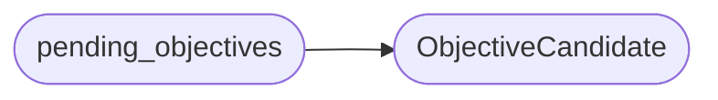

# `modules.lazy_objective_queue`

> Source: [modules/lazy_objective_queue.py:1](../../modules/lazy_objective_queue.py#L1) | language `py` | coverage 100.0% | [API index](../index.md)

Objective queue plumbing: the autonomous loop's read side of the objective store.

`[`skills.lazyown_objective`](skills.lazyown_objective.py.md)` owns the JSONL store and `[`modules.sinks.objectives`](modules.sinks.objectives.py.md)`
appends proven-outcome follow-ups; until now the LazyLoopEngine never consumed
either (the objectives file was write-only for the loop). This module closes
that gap with one small contract the planner and the wrap-up round both call:

pending_objectives   -> planner wake candidates
mark_started         -> objective claimed by one task this round
settle               -> wrap-up completes or requeues the objective

Parsing is tolerant: malformed or foreign lines are skipped, never fatal, so
campaign state cannot wedge the planner. State transitions rewrite only the
touched records and keep every other line byte-compatible.

## Contents

- **Classes:** [`ObjectiveCandidate`](#objectivecandidate)
- **Functions:** [`pending_objectives`](#pending_objectives), [`mark_started`](#mark_started), [`settle`](#settle), [`objective_ids_from_text`](#objective_ids_from_text)

## Call Graph

Solid arrows stay in this module, dashed arrows leave it.



## Classes

<a id="objectivecandidate"></a>

### `ObjectiveCandidate`

`class` `dataclass` | [modules/lazy_objective_queue.py:35](../../modules/lazy_objective_queue.py#L35)

Decorators: `@dataclass(frozen=True)`

```python
class ObjectiveCandidate
```

One pending objective shaped for planner consumption.

**Attributes**

| Name | Type | Default | Description |
|---|---|---|---|
| [`objective_id`](#objectivecandidate-objective_id) | `str` |  | Store id (8-char hex or ``outcome_`` digest). |
| [`text`](#objectivecandidate-text) | `str` |  | Objective text actionable as an intent. |
| [`priority`](#objectivecandidate-priority) | `int` |  | Loop priority; critical outranks generic candidates. |

---

## Functions

<a id="pending_objectives"></a>

### `pending_objectives`

`function` | [modules/lazy_objective_queue.py:105](../../modules/lazy_objective_queue.py#L105)

```python
def pending_objectives(limit: int = 2, target: str = '') -> list[ObjectiveCandidate]
```

Return pending objectives shaped as planner candidates.

Objectives whose recorded ``context.target`` names a different host than
the one under test are skipped so one loop never drags another target's
work in; objectives without a recorded target are global and always
considered. Oldest first within the same priority.

**Parameters**

| Name | Type | Default | Description |
|---|---|---|---|
| `limit` | `int` | `2` | Maximum candidates returned. |
| `target` | `str` | `''` | Host the task is scoped to (blank when unknown). |

**Returns:** `list[ObjectiveCandidate]` - Priority-ordered [`ObjectiveCandidate`](#objectivecandidate) list.

*Calls:* [`ObjectiveCandidate`](#objectivecandidate)

---

<a id="mark_started"></a>

### `mark_started`

`function` | [modules/lazy_objective_queue.py:177](../../modules/lazy_objective_queue.py#L177)

```python
def mark_started(objective_id: str, task_id: str = '') -> bool
```

Mark an objective ``in_progress`` when a task claims it.

**Parameters**

| Name | Type | Default | Description |
|---|---|---|---|
| `objective_id` | `str` |  | Store id to claim. |
| `task_id` | `str` | `''` | Claiming loop task for the audit note. |

**Returns:** `bool` - True when the status flipped; False when already claimed or absent.

---

<a id="settle"></a>

### `settle`

`function` | [modules/lazy_objective_queue.py:196](../../modules/lazy_objective_queue.py#L196)

```python
def settle(objective_id: str, task_id: str = '', success: bool = False) -> str
```

Complete a done objective or requeue an unfinished one.

Wrap-up handler: when the task proved the objective (its intent reached
`[`done`](modules.planner.py.md#todoitem-done)`) the objective marks `[`done`](modules.planner.py.md#todoitem-done)`; otherwise it returns to
``pending`` so a later task can attempt it again.

**Parameters**

| Name | Type | Default | Description |
|---|---|---|---|
| `objective_id` | `str` |  | Store id to settle. |
| `task_id` | `str` | `''` | Settling loop task for the audit note. |
| `success` | `bool` | `False` | True when the owning intent completed successfully. |

**Returns:** `str` - The new status (`[`done`](modules.planner.py.md#todoitem-done)` or ``pending``), empty when not found.

---

<a id="objective_ids_from_text"></a>

### `objective_ids_from_text`

`function` | [modules/lazy_objective_queue.py:235](../../modules/lazy_objective_queue.py#L235)

```python
def objective_ids_from_text(text: str) -> str
```

Extract the objective id embedded in an intent summary prefix.

**Parameters**

| Name | Type | Default | Description |
|---|---|---|---|
| `text` | `str` |  | Intent text like ``objective ab12cd34: enumerate shares``. |

**Returns:** `str` - The id token, or empty when the text is not objective-tagged.

---
