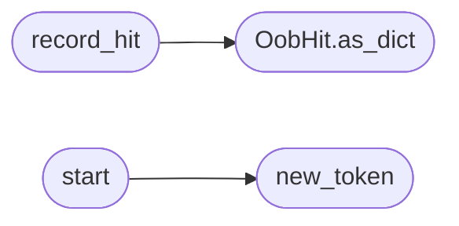

# `modules.lazy_oob`

> Source: [modules/lazy_oob.py:1](../../modules/lazy_oob.py#L1) | language `py` | coverage 100.0% | [API index](../index.md)

Local OOB canary for blind SSRF/RCE detection.

Starts an HTTP listener bound to the operator's ``lhost`` and serves
unique token paths (``/oob/<token>``). Attack payloads reference the
canary URL; any callback proves code execution or server-side request
forgery. Hits are recorded in memory and mirrored to
``sessions/oob_hits.jsonl``. The listener never parses, execs or proxies
anything: it only records that a request arrived.

**Example**

```pycon
>>> from modules import lazy_oob
>>> canary = lazy_oob.start()
>>> canary.url()
'http://127.0.0.1:<port>/oob/<token>'
>>> lazy_oob.stop()
```

## Contents

- **Classes:** [`OobHit`](#oobhit)
- **Functions:** [`record_hit`](#record_hit), [`start`](#start), [`new_token`](#new_token), [`url`](#url), [`hits`](#hits), [`stop`](#stop), [`is_running`](#is_running)
- **Constants:** [`HITS_PATH`](#hits_path), [`DEFAULT_BIND_HOST`](#default_bind_host)

## Call Graph

Solid arrows stay in this module, dashed arrows leave it.



## Classes

<a id="oobhit"></a>

### `OobHit`

`class` `dataclass` | [modules/lazy_oob.py:41](../../modules/lazy_oob.py#L41)

Decorators: `@dataclass`

```python
class OobHit
```

One callback observed by the canary.

**Attributes**

| Name | Type | Default | Description |
|---|---|---|---|
| [`token`](#oobhit-token) | `str` |  |  |
| [`path`](#oobhit-path) | `str` |  |  |
| [`source`](#oobhit-source) | `str` |  |  |
| [`method`](#oobhit-method) | `str` |  |  |
| [`at`](#oobhit-at) | `float` |  |  |
| [`headers`](#oobhit-headers) | `dict[str, str]` | `field(default_factory=dict)` |  |

**Members**

| Member | Kind | Summary |
|---|---|---|
| [`as_dict`](#oobhit-as_dict) | method | Return the JSON-serialisable row. |

<a id="oobhit-as_dict"></a>

#### `OobHit.as_dict`

`method` | [modules/lazy_oob.py:51](../../modules/lazy_oob.py#L51)

```python
def as_dict(self) -> dict[str, Any]
```

Return the JSON-serialisable row.

**Returns:** `dict[str, Any]`

*Called by:* [`record_hit`](#record_hit)

---

## Functions

<a id="record_hit"></a>

### `record_hit`

`function` | [modules/lazy_oob.py:112](../../modules/lazy_oob.py#L112)

```python
def record_hit(hit: OobHit) -> None
```

Store one hit in memory and append it to the JSONL mirror.

**Parameters**

| Name | Type | Default | Description |
|---|---|---|---|
| `hit` | `OobHit` |  | The observed callback. |

*Calls:* [`OobHit.as_dict`](#oobhit-as_dict)

---

<a id="start"></a>

### `start`

`function` | [modules/lazy_oob.py:128](../../modules/lazy_oob.py#L128)

```python
def start(host: str = '', port: int = DEFAULT_PORT) -> dict[str, Any]
```

Start (or reuse) the canary listener.

**Parameters**

| Name | Type | Default | Description |
|---|---|---|---|
| `host` | `str` | `''` | Bind address; empty binds to ``lhost`` from payload.json, falling back to loopback. |
| `port` | `int` | `DEFAULT_PORT` | Bind port; 0 picks a free ephemeral port. |

**Returns:** `dict[str, Any]` - Mapping with `[`ok`](scripts.top_tier_check.py.md#ok)`, `[`token`](#oobhit-token)`, ``port``, `[`url`](#url)` and ``error``.

*Calls:* [`new_token`](#new_token)

---

<a id="new_token"></a>

### `new_token`

`function` | [modules/lazy_oob.py:167](../../modules/lazy_oob.py#L167)

```python
def new_token() -> str
```

Return one URL-safe callback token.

**Returns:** `str`

*Called by:* [`start`](#start)

---

<a id="url"></a>

### `url`

`function` | [modules/lazy_oob.py:184](../../modules/lazy_oob.py#L184)

```python
def url(token: str = '') -> str
```

Return the callback URL for a token (latest when omitted).

**Parameters**

| Name | Type | Default | Description |
|---|---|---|---|
| `token` | `str` | `''` | Explicit token; empty reuses the latest active token. |

**Returns:** `str` - The URL string, or empty when the canary is not running.

*Called by:* [`LazyOobCommandSet.do_lazyoob`](cli.commands.lazy_oob.py.md#lazyoobcommandset-do_lazyoob)

---

<a id="hits"></a>

### `hits`

`function` | [modules/lazy_oob.py:204](../../modules/lazy_oob.py#L204)

```python
def hits(token: str = '') -> list[dict[str, Any]]
```

Return recorded hits, optionally filtered by token.

**Parameters**

| Name | Type | Default | Description |
|---|---|---|---|
| `token` | `str` | `''` | Filter token; empty returns every hit. |

**Returns:** `list[dict[str, Any]]` - Hit dicts, newest last.

*Called by:* [`LazyOobCommandSet.do_lazyoob`](cli.commands.lazy_oob.py.md#lazyoobcommandset-do_lazyoob)

---

<a id="stop"></a>

### `stop`

`function` | [modules/lazy_oob.py:220](../../modules/lazy_oob.py#L220)

```python
def stop() -> dict[str, Any]
```

Shut the canary down and report how many hits it saw.

**Returns:** `dict[str, Any]` - Mapping with `[`ok`](scripts.top_tier_check.py.md#ok)`, `[`hits`](#hits)` and ``error``.

---

<a id="is_running"></a>

### `is_running`

`function` | [modules/lazy_oob.py:249](../../modules/lazy_oob.py#L249)

```python
def is_running() -> bool
```

Return whether the canary listener is alive.

**Returns:** `bool`

---

## Constants

<a id="hits_path"></a>

### `HITS_PATH`

`constant` | [modules/lazy_oob.py:29](../../modules/lazy_oob.py#L29)

```python
HITS_PATH = BASE_DIR / 'sessions' / 'oob_hits.jsonl'
```

---

<a id="default_bind_host"></a>

### `DEFAULT_BIND_HOST`

`constant` | [modules/lazy_oob.py:30](../../modules/lazy_oob.py#L30)

```python
DEFAULT_BIND_HOST = '127.0.0.1'
```

---
