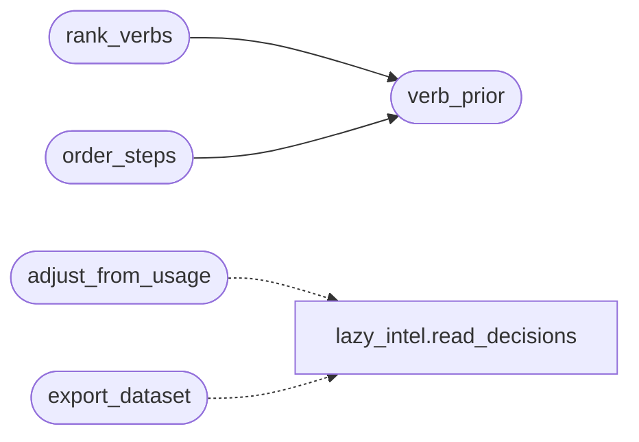

# `modules.lazy_orchestrator_feedback`

> Source: [modules/lazy_orchestrator_feedback.py:1](../../modules/lazy_orchestrator_feedback.py#L1) | language `py` | coverage 100.0% | [API index](../index.md)

Organic orchestrator training from loop usage.

Mirrors how the detection oracle learns: per-command outcomes already flow
online to MoE/Q-learning via ``loop_ai_bridge.record_step``; this module is
the batch counterpart of `[`DetectionFeed.adjust_from_feedback`](modules.detection_feed.py.md#detectionfeed-adjust_from_feedback)`. It reads
the routing log written by [`modules.lazy_intel`](modules.lazy_intel.py.md) and produces two
artefacts under ``sessions/lazy/``:

- ``verb_priors.json`` — per-(phase, verb) success rates. The planner
  consults them through [`verb_prior`](#verb_prior) to rank candidate verbs, so
  verbs that historically work for a phase float up without any manual
  tuning. Cold verbs (fewer than `[`MIN_ATTEMPTS`](#min_attempts)` samples) keep their
  default order instead of being punished for having no history.
- ``orchestrator_dataset.jsonl`` — instruction-tuning rows
  (instruction/input/output/reward/meta) exported by [`export_dataset`](#export_dataset)
  for TopoSwarm ``--finetune`` runs. Rows only exist when the operator
  actually ran the loop: usage writes the dataset, nobody hand-crafts it.

Stdlib only. Never raises; all entry points degrade gracefully.

## Contents

- **Functions:** [`adjust_from_usage`](#adjust_from_usage), [`verb_prior`](#verb_prior), [`rank_verbs`](#rank_verbs), [`order_steps`](#order_steps), [`export_dataset`](#export_dataset)
- **Constants:** [`MIN_ATTEMPTS`](#min_attempts)

## Call Graph

Solid arrows stay in this module, dashed arrows leave it.



## Functions

<a id="adjust_from_usage"></a>

### `adjust_from_usage`

`function` | [modules/lazy_orchestrator_feedback.py:61](../../modules/lazy_orchestrator_feedback.py#L61)

```python
def adjust_from_usage(limit: int = 5000) -> dict
```

Fold routing outcomes into per-(phase, stack, verb) success priors.

Stacks fingerprint the target services, so repeat engagements against
the same stack learn faster while unseen stacks fall back to global
priors. Stored shape per phase is ``{"_global": {...}, "_stacks":
{stack: {...}}}``; legacy flat files migrate on load.

**Parameters**

| Name | Type | Default | Description |
|---|---|---|---|
| `limit` | `int` | `5000` | Max routing records scanned from the tail. |

**Returns:** `dict` - Summary with verbs updated and outcomes seen.

*Calls:* [`read_decisions`](modules.lazy_intel.py.md#read_decisions)

---

<a id="verb_prior"></a>

### `verb_prior`

`function` | [modules/lazy_orchestrator_feedback.py:162](../../modules/lazy_orchestrator_feedback.py#L162)

```python
def verb_prior(phase: str, verb: str, stack: str = '') -> dict | None
```

Return the success prior for one (phase, stack, verb) triple.

Stack-specific priors win when warm; otherwise the global pair
applies. Cold pairs return None so default order is preserved.

**Parameters**

| Name | Type | Default | Description |
|---|---|---|---|
| `phase` | `str` |  | Kill-chain phase. |
| `verb` | `str` |  | Shell verb. |
| `stack` | `str` | `''` | Target stack fingerprint. |

**Returns:** `dict | None` - Prior dict with success/total/rate, or None when cold.

*Called by:* [`order_steps`](#order_steps), [`rank_verbs`](#rank_verbs)

---

<a id="rank_verbs"></a>

### `rank_verbs`

`function` | [modules/lazy_orchestrator_feedback.py:189](../../modules/lazy_orchestrator_feedback.py#L189)

```python
def rank_verbs(phase: str, verbs: list[str], stack: str = '') -> list[str]
```

Order verbs by learned success rate, stable for cold verbs.

**Parameters**

| Name | Type | Default | Description |
|---|---|---|---|
| `phase` | `str` |  | Kill-chain phase the verbs serve. |
| `verbs` | `list[str]` |  | Candidate verb names in default order. |
| `stack` | `str` | `''` | Target stack fingerprint for stack-specific priors. |

**Returns:** `list[str]` - Verbs with warm priors first (rate desc), cold verbs untouched
after them in their original relative order.

*Calls:* [`verb_prior`](#verb_prior)

*Called by:* [`steps_for`](modules.auto_registry.py.md#steps_for)

---

<a id="order_steps"></a>

### `order_steps`

`function` | [modules/lazy_orchestrator_feedback.py:213](../../modules/lazy_orchestrator_feedback.py#L213)

```python
def order_steps(steps: list[str], stack: str = '') -> list[str]
```

Reorder resolved step lines by stack-aware verb priors.

**Parameters**

| Name | Type | Default | Description |
|---|---|---|---|
| `steps` | `list[str]` |  | Command lines in planner order. |
| `stack` | `str` | `''` | Target stack fingerprint. |

**Returns:** `list[str]` - Steps with warm-prior verbs first, order otherwise preserved.

*Calls:* [`verb_prior`](#verb_prior)

---

<a id="export_dataset"></a>

### `export_dataset`

`function` | [modules/lazy_orchestrator_feedback.py:238](../../modules/lazy_orchestrator_feedback.py#L238)

```python
def export_dataset(out: str | Path | None = None, limit: int = 5000) -> dict
```

Export instruction-tuning rows joined from decisions + outcomes.

Each row pairs the operator-visible intent (instruction/input) with
the command the loop chose (output) and the reward it earned, so a
TopoSwarm ``--finetune`` run learns orchestration from real usage.

**Parameters**

| Name | Type | Default | Description |
|---|---|---|---|
| `out` | `str \| Path \| None` | `None` | Destination path. Defaults to the store dataset file. |
| `limit` | `int` | `5000` | Max routing records scanned from the tail. |

**Returns:** `dict` - Summary with rows written and destination.

*Calls:* [`read_decisions`](modules.lazy_intel.py.md#read_decisions)

---

## Constants

<a id="min_attempts"></a>

### `MIN_ATTEMPTS`

`constant` | [modules/lazy_orchestrator_feedback.py:34](../../modules/lazy_orchestrator_feedback.py#L34)

```python
MIN_ATTEMPTS = 3
```

---
