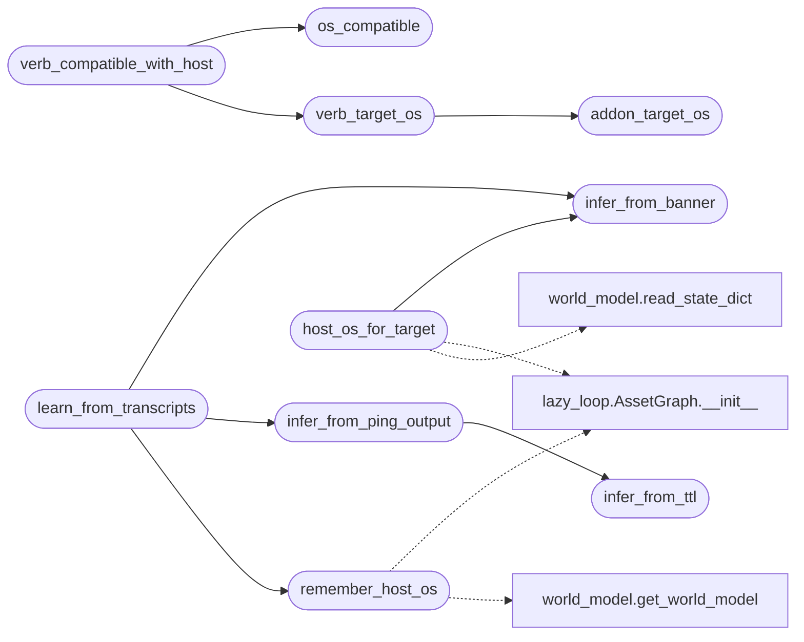

# `modules.lazy_osinfer`

> Source: [modules/lazy_osinfer.py:1](../../modules/lazy_osinfer.py#L1) | language `py` | coverage 100.0% | [API index](../index.md)

Target OS inference and OS-aware verb gating.

The autonomous loop must never send a Windows-only verb (a shellcode
loader, an AD privesc tool) against a Linux host. This module:

- infers the target OS from a ping reply's TTL (the loop's first step),
  from service banners (RDP/SMB/MSRPC/SQL names) and from nmap OS lines;
- remembers the inferred OS on the global asset graph and the world
  model so every later decision can read it;
- answers whether a verb's target OS is compatible with the host OS,
  so the worker can block a mismatch with a clear reason instead of
  firing a Windows payload at a Linux box.

Stdlib only. Every entry point degrades safely: an unknown OS never
blocks a verb.

## Contents

- **Functions:** [`infer_from_ttl`](#infer_from_ttl), [`infer_from_ping_output`](#infer_from_ping_output), [`infer_from_banner`](#infer_from_banner), [`merge_os`](#merge_os), [`addon_target_os`](#addon_target_os), [`verb_target_os`](#verb_target_os), [`os_compatible`](#os_compatible), [`verb_compatible_with_host`](#verb_compatible_with_host), [`host_os_for_target`](#host_os_for_target), [`remember_host_os`](#remember_host_os), [`learn_from_transcripts`](#learn_from_transcripts)
- **Constants:** [`OS_LINUX`](#os_linux), [`OS_WINDOWS`](#os_windows), [`OS_ANY`](#os_any), [`OS_UNKNOWN`](#os_unknown)

## Call Graph

Solid arrows stay in this module, dashed arrows leave it.



## Functions

<a id="infer_from_ttl"></a>

### `infer_from_ttl`

`function` | [modules/lazy_osinfer.py:47](../../modules/lazy_osinfer.py#L47)

```python
def infer_from_ttl(ttl: int | None) -> str
```

Infer the remote OS family from a reply's TTL value.

Initial TTLs: 64 for most Linux/Unix stacks, 128 for Windows,
255 for some network gear. Fewer hops subtract from the initial
value, so a nearby value (63/127) keeps its verdict.

**Parameters**

| Name | Type | Default | Description |
|---|---|---|---|
| `ttl` | `int \| None` |  | Observed TTL, None when unknown. |

**Returns:** `str` - ``linux``/``windows``/`[`unknown`](skills.lazyown_policy.py.md#classificationresult-unknown)`.

*Called by:* [`infer_from_ping_output`](#infer_from_ping_output)

---

<a id="infer_from_ping_output"></a>

### `infer_from_ping_output`

`function` | [modules/lazy_osinfer.py:72](../../modules/lazy_osinfer.py#L72)

```python
def infer_from_ping_output(output: str) -> dict
```

Read ``ttl=``/``TTL=`` from ping output and classify the OS.

**Parameters**

| Name | Type | Default | Description |
|---|---|---|---|
| `output` | `str` |  | Raw ping stdout/stderr. |

**Returns:** `dict` - ``{"os": ..., "ttl": int|None, "reason": str}``.

*Calls:* [`infer_from_ttl`](#infer_from_ttl)

*Called by:* [`learn_from_transcripts`](#learn_from_transcripts)

---

<a id="infer_from_banner"></a>

### `infer_from_banner`

`function` | [modules/lazy_osinfer.py:97](../../modules/lazy_osinfer.py#L97)

```python
def infer_from_banner(text: str) -> dict
```

Infer the OS family from service names or banner text.

**Parameters**

| Name | Type | Default | Description |
|---|---|---|---|
| `text` | `str` |  | Concatenated service names / banners for one host. |

**Returns:** `dict` - ``{"os": ..., "reason": str}``.

*Called by:* [`host_os_for_target`](#host_os_for_target), [`learn_from_transcripts`](#learn_from_transcripts)

---

<a id="merge_os"></a>

### `merge_os`

`function` | [modules/lazy_osinfer.py:118](../../modules/lazy_osinfer.py#L118)

```python
def merge_os(current: str, new: str) -> str
```

Merge two inferred OS hints; a confident value wins.

**Parameters**

| Name | Type | Default | Description |
|---|---|---|---|
| `current` | `str` |  |  |
| `new` | `str` |  |  |

**Returns:** `str`

---

<a id="addon_target_os"></a>

### `addon_target_os`

`function` | [modules/lazy_osinfer.py:130](../../modules/lazy_osinfer.py#L130)

```python
def addon_target_os(name: str) -> str
```

Return the ``os:`` field of one lazyaddon manifest.

**Parameters**

| Name | Type | Default | Description |
|---|---|---|---|
| `name` | `str` |  | Addon name (``hellbird``). |

**Returns:** `str` - ``windows``/``linux``/``any`` (default any, unknown addon any).

*Called by:* [`propose_addon_intents`](modules.auto_registry.py.md#propose_addon_intents), [`verb_target_os`](#verb_target_os)

---

<a id="verb_target_os"></a>

### `verb_target_os`

`function` | [modules/lazy_osinfer.py:157](../../modules/lazy_osinfer.py#L157)

```python
def verb_target_os(command: str) -> str
```

Return the OS family one command line targets.

Understands ``lazy addon <name>`` lines, the agent-minted
``lazy_addon run <name>`` form (both read the addon manifest) and
``auto <verb>`` lines (reads the built-in verb's ``os`` field).
Plain shell commands always answer ``any``.

**Parameters**

| Name | Type | Default | Description |
|---|---|---|---|
| `command` | `str` |  | Resolved shell command line. |

**Returns:** `str` - ``windows``/``linux``/``any``.

*Calls:* [`addon_target_os`](#addon_target_os)

*Called by:* [`verb_compatible_with_host`](#verb_compatible_with_host)

---

<a id="os_compatible"></a>

### `os_compatible`

`function` | [modules/lazy_osinfer.py:194](../../modules/lazy_osinfer.py#L194)

```python
def os_compatible(verb_os: str, host_os: str) -> bool
```

Whether a verb's target OS may run against a host's inferred OS.

Unknown hosts (no inference yet) and ``any`` verbs never block; a
mismatch (windows verb, linux host or the reverse) does.

**Parameters**

| Name | Type | Default | Description |
|---|---|---|---|
| `verb_os` | `str` |  | Verb target OS (``any``/``windows``/``linux``). |
| `host_os` | `str` |  | Inferred host OS (``""`` when unknown). |

**Returns:** `bool` - True when compatible.

*Called by:* [`propose_addon_intents`](modules.auto_registry.py.md#propose_addon_intents), [`verb_compatible_with_host`](#verb_compatible_with_host)

---

<a id="verb_compatible_with_host"></a>

### `verb_compatible_with_host`

`function` | [modules/lazy_osinfer.py:216](../../modules/lazy_osinfer.py#L216)

```python
def verb_compatible_with_host(command: str, host_os: str) -> tuple[bool, str, str]
```

Gate one command line against a host's inferred OS.

**Parameters**

| Name | Type | Default | Description |
|---|---|---|---|
| `command` | `str` |  | Resolved shell command line. |
| `host_os` | `str` |  | Inferred host OS (``""`` when unknown). |

**Returns:** `tuple[bool, str, str]` - ``(allowed, verb_os, reason)``; reason is empty when allowed.

*Calls:* [`os_compatible`](#os_compatible), [`verb_target_os`](#verb_target_os)

---

<a id="host_os_for_target"></a>

### `host_os_for_target`

`function` | [modules/lazy_osinfer.py:239](../../modules/lazy_osinfer.py#L239)

```python
def host_os_for_target(target: str) -> str
```

Return the remembered OS for one target host.

Reads the loop asset graph first, then the world model, then the
``sessions/os.json`` hint file. Empty when nothing is known.

**Parameters**

| Name | Type | Default | Description |
|---|---|---|---|
| `target` | `str` |  | Host address. |

**Returns:** `str` - ``linux``/``windows``/``""``.

*Calls:* [`AssetGraph.__init__`](modules.lazy_loop.py.md#assetgraph-__init__), [`infer_from_banner`](#infer_from_banner), [`read_state_dict`](modules.world_model.py.md#read_state_dict)

*Called by:* [`auto`](modules.atomic_exploit_bridge.py.md#auto), [`propose_addon_intents`](modules.auto_registry.py.md#propose_addon_intents)

---

<a id="remember_host_os"></a>

### `remember_host_os`

`function` | [modules/lazy_osinfer.py:287](../../modules/lazy_osinfer.py#L287)

```python
def remember_host_os(target: str, os_name: str, reason: str = '') -> bool
```

Persist an inferred OS on the asset graph and world model.

**Parameters**

| Name | Type | Default | Description |
|---|---|---|---|
| `target` | `str` |  | Host address. |
| `os_name` | `str` |  | Inferred OS (``linux``/``windows``); empty clears nothing. |
| `reason` | `str` | `''` | Why the OS was inferred (``ping ttl 64``). |

**Returns:** `bool` - True when something was remembered.

*Calls:* [`AssetGraph.__init__`](modules.lazy_loop.py.md#assetgraph-__init__), [`get_world_model`](modules.world_model.py.md#get_world_model)

*Called by:* [`learn_from_transcripts`](#learn_from_transcripts)

---

<a id="learn_from_transcripts"></a>

### `learn_from_transcripts`

`function` | [modules/lazy_osinfer.py:330](../../modules/lazy_osinfer.py#L330)

```python
def learn_from_transcripts(target: str, transcripts: list[tuple[str, str]]) -> dict
```

Infer and remember the host OS from executed step outputs.

Reads every transcript pair looking for ping TTLs and nmap OS
lines; the strongest inference wins and is persisted.

**Parameters**

| Name | Type | Default | Description |
|---|---|---|---|
| `target` | `str` |  | Host address the steps ran against. |
| `transcripts` | `list[tuple[str, str]]` |  | ``[(command, output)]`` pairs. |

**Returns:** `dict` - The inferred record ``{"os", "ttl", "reason"}`` (os "" when unknown).

*Calls:* [`infer_from_banner`](#infer_from_banner), [`infer_from_ping_output`](#infer_from_ping_output), [`remember_host_os`](#remember_host_os)

---

## Constants

<a id="os_linux"></a>

### `OS_LINUX`

`constant` | [modules/lazy_osinfer.py:28](../../modules/lazy_osinfer.py#L28)

```python
OS_LINUX = 'linux'
```

---

<a id="os_windows"></a>

### `OS_WINDOWS`

`constant` | [modules/lazy_osinfer.py:29](../../modules/lazy_osinfer.py#L29)

```python
OS_WINDOWS = 'windows'
```

---

<a id="os_any"></a>

### `OS_ANY`

`constant` | [modules/lazy_osinfer.py:30](../../modules/lazy_osinfer.py#L30)

```python
OS_ANY = 'any'
```

---

<a id="os_unknown"></a>

### `OS_UNKNOWN`

`constant` | [modules/lazy_osinfer.py:31](../../modules/lazy_osinfer.py#L31)

```python
OS_UNKNOWN = ''
```

---
