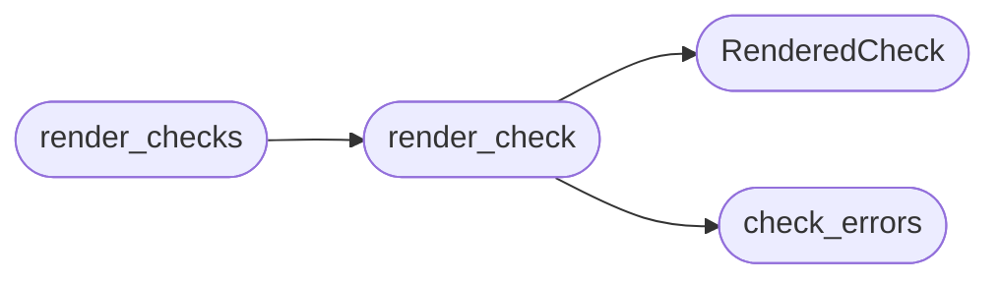

# `modules.lazy_probes`

> Source: [modules/lazy_probes.py:1](../../modules/lazy_probes.py#L1) | language `py` | coverage 100.0% | [API index](../index.md)

Read-only validation command registry for LazyOwn.

Every check kind owns its command text, its quoting and a structured
`[`expect`](#renderedcheck-expect)` contract that says how the output decides the question. A model
may pick a kind and parameters; the registry below validates them against
allowlists and renders the concrete command, so a person can read the
`[`command`](#renderedcheck-command)`/`[`explain`](#renderedcheck-explain)` pair and a chain step or a beacon session can run
the same command with the same `[`expect`](#renderedcheck-expect)`. Nothing here mutates a target.

Public surface is one function, [`render_check`](#render_check), plus
[`render_checks`](#render_checks) for a batch. Unknown kinds and out-of-allowlist
parameters fail loudly in `[`errors`](#renderedcheck-errors)`, never silently.

## Contents

- **Classes:** [`RenderedCheck`](#renderedcheck)
- **Functions:** [`range_text`](#range_text), [`check_errors`](#check_errors), [`render_check`](#render_check), [`render_checks`](#render_checks)
- **Constants:** [`CHECK_VERSION_BANNER`](#check_version_banner), [`CHECK_HTTP_PROBE`](#check_http_probe), [`CHECK_NUCLEI_TEMPLATE`](#check_nuclei_template), [`CHECK_NSE_SCRIPT`](#check_nse_script), [`CHECK_PACKAGE_VERSION`](#check_package_version), [`CHECK_SERVICE_STATE`](#check_service_state), [`CHECK_KINDS`](#check_kinds), [`TARGET_PORT`](#target_port)

## Call Graph

Solid arrows stay in this module, dashed arrows leave it.



## Classes

<a id="renderedcheck"></a>

### `RenderedCheck`

`class` `dataclass` | [modules/lazy_probes.py:47](../../modules/lazy_probes.py#L47)

Decorators: `@dataclass`

```python
class RenderedCheck
```

One ready-to-run read-only validation command.

**Attributes**

| Name | Type | Default | Description |
|---|---|---|---|
| [`kind`](#renderedcheck-kind) | `str` |  | Check kind the command was rendered from. |
| [`tool`](#renderedcheck-tool) | `str` | `''` | Tool the command drives (nmap, curl, nuclei, ...). |
| [`command`](#renderedcheck-command) | `str` | `''` | Read-only command line with ``<TARGET>`` (and a port) placeholder for the operator to substitute. |
| [`expect`](#renderedcheck-expect) | `dict` | `field(default_factory=dict)` | Structured accept result contract. |
| [`explain`](#renderedcheck-explain) | `str` | `''` | One-line explanation of the decision rule. |
| [`read_only`](#renderedcheck-read_only) | `bool` | `True` | Always True, by contract. |
| [`errors`](#renderedcheck-errors) | `list[str]` | `field(default_factory=list)` | Empty for a valid check, else the rejection reasons. |

---

## Functions

<a id="range_text"></a>

### `range_text`

`function` | [modules/lazy_probes.py:70](../../modules/lazy_probes.py#L70)

```python
def range_text(ranges: list[dict]) -> str
```

Render affected ranges as a human phrase.

**Parameters**

| Name | Type | Default | Description |
|---|---|---|---|
| `ranges` | `list[dict]` |  | Range dicts with ``introduced``/``fixed``/``last_affected``. |

**Returns:** `str` - A readable sentence fragment describing the bounds.

---

<a id="check_errors"></a>

### `check_errors`

`function` | [modules/lazy_probes.py:108](../../modules/lazy_probes.py#L108)

```python
def check_errors(kind: str, params: dict) -> list[str]
```

Validate one check request against the kind's allowlist.

**Parameters**

| Name | Type | Default | Description |
|---|---|---|---|
| `kind` | `str` |  | One of the [`CHECK_KINDS`](#check_kinds). |
| `params` | `dict` |  | Check parameters. |

**Returns:** `list[str]` - A list of rejection reasons, empty when the check is renderable.

*Called by:* [`render_check`](#render_check)

---

<a id="render_check"></a>

### `render_check`

`function` | [modules/lazy_probes.py:156](../../modules/lazy_probes.py#L156)

```python
def render_check(kind: str, params: dict) -> RenderedCheck
```

Render one read-only validation command.

**Parameters**

| Name | Type | Default | Description |
|---|---|---|---|
| `kind` | `str` |  | One of the [`CHECK_KINDS`](#check_kinds). |
| `params` | `dict` |  | Validated check parameters; extra keys are ignored. |

**Returns:** `RenderedCheck` - A [`RenderedCheck`](#renderedcheck); when the parameters fail their
allowlist the result carries only `[`errors`](#renderedcheck-errors)`.

*Calls:* [`RenderedCheck`](#renderedcheck), [`check_errors`](#check_errors)

*Called by:* [`probe_checks`](modules.lazy_exposure.py.md#probe_checks), [`render_checks`](#render_checks)

---

<a id="render_checks"></a>

### `render_checks`

`function` | [modules/lazy_probes.py:177](../../modules/lazy_probes.py#L177)

```python
def render_checks(checks: list[dict]) -> list[RenderedCheck]
```

Render a batch of checks in order.

**Parameters**

| Name | Type | Default | Description |
|---|---|---|---|
| `checks` | `list[dict]` |  | ``{"kind": ..., "params": {...}}`` dicts. |

**Returns:** `list[RenderedCheck]` - Rendered checks in the same order.

*Calls:* [`render_check`](#render_check)

---

## Constants

<a id="check_version_banner"></a>

### `CHECK_VERSION_BANNER`

`constant` | [modules/lazy_probes.py:22](../../modules/lazy_probes.py#L22)

```python
CHECK_VERSION_BANNER = 'version_banner'
```

---

<a id="check_http_probe"></a>

### `CHECK_HTTP_PROBE`

`constant` | [modules/lazy_probes.py:23](../../modules/lazy_probes.py#L23)

```python
CHECK_HTTP_PROBE = 'http_probe'
```

---

<a id="check_nuclei_template"></a>

### `CHECK_NUCLEI_TEMPLATE`

`constant` | [modules/lazy_probes.py:24](../../modules/lazy_probes.py#L24)

```python
CHECK_NUCLEI_TEMPLATE = 'nuclei_template'
```

---

<a id="check_nse_script"></a>

### `CHECK_NSE_SCRIPT`

`constant` | [modules/lazy_probes.py:25](../../modules/lazy_probes.py#L25)

```python
CHECK_NSE_SCRIPT = 'nse_script'
```

---

<a id="check_package_version"></a>

### `CHECK_PACKAGE_VERSION`

`constant` | [modules/lazy_probes.py:26](../../modules/lazy_probes.py#L26)

```python
CHECK_PACKAGE_VERSION = 'package_version'
```

---

<a id="check_service_state"></a>

### `CHECK_SERVICE_STATE`

`constant` | [modules/lazy_probes.py:27](../../modules/lazy_probes.py#L27)

```python
CHECK_SERVICE_STATE = 'service_state'
```

---

<a id="check_kinds"></a>

### `CHECK_KINDS`

`constant` | [modules/lazy_probes.py:29](../../modules/lazy_probes.py#L29)

```python
CHECK_KINDS
```

---

<a id="target_port"></a>

### `TARGET_PORT`

`constant` | [modules/lazy_probes.py:42](../../modules/lazy_probes.py#L42)

```python
TARGET_PORT = '<TARGET>'
```

---
