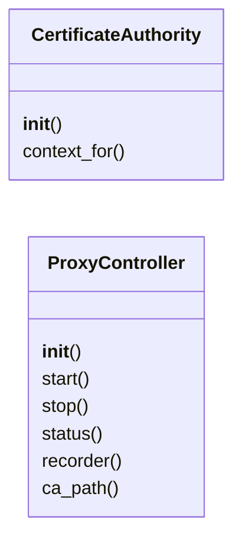
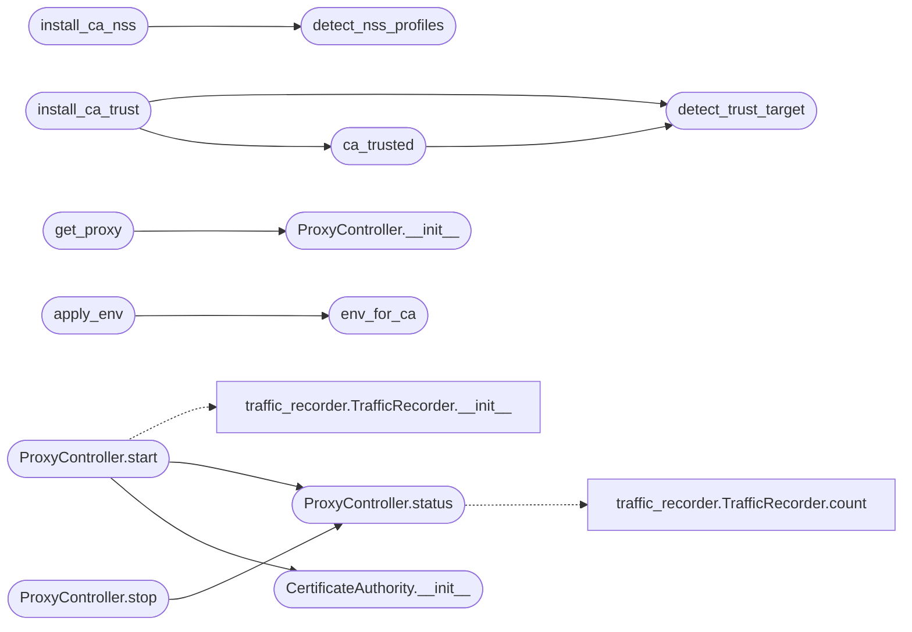

# `modules.lazy_proxy`

> Source: [modules/lazy_proxy.py:1](../../modules/lazy_proxy.py#L1) | language `py` | coverage 100.0% | [API index](../index.md)

Recording HTTP/HTTPS proxy for the autonomous loop.

Every exchange a worker (or any tool the operator routes) sends through
this proxy is persisted with the existing
[`modules.traffic_recorder.TrafficRecorder`](modules.traffic_recorder.py.md#trafficrecorder): file-tree bodies plus
SQLite index. HTTPS is terminated with a locally generated CA so
request and response bodies are captured for findings/evidence; the CA
certificate path is exported so curl/requests/python trust it.

Automation contract:
    `[`LazyLoopEngine.proxy_start`](modules.lazy_loop.py.md#lazyloopengine-proxy_start)` starts one shared recorder
    instance; ``auto_loop`` starts it when ``proxy_autostart`` is on and
    points the worker environment at it; every round ingests new
    exchanges into the task traffic log so `[`lazy_traffic`](modules.lazy_bridge.py.md#lazy_traffic)` and finding
    evidence see proxy traffic like any bash execution.

Fail-open policy: recorder or TLS problems never kill the operator's
traffic; the proxy answers 502 and keeps serving.

## Contents

- **Classes:** [`CertificateAuthority`](#certificateauthority), [`ProxyController`](#proxycontroller)
- **Functions:** [`tls_lab_unverified_allowed`](#tls_lab_unverified_allowed), [`resolve_validated_target`](#resolve_validated_target), [`connect_pinned`](#connect_pinned), [`detect_trust_target`](#detect_trust_target), [`ca_trusted`](#ca_trusted), [`detect_nss_profiles`](#detect_nss_profiles), [`install_ca_nss`](#install_ca_nss), [`install_ca_trust`](#install_ca_trust), [`get_proxy`](#get_proxy), [`env_for_ca`](#env_for_ca), [`apply_env`](#apply_env), [`restore_env`](#restore_env)
- **Constants:** [`DEFAULT_PROXY_HOST`](#default_proxy_host), [`DEFAULT_PROXY_PORT`](#default_proxy_port), [`CA_CERT_NAME`](#ca_cert_name), [`TRUST_ANCHOR_NAME`](#trust_anchor_name), [`NSS_NICKNAME`](#nss_nickname)

## Type Diagram



## Call Graph

Solid arrows stay in this module, dashed arrows leave it.



## Classes

<a id="certificateauthority"></a>

### `CertificateAuthority`

`class` | [modules/lazy_proxy.py:623](../../modules/lazy_proxy.py#L623)

```python
class CertificateAuthority
```

On-disk CA plus cached per-host leaf certificates for MITM.

**Members**

| Member | Kind | Summary |
|---|---|---|
| [`__init__`](#certificateauthority-__init__) | constructor | Load or create the CA under ``pki_dir``. |
| [`context_for`](#certificateauthority-context_for) | method | Return the server TLS context for one host, generating on miss. |

<a id="certificateauthority-__init__"></a>

#### `CertificateAuthority.__init__`

`constructor` | [modules/lazy_proxy.py:626](../../modules/lazy_proxy.py#L626)

```python
def __init__(self, pki_dir: str | Path) -> None
```

Load or create the CA under ``pki_dir``.

**Parameters**

| Name | Type | Default | Description |
|---|---|---|---|
| `pki_dir` | `str \| Path` |  |  |

*Called by:* [`ProxyController.start`](#proxycontroller-start)

<a id="certificateauthority-context_for"></a>

#### `CertificateAuthority.context_for`

`method` | [modules/lazy_proxy.py:736](../../modules/lazy_proxy.py#L736)

```python
def context_for(self, host: str) -> ssl.SSLContext
```

Return the server TLS context for one host, generating on miss.

**Parameters**

| Name | Type | Default | Description |
|---|---|---|---|
| `host` | `str` |  |  |

**Returns:** `ssl.SSLContext`

---

<a id="proxycontroller"></a>

### `ProxyController`

`class` | [modules/lazy_proxy.py:803](../../modules/lazy_proxy.py#L803)

```python
class ProxyController
```

Owns the single shared recorder proxy instance.

**Members**

| Member | Kind | Summary |
|---|---|---|
| [`__init__`](#proxycontroller-__init__) | constructor | Prepare state; nothing binds until `start`. |
| [`start`](#proxycontroller-start) | method | Bind the recorder proxy; idempotent while already running. |
| [`stop`](#proxycontroller-stop) | method | Shut the proxy down; safe when it was never started. |
| [`status`](#proxycontroller-status) | method | Report running state, address, CA path and exchange count. |
| [`recorder`](#proxycontroller-recorder) | method | Return the live recorder for ingestion, or None when stopped. |
| [`ca_path`](#proxycontroller-ca_path) | method | Return the CA certificate path for trust-store wiring. |

<a id="proxycontroller-__init__"></a>

#### `ProxyController.__init__`

`constructor` | [modules/lazy_proxy.py:806](../../modules/lazy_proxy.py#L806)

```python
def __init__(self) -> None
```

Prepare state; nothing binds until `start`.

*Called by:* [`get_proxy`](#get_proxy)

<a id="proxycontroller-start"></a>

#### `ProxyController.start`

`method` | [modules/lazy_proxy.py:819](../../modules/lazy_proxy.py#L819)

```python
def start(self, host: str = DEFAULT_PROXY_HOST, port: int = DEFAULT_PROXY_PORT, task_id: str = '', traffic_dir: str | Path | None = None, upstream: str = '') -> dict
```

Bind the recorder proxy; idempotent while already running.

**Parameters**

| Name | Type | Default | Description |
|---|---|---|---|
| `host` | `str` | `DEFAULT_PROXY_HOST` | Bind address. |
| `port` | `int` | `DEFAULT_PROXY_PORT` | Bind port (0 picks a free one). |
| `task_id` | `str` | `''` | Task tag stored with each exchange. |
| `traffic_dir` | `str \| Path \| None` | `None` | Recorder directory override. |
| `upstream` | `str` | `''` | Optional ``[user:pass@]host:port`` proxy to chain. |

**Returns:** `dict` - Proxy status dict.

*Calls:* [`CertificateAuthority.__init__`](#certificateauthority-__init__), [`ProxyController.status`](#proxycontroller-status), [`TrafficRecorder.__init__`](modules.traffic_recorder.py.md#trafficrecorder-__init__)

<a id="proxycontroller-stop"></a>

#### `ProxyController.stop`

`method` | [modules/lazy_proxy.py:864](../../modules/lazy_proxy.py#L864)

```python
def stop(self) -> dict
```

Shut the proxy down; safe when it was never started.

**Returns:** `dict`

*Calls:* [`ProxyController.status`](#proxycontroller-status)

<a id="proxycontroller-status"></a>

#### `ProxyController.status`

`method` | [modules/lazy_proxy.py:880](../../modules/lazy_proxy.py#L880)

```python
def status(self) -> dict
```

Report running state, address, CA path and exchange count.

**Returns:** `dict`

*Calls:* [`TrafficRecorder.count`](modules.traffic_recorder.py.md#trafficrecorder-count)

*Called by:* [`LazyCommandSet.do_lazy_sandbox`](cli.commands.lazyops.py.md#lazycommandset-do_lazy_sandbox), [`ProxyController.start`](#proxycontroller-start), [`ProxyController.stop`](#proxycontroller-stop)

<a id="proxycontroller-recorder"></a>

#### `ProxyController.recorder`

`method` | [modules/lazy_proxy.py:902](../../modules/lazy_proxy.py#L902)

```python
def recorder(self) -> TrafficRecorder | None
```

Return the live recorder for ingestion, or None when stopped.

**Returns:** `TrafficRecorder | None`

<a id="proxycontroller-ca_path"></a>

#### `ProxyController.ca_path`

`method` | [modules/lazy_proxy.py:906](../../modules/lazy_proxy.py#L906)

```python
def ca_path(self) -> str
```

Return the CA certificate path for trust-store wiring.

**Returns:** `str`

---

## Functions

<a id="tls_lab_unverified_allowed"></a>

### `tls_lab_unverified_allowed`

`function` | [modules/lazy_proxy.py:253](../../modules/lazy_proxy.py#L253)

```python
def tls_lab_unverified_allowed(host: str) -> bool
```

Return True only when a lab host has explicit self-signed opt-in.

**Parameters**

| Name | Type | Default | Description |
|---|---|---|---|
| `host` | `str` |  | Target hostname or IP literal. |

**Returns:** `bool` - True when ``LAZY_PROXY_ALLOW_SELF_SIGNED_LAB=1`` covers this host.

---

<a id="resolve_validated_target"></a>

### `resolve_validated_target`

`function` | [modules/lazy_proxy.py:282](../../modules/lazy_proxy.py#L282)

```python
def resolve_validated_target(host: str, port: int, scheme: str) -> tuple[str, list[str]]
```

Validate a target and return its pinned IP literals.

The returned IPs already passed the metadata/private policy, so
callers must dial one of them instead of re-resolving the hostname
(DNS-rebinding TOCTOU guard) while keeping SNI/host header as the
original validated hostname.

**Parameters**

| Name | Type | Default | Description |
|---|---|---|---|
| `host` | `str` |  | Client-supplied target host. |
| `port` | `int` |  | Client-supplied target port. |
| `scheme` | `str` |  | ``http`` or ``https``. |

**Returns:** `tuple[str, list[str]]` - Tuple of validated hostname and pinned IP list (possibly empty
for IP literals, in which case the literal itself is the pin).

**Raises**

- `ValueError`: When the target is denied by SSRF policy.

---

<a id="connect_pinned"></a>

### `connect_pinned`

`function` | [modules/lazy_proxy.py:355](../../modules/lazy_proxy.py#L355)

```python
def connect_pinned(host: str, ips: list[str], port: int, scheme: str, *, timeout: float)
```

Open a socket to a pinned validated IP, wrapping TLS for https.

**Parameters**

| Name | Type | Default | Description |
|---|---|---|---|
| `host` | `str` |  | Validated hostname for SNI and certificate verification. |
| `ips` | `list[str]` |  | Pinned IP literals from [`resolve_validated_target`](#resolve_validated_target). |
| `port` | `int` |  | Validated port. |
| `scheme` | `str` |  | ``http`` or ``https``. |
| `timeout` | `float` |  | Connection timeout in seconds. |

**Returns:** Connected (optionally TLS-wrapped) socket.

---

<a id="detect_trust_target"></a>

### `detect_trust_target`

`function` | [modules/lazy_proxy.py:490](../../modules/lazy_proxy.py#L490)

```python
def detect_trust_target() -> tuple[str, tuple[str, ...]]
```

Return the first existing system trust anchor directory and refresh command.

**Returns:** `tuple[str, tuple[str, ...]]`

*Called by:* [`ca_trusted`](#ca_trusted), [`install_ca_trust`](#install_ca_trust)

---

<a id="ca_trusted"></a>

### `ca_trusted`

`function` | [modules/lazy_proxy.py:498](../../modules/lazy_proxy.py#L498)

```python
def ca_trusted(ca_path: str | Path) -> bool
```

Return True when the system anchor already holds this CA.

**Parameters**

| Name | Type | Default | Description |
|---|---|---|---|
| `ca_path` | `str \| Path` |  |  |

**Returns:** `bool`

*Calls:* [`detect_trust_target`](#detect_trust_target)

*Called by:* [`install_ca_trust`](#install_ca_trust)

---

<a id="detect_nss_profiles"></a>

### `detect_nss_profiles`

`function` | [modules/lazy_proxy.py:517](../../modules/lazy_proxy.py#L517)

```python
def detect_nss_profiles() -> list[str]
```

Return user NSS database directories (Firefox profiles + Chrome).

**Returns:** `list[str]`

*Called by:* [`install_ca_nss`](#install_ca_nss)

---

<a id="install_ca_nss"></a>

### `install_ca_nss`

`function` | [modules/lazy_proxy.py:532](../../modules/lazy_proxy.py#L532)

```python
def install_ca_nss(ca_path: str | Path, runner=None, profiles: list[str] | None = None) -> dict
```

Install the recorder CA into user NSS databases via certutil.

NSS stores are user-owned, so no sudo is required; the command is a
no-op when certutil or the profiles are missing.

**Parameters**

| Name | Type | Default | Description |
|---|---|---|---|
| `ca_path` | `str \| Path` |  | CA certificate PEM path. |
| `runner` |  | `None` | Injection point for certutil execution (tests). |
| `profiles` | `list[str] \| None` | `None` | Explicit NSS directories (defaults to auto-discovery). |

**Returns:** `dict` - Dict with installed/profiles counts and reason; never raises.

*Calls:* [`detect_nss_profiles`](#detect_nss_profiles)

*Called by:* [`LazyCommandSet.do_lazy_traffic`](cli.commands.lazyops.py.md#lazycommandset-do_lazy_traffic)

---

<a id="install_ca_trust"></a>

### `install_ca_trust`

`function` | [modules/lazy_proxy.py:572](../../modules/lazy_proxy.py#L572)

```python
def install_ca_trust(ca_path: str | Path, runner=None) -> dict
```

Install the recorder CA into the system trust store.

The anchor is only written when the CA is missing or stale; sudo is
invoked then and prompts on the operator terminal. Non-interactive
callers (MCP) fail soft with a reason instead of hanging.

**Parameters**

| Name | Type | Default | Description |
|---|---|---|---|
| `ca_path` | `str \| Path` |  | CA certificate PEM path. |
| `runner` |  | `None` | Injection point for privileged execution (tests). |

**Returns:** `dict` - Dict with installed flag, anchor path and reason; never raises.

*Calls:* [`ca_trusted`](#ca_trusted), [`detect_trust_target`](#detect_trust_target)

*Called by:* [`LazyCommandSet.do_lazy_traffic`](cli.commands.lazyops.py.md#lazycommandset-do_lazy_traffic)

---

<a id="get_proxy"></a>

### `get_proxy`

`function` | [modules/lazy_proxy.py:1336](../../modules/lazy_proxy.py#L1336)

```python
def get_proxy() -> ProxyController
```

Return the process-wide recorder proxy controller.

**Returns:** `ProxyController`

*Calls:* [`ProxyController.__init__`](#proxycontroller-__init__)

*Called by:* [`LazyCommandSet.do_lazy_evidence`](cli.commands.lazyops.py.md#lazycommandset-do_lazy_evidence), [`LazyCommandSet.do_lazy_traffic`](cli.commands.lazyops.py.md#lazycommandset-do_lazy_traffic)

---

<a id="env_for_ca"></a>

### `env_for_ca`

`function` | [modules/lazy_proxy.py:1345](../../modules/lazy_proxy.py#L1345)

```python
def env_for_ca(ca_path: str, host: str = DEFAULT_PROXY_HOST, port: int = DEFAULT_PROXY_PORT) -> dict
```

Build the environment overrides that route tools through the proxy.

**Parameters**

| Name | Type | Default | Description |
|---|---|---|---|
| `ca_path` | `str` |  |  |
| `host` | `str` | `DEFAULT_PROXY_HOST` |  |
| `port` | `int` | `DEFAULT_PROXY_PORT` |  |

**Returns:** `dict`

*Called by:* [`apply_env`](#apply_env)

---

<a id="apply_env"></a>

### `apply_env`

`function` | [modules/lazy_proxy.py:1361](../../modules/lazy_proxy.py#L1361)

```python
def apply_env(ca_path: str, host: str = DEFAULT_PROXY_HOST, port: int = DEFAULT_PROXY_PORT) -> dict
```

Apply proxy env vars, returning the previous values for restore.

**Parameters**

| Name | Type | Default | Description |
|---|---|---|---|
| `ca_path` | `str` |  |  |
| `host` | `str` | `DEFAULT_PROXY_HOST` |  |
| `port` | `int` | `DEFAULT_PROXY_PORT` |  |

**Returns:** `dict`

*Calls:* [`env_for_ca`](#env_for_ca)

---

<a id="restore_env"></a>

### `restore_env`

`function` | [modules/lazy_proxy.py:1368](../../modules/lazy_proxy.py#L1368)

```python
def restore_env(previous: dict) -> None
```

Restore environment values captured by [`apply_env`](#apply_env).

**Parameters**

| Name | Type | Default | Description |
|---|---|---|---|
| `previous` | `dict` |  |  |

---

## Constants

<a id="default_proxy_host"></a>

### `DEFAULT_PROXY_HOST`

`constant` | [modules/lazy_proxy.py:55](../../modules/lazy_proxy.py#L55)

```python
DEFAULT_PROXY_HOST = '127.0.0.1'
```

---

<a id="default_proxy_port"></a>

### `DEFAULT_PROXY_PORT`

`constant` | [modules/lazy_proxy.py:56](../../modules/lazy_proxy.py#L56)

```python
DEFAULT_PROXY_PORT = 8899
```

---

<a id="ca_cert_name"></a>

### `CA_CERT_NAME`

`constant` | [modules/lazy_proxy.py:58](../../modules/lazy_proxy.py#L58)

```python
CA_CERT_NAME = 'ca.pem'
```

---

<a id="trust_anchor_name"></a>

### `TRUST_ANCHOR_NAME`

`constant` | [modules/lazy_proxy.py:66](../../modules/lazy_proxy.py#L66)

```python
TRUST_ANCHOR_NAME = 'lazyown-recorder-ca.crt'
```

---

<a id="nss_nickname"></a>

### `NSS_NICKNAME`

`constant` | [modules/lazy_proxy.py:67](../../modules/lazy_proxy.py#L67)

```python
NSS_NICKNAME = 'LazyOwn Recorder CA'
```

---
