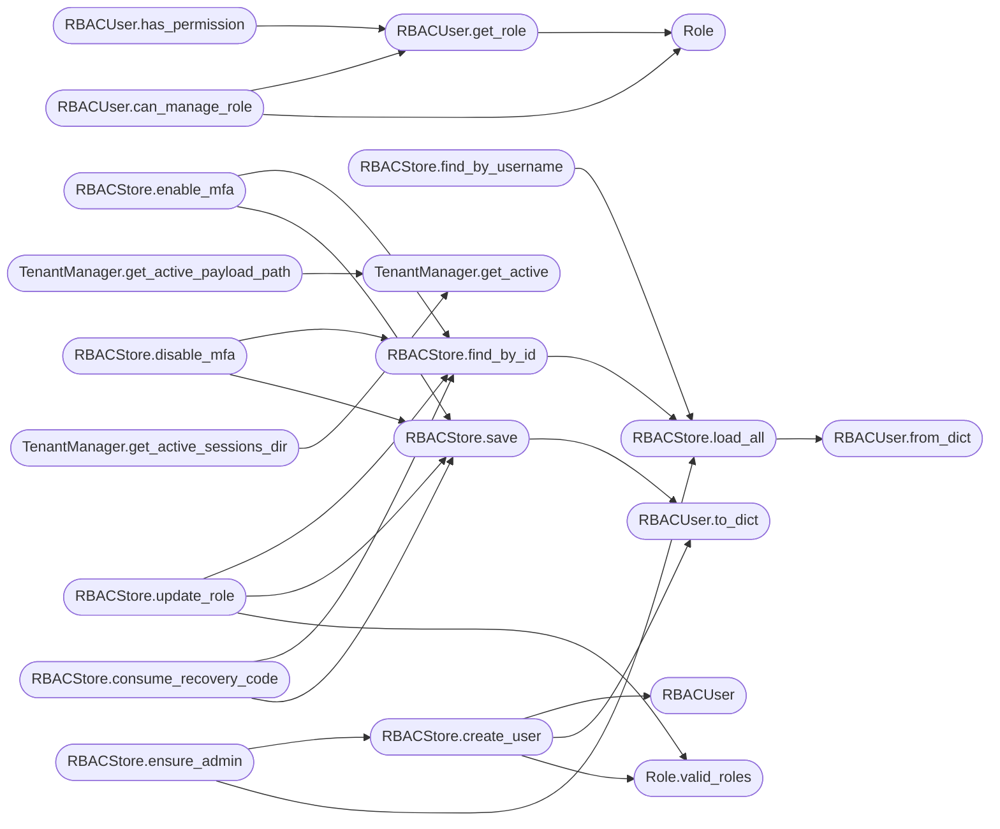

# `modules.lazy_rbac`

> Source: [modules/lazy_rbac.py:1](../../modules/lazy_rbac.py#L1) | language `py` | coverage 20.0% | [API index](../index.md)

modules/lazy_rbac.py ==================== Role-Based Access Control, Multi-Factor Authentication, and Multi-Tenancy for the LazyOwn RedTeam Framework.

Provides:
- RBAC: admin, operator, viewer, auditor roles with permission enforcement
- MFA: TOTP-based multi-factor auth (self-hosted, pyotp, no external APIs)
- Multi-tenancy: payload profiles + session isolation per engagement
- Decorators: @require_role, @require_permission for Flask routes
- CLI integration: command-level permission checks

Architecture
------------
- Roles are defined as enums with permission bitmasks
- Users stored in users.json with role, mfa_secret, mfa_enabled fields
- Tenancy managed via payloads/ directory with named profiles
- Zero cost: pyotp is already a dependency, no external services needed

## Contents

- **Classes:** [`RBACUser`](#rbacuser), [`RBACStore`](#rbacstore), [`TenantConfig`](#tenantconfig), [`TenantManager`](#tenantmanager)
- **Enums:** [`Role`](#role), [`Permission`](#permission)
- **Functions:** [`init_rbac_store`](#init_rbac_store), [`init_tenant_manager`](#init_tenant_manager), [`require_role`](#require_role), [`require_permission`](#require_permission), [`require_mfa`](#require_mfa), [`get_rbac_store`](#get_rbac_store), [`set_rbac_store`](#set_rbac_store), [`get_tenant_manager`](#get_tenant_manager), [`set_tenant_manager`](#set_tenant_manager), [`check_cli_permission`](#check_cli_permission), [`get_user_role`](#get_user_role), [`generate_mfa_qr_url`](#generate_mfa_qr_url), [`generate_qr_svg`](#generate_qr_svg)
- **Constants:** [`DEFAULT_USERS_PATH`](#default_users_path), [`DEFAULT_PAYLOADS_DIR`](#default_payloads_dir), [`DEFAULT_PAYLOAD_PATH`](#default_payload_path), [`DEFAULT_SESSIONS_DIR`](#default_sessions_dir), [`DEFAULT_CONFIG_PATH`](#default_config_path), [`MFA_ISSUER`](#mfa_issuer), [`RECOVERY_CODES_COUNT`](#recovery_codes_count), [`RECOVERY_CODE_LENGTH`](#recovery_code_length), [`ROLE_DEFAULT`](#role_default), [`ROLE_PERMISSIONS`](#role_permissions)

## Type Diagram

```mermaid
classDiagram
    direction LR
    class Role
    <<enum>> Role
    Role : ADMIN
    Role : OPERATOR
    Role : VIEWER
    Role : AUDITOR
    Role : valid_roles()
    class Permission
    <<enum>> Permission
    Permission : USER_MANAGE
    Permission : CONFIG_EDIT
    Permission : CMD_RUN
    Permission : CMD_DESTRUCTIVE
    Permission : REPORT_VIEW
    Permission : REPORT_GENERATE
    Permission : SESSION_VIEW
    Permission : SESSION_MANAGE
    Permission : AUDIT_VIEW
    Permission : COLLAB_JOIN
    Permission : COLLAB_PUBLISH
    Permission : COLLAB_LOCK
    Permission : TENANT_MANAGE
    class RBACUser
    RBACUser : int id
    RBACUser : str username
    RBACUser : str password_hash
    RBACUser : str role
    RBACUser : bool mfa_enabled
    RBACUser : str mfa_secret
    RBACUser : list[str] recovery_codes
    RBACUser : int elo
    RBACUser : str tenant_id
    RBACUser : bool must_change_password
    RBACUser : to_dict()
    RBACUser : from_dict()
    RBACUser : get_role()
    RBACUser : has_permission()
    RBACUser : can_manage_role()
    RBACUser : get_mfa_provisioning_uri()
    RBACUser : verify_totp()
    RBACUser : verify_recovery_code()
    RBACUser : consume_recovery_code()
    class RBACStore
    RBACStore : __init__()
    RBACStore : load_all()
    RBACStore : find_by_id()
    RBACStore : find_by_username()
    RBACStore : save()
    RBACStore : create_user()
    RBACStore : delete_user()
    RBACStore : update_role()
    RBACStore : enable_mfa()
    RBACStore : disable_mfa()
    RBACStore : consume_recovery_code()
    RBACStore : ensure_admin()
    class TenantConfig
    TenantConfig : str tenant_id
    TenantConfig : str name
    TenantConfig : str payload_path
    TenantConfig : str sessions_dir
    TenantConfig : float created_at
    TenantConfig : dict[str, Any] metadata
    TenantConfig : from_payload()
    TenantConfig : to_dict()
    TenantConfig : from_dict()
    class TenantManager
    TenantManager : __init__()
    TenantManager : list_tenants()
    TenantManager : get_active()
    TenantManager : get_active_payload_path()
    TenantManager : get_active_sessions_dir()
    TenantManager : get_payload_for_tenant()
    TenantManager : create_tenant()
    TenantManager : switch_tenant()
    TenantManager : delete_tenant()
    TenantManager : ensure_default_tenant()
```



## Call Graph

Solid arrows stay in this module, dashed arrows leave it.



## Classes

<a id="rbacuser"></a>

### `RBACUser`

`class` `dataclass` | [modules/lazy_rbac.py:124](../../modules/lazy_rbac.py#L124)

Decorators: `@dataclass`

```python
class RBACUser
```

**Attributes**

| Name | Type | Default | Description |
|---|---|---|---|
| [`id`](#rbacuser-id) | `int` |  |  |
| [`username`](#rbacuser-username) | `str` |  |  |
| [`password_hash`](#rbacuser-password_hash) | `str` |  |  |
| [`role`](#rbacuser-role) | `str` | `ROLE_DEFAULT` |  |
| [`mfa_enabled`](#rbacuser-mfa_enabled) | `bool` | `False` |  |
| [`mfa_secret`](#rbacuser-mfa_secret) | `str` | `''` |  |
| [`recovery_codes`](#rbacuser-recovery_codes) | `list[str]` | `field(default_factory=list)` |  |
| [`elo`](#rbacuser-elo) | `int` | `0` |  |
| [`tenant_id`](#rbacuser-tenant_id) | `str` | `'default'` |  |
| [`must_change_password`](#rbacuser-must_change_password) | `bool` | `False` |  |

**Members**

| Member | Kind | Summary |
|---|---|---|
| [`to_dict`](#rbacuser-to_dict) | method |  |
| [`from_dict`](#rbacuser-from_dict) | classmethod |  |
| [`get_role`](#rbacuser-get_role) | method |  |
| [`has_permission`](#rbacuser-has_permission) | method |  |
| [`can_manage_role`](#rbacuser-can_manage_role) | method | Check if this user can assign/manage the given role. |
| [`get_mfa_provisioning_uri`](#rbacuser-get_mfa_provisioning_uri) | method |  |
| [`verify_totp`](#rbacuser-verify_totp) | method |  |
| [`verify_recovery_code`](#rbacuser-verify_recovery_code) | method |  |
| [`consume_recovery_code`](#rbacuser-consume_recovery_code) | method |  |

<a id="rbacuser-to_dict"></a>

#### `RBACUser.to_dict`

`method` | [modules/lazy_rbac.py:136](../../modules/lazy_rbac.py#L136)

```python
def to_dict(self) -> dict
```

**Returns:** `dict`

*Called by:* [`RBACStore.create_user`](#rbacstore-create_user), [`RBACStore.save`](#rbacstore-save)

<a id="rbacuser-from_dict"></a>

#### `RBACUser.from_dict`

`classmethod` | [modules/lazy_rbac.py:140](../../modules/lazy_rbac.py#L140)

Decorators: `@classmethod`

```python
def from_dict(cls, data: dict) -> RBACUser
```

**Parameters**

| Name | Type | Default | Description |
|---|---|---|---|
| `data` | `dict` |  |  |

**Returns:** `RBACUser`

*Called by:* [`save_users`](lazyc2.py.md#save_users), [`save_users`](lazyc2.extensions.users.py.md#save_users), [`RBACStore.load_all`](#rbacstore-load_all)

<a id="rbacuser-get_role"></a>

#### `RBACUser.get_role`

`method` | [modules/lazy_rbac.py:164](../../modules/lazy_rbac.py#L164)

```python
def get_role(self) -> Role
```

**Returns:** `Role`

*Calls:* [`Role`](#role)

*Called by:* [`RBACUser.can_manage_role`](#rbacuser-can_manage_role), [`RBACUser.has_permission`](#rbacuser-has_permission)

<a id="rbacuser-has_permission"></a>

#### `RBACUser.has_permission`

`method` | [modules/lazy_rbac.py:170](../../modules/lazy_rbac.py#L170)

```python
def has_permission(self, permission: Permission) -> bool
```

**Parameters**

| Name | Type | Default | Description |
|---|---|---|---|
| `permission` | `Permission` |  |  |

**Returns:** `bool`

*Calls:* [`RBACUser.get_role`](#rbacuser-get_role)

<a id="rbacuser-can_manage_role"></a>

#### `RBACUser.can_manage_role`

`method` | [modules/lazy_rbac.py:174](../../modules/lazy_rbac.py#L174)

```python
def can_manage_role(self, target_role: str) -> bool
```

Check if this user can assign/manage the given role.

**Parameters**

| Name | Type | Default | Description |
|---|---|---|---|
| `target_role` | `str` |  |  |

**Returns:** `bool`

*Calls:* [`RBACUser.get_role`](#rbacuser-get_role), [`Role`](#role)

<a id="rbacuser-get_mfa_provisioning_uri"></a>

#### `RBACUser.get_mfa_provisioning_uri`

`method` | [modules/lazy_rbac.py:182](../../modules/lazy_rbac.py#L182)

```python
def get_mfa_provisioning_uri(self) -> str
```

**Returns:** `str`

<a id="rbacuser-verify_totp"></a>

#### `RBACUser.verify_totp`

`method` | [modules/lazy_rbac.py:187](../../modules/lazy_rbac.py#L187)

```python
def verify_totp(self, token: str) -> bool
```

**Parameters**

| Name | Type | Default | Description |
|---|---|---|---|
| `token` | `str` |  |  |

**Returns:** `bool`

<a id="rbacuser-verify_recovery_code"></a>

#### `RBACUser.verify_recovery_code`

`method` | [modules/lazy_rbac.py:192](../../modules/lazy_rbac.py#L192)

```python
def verify_recovery_code(self, code: str) -> bool
```

**Parameters**

| Name | Type | Default | Description |
|---|---|---|---|
| `code` | `str` |  |  |

**Returns:** `bool`

<a id="rbacuser-consume_recovery_code"></a>

#### `RBACUser.consume_recovery_code`

`method` | [modules/lazy_rbac.py:200](../../modules/lazy_rbac.py#L200)

```python
def consume_recovery_code(self, code: str) -> bool
```

**Parameters**

| Name | Type | Default | Description |
|---|---|---|---|
| `code` | `str` |  |  |

**Returns:** `bool`

---

<a id="rbacstore"></a>

### `RBACStore`

`class` | [modules/lazy_rbac.py:210](../../modules/lazy_rbac.py#L210)

```python
class RBACStore
```

Persistence layer for RBAC users.

**Members**

| Member | Kind | Summary |
|---|---|---|
| [`__init__`](#rbacstore-__init__) | constructor |  |
| [`load_all`](#rbacstore-load_all) | method |  |
| [`find_by_id`](#rbacstore-find_by_id) | method |  |
| [`find_by_username`](#rbacstore-find_by_username) | method |  |
| [`save`](#rbacstore-save) | method |  |
| [`create_user`](#rbacstore-create_user) | method |  |
| [`delete_user`](#rbacstore-delete_user) | method |  |
| [`update_role`](#rbacstore-update_role) | method |  |
| [`enable_mfa`](#rbacstore-enable_mfa) | method |  |
| [`disable_mfa`](#rbacstore-disable_mfa) | method |  |
| [`consume_recovery_code`](#rbacstore-consume_recovery_code) | method |  |
| [`ensure_admin`](#rbacstore-ensure_admin) | method | Ensure at least one admin exists, creating one if needed. |

<a id="rbacstore-__init__"></a>

#### `RBACStore.__init__`

`constructor` | [modules/lazy_rbac.py:213](../../modules/lazy_rbac.py#L213)

```python
def __init__(self, users_path: str = DEFAULT_USERS_PATH)
```

**Parameters**

| Name | Type | Default | Description |
|---|---|---|---|
| `users_path` | `str` | `DEFAULT_USERS_PATH` |  |

*Called by:* [`init_rbac_store`](#init_rbac_store)

<a id="rbacstore-load_all"></a>

#### `RBACStore.load_all`

`method` | [modules/lazy_rbac.py:245](../../modules/lazy_rbac.py#L245)

```python
def load_all(self) -> list[RBACUser]
```

**Returns:** `list[RBACUser]`

*Calls:* [`RBACUser.from_dict`](#rbacuser-from_dict)

*Called by:* [`RBACStore.ensure_admin`](#rbacstore-ensure_admin), [`RBACStore.find_by_id`](#rbacstore-find_by_id), [`RBACStore.find_by_username`](#rbacstore-find_by_username)

<a id="rbacstore-find_by_id"></a>

#### `RBACStore.find_by_id`

`method` | [modules/lazy_rbac.py:249](../../modules/lazy_rbac.py#L249)

```python
def find_by_id(self, user_id: int) -> RBACUser | None
```

**Parameters**

| Name | Type | Default | Description |
|---|---|---|---|
| `user_id` | `int` |  |  |

**Returns:** `RBACUser | None`

*Calls:* [`RBACStore.load_all`](#rbacstore-load_all)

*Called by:* [`RBACStore.consume_recovery_code`](#rbacstore-consume_recovery_code), [`RBACStore.disable_mfa`](#rbacstore-disable_mfa), [`RBACStore.enable_mfa`](#rbacstore-enable_mfa), [`RBACStore.update_role`](#rbacstore-update_role)

<a id="rbacstore-find_by_username"></a>

#### `RBACStore.find_by_username`

`method` | [modules/lazy_rbac.py:255](../../modules/lazy_rbac.py#L255)

```python
def find_by_username(self, username: str) -> RBACUser | None
```

**Parameters**

| Name | Type | Default | Description |
|---|---|---|---|
| `username` | `str` |  |  |

**Returns:** `RBACUser | None`

*Calls:* [`RBACStore.load_all`](#rbacstore-load_all)

<a id="rbacstore-save"></a>

#### `RBACStore.save`

`method` | [modules/lazy_rbac.py:261](../../modules/lazy_rbac.py#L261)

```python
def save(self, user: RBACUser) -> None
```

**Parameters**

| Name | Type | Default | Description |
|---|---|---|---|
| `user` | `RBACUser` |  |  |

*Calls:* [`RBACUser.to_dict`](#rbacuser-to_dict)

*Called by:* [`RBACStore.consume_recovery_code`](#rbacstore-consume_recovery_code), [`RBACStore.disable_mfa`](#rbacstore-disable_mfa), [`RBACStore.enable_mfa`](#rbacstore-enable_mfa), [`RBACStore.update_role`](#rbacstore-update_role)

<a id="rbacstore-create_user"></a>

#### `RBACStore.create_user`

`method` | [modules/lazy_rbac.py:274](../../modules/lazy_rbac.py#L274)

```python
def create_user(self, username: str, password_hash: str, role: str = ROLE_DEFAULT, tenant_id: str = 'default') -> RBACUser
```

**Parameters**

| Name | Type | Default | Description |
|---|---|---|---|
| `username` | `str` |  |  |
| `password_hash` | `str` |  |  |
| `role` | `str` | `ROLE_DEFAULT` |  |
| `tenant_id` | `str` | `'default'` |  |

**Returns:** `RBACUser`

*Calls:* [`RBACUser`](#rbacuser), [`RBACUser.to_dict`](#rbacuser-to_dict), [`Role.valid_roles`](#role-valid_roles)

*Called by:* [`RBACStore.ensure_admin`](#rbacstore-ensure_admin)

<a id="rbacstore-delete_user"></a>

#### `RBACStore.delete_user`

`method` | [modules/lazy_rbac.py:295](../../modules/lazy_rbac.py#L295)

```python
def delete_user(self, user_id: int) -> bool
```

**Parameters**

| Name | Type | Default | Description |
|---|---|---|---|
| `user_id` | `int` |  |  |

**Returns:** `bool`

<a id="rbacstore-update_role"></a>

#### `RBACStore.update_role`

`method` | [modules/lazy_rbac.py:304](../../modules/lazy_rbac.py#L304)

```python
def update_role(self, user_id: int, new_role: str) -> RBACUser | None
```

**Parameters**

| Name | Type | Default | Description |
|---|---|---|---|
| `user_id` | `int` |  |  |
| `new_role` | `str` |  |  |

**Returns:** `RBACUser | None`

*Calls:* [`RBACStore.find_by_id`](#rbacstore-find_by_id), [`RBACStore.save`](#rbacstore-save), [`Role.valid_roles`](#role-valid_roles)

<a id="rbacstore-enable_mfa"></a>

#### `RBACStore.enable_mfa`

`method` | [modules/lazy_rbac.py:314](../../modules/lazy_rbac.py#L314)

```python
def enable_mfa(self, user_id: int) -> RBACUser | None
```

**Parameters**

| Name | Type | Default | Description |
|---|---|---|---|
| `user_id` | `int` |  |  |

**Returns:** `RBACUser | None`

*Calls:* [`RBACStore.find_by_id`](#rbacstore-find_by_id), [`RBACStore.save`](#rbacstore-save)

<a id="rbacstore-disable_mfa"></a>

#### `RBACStore.disable_mfa`

`method` | [modules/lazy_rbac.py:324](../../modules/lazy_rbac.py#L324)

```python
def disable_mfa(self, user_id: int) -> RBACUser | None
```

**Parameters**

| Name | Type | Default | Description |
|---|---|---|---|
| `user_id` | `int` |  |  |

**Returns:** `RBACUser | None`

*Calls:* [`RBACStore.find_by_id`](#rbacstore-find_by_id), [`RBACStore.save`](#rbacstore-save)

<a id="rbacstore-consume_recovery_code"></a>

#### `RBACStore.consume_recovery_code`

`method` | [modules/lazy_rbac.py:334](../../modules/lazy_rbac.py#L334)

```python
def consume_recovery_code(self, user_id: int, code: str) -> bool
```

**Parameters**

| Name | Type | Default | Description |
|---|---|---|---|
| `user_id` | `int` |  |  |
| `code` | `str` |  |  |

**Returns:** `bool`

*Calls:* [`RBACStore.find_by_id`](#rbacstore-find_by_id), [`RBACStore.save`](#rbacstore-save)

<a id="rbacstore-ensure_admin"></a>

#### `RBACStore.ensure_admin`

`method` | [modules/lazy_rbac.py:343](../../modules/lazy_rbac.py#L343)

```python
def ensure_admin(self, username: str, password_hash: str) -> RBACUser
```

Ensure at least one admin exists, creating one if needed.

**Parameters**

| Name | Type | Default | Description |
|---|---|---|---|
| `username` | `str` |  |  |
| `password_hash` | `str` |  |  |

**Returns:** `RBACUser`

*Calls:* [`RBACStore.create_user`](#rbacstore-create_user), [`RBACStore.load_all`](#rbacstore-load_all)

---

<a id="tenantconfig"></a>

### `TenantConfig`

`class` `dataclass` | [modules/lazy_rbac.py:368](../../modules/lazy_rbac.py#L368)

Decorators: `@dataclass`

```python
class TenantConfig
```

**Attributes**

| Name | Type | Default | Description |
|---|---|---|---|
| [`tenant_id`](#tenantconfig-tenant_id) | `str` |  |  |
| [`name`](#tenantconfig-name) | `str` |  |  |
| [`payload_path`](#tenantconfig-payload_path) | `str` |  |  |
| [`sessions_dir`](#tenantconfig-sessions_dir) | `str` |  |  |
| [`created_at`](#tenantconfig-created_at) | `float` | `field(default_factory=time.time)` |  |
| [`metadata`](#tenantconfig-metadata) | `dict[str, Any]` | `field(default_factory=dict)` |  |

**Members**

| Member | Kind | Summary |
|---|---|---|
| [`from_payload`](#tenantconfig-from_payload) | classmethod |  |
| [`to_dict`](#tenantconfig-to_dict) | method |  |
| [`from_dict`](#tenantconfig-from_dict) | classmethod |  |

<a id="tenantconfig-from_payload"></a>

#### `TenantConfig.from_payload`

`classmethod` | [modules/lazy_rbac.py:377](../../modules/lazy_rbac.py#L377)

Decorators: `@classmethod`

```python
def from_payload(cls, tenant_id: str, name: str, payload_path: str) -> TenantConfig
```

**Parameters**

| Name | Type | Default | Description |
|---|---|---|---|
| `tenant_id` | `str` |  |  |
| `name` | `str` |  |  |
| `payload_path` | `str` |  |  |

**Returns:** `TenantConfig`

*Called by:* [`TenantManager.create_tenant`](#tenantmanager-create_tenant)

<a id="tenantconfig-to_dict"></a>

#### `TenantConfig.to_dict`

`method` | [modules/lazy_rbac.py:386](../../modules/lazy_rbac.py#L386)

```python
def to_dict(self) -> dict
```

**Returns:** `dict`

<a id="tenantconfig-from_dict"></a>

#### `TenantConfig.from_dict`

`classmethod` | [modules/lazy_rbac.py:390](../../modules/lazy_rbac.py#L390)

Decorators: `@classmethod`

```python
def from_dict(cls, data: dict) -> TenantConfig
```

**Parameters**

| Name | Type | Default | Description |
|---|---|---|---|
| `data` | `dict` |  |  |

**Returns:** `TenantConfig`

---

<a id="tenantmanager"></a>

### `TenantManager`

`class` | [modules/lazy_rbac.py:394](../../modules/lazy_rbac.py#L394)

```python
class TenantManager
```

Multi-tenancy engine: payload profiles + session isolation.

**Members**

| Member | Kind | Summary |
|---|---|---|
| [`__init__`](#tenantmanager-__init__) | constructor |  |
| [`list_tenants`](#tenantmanager-list_tenants) | method |  |
| [`get_active`](#tenantmanager-get_active) | method |  |
| [`get_active_payload_path`](#tenantmanager-get_active_payload_path) | method |  |
| [`get_active_sessions_dir`](#tenantmanager-get_active_sessions_dir) | method |  |
| [`get_payload_for_tenant`](#tenantmanager-get_payload_for_tenant) | method |  |
| [`create_tenant`](#tenantmanager-create_tenant) | method |  |
| [`switch_tenant`](#tenantmanager-switch_tenant) | method |  |
| [`delete_tenant`](#tenantmanager-delete_tenant) | method |  |
| [`ensure_default_tenant`](#tenantmanager-ensure_default_tenant) | method |  |

<a id="tenantmanager-__init__"></a>

#### `TenantManager.__init__`

`constructor` | [modules/lazy_rbac.py:397](../../modules/lazy_rbac.py#L397)

```python
def __init__(self, payloads_dir: str = DEFAULT_PAYLOADS_DIR, config_path: str = DEFAULT_CONFIG_PATH, default_payload: str = DEFAULT_PAYLOAD_PATH)
```

**Parameters**

| Name | Type | Default | Description |
|---|---|---|---|
| `payloads_dir` | `str` | `DEFAULT_PAYLOADS_DIR` |  |
| `config_path` | `str` | `DEFAULT_CONFIG_PATH` |  |
| `default_payload` | `str` | `DEFAULT_PAYLOAD_PATH` |  |

*Called by:* [`get_tenant_manager`](#get_tenant_manager), [`init_tenant_manager`](#init_tenant_manager)

<a id="tenantmanager-list_tenants"></a>

#### `TenantManager.list_tenants`

`method` | [modules/lazy_rbac.py:431](../../modules/lazy_rbac.py#L431)

```python
def list_tenants(self) -> list[TenantConfig]
```

**Returns:** `list[TenantConfig]`

<a id="tenantmanager-get_active"></a>

#### `TenantManager.get_active`

`method` | [modules/lazy_rbac.py:434](../../modules/lazy_rbac.py#L434)

```python
def get_active(self) -> TenantConfig | None
```

**Returns:** `TenantConfig | None`

*Called by:* [`TenantManager.get_active_payload_path`](#tenantmanager-get_active_payload_path), [`TenantManager.get_active_sessions_dir`](#tenantmanager-get_active_sessions_dir)

<a id="tenantmanager-get_active_payload_path"></a>

#### `TenantManager.get_active_payload_path`

`method` | [modules/lazy_rbac.py:439](../../modules/lazy_rbac.py#L439)

```python
def get_active_payload_path(self) -> str
```

**Returns:** `str`

*Calls:* [`TenantManager.get_active`](#tenantmanager-get_active)

<a id="tenantmanager-get_active_sessions_dir"></a>

#### `TenantManager.get_active_sessions_dir`

`method` | [modules/lazy_rbac.py:445](../../modules/lazy_rbac.py#L445)

```python
def get_active_sessions_dir(self) -> str
```

**Returns:** `str`

*Calls:* [`TenantManager.get_active`](#tenantmanager-get_active)

<a id="tenantmanager-get_payload_for_tenant"></a>

#### `TenantManager.get_payload_for_tenant`

`method` | [modules/lazy_rbac.py:451](../../modules/lazy_rbac.py#L451)

```python
def get_payload_for_tenant(self, tenant_id: str) -> str
```

**Parameters**

| Name | Type | Default | Description |
|---|---|---|---|
| `tenant_id` | `str` |  |  |

**Returns:** `str`

<a id="tenantmanager-create_tenant"></a>

#### `TenantManager.create_tenant`

`method` | [modules/lazy_rbac.py:457](../../modules/lazy_rbac.py#L457)

```python
def create_tenant(self, name: str, base_payload: str | None = None) -> TenantConfig
```

**Parameters**

| Name | Type | Default | Description |
|---|---|---|---|
| `name` | `str` |  |  |
| `base_payload` | `str \| None` | `None` |  |

**Returns:** `TenantConfig`

**Raises**

- `ValueError`: (raised in the body, not documented)

*Calls:* [`TenantConfig.from_payload`](#tenantconfig-from_payload)

*Called by:* [`TenantManager.ensure_default_tenant`](#tenantmanager-ensure_default_tenant)

<a id="tenantmanager-switch_tenant"></a>

#### `TenantManager.switch_tenant`

`method` | [modules/lazy_rbac.py:486](../../modules/lazy_rbac.py#L486)

```python
def switch_tenant(self, tenant_id: str) -> TenantConfig
```

**Parameters**

| Name | Type | Default | Description |
|---|---|---|---|
| `tenant_id` | `str` |  |  |

**Returns:** `TenantConfig`

**Raises**

- `ValueError`: (raised in the body, not documented)

<a id="tenantmanager-delete_tenant"></a>

#### `TenantManager.delete_tenant`

`method` | [modules/lazy_rbac.py:495](../../modules/lazy_rbac.py#L495)

```python
def delete_tenant(self, tenant_id: str) -> bool
```

**Parameters**

| Name | Type | Default | Description |
|---|---|---|---|
| `tenant_id` | `str` |  |  |

**Returns:** `bool`

<a id="tenantmanager-ensure_default_tenant"></a>

#### `TenantManager.ensure_default_tenant`

`method` | [modules/lazy_rbac.py:504](../../modules/lazy_rbac.py#L504)

```python
def ensure_default_tenant(self) -> TenantConfig
```

**Returns:** `TenantConfig`

*Calls:* [`TenantManager.create_tenant`](#tenantmanager-create_tenant)

---

## Enums

<a id="role"></a>

### `Role`

`enum` | [modules/lazy_rbac.py:55](../../modules/lazy_rbac.py#L55)

```python
class Role(enum.Enum)
```

Bases: `enum.Enum`

**Attributes**

| Name | Type | Default | Description |
|---|---|---|---|
| [`ADMIN`](#role-admin) |  | `'admin'` |  |
| [`OPERATOR`](#role-operator) |  | `'operator'` |  |
| [`VIEWER`](#role-viewer) |  | `'viewer'` |  |
| [`AUDITOR`](#role-auditor) |  | `'auditor'` |  |

**Members**

| Member | Kind | Summary |
|---|---|---|
| [`valid_roles`](#role-valid_roles) | classmethod |  |

<a id="role-valid_roles"></a>

#### `Role.valid_roles`

`classmethod` | [modules/lazy_rbac.py:62](../../modules/lazy_rbac.py#L62)

Decorators: `@classmethod`

```python
def valid_roles(cls) -> set[str]
```

**Returns:** `set[str]`

*Called by:* [`admin_set_role`](lazyc2.blueprints.auth.py.md#admin_set_role), [`RBACStore.create_user`](#rbacstore-create_user), [`RBACStore.update_role`](#rbacstore-update_role)

---

<a id="permission"></a>

### `Permission`

`enum` | [modules/lazy_rbac.py:66](../../modules/lazy_rbac.py#L66)

```python
class Permission(enum.Enum)
```

Bases: `enum.Enum`

**Attributes**

| Name | Type | Default | Description |
|---|---|---|---|
| [`USER_MANAGE`](#permission-user_manage) |  | `'user_manage'` |  |
| [`CONFIG_EDIT`](#permission-config_edit) |  | `'config_edit'` |  |
| [`CMD_RUN`](#permission-cmd_run) |  | `'cmd_run'` |  |
| [`CMD_DESTRUCTIVE`](#permission-cmd_destructive) |  | `'cmd_destructive'` |  |
| [`REPORT_VIEW`](#permission-report_view) |  | `'report_view'` |  |
| [`REPORT_GENERATE`](#permission-report_generate) |  | `'report_generate'` |  |
| [`SESSION_VIEW`](#permission-session_view) |  | `'session_view'` |  |
| [`SESSION_MANAGE`](#permission-session_manage) |  | `'session_manage'` |  |
| [`AUDIT_VIEW`](#permission-audit_view) |  | `'audit_view'` |  |
| [`COLLAB_JOIN`](#permission-collab_join) |  | `'collab_join'` |  |
| [`COLLAB_PUBLISH`](#permission-collab_publish) |  | `'collab_publish'` |  |
| [`COLLAB_LOCK`](#permission-collab_lock) |  | `'collab_lock'` |  |
| [`TENANT_MANAGE`](#permission-tenant_manage) |  | `'tenant_manage'` |  |

---

## Functions

<a id="init_rbac_store"></a>

### `init_rbac_store`

`function` | [modules/lazy_rbac.py:523](../../modules/lazy_rbac.py#L523)

```python
def init_rbac_store(users_path: str = DEFAULT_USERS_PATH) -> RBACStore
```

**Parameters**

| Name | Type | Default | Description |
|---|---|---|---|
| `users_path` | `str` | `DEFAULT_USERS_PATH` |  |

**Returns:** `RBACStore`

*Calls:* [`RBACStore.__init__`](#rbacstore-__init__)

---

<a id="init_tenant_manager"></a>

### `init_tenant_manager`

`function` | [modules/lazy_rbac.py:527](../../modules/lazy_rbac.py#L527)

```python
def init_tenant_manager(payloads_dir: str = DEFAULT_PAYLOADS_DIR, config_path: str = DEFAULT_CONFIG_PATH, default_payload: str = DEFAULT_PAYLOAD_PATH) -> TenantManager
```

**Parameters**

| Name | Type | Default | Description |
|---|---|---|---|
| `payloads_dir` | `str` | `DEFAULT_PAYLOADS_DIR` |  |
| `config_path` | `str` | `DEFAULT_CONFIG_PATH` |  |
| `default_payload` | `str` | `DEFAULT_PAYLOAD_PATH` |  |

**Returns:** `TenantManager`

*Calls:* [`TenantManager.__init__`](#tenantmanager-__init__)

---

<a id="require_role"></a>

### `require_role`

`function` | [modules/lazy_rbac.py:539](../../modules/lazy_rbac.py#L539)

```python
def require_role(*roles: str)
```

Flask decorator: require one of the given roles.

Must be used WITH @login_required.

**Parameters**

| Name | Type | Default | Description |
|---|---|---|---|
| `*roles` | `str` |  |  |

*Calls:* [`RuntimeTracker.abort`](modules.lazy_loop.py.md#runtimetracker-abort), [`Ct.G.I.J.L.M.N.N.Ot.Q.R.S.S.St.T.X.Y.Z.a.b.c.c.d.et.extends.extends.extends.extends.extends.extends.extends.extends.extends.extends.extends.f`](static.js.quill-2.0.3.js.md#ct-g-i-j-l-m-n-n-ot-q-r-s-s-st-t-x-y-z-a-b-c-c-d-et-extends-extends-extends-extends-extends-extends-extends-extends-extends-extends-extends-f)

---

<a id="require_permission"></a>

### `require_permission`

`function` | [modules/lazy_rbac.py:565](../../modules/lazy_rbac.py#L565)

```python
def require_permission(*permissions: str)
```

Flask decorator: require specific permissions.

**Parameters**

| Name | Type | Default | Description |
|---|---|---|---|
| `*permissions` | `str` |  |  |

*Calls:* [`RuntimeTracker.abort`](modules.lazy_loop.py.md#runtimetracker-abort), [`Permission`](#permission), [`Ct.G.I.J.L.M.N.N.Ot.Q.R.S.S.St.T.X.Y.Z.a.b.c.c.d.et.extends.extends.extends.extends.extends.extends.extends.extends.extends.extends.extends.f`](static.js.quill-2.0.3.js.md#ct-g-i-j-l-m-n-n-ot-q-r-s-s-st-t-x-y-z-a-b-c-c-d-et-extends-extends-extends-extends-extends-extends-extends-extends-extends-extends-extends-f)

---

<a id="require_mfa"></a>

### `require_mfa`

`function` | [modules/lazy_rbac.py:596](../../modules/lazy_rbac.py#L596)

```python
def require_mfa(f: Callable) -> Callable
```

Decorator that enforces MFA before accessing protected routes.

**Parameters**

| Name | Type | Default | Description |
|---|---|---|---|
| `f` | `Callable` |  |  |

**Returns:** `Callable`

*Calls:* [`RuntimeTracker.abort`](modules.lazy_loop.py.md#runtimetracker-abort), [`Ct.G.I.J.L.M.N.N.Ot.Q.R.S.S.St.T.X.Y.Z.a.b.c.c.d.et.extends.extends.extends.extends.extends.extends.extends.extends.extends.extends.extends.f`](static.js.quill-2.0.3.js.md#ct-g-i-j-l-m-n-n-ot-q-r-s-s-st-t-x-y-z-a-b-c-c-d-et-extends-extends-extends-extends-extends-extends-extends-extends-extends-extends-extends-f)

---

<a id="get_rbac_store"></a>

### `get_rbac_store`

`function` | [modules/lazy_rbac.py:639](../../modules/lazy_rbac.py#L639)

```python
def get_rbac_store() -> RBACStore
```

**Returns:** `RBACStore`

*Called by:* [`aumentar_elo`](lazyc2.py.md#aumentar_elo), [`check_auth`](lazyc2.py.md#check_auth), [`load_user`](lazyc2.py.md#load_user), [`load_users`](lazyc2.py.md#load_users), [`save_users`](lazyc2.py.md#save_users), [`create_app`](lazyc2.app_factory.py.md#create_app), [`load_users`](lazyc2.extensions.users.py.md#load_users), [`save_users`](lazyc2.extensions.users.py.md#save_users), [`register`](modules.cli_auth.py.md#register), [`user_exists`](modules.cli_auth.py.md#user_exists)

---

<a id="set_rbac_store"></a>

### `set_rbac_store`

`function` | [modules/lazy_rbac.py:643](../../modules/lazy_rbac.py#L643)

```python
def set_rbac_store(store: RBACStore) -> None
```

**Parameters**

| Name | Type | Default | Description |
|---|---|---|---|
| `store` | `RBACStore` |  |  |

---

<a id="get_tenant_manager"></a>

### `get_tenant_manager`

`function` | [modules/lazy_rbac.py:648](../../modules/lazy_rbac.py#L648)

```python
def get_tenant_manager() -> TenantManager
```

**Returns:** `TenantManager`

*Calls:* [`TenantManager.__init__`](#tenantmanager-__init__)

*Called by:* [`SessionOpsCommandSet.do_tenant`](cli.commands.session_ops.py.md#sessionopscommandset-do_tenant)

---

<a id="set_tenant_manager"></a>

### `set_tenant_manager`

`function` | [modules/lazy_rbac.py:655](../../modules/lazy_rbac.py#L655)

```python
def set_tenant_manager(tm: TenantManager) -> None
```

**Parameters**

| Name | Type | Default | Description |
|---|---|---|---|
| `tm` | `TenantManager` |  |  |

---

<a id="check_cli_permission"></a>

### `check_cli_permission`

`function` | [modules/lazy_rbac.py:660](../../modules/lazy_rbac.py#L660)

```python
def check_cli_permission(username: str, permission: str) -> bool
```

Check if a CLI user has the given permission.

**Parameters**

| Name | Type | Default | Description |
|---|---|---|---|
| `username` | `str` |  |  |
| `permission` | `str` |  |  |

**Returns:** `bool`

*Calls:* [`Permission`](#permission)

---

<a id="get_user_role"></a>

### `get_user_role`

`function` | [modules/lazy_rbac.py:672](../../modules/lazy_rbac.py#L672)

```python
def get_user_role(username: str) -> str
```

**Parameters**

| Name | Type | Default | Description |
|---|---|---|---|
| `username` | `str` |  |  |

**Returns:** `str`

---

<a id="generate_mfa_qr_url"></a>

### `generate_mfa_qr_url`

`function` | [modules/lazy_rbac.py:680](../../modules/lazy_rbac.py#L680)

```python
def generate_mfa_qr_url(secret: str, username: str) -> str
```

Generate a QR code data URI for MFA setup (local, no external API).

Uses the /mfa/qr/<username> endpoint which generates the QR code
server-side as an SVG image. Zero external dependencies.

**Parameters**

| Name | Type | Default | Description |
|---|---|---|---|
| `secret` | `str` |  |  |
| `username` | `str` |  |  |

**Returns:** `str`

*Called by:* [`mfa_setup`](lazyc2.blueprints.auth.py.md#mfa_setup)

---

<a id="generate_qr_svg"></a>

### `generate_qr_svg`

`function` | [modules/lazy_rbac.py:689](../../modules/lazy_rbac.py#L689)

```python
def generate_qr_svg(data: str) -> str
```

Generate an SVG QR code image from text data.

Pure Python implementation. Automatically selects the appropriate
QR version based on data length. Zero external dependencies.

**Parameters**

| Name | Type | Default | Description |
|---|---|---|---|
| `data` | `str` |  |  |

**Returns:** `str`

*Called by:* [`mfa_qr`](lazyc2.blueprints.auth.py.md#mfa_qr)

---

## Constants

<a id="default_users_path"></a>

### `DEFAULT_USERS_PATH`

`constant` | [modules/lazy_rbac.py:42](../../modules/lazy_rbac.py#L42)

```python
DEFAULT_USERS_PATH = 'users.json'
```

---

<a id="default_payloads_dir"></a>

### `DEFAULT_PAYLOADS_DIR`

`constant` | [modules/lazy_rbac.py:43](../../modules/lazy_rbac.py#L43)

```python
DEFAULT_PAYLOADS_DIR = 'payloads'
```

---

<a id="default_payload_path"></a>

### `DEFAULT_PAYLOAD_PATH`

`constant` | [modules/lazy_rbac.py:44](../../modules/lazy_rbac.py#L44)

```python
DEFAULT_PAYLOAD_PATH = 'payload.json'
```

---

<a id="default_sessions_dir"></a>

### `DEFAULT_SESSIONS_DIR`

`constant` | [modules/lazy_rbac.py:45](../../modules/lazy_rbac.py#L45)

```python
DEFAULT_SESSIONS_DIR = 'sessions'
```

---

<a id="default_config_path"></a>

### `DEFAULT_CONFIG_PATH`

`constant` | [modules/lazy_rbac.py:46](../../modules/lazy_rbac.py#L46)

```python
DEFAULT_CONFIG_PATH = 'config.json'
```

---

<a id="mfa_issuer"></a>

### `MFA_ISSUER`

`constant` | [modules/lazy_rbac.py:47](../../modules/lazy_rbac.py#L47)

```python
MFA_ISSUER = 'LazyOwn'
```

---

<a id="recovery_codes_count"></a>

### `RECOVERY_CODES_COUNT`

`constant` | [modules/lazy_rbac.py:49](../../modules/lazy_rbac.py#L49)

```python
RECOVERY_CODES_COUNT = 8
```

---

<a id="recovery_code_length"></a>

### `RECOVERY_CODE_LENGTH`

`constant` | [modules/lazy_rbac.py:50](../../modules/lazy_rbac.py#L50)

```python
RECOVERY_CODE_LENGTH = 10
```

---

<a id="role_default"></a>

### `ROLE_DEFAULT`

`constant` | [modules/lazy_rbac.py:52](../../modules/lazy_rbac.py#L52)

```python
ROLE_DEFAULT = 'operator'
```

---

<a id="role_permissions"></a>

### `ROLE_PERMISSIONS`

`constant` | [modules/lazy_rbac.py:82](../../modules/lazy_rbac.py#L82)

```python
ROLE_PERMISSIONS: dict[Role, set[Permission]]
```

---
