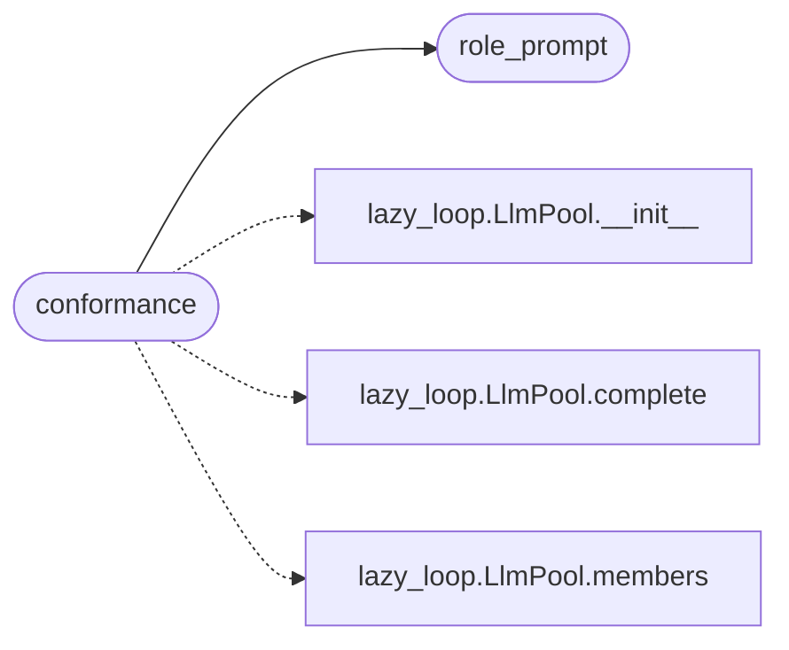

# `modules.lazy_roles`

> Source: [modules/lazy_roles.py:1](../../modules/lazy_roles.py#L1) | language `py` | coverage 100.0% | [API index](../index.md)

Lazy specialist roles for the autonomous loop.

Ports the useful half of the multi-agent pattern (dedicated planning,
execution, memory, review and repair perspectives) with Lazy branding and
Lazy execution semantics: roles are prompt perspectives over the existing
`[`LlmPool`](modules.lazy_loop.py.md#llmpool)`, not separate services. Workers keep executing real Lazy shell
commands through the Guard; a role only shapes what the model proposes.

Stdlib only.

## Contents

- **Functions:** [`list_roles`](#list_roles), [`role_prompt`](#role_prompt), [`roles_for_phase`](#roles_for_phase), [`conformance`](#conformance)
- **Constants:** [`LAZY_ROLES`](#lazy_roles), [`CONFORMANCE_PROBE`](#conformance_probe), [`CONFORMANCE_FILE`](#conformance_file)

## Call Graph

Solid arrows stay in this module, dashed arrows leave it.



## Functions

<a id="list_roles"></a>

### `list_roles`

`function` | [modules/lazy_roles.py:100](../../modules/lazy_roles.py#L100)

```python
def list_roles() -> list[dict]
```

Return every Lazy role descriptor.

**Returns:** `list[dict]` - List of dicts with name, lane, phases and prompt.

---

<a id="role_prompt"></a>

### `role_prompt`

`function` | [modules/lazy_roles.py:109](../../modules/lazy_roles.py#L109)

```python
def role_prompt(role: str, goal: str = '', context: str = '') -> str
```

Build the system prompt for one role.

**Parameters**

| Name | Type | Default | Description |
|---|---|---|---|
| `role` | `str` |  | Role name from [`LAZY_ROLES`](#lazy_roles). |
| `goal` | `str` | `''` | Current task goal prepended as objective. |
| `context` | `str` | `''` | Optional bounded context appended after the role brief. |

**Returns:** `str` - Full prompt text.

**Raises**

- `KeyError`: Unknown role.

*Called by:* [`conformance`](#conformance)

---

<a id="roles_for_phase"></a>

### `roles_for_phase`

`function` | [modules/lazy_roles.py:134](../../modules/lazy_roles.py#L134)

```python
def roles_for_phase(phase: str) -> list[str]
```

Return role names serving one kill-chain phase.

**Parameters**

| Name | Type | Default | Description |
|---|---|---|---|
| `phase` | `str` |  | Kill-chain phase. |

**Returns:** `list[str]` - Role names in definition order.

---

<a id="conformance"></a>

### `conformance`

`function` | [modules/lazy_roles.py:154](../../modules/lazy_roles.py#L154)

```python
def conformance(role: str = '') -> dict
```

Probe every pool member with role prompts, like provider conformance.

Each member answers the same fixed probe under each role perspective.
Results persist to ``sessions/lazy/llm_conformance.json`` with a
fastest-healthy affinity map (role -> member) the planner can prefer.

**Parameters**

| Name | Type | Default | Description |
|---|---|---|---|
| `role` | `str` | `''` | Single role to probe, or all roles when empty. |

**Returns:** `dict` - Summary with per-member results and affinity. Never raises.

*Calls:* [`LlmPool.__init__`](modules.lazy_loop.py.md#llmpool-__init__), [`LlmPool.complete`](modules.lazy_loop.py.md#llmpool-complete), [`LlmPool.members`](modules.lazy_loop.py.md#llmpool-members), [`role_prompt`](#role_prompt)

---

## Constants

<a id="lazy_roles"></a>

### `LAZY_ROLES`

`constant` | [modules/lazy_roles.py:14](../../modules/lazy_roles.py#L14)

```python
LAZY_ROLES: dict[str, dict]
```

---

<a id="conformance_probe"></a>

### `CONFORMANCE_PROBE`

`constant` | [modules/lazy_roles.py:147](../../modules/lazy_roles.py#L147)

```python
CONFORMANCE_PROBE
```

---

<a id="conformance_file"></a>

### `CONFORMANCE_FILE`

`constant` | [modules/lazy_roles.py:151](../../modules/lazy_roles.py#L151)

```python
CONFORMANCE_FILE = 'llm_conformance.json'
```

---
