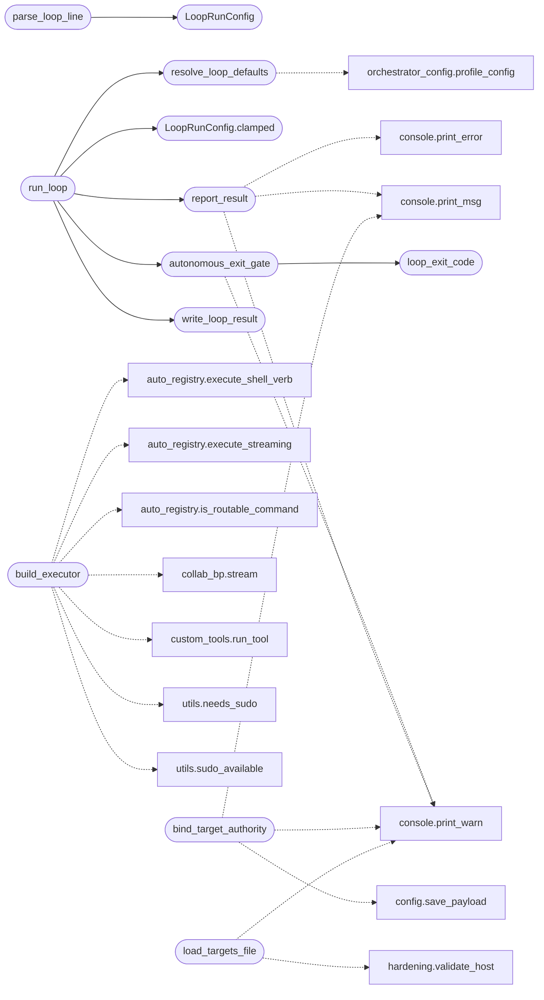

# `modules.lazy_runner`

> Source: [modules/lazy_runner.py:1](../../modules/lazy_runner.py#L1) | language `py` | coverage 100.0% | [API index](../index.md)

Single execution path for ``lazy_loop`` and ``auto_loop``.

Both commands are the same engine by contract; this module owns the one
runner so their behavior cannot drift again. Command sets only parse
arguments into a [`LoopRunConfig`](#looprunconfig) — everything operational lives
here: terminal safety, autonomous prompt suppression, live worker
streaming, the Rich milestone panel, cancellation and the final
summary.

## Contents

- **Classes:** [`LoopRunConfig`](#looprunconfig)
- **Functions:** [`parse_loop_line`](#parse_loop_line), [`resolve_loop_defaults`](#resolve_loop_defaults), [`build_executor`](#build_executor), [`loop_exit_code`](#loop_exit_code), [`autonomous_exit_gate`](#autonomous_exit_gate), [`write_loop_result`](#write_loop_result), [`report_result`](#report_result), [`bind_target_authority`](#bind_target_authority), [`load_targets_file`](#load_targets_file), [`run_loop`](#run_loop)
- **Constants:** [`AUTONOMOUS_ENV`](#autonomous_env), [`LOOP_RESULT_FILENAME`](#loop_result_filename), [`ENGAGEMENT_MODES`](#engagement_modes)

## Call Graph

Solid arrows stay in this module, dashed arrows leave it.



## Classes

<a id="looprunconfig"></a>

### `LoopRunConfig`

`class` `dataclass` | [modules/lazy_runner.py:101](../../modules/lazy_runner.py#L101)

Decorators: `@dataclass`

```python
class LoopRunConfig
```

Everything one loop invocation needs, parsed by the command sets.

**Attributes**

| Name | Type | Default | Description |
|---|---|---|---|
| [`goal`](#looprunconfig-goal) | `str` | `''` |  |
| [`task_id`](#looprunconfig-task_id) | `str` | `''` |  |
| [`target`](#looprunconfig-target) | `str` | `''` |  |
| [`rounds`](#looprunconfig-rounds) | `int` | `DEFAULT_ROUNDS` |  |
| [`workers`](#looprunconfig-workers) | `int` | `DEFAULT_WORKERS` |  |
| [`timeout`](#looprunconfig-timeout) | `float` | `0.0` |  |
| [`step_delay`](#looprunconfig-step_delay) | `float` | `0.0` |  |
| [`sandbox`](#looprunconfig-sandbox) | `str` | `''` |  |
| [`no_bootstrap`](#looprunconfig-no_bootstrap) | `bool` | `False` |  |
| [`progress`](#looprunconfig-progress) | `bool` | `True` |  |
| [`view`](#looprunconfig-view) | `bool` | `False` |  |
| [`verb_timeout`](#looprunconfig-verb_timeout) | `float` | `DEFAULT_VERB_TIMEOUT_SEC` |  |
| [`profile`](#looprunconfig-profile) | `str` | `''` |  |
| [`rounds_set`](#looprunconfig-rounds_set) | `bool` | `True` |  |
| [`workers_set`](#looprunconfig-workers_set) | `bool` | `True` |  |
| [`budget`](#looprunconfig-budget) | `dict` | `field(default_factory=dict)` |  |
| [`budget_confirm`](#looprunconfig-budget_confirm) | `bool` | `False` |  |
| [`phishing_fallback`](#looprunconfig-phishing_fallback) | `bool` | `False` |  |
| [`no_preflight`](#looprunconfig-no_preflight) | `bool` | `False` |  |
| [`audit`](#looprunconfig-audit) | `object` | `field(default=None, compare=False)` |  |
| [`extra`](#looprunconfig-extra) | `dict` | `field(default_factory=dict)` |  |
| [`targets_file`](#looprunconfig-targets_file) | `str` | `''` |  |
| [`max_concurrent`](#looprunconfig-max_concurrent) | `int` | `0` |  |
| [`mode`](#looprunconfig-mode) | `str` | `''` |  |

**Members**

| Member | Kind | Summary |
|---|---|---|
| [`clamped`](#looprunconfig-clamped) | method | Clamp numeric knobs to the supported operating range. |

<a id="looprunconfig-clamped"></a>

#### `LoopRunConfig.clamped`

`method` | [modules/lazy_runner.py:129](../../modules/lazy_runner.py#L129)

```python
def clamped(self) -> LoopRunConfig
```

Clamp numeric knobs to the supported operating range.

**Returns:** `LoopRunConfig`

*Called by:* [`run_loop`](#run_loop)

---

## Functions

<a id="parse_loop_line"></a>

### `parse_loop_line`

`function` | [modules/lazy_runner.py:181](../../modules/lazy_runner.py#L181)

```python
def parse_loop_line(line: str) -> LoopRunConfig
```

Parse one loop command line into a [`LoopRunConfig`](#looprunconfig).

Shared by ``lazy_loop`` and ``auto_loop`` so both accept the exact
same flags and defaults.

**Parameters**

| Name | Type | Default | Description |
|---|---|---|---|
| `line` | `str` |  | Raw command line after the verb. |

**Returns:** `LoopRunConfig` - Parsed configuration.

**Raises**

- `ValueError`: Empty line, unknown flag value or unbalanced quotes.

*Calls:* [`LoopRunConfig`](#looprunconfig)

*Called by:* [`LazyCommandSet.do_lazy_loop`](cli.commands.lazyops.py.md#lazycommandset-do_lazy_loop), [`McpBridgeCommandSet.do_auto_loop`](cli.commands.mcp_bridge.py.md#mcpbridgecommandset-do_auto_loop)

---

<a id="resolve_loop_defaults"></a>

### `resolve_loop_defaults`

`function` | [modules/lazy_runner.py:315](../../modules/lazy_runner.py#L315)

```python
def resolve_loop_defaults(config: LoopRunConfig) -> LoopRunConfig
```

Fill unset rounds and workers from the selected orchestrator profile.

**Parameters**

| Name | Type | Default | Description |
|---|---|---|---|
| `config` | `LoopRunConfig` |  | Parsed invocation; explicit flags stay untouched. |

**Returns:** `LoopRunConfig` - The same configuration with profile defaults applied.

*Calls:* [`profile_config`](modules.orchestrator_config.py.md#profile_config)

*Called by:* [`run_loop`](#run_loop)

---

<a id="build_executor"></a>

### `build_executor`

`function` | [modules/lazy_runner.py:351](../../modules/lazy_runner.py#L351)

```python
def build_executor(shell, config: LoopRunConfig, stream: Callable[[str], None], cancelled: dict, sandbox_task_id: str = '', sandbox_image: str = '', audit=None) -> Callable[[str], str]
```

Build the worker executor: shell verbs, custom tools, safe bash.

Every branch is stdin-detached: shell verbs cannot prompt (input is
suppressed by the autonomous context), custom tools run through the
streaming runner, and raw bash goes through `[`execute_streaming`](modules.auto_registry.py.md#execute_streaming)`
with ``stdin=DEVNULL`` and its own process group so Ctrl+C and time
limits always kill the child, never the operator's terminal.

When ``sandbox_task_id`` is set, routable shell verbs run inside the
per-task Docker container (`[`modules.lazy_sandbox`](modules.lazy_sandbox.py.md)`) instead of the
operator host; custom tools and raw bash stay local.

When `[`audit`](scripts.devtools.command_audit.py.md#audit)` is provided, every dispatched command is recorded in
the loop audit timeline with its duration and outcome.

**Parameters**

| Name | Type | Default | Description |
|---|---|---|---|
| `shell` |  |  |  |
| `config` | `LoopRunConfig` |  |  |
| `stream` | `Callable[[str], None]` |  |  |
| `cancelled` | `dict` |  |  |
| `sandbox_task_id` | `str` | `''` |  |
| `sandbox_image` | `str` | `''` |  |
| `audit` |  | `None` |  |

**Returns:** `Callable[[str], str]`

*Calls:* [`execute_shell_verb`](modules.auto_registry.py.md#execute_shell_verb), [`execute_streaming`](modules.auto_registry.py.md#execute_streaming), [`is_routable_command`](modules.auto_registry.py.md#is_routable_command), [`stream`](modules.collab_bp.py.md#stream), [`run_tool`](modules.custom_tools.py.md#run_tool), [`needs_sudo`](utils.py.md#needs_sudo), [`sudo_available`](utils.py.md#sudo_available)

---

<a id="loop_exit_code"></a>

### `loop_exit_code`

`function` | [modules/lazy_runner.py:572](../../modules/lazy_runner.py#L572)

```python
def loop_exit_code(result: dict) -> int
```

Map one loop summary to an honest process exit code.

A loop that only exhausted its rounds, timed out or stopped in a
handoff is not a success: the dashboard marks loops on exit code, so
this mapping keeps the finished/failed distinction truthful.

**Parameters**

| Name | Type | Default | Description |
|---|---|---|---|
| `result` | `dict` |  | Orchestrator summary. |

**Returns:** `int` - ``0`` only when the engine reached a success status and the
independent verdict did not downgrade it; ``4`` on timeout and
``1`` for every other non-success ending.

*Called by:* [`autonomous_exit_gate`](#autonomous_exit_gate)

---

<a id="autonomous_exit_gate"></a>

### `autonomous_exit_gate`

`function` | [modules/lazy_runner.py:607](../../modules/lazy_runner.py#L607)

```python
def autonomous_exit_gate(result: dict) -> None
```

Convert a non-success loop ending into a non-zero process exit.

Only active under the autonomous environment (C2-managed loop
subprocesses): an interactive shell must survive a finished loop so
the operator keeps working, while a dashboard loop must never look
FINISHED when the goal was not achieved.

**Parameters**

| Name | Type | Default | Description |
|---|---|---|---|
| `result` | `dict` |  | Orchestrator summary. |

**Raises**

- `SystemExit`: When running autonomously and the outcome is not a success.

*Calls:* [`print_warn`](core.console.py.md#print_warn), [`loop_exit_code`](#loop_exit_code)

*Called by:* [`run_loop`](#run_loop)

---

<a id="write_loop_result"></a>

### `write_loop_result`

`function` | [modules/lazy_runner.py:656](../../modules/lazy_runner.py#L656)

```python
def write_loop_result(config: LoopRunConfig, result: dict) -> None
```

Persist the final loop outcome for the dashboard and the operator.

The C2 loop manager cannot read the engine's internal status from a
subprocess; it reads this file instead (workspace of the loop when
running under the dashboard, ``sessions/loop_result_<task>.json``
otherwise). Never raises.

**Parameters**

| Name | Type | Default | Description |
|---|---|---|---|
| `config` | `LoopRunConfig` |  | Parsed run configuration. |
| `result` | `dict` |  | Orchestrator summary. |

*Called by:* [`run_loop`](#run_loop)

---

<a id="report_result"></a>

### `report_result`

`function` | [modules/lazy_runner.py:685](../../modules/lazy_runner.py#L685)

```python
def report_result(result: dict) -> None
```

Print the final outcome of one loop run.

Failed, cancelled or incomplete endings carry a retry offer so the
operator can resume the exact task with user-varied flags, or arm
the elevated ``--sudo`` mode when the failure was a sudo gate. The
durable ledger handoff (states, confirmed evidence, discarded
vectors, next decision) prints when present, and the independent
goal verdict prints whenever the evaluator produced one, so a
finished badge is never the only success claim.

**Parameters**

| Name | Type | Default | Description |
|---|---|---|---|
| `result` | `dict` |  |  |

*Calls:* [`print_error`](core.console.py.md#print_error), [`print_msg`](core.console.py.md#print_msg), [`print_warn`](core.console.py.md#print_warn)

*Called by:* [`run_loop`](#run_loop)

---

<a id="bind_target_authority"></a>

### `bind_target_authority`

`function` | [modules/lazy_runner.py:1186](../../modules/lazy_runner.py#L1186)

```python
def bind_target_authority(shell, targets: list[str]) -> dict
```

Make the run's target(s) authoritative over payload rhost and scope.

The loop binds a target to the task, but offensive verbs and the scope
guard read ``rhost`` and ``scope`` from ``payload.json``. When those
are stale, a run can act against a host the operator never named: a
verb falls back to a stale ``rhost`` or the planner wanders onto a
stale but still-in-scope host. This binds ``rhost`` to the primary
target and replaces the authorized scope with exactly the run's
targets, so the loop can only touch what was requested. Writes go
through the shell's single payload writer; the enforcement posture is
left untouched.

**Parameters**

| Name | Type | Default | Description |
|---|---|---|---|
| `shell` |  |  | The live LazyOwn shell whose params back the payload. |
| `targets` | `list[str]` |  | The validated run target(s); the first is the primary ``rhost`` and the full list becomes the authorized scope. |

**Returns:** `dict` - A summary mapping (``bound``, ``rhost``, ``scope``, and the prior
values) or ``{"bound": False}`` when there is nothing to bind.

*Calls:* [`save_payload`](core.config.py.md#save_payload), [`print_msg`](core.console.py.md#print_msg), [`print_warn`](core.console.py.md#print_warn)

*Called by:* [`LazyCommandSet.do_lazy_loop`](cli.commands.lazyops.py.md#lazycommandset-do_lazy_loop), [`McpBridgeCommandSet.do_auto_loop`](cli.commands.mcp_bridge.py.md#mcpbridgecommandset-do_auto_loop), [`handle`](skills.mcp_tools.auto_loop.py.md#handle)

---

<a id="load_targets_file"></a>

### `load_targets_file`

`function` | [modules/lazy_runner.py:1246](../../modules/lazy_runner.py#L1246)

```python
def load_targets_file(path: str) -> list[str]
```

Read and validate one target per line from a scope file.

Numeric dotted entries must parse as real IPs (``999.999.1.1`` is
rejected even though the hostname regex would accept it); anything
else goes through the shared host policy.

**Parameters**

| Name | Type | Default | Description |
|---|---|---|---|
| `path` | `str` |  | Plain-text file; blank lines and ``#`` comments skipped. |

**Returns:** `list[str]` - Deduplicated valid hosts or CIDR blocks, capped at
``_MAX_BATCH_TARGETS``.

**Raises**

- `ValueError`: Missing file or no valid target inside.

*Calls:* [`print_warn`](core.console.py.md#print_warn), [`validate_host`](core.hardening.py.md#validate_host)

*Called by:* [`LazyCommandSet.do_lazy_loop`](cli.commands.lazyops.py.md#lazycommandset-do_lazy_loop), [`McpBridgeCommandSet.do_auto_loop`](cli.commands.mcp_bridge.py.md#mcpbridgecommandset-do_auto_loop)

---

<a id="run_loop"></a>

### `run_loop`

`function` | [modules/lazy_runner.py:1301](../../modules/lazy_runner.py#L1301)

```python
def run_loop(shell, params: dict, config: LoopRunConfig) -> dict
```

Execute one complete loop run and return its summary.

**Parameters**

| Name | Type | Default | Description |
|---|---|---|---|
| `shell` |  |  | Live LazyOwn shell (workers route verbs through it). |
| `params` | `dict` |  | Payload mapping (proxy/concurrency/verb timeout). |
| `config` | `LoopRunConfig` |  | Parsed command invocation. |

**Returns:** `dict` - Orchestrator summary with ``cancelled``/``error`` keys added.

*Calls:* [`run_monitor_session`](cli.lazy_monitor.py.md#run_monitor_session), [`autonomous_mode`](core.autonomous.py.md#autonomous_mode), [`print_error`](core.console.py.md#print_error), [`print_msg`](core.console.py.md#print_msg), [`print_warn`](core.console.py.md#print_warn), [`TerminalGuard.__init__`](core.terminal_guard.py.md#terminalguard-__init__), [`LazyEngine`](modules.lazy_engine.py.md#lazyengine), [`LazyLoopEngine.apply_profile`](modules.lazy_loop.py.md#lazyloopengine-apply_profile), [`LazyLoopEngine.create_task`](modules.lazy_loop.py.md#lazyloopengine-create_task), [`LazyLoopEngine.ensure_target`](modules.lazy_loop.py.md#lazyloopengine-ensure_target), [`LoopRunConfig.clamped`](#looprunconfig-clamped), [`autonomous_exit_gate`](#autonomous_exit_gate) and 3 more

*Called by:* [`LazyCommandSet.do_lazy_loop`](cli.commands.lazyops.py.md#lazycommandset-do_lazy_loop), [`McpBridgeCommandSet.do_auto_loop`](cli.commands.mcp_bridge.py.md#mcpbridgecommandset-do_auto_loop), [`run`](modules.tools.loop_smoke.py.md#run)

---

## Constants

<a id="autonomous_env"></a>

### `AUTONOMOUS_ENV`

`constant` | [modules/lazy_runner.py:44](../../modules/lazy_runner.py#L44)

```python
AUTONOMOUS_ENV = 'LAZYOWN_AUTONOMOUS'
```

---

<a id="loop_result_filename"></a>

### `LOOP_RESULT_FILENAME`

`constant` | [modules/lazy_runner.py:46](../../modules/lazy_runner.py#L46)

```python
LOOP_RESULT_FILENAME = 'result.json'
```

---

<a id="engagement_modes"></a>

### `ENGAGEMENT_MODES`

`constant` | [modules/lazy_runner.py:161](../../modules/lazy_runner.py#L161)

```python
ENGAGEMENT_MODES = ('pentest', 'redteam', 'ctf')
```

---
