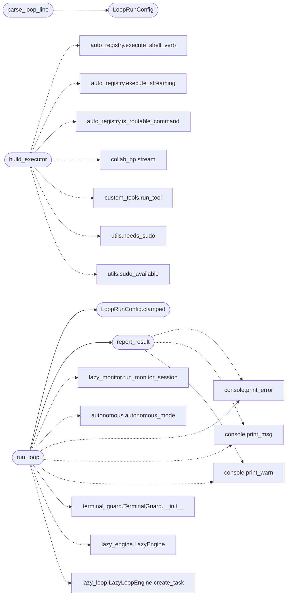

# `modules.lazy_runner`

> Source: [modules/lazy_runner.py:1](../../modules/lazy_runner.py#L1) | language `py` | coverage 100.0% | [API index](../index.md)

Single execution path for ``lazy_loop`` and ``auto_loop``.

Both commands are the same engine by contract; this module owns the one
runner so their behavior cannot drift again. Command sets only parse
arguments into a [`LoopRunConfig`](#looprunconfig) — everything operational lives
here: terminal safety, autonomous prompt suppression, live worker
streaming, the Rich milestone panel, cancellation and the final
summary.

## Contents

- **Classes:** [`LoopRunConfig`](#looprunconfig)
- **Functions:** [`parse_loop_line`](#parse_loop_line), [`build_executor`](#build_executor), [`report_result`](#report_result), [`run_loop`](#run_loop)

## Call Graph

Solid arrows stay in this module, dashed arrows leave it.



## Classes

<a id="looprunconfig"></a>

### `LoopRunConfig`

`class` `dataclass` | [modules/lazy_runner.py:90](../../modules/lazy_runner.py#L90)

Decorators: `@dataclass`

```python
class LoopRunConfig
```

Everything one loop invocation needs, parsed by the command sets.

**Attributes**

| Name | Type | Default | Description |
|---|---|---|---|
| [`goal`](#looprunconfig-goal) | `str` | `''` |  |
| [`task_id`](#looprunconfig-task_id) | `str` | `''` |  |
| [`target`](#looprunconfig-target) | `str` | `''` |  |
| [`rounds`](#looprunconfig-rounds) | `int` | `DEFAULT_ROUNDS` |  |
| [`workers`](#looprunconfig-workers) | `int` | `DEFAULT_WORKERS` |  |
| [`timeout`](#looprunconfig-timeout) | `float` | `0.0` |  |
| [`step_delay`](#looprunconfig-step_delay) | `float` | `0.0` |  |
| [`no_bootstrap`](#looprunconfig-no_bootstrap) | `bool` | `False` |  |
| [`progress`](#looprunconfig-progress) | `bool` | `True` |  |
| [`view`](#looprunconfig-view) | `bool` | `False` |  |
| [`verb_timeout`](#looprunconfig-verb_timeout) | `float` | `DEFAULT_VERB_TIMEOUT_SEC` |  |
| [`extra`](#looprunconfig-extra) | `dict` | `field(default_factory=dict)` |  |

**Members**

| Member | Kind | Summary |
|---|---|---|
| [`clamped`](#looprunconfig-clamped) | method | Clamp numeric knobs to the supported operating range. |

<a id="looprunconfig-clamped"></a>

#### `LoopRunConfig.clamped`

`method` | [modules/lazy_runner.py:106](../../modules/lazy_runner.py#L106)

```python
def clamped(self) -> LoopRunConfig
```

Clamp numeric knobs to the supported operating range.

**Returns:** `LoopRunConfig`

*Called by:* [`run_loop`](#run_loop)

---

## Functions

<a id="parse_loop_line"></a>

### `parse_loop_line`

`function` | [modules/lazy_runner.py:136](../../modules/lazy_runner.py#L136)

```python
def parse_loop_line(line: str) -> LoopRunConfig
```

Parse one loop command line into a [`LoopRunConfig`](#looprunconfig).

Shared by ``lazy_loop`` and ``auto_loop`` so both accept the exact
same flags and defaults.

**Parameters**

| Name | Type | Default | Description |
|---|---|---|---|
| `line` | `str` |  | Raw command line after the verb. |

**Returns:** `LoopRunConfig` - Parsed configuration.

**Raises**

- `ValueError`: Empty line, unknown flag value or unbalanced quotes.

*Calls:* [`LoopRunConfig`](#looprunconfig)

*Called by:* [`LazyCommandSet.do_lazy_loop`](cli.commands.lazyops.py.md#lazycommandset-do_lazy_loop), [`McpBridgeCommandSet.do_auto_loop`](cli.commands.mcp_bridge.py.md#mcpbridgecommandset-do_auto_loop)

---

<a id="build_executor"></a>

### `build_executor`

`function` | [modules/lazy_runner.py:213](../../modules/lazy_runner.py#L213)

```python
def build_executor(shell, config: LoopRunConfig, stream: Callable[[str], None], cancelled: dict) -> Callable[[str], str]
```

Build the worker executor: shell verbs, custom tools, safe bash.

Every branch is stdin-detached: shell verbs cannot prompt (input is
suppressed by the autonomous context), custom tools run through the
streaming runner, and raw bash goes through `[`execute_streaming`](modules.auto_registry.py.md#execute_streaming)`
with ``stdin=DEVNULL`` and its own process group so Ctrl+C and time
limits always kill the child, never the operator's terminal.

**Parameters**

| Name | Type | Default | Description |
|---|---|---|---|
| `shell` |  |  |  |
| `config` | `LoopRunConfig` |  |  |
| `stream` | `Callable[[str], None]` |  |  |
| `cancelled` | `dict` |  |  |

**Returns:** `Callable[[str], str]`

*Calls:* [`execute_shell_verb`](modules.auto_registry.py.md#execute_shell_verb), [`execute_streaming`](modules.auto_registry.py.md#execute_streaming), [`is_routable_command`](modules.auto_registry.py.md#is_routable_command), [`stream`](modules.collab_bp.py.md#stream), [`run_tool`](modules.custom_tools.py.md#run_tool), [`needs_sudo`](utils.py.md#needs_sudo), [`sudo_available`](utils.py.md#sudo_available)

---

<a id="report_result"></a>

### `report_result`

`function` | [modules/lazy_runner.py:329](../../modules/lazy_runner.py#L329)

```python
def report_result(result: dict) -> None
```

Print the final outcome of one loop run.

**Parameters**

| Name | Type | Default | Description |
|---|---|---|---|
| `result` | `dict` |  |  |

*Calls:* [`print_error`](core.console.py.md#print_error), [`print_msg`](core.console.py.md#print_msg), [`print_warn`](core.console.py.md#print_warn)

*Called by:* [`run_loop`](#run_loop)

---

<a id="run_loop"></a>

### `run_loop`

`function` | [modules/lazy_runner.py:640](../../modules/lazy_runner.py#L640)

```python
def run_loop(shell, params: dict, config: LoopRunConfig) -> dict
```

Execute one complete loop run and return its summary.

**Parameters**

| Name | Type | Default | Description |
|---|---|---|---|
| `shell` |  |  | Live LazyOwn shell (workers route verbs through it). |
| `params` | `dict` |  | Payload mapping (proxy/concurrency/verb timeout). |
| `config` | `LoopRunConfig` |  | Parsed command invocation. |

**Returns:** `dict` - Orchestrator summary with ``cancelled``/``error`` keys added.

*Calls:* [`run_monitor_session`](cli.lazy_monitor.py.md#run_monitor_session), [`autonomous_mode`](core.autonomous.py.md#autonomous_mode), [`print_error`](core.console.py.md#print_error), [`print_msg`](core.console.py.md#print_msg), [`print_warn`](core.console.py.md#print_warn), [`TerminalGuard.__init__`](core.terminal_guard.py.md#terminalguard-__init__), [`LazyEngine`](modules.lazy_engine.py.md#lazyengine), [`LazyLoopEngine.create_task`](modules.lazy_loop.py.md#lazyloopengine-create_task), [`LoopRunConfig.clamped`](#looprunconfig-clamped), [`report_result`](#report_result)

*Called by:* [`LazyCommandSet.do_lazy_loop`](cli.commands.lazyops.py.md#lazycommandset-do_lazy_loop), [`McpBridgeCommandSet.do_auto_loop`](cli.commands.mcp_bridge.py.md#mcpbridgecommandset-do_auto_loop), [`run`](modules.tools.loop_smoke.py.md#run)

---
