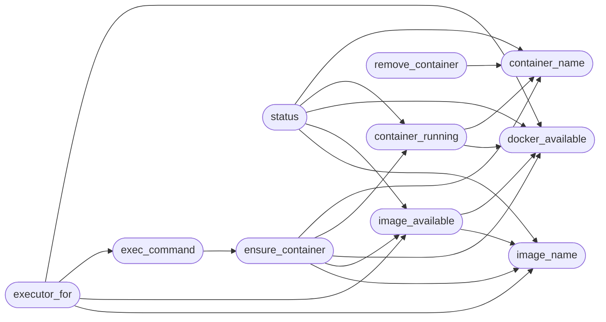

# `modules.lazy_sandbox`

> Source: [modules/lazy_sandbox.py:1](../../modules/lazy_sandbox.py#L1) | language `py` | coverage 100.0% | [API index](../index.md)

Per-task Docker sandbox for the Lazy autonomous loop.

Ports the per-flow container idea with Lazy semantics: one container per
loop task, built from the existing ``Dockerfile.sandbox`` image
(``lazyown-sandbox`` by default, the same tag ``./run`` uses), with the
repository mounted at ``/app`` exactly like the documented sandbox usage.
Workers keep issuing Lazy shell verbs; the sandbox executor pipes each
verb into the in-container shell over stdin (``<verb>`` + ``exit``) and
captures the cleaned output, so Guard, scope, traffic and intel see the
same transcript shape as host execution.

Safety profile: no privileged flag, all capabilities dropped except
``NET_RAW`` (nmap needs raw sockets), memory/CPU caps, operator-owned
network selection. The image is never auto-built inside a round (a build
takes minutes and would wedge the loop); a missing image returns a
capability-style error the worker records as a fact.

Stdlib only. All Docker interaction goes through the ``docker`` CLI so no
SDK dependency is needed.

## Contents

- **Functions:** [`image_name`](#image_name), [`container_name`](#container_name), [`docker_available`](#docker_available), [`image_available`](#image_available), [`container_running`](#container_running), [`ensure_container`](#ensure_container), [`exec_command`](#exec_command), [`remove_container`](#remove_container), [`status`](#status), [`executor_for`](#executor_for)

## Call Graph

Solid arrows stay in this module, dashed arrows leave it.



## Functions

<a id="image_name"></a>

### `image_name`

`function` | [modules/lazy_sandbox.py:52](../../modules/lazy_sandbox.py#L52)

```python
def image_name(configured: str = '') -> str
```

Resolve the sandbox image name.

**Parameters**

| Name | Type | Default | Description |
|---|---|---|---|
| `configured` | `str` | `''` | Explicit image from the ``--sandbox`` flag. |

**Returns:** `str` - Explicit image, payload ``sandbox_image`` override, or default.

*Called by:* [`LazyCommandSet.do_lazy_sandbox`](cli.commands.lazyops.py.md#lazycommandset-do_lazy_sandbox), [`ensure_container`](#ensure_container), [`executor_for`](#executor_for), [`image_available`](#image_available), [`status`](#status)

---

<a id="container_name"></a>

### `container_name`

`function` | [modules/lazy_sandbox.py:67](../../modules/lazy_sandbox.py#L67)

```python
def container_name(task_id: str) -> str
```

Return the deterministic container name for one task.

**Parameters**

| Name | Type | Default | Description |
|---|---|---|---|
| `task_id` | `str` |  |  |

**Returns:** `str`

*Called by:* [`LazyCommandSet.do_lazy_sandbox`](cli.commands.lazyops.py.md#lazycommandset-do_lazy_sandbox), [`container_running`](#container_running), [`ensure_container`](#ensure_container), [`remove_container`](#remove_container), [`status`](#status)

---

<a id="docker_available"></a>

### `docker_available`

`function` | [modules/lazy_sandbox.py:73](../../modules/lazy_sandbox.py#L73)

```python
def docker_available() -> bool
```

Return True when the docker CLI is on PATH.

**Returns:** `bool`

*Called by:* [`container_running`](#container_running), [`ensure_container`](#ensure_container), [`executor_for`](#executor_for), [`image_available`](#image_available), [`status`](#status)

---

<a id="image_available"></a>

### `image_available`

`function` | [modules/lazy_sandbox.py:78](../../modules/lazy_sandbox.py#L78)

```python
def image_available(image: str = '') -> bool
```

Return True when the sandbox image exists locally.

**Parameters**

| Name | Type | Default | Description |
|---|---|---|---|
| `image` | `str` | `''` |  |

**Returns:** `bool`

*Calls:* [`docker_available`](#docker_available), [`image_name`](#image_name)

*Called by:* [`ensure_container`](#ensure_container), [`executor_for`](#executor_for), [`status`](#status)

---

<a id="container_running"></a>

### `container_running`

`function` | [modules/lazy_sandbox.py:94](../../modules/lazy_sandbox.py#L94)

```python
def container_running(task_id: str) -> str
```

Return the container name when it is up, else empty string.

**Parameters**

| Name | Type | Default | Description |
|---|---|---|---|
| `task_id` | `str` |  |  |

**Returns:** `str`

*Calls:* [`container_name`](#container_name), [`docker_available`](#docker_available)

*Called by:* [`ensure_container`](#ensure_container), [`status`](#status)

---

<a id="ensure_container"></a>

### `ensure_container`

`function` | [modules/lazy_sandbox.py:112](../../modules/lazy_sandbox.py#L112)

```python
def ensure_container(task_id: str, image: str = '') -> str
```

Start the per-task container when needed, return its name or error.

**Parameters**

| Name | Type | Default | Description |
|---|---|---|---|
| `task_id` | `str` |  | Loop task identifier. |
| `image` | `str` | `''` | Explicit image override. |

**Returns:** `str` - Container name on success, ``execution failed: ...`` otherwise.

*Calls:* [`container_name`](#container_name), [`container_running`](#container_running), [`docker_available`](#docker_available), [`image_available`](#image_available), [`image_name`](#image_name)

*Called by:* [`LazyCommandSet.do_lazy_sandbox`](cli.commands.lazyops.py.md#lazycommandset-do_lazy_sandbox), [`exec_command`](#exec_command)

---

<a id="exec_command"></a>

### `exec_command`

`function` | [modules/lazy_sandbox.py:180](../../modules/lazy_sandbox.py#L180)

```python
def exec_command(task_id: str, command: str, timeout_sec: float = 0.0, image: str = '') -> str
```

Run one Lazy shell verb inside the task container.

**Parameters**

| Name | Type | Default | Description |
|---|---|---|---|
| `task_id` | `str` |  | Loop task identifier. |
| `command` | `str` |  | Lazy shell verb line. |
| `timeout_sec` | `float` | `0.0` | Hard timeout for the exec. |
| `image` | `str` | `''` | Explicit image override. |

**Returns:** `str` - Cleaned shell output, timeout notice with partial tail, or error.

*Calls:* [`ensure_container`](#ensure_container)

*Called by:* [`LazyCommandSet.do_lazy_sandbox`](cli.commands.lazyops.py.md#lazycommandset-do_lazy_sandbox), [`executor_for`](#executor_for)

---

<a id="remove_container"></a>

### `remove_container`

`function` | [modules/lazy_sandbox.py:214](../../modules/lazy_sandbox.py#L214)

```python
def remove_container(task_id: str) -> bool
```

Stop and remove the task container.

Never raises.

**Parameters**

| Name | Type | Default | Description |
|---|---|---|---|
| `task_id` | `str` |  |  |

**Returns:** `bool`

*Calls:* [`container_name`](#container_name)

*Called by:* [`LazyCommandSet.do_lazy_sandbox`](cli.commands.lazyops.py.md#lazycommandset-do_lazy_sandbox)

---

<a id="status"></a>

### `status`

`function` | [modules/lazy_sandbox.py:223](../../modules/lazy_sandbox.py#L223)

```python
def status(task_id: str = '') -> dict
```

Describe sandbox readiness and containers.

**Parameters**

| Name | Type | Default | Description |
|---|---|---|---|
| `task_id` | `str` | `''` | Optional task to inspect. |

**Returns:** `dict` - Readiness dict with docker, image and container state.

*Calls:* [`container_name`](#container_name), [`container_running`](#container_running), [`docker_available`](#docker_available), [`image_available`](#image_available), [`image_name`](#image_name)

---

<a id="executor_for"></a>

### `executor_for`

`function` | [modules/lazy_sandbox.py:251](../../modules/lazy_sandbox.py#L251)

```python
def executor_for(task_id: str, image: str = '')
```

Build a worker executor routing shell verbs into the sandbox.

**Parameters**

| Name | Type | Default | Description |
|---|---|---|---|
| `task_id` | `str` |  | Loop task identifier bound to one container. |
| `image` | `str` | `''` | Explicit image override from ``--sandbox``. |

**Returns:** Executor callable, or None when Docker is unusable (caller keeps
host execution and the worker records the gap as usual).

*Calls:* [`docker_available`](#docker_available), [`exec_command`](#exec_command), [`image_available`](#image_available), [`image_name`](#image_name)

---
