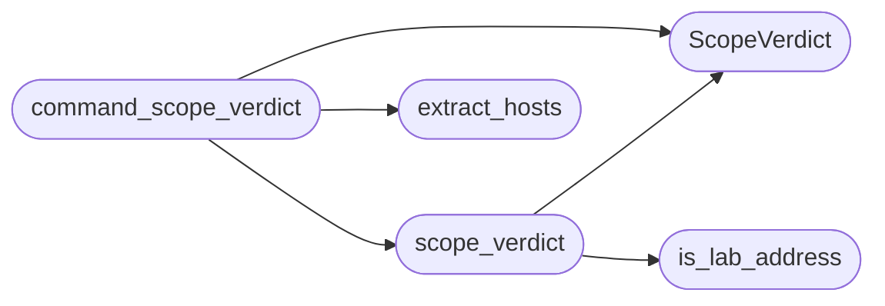

# `modules.lazy_scope`

> Source: [modules/lazy_scope.py:1](../../modules/lazy_scope.py#L1) | language `py` | coverage 100.0% | [API index](../index.md)

Lab-only default scope for autonomous loop targets.

When no explicit task scope is configured the autonomous loop must never
touch public infrastructure. This module decides whether a target is a
local lab address: loopback, RFC1918 IPv4, link-local, unique-local or
loopback IPv6, or a hostname whose every resolved address is lab-local.
Operators can extend the lab set with an explicit allowlist file.

**Returns:** None.

**Raises**

- `None.`

## Contents

- **Classes:** [`ScopeVerdict`](#scopeverdict)
- **Functions:** [`is_lab_address`](#is_lab_address), [`extract_hosts`](#extract_hosts), [`resolve_addresses`](#resolve_addresses), [`read_allowlist`](#read_allowlist), [`scope_verdict`](#scope_verdict), [`command_scope_verdict`](#command_scope_verdict)
- **Constants:** [`LAB_DEFAULT_ENABLED`](#lab_default_enabled), [`LAB_RESOLVE_TIMEOUT_SEC`](#lab_resolve_timeout_sec), [`LAB_RESOLVE_TTL_SEC`](#lab_resolve_ttl_sec), [`ALLOWLIST_FILENAME`](#allowlist_filename)

## Call Graph

Solid arrows stay in this module, dashed arrows leave it.



## Classes

<a id="scopeverdict"></a>

### `ScopeVerdict`

`class` `dataclass` | [modules/lazy_scope.py:49](../../modules/lazy_scope.py#L49)

Decorators: `@dataclass(frozen=True)`

```python
class ScopeVerdict
```

Outcome of a lab-scope check for one target.

**Attributes**

| Name | Type | Default | Description |
|---|---|---|---|
| [`allowed`](#scopeverdict-allowed) | `bool` |  | True when the target may be touched. |
| [`reason`](#scopeverdict-reason) | `str` | `''` | Machine-readable denial kind or "" when allowed. |
| [`detail`](#scopeverdict-detail) | `str` | `''` | Human-readable explanation for the audit trail. |

---

## Functions

<a id="is_lab_address"></a>

### `is_lab_address`

`function` | [modules/lazy_scope.py:104](../../modules/lazy_scope.py#L104)

```python
def is_lab_address(address: str) -> bool
```

Classify one address as lab-local.

**Parameters**

| Name | Type | Default | Description |
|---|---|---|---|
| `address` | `str` |  | IPv4 or IPv6 literal. |

**Returns:** `bool` - True for loopback, RFC1918, link-local or unique-local addresses.

*Called by:* [`scope_verdict`](#scope_verdict)

---

<a id="extract_hosts"></a>

### `extract_hosts`

`function` | [modules/lazy_scope.py:129](../../modules/lazy_scope.py#L129)

```python
def extract_hosts(text: str) -> list[str]
```

Pull IP literals and plausible hostnames out of free text.

**Parameters**

| Name | Type | Default | Description |
|---|---|---|---|
| `text` | `str` |  | Command line, intent text or tool arguments. |

**Returns:** `list[str]` - Unique candidate hosts in first-seen order, capped.

*Called by:* [`command_scope_verdict`](#command_scope_verdict)

---

<a id="resolve_addresses"></a>

### `resolve_addresses`

`function` | [modules/lazy_scope.py:163](../../modules/lazy_scope.py#L163)

```python
def resolve_addresses(name: str, now: float | None = None) -> tuple[str, ...]
```

Resolve a hostname to all of its addresses.

**Parameters**

| Name | Type | Default | Description |
|---|---|---|---|
| `name` | `str` |  | Hostname to resolve. |
| `now` | `float \| None` | `None` | Optional monotonic timestamp override (tests). |

**Returns:** `tuple[str, ...]` - Tuple of address strings; empty when resolution fails or the
name is an address literal already.

---

<a id="read_allowlist"></a>

### `read_allowlist`

`function` | [modules/lazy_scope.py:208](../../modules/lazy_scope.py#L208)

```python
def read_allowlist(sessions_dir: str | Path = 'sessions') -> frozenset[str]
```

Load operator-approved extra lab hosts.

**Parameters**

| Name | Type | Default | Description |
|---|---|---|---|
| `sessions_dir` | `str \| Path` | `'sessions'` | Directory holding ``scope_allow.txt``. |

**Returns:** `frozenset[str]` - Frozenset of lowercase host entries; comments and blanks skipped.

---

<a id="scope_verdict"></a>

### `scope_verdict`

`function` | [modules/lazy_scope.py:229](../../modules/lazy_scope.py#L229)

```python
def scope_verdict(target: str, resolver=resolve_addresses, allowlist: frozenset[str] | None = None) -> ScopeVerdict
```

Decide whether one target is inside the default lab scope.

Address literals are classified directly; hostnames must resolve and
every answer must be lab-local. Unresolvable names are denied.

**Parameters**

| Name | Type | Default | Description |
|---|---|---|---|
| `target` | `str` |  | Host or IP the loop wants to touch. |
| `resolver` |  | `resolve_addresses` | Address resolver (injectable for tests). |
| `allowlist` | `frozenset[str] \| None` | `None` | Extra operator-approved lab hosts. |

**Returns:** `ScopeVerdict` - ScopeVerdict with allowed flag, denial kind and detail.

*Calls:* [`ScopeVerdict`](#scopeverdict), [`is_lab_address`](#is_lab_address)

*Called by:* [`command_scope_verdict`](#command_scope_verdict)

---

<a id="command_scope_verdict"></a>

### `command_scope_verdict`

`function` | [modules/lazy_scope.py:270](../../modules/lazy_scope.py#L270)

```python
def command_scope_verdict(command: str, resolver=resolve_addresses, allowlist: frozenset[str] | None = None) -> ScopeVerdict
```

Check every host mentioned in a command line.

**Parameters**

| Name | Type | Default | Description |
|---|---|---|---|
| `command` | `str` |  | Full command string about to execute. |
| `resolver` |  | `resolve_addresses` | Address resolver (injectable for tests). |
| `allowlist` | `frozenset[str] \| None` | `None` | Extra operator-approved lab hosts. |

**Returns:** `ScopeVerdict` - Verdict for the first offending host, or an allowed verdict when
every extracted host passes.

*Calls:* [`ScopeVerdict`](#scopeverdict), [`extract_hosts`](#extract_hosts), [`scope_verdict`](#scope_verdict)

---

## Constants

<a id="lab_default_enabled"></a>

### `LAB_DEFAULT_ENABLED`

`constant` | [modules/lazy_scope.py:27](../../modules/lazy_scope.py#L27)

```python
LAB_DEFAULT_ENABLED = True
```

---

<a id="lab_resolve_timeout_sec"></a>

### `LAB_RESOLVE_TIMEOUT_SEC`

`constant` | [modules/lazy_scope.py:28](../../modules/lazy_scope.py#L28)

```python
LAB_RESOLVE_TIMEOUT_SEC = 2.0
```

---

<a id="lab_resolve_ttl_sec"></a>

### `LAB_RESOLVE_TTL_SEC`

`constant` | [modules/lazy_scope.py:29](../../modules/lazy_scope.py#L29)

```python
LAB_RESOLVE_TTL_SEC = 300.0
```

---

<a id="allowlist_filename"></a>

### `ALLOWLIST_FILENAME`

`constant` | [modules/lazy_scope.py:31](../../modules/lazy_scope.py#L31)

```python
ALLOWLIST_FILENAME = 'scope_allow.txt'
```

---
