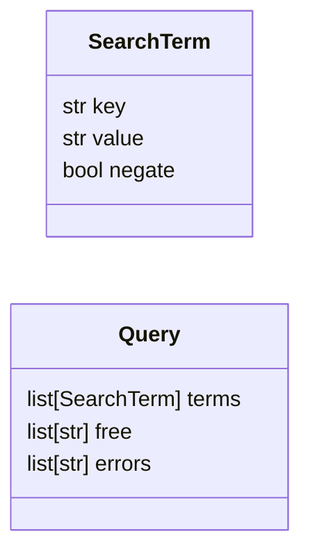
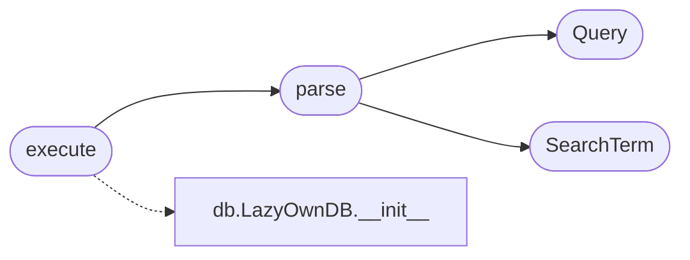

# `modules.lazy_search`

> Source: [modules/lazy_search.py:1](../../modules/lazy_search.py#L1) | language `py` | coverage 100.0% | [API index](../index.md)

Lazy saved-search grammar over the engagement database.

A Shodan-lite query language over [`modules.db`](modules.db.py.md): ``key:value`` clamps
with ``-key:value`` exclusions and bare free words, all AND-combined:

    port:3389 -host:vpn tech:"apache tomcat" sev:high

Spot keys (aliases included): ``host``/``ip``, ``port``, ``service``,
``product``/``tech``, ``version``, ``os``, ``state``, ``sev``/``severity``,
`[`cve`](lazyc2.py.md#cve)`, ``user``. Untagged words search host address, service name,
product text and vulnerability name together.

Rows come from the workspace's hosts/services/vulns/creds through the
public `[`LazyOwnDB`](modules.db.py.md#lazyowndb)` API, so permissions and the workspace contract stay
inside the database layer.

## Contents

- **Classes:** [`SearchTerm`](#searchterm), [`Query`](#query)
- **Functions:** [`parse`](#parse), [`execute`](#execute)
- **Constants:** [`KEY_ALIASES`](#key_aliases), [`SEVERITY_SYNONYMS`](#severity_synonyms)

## Type Diagram



## Call Graph

Solid arrows stay in this module, dashed arrows leave it.



## Classes

<a id="searchterm"></a>

### `SearchTerm`

`class` `dataclass` | [modules/lazy_search.py:65](../../modules/lazy_search.py#L65)

Decorators: `@dataclass`

```python
class SearchTerm
```

One comparison clamp from the grammar.

**Attributes**

| Name | Type | Default | Description |
|---|---|---|---|
| [`key`](#searchterm-key) | `str` | `''` | Spot-key name (post-alias resolution) or empty for free text. |
| [`value`](#searchterm-value) | `str` | `''` | Lowercased comparison value. |
| [`negate`](#searchterm-negate) | `bool` | `False` | True when the term must NOT match. |

---

<a id="query"></a>

### `Query`

`class` `dataclass` | [modules/lazy_search.py:80](../../modules/lazy_search.py#L80)

Decorators: `@dataclass`

```python
class Query
```

A parsed search expression.

**Attributes**

| Name | Type | Default | Description |
|---|---|---|---|
| [`terms`](#query-terms) | `list[SearchTerm]` | `field(default_factory=list)` | Spot-key clamps. |
| [`free`](#query-free) | `list[str]` | `field(default_factory=list)` | Bare words matching any searchable text column. |
| [`errors`](#query-errors) | `list[str]` | `field(default_factory=list)` | Parse problems when the grammar was violated. |

---

## Functions

<a id="parse"></a>

### `parse`

`function` | [modules/lazy_search.py:94](../../modules/lazy_search.py#L94)

```python
def parse(query: str) -> Query
```

Parse the grammar tokens.

**Parameters**

| Name | Type | Default | Description |
|---|---|---|---|
| `query` | `str` |  | Raw query line, e.g. ``port:3389 -host:vpn tech:"apache"``. |

**Returns:** `Query` - A [`Query`](#query); unknown spot keys become `[`errors`](#query-errors)` entries and
the term is dropped, so a typo never silently changes the answer.

*Calls:* [`Query`](#query), [`SearchTerm`](#searchterm)

*Called by:* [`execute`](#execute)

---

<a id="execute"></a>

### `execute`

`function` | [modules/lazy_search.py:132](../../modules/lazy_search.py#L132)

```python
def execute(db: LazyOwnDB | None, query: str, workspace_name: str = 'default', db_path: str | None = None) -> dict
```

Run a parsed query against the engagement database.

**Parameters**

| Name | Type | Default | Description |
|---|---|---|---|
| `db` | `LazyOwnDB \| None` |  | Open `[`LazyOwnDB`](modules.db.py.md#lazyowndb)`; when None a fresh handle over `[`db_path`](modules.db.py.md#lazyowndb-db_path)` (or the default store) is used and closed afterward. |
| `query` | `str` |  | Raw grammar string (parsed here). |
| `workspace_name` | `str` | `'default'` | Workspace to search. |
| `db_path` | `str \| None` | `None` | Optional database path used when `[`db`](modules.state_manager.py.md#statemanager-db)` is None. |

**Returns:** `dict` - ``{"hosts": [...], "services": [...], "vulns": [...], "creds": [...],
"errors": [...]}`` with matched rows only (services carry their
host's address, vulns and creds are already host-joined).

*Calls:* [`LazyOwnDB.__init__`](modules.db.py.md#lazyowndb-__init__), [`parse`](#parse)

---

## Constants

<a id="key_aliases"></a>

### `KEY_ALIASES`

`constant` | [modules/lazy_search.py:36](../../modules/lazy_search.py#L36)

```python
KEY_ALIASES
```

---

<a id="severity_synonyms"></a>

### `SEVERITY_SYNONYMS`

`constant` | [modules/lazy_search.py:53](../../modules/lazy_search.py#L53)

```python
SEVERITY_SYNONYMS
```

---
