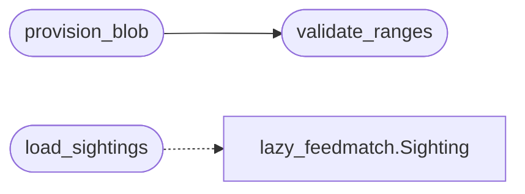

# `modules.lazy_sentinel`

> Source: [modules/lazy_sentinel.py:1](../../modules/lazy_sentinel.py#L1) | language `py` | coverage 100.0% | [API index](../index.md)

Internal-network sentinel for LazyOwn.

Turns the C2 beacon fleet into scan probes. One self-contained, copy-paste
``sh`` blob does the discovery and version sweep from inside the private
network, spools a grepable nmap artefact plus a done marker, and everything
an operator or a beacon session has to do is paste the one-liner. The
`[`ingest`](modules.lesson_ingestor.py.md#lessoningestor-ingest)` side parses the spool back into [`Sighting`](modules.lazy_feedmatch.py.md#sighting) rows so the
feed matcher, the exposure report and autofire all see inside-out evidence
without leaving this contract.

Guards: only private, bounded CIDR ranges (no loopback, link-local,
multicast or cloud-metadata addresses, no range wider than
[`MAX_RANGE_HOSTS`](#max_range_hosts) hosts), and every blob is read-only.

## Contents

- **Functions:** [`ingest_spool`](#ingest_spool), [`validate_ranges`](#validate_ranges), [`provision_blob`](#provision_blob), [`dispatch_line`](#dispatch_line), [`save_sightings`](#save_sightings), [`load_sightings`](#load_sightings)
- **Constants:** [`SPOOL_DIR`](#spool_dir), [`DONE_MARK`](#done_mark), [`MAX_RANGE_HOSTS`](#max_range_hosts), [`MAX_RANGES`](#max_ranges)

## Call Graph

Solid arrows stay in this module, dashed arrows leave it.



## Functions

<a id="ingest_spool"></a>

### `ingest_spool`

`function` | [modules/lazy_sentinel.py:45](../../modules/lazy_sentinel.py#L45)

```python
def ingest_spool(path: str | Path) -> dict
```

Parse a sentinel spool artefact back into queryable sightings.

Accepts the nmap grepable format (``-oG``) and a plain
``ip<TAB>port<TAB>product<TAB>version`` fallback.

**Parameters**

| Name | Type | Default | Description |
|---|---|---|---|
| `path` | `str \| Path` |  | Local path of the copied spool artefact. |

**Returns:** `dict` - ``{"hosts": [{"ip", "services": [{"port", "product", "version"}]}],
"sightings": [Sighting]}``; errors never raise, a bad file simply
yields an empty result.

---

<a id="validate_ranges"></a>

### `validate_ranges`

`function` | [modules/lazy_sentinel.py:123](../../modules/lazy_sentinel.py#L123)

```python
def validate_ranges(ranges: list[str]) -> list[str]
```

Reject unbounded or non-private targets for the sentinel blob.

**Parameters**

| Name | Type | Default | Description |
|---|---|---|---|
| `ranges` | `list[str]` |  | CIDR strings proposed for an internal sweep. |

**Returns:** `list[str]` - One error message per rejected range, empty when all pass.

*Called by:* [`provision_blob`](#provision_blob)

---

<a id="provision_blob"></a>

### `provision_blob`

`function` | [modules/lazy_sentinel.py:152](../../modules/lazy_sentinel.py#L152)

```python
def provision_blob(ranges: list[str], spool_path: str | Path | None = None, spool_dir: str | Path | None = None) -> dict
```

Build the copy-paste sentinel sweep blob.

**Parameters**

| Name | Type | Default | Description |
|---|---|---|---|
| `ranges` | `list[str]` |  | Private CIDR strings, validated first. |
| `spool_path` | `str \| Path \| None` | `None` | Optional spool file override inside the target. |
| `spool_dir` | `str \| Path \| None` | `None` | Optional local directory override for the id records. |

**Returns:** `dict` - ``{"id", "ranges", "spool_path", "script", "oneliner", "errors"}``
where ``errors`` is empty only on success. Never executes anything.

*Calls:* [`validate_ranges`](#validate_ranges)

---

<a id="dispatch_line"></a>

### `dispatch_line`

`function` | [modules/lazy_sentinel.py:203](../../modules/lazy_sentinel.py#L203)

```python
def dispatch_line(client_id: str, blob: dict) -> str
```

Render the ``c2_exec`` line that runs the blob through one beacon.

**Parameters**

| Name | Type | Default | Description |
|---|---|---|---|
| `client_id` | `str` |  | Validated beacon client identifier. |
| `blob` | `dict` |  | Provision result from [`provision_blob`](#provision_blob). |

**Returns:** `str` - A ``c2_exec ... sh -c '<blob>'`` command line.

**Raises**

- `ValueError`: On an empty client id or a failed blob.

---

<a id="save_sightings"></a>

### `save_sightings`

`function` | [modules/lazy_sentinel.py:252](../../modules/lazy_sentinel.py#L252)

```python
def save_sightings(sightings: list[Sighting], path: str | Path | None = None) -> Path | None
```

Persist parsed sightings for the report/check surfaces.

**Parameters**

| Name | Type | Default | Description |
|---|---|---|---|
| `sightings` | `list[Sighting]` |  | Flattened sightings from [`ingest_spool`](#ingest_spool). |
| `path` | `str \| Path \| None` | `None` | Optional output override. |

**Returns:** `Path | None` - The written path or None on failure. Never raises.

---

<a id="load_sightings"></a>

### `load_sightings`

`function` | [modules/lazy_sentinel.py:282](../../modules/lazy_sentinel.py#L282)

```python
def load_sightings(path: str | Path) -> list[Sighting]
```

Reload a previous `[`save_sightings`](#save_sightings)` artefact.

**Parameters**

| Name | Type | Default | Description |
|---|---|---|---|
| `path` | `str \| Path` |  | Artefact written earlier. |

**Returns:** `list[Sighting]` - Sighting rows; empty list on unreadable or malformed input.

*Calls:* [`Sighting`](modules.lazy_feedmatch.py.md#sighting)

---

## Constants

<a id="spool_dir"></a>

### `SPOOL_DIR`

`constant` | [modules/lazy_sentinel.py:30](../../modules/lazy_sentinel.py#L30)

```python
SPOOL_DIR = BASE_DIR / 'sessions' / 'sentinel'
```

---

<a id="done_mark"></a>

### `DONE_MARK`

`constant` | [modules/lazy_sentinel.py:31](../../modules/lazy_sentinel.py#L31)

```python
DONE_MARK = b'SENTINEL_DONE'
```

---

<a id="max_range_hosts"></a>

### `MAX_RANGE_HOSTS`

`constant` | [modules/lazy_sentinel.py:32](../../modules/lazy_sentinel.py#L32)

```python
MAX_RANGE_HOSTS = 256
```

---

<a id="max_ranges"></a>

### `MAX_RANGES`

`constant` | [modules/lazy_sentinel.py:33](../../modules/lazy_sentinel.py#L33)

```python
MAX_RANGES = 8
```

---
