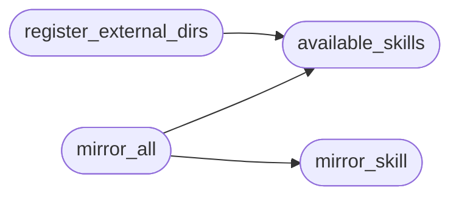

# `modules.lazy_skill_mirror`

> Source: [modules/lazy_skill_mirror.py:1](../../modules/lazy_skill_mirror.py#L1) | language `py` | coverage 100.0% | [API index](../index.md)

Mirror LazyOwn skills for Hermes discovery.

Hermes loads skills from ``~/.hermes/skills/<group>/<name>/SKILL.md``
while opencode reads ``skills/<name>/SKILL.md`` in this repo, so the
two runtimes never share one directory. This module derives thin
Hermes-compatible mirrors under ``skills/<name>/hermes/SKILL.md`` from
the repo frontmatter (name, description, version, author, license) and
registers the parent ``skills/`` tree in the operator's
``~/.hermes/config.yaml`` ``skills.external_dirs`` — the same pattern
opencode uses with its ``skills.paths`` list.

Mirrors only re-target the frontmatter; the body stays byte-identical
so both agents read the same procedure. Never touches the operator's
config without an explicit call; every write backs the file up first.

## Contents

- **Functions:** [`available_skills`](#available_skills), [`mirror_skill`](#mirror_skill), [`mirror_all`](#mirror_all), [`register_external_dirs`](#register_external_dirs)

## Call Graph

Solid arrows stay in this module, dashed arrows leave it.



## Functions

<a id="available_skills"></a>

### `available_skills`

`function` | [modules/lazy_skill_mirror.py:67](../../modules/lazy_skill_mirror.py#L67)

```python
def available_skills() -> list[str]
```

Return repo skill names that ship a SKILL.md.

**Returns:** `list[str]`

*Called by:* [`mirror_all`](#mirror_all), [`register_external_dirs`](#register_external_dirs)

---

<a id="mirror_skill"></a>

### `mirror_skill`

`function` | [modules/lazy_skill_mirror.py:78](../../modules/lazy_skill_mirror.py#L78)

```python
def mirror_skill(name: str) -> dict
```

Write the Hermes mirror of one skill.

**Parameters**

| Name | Type | Default | Description |
|---|---|---|---|
| `name` | `str` |  | Repo skill directory name. |

**Returns:** `dict` - Summary with path and changed flag; never raises.

*Called by:* [`LazyCommandSet.do_lazy_skill`](cli.commands.lazyops.py.md#lazycommandset-do_lazy_skill), [`mirror_all`](#mirror_all)

---

<a id="mirror_all"></a>

### `mirror_all`

`function` | [modules/lazy_skill_mirror.py:106](../../modules/lazy_skill_mirror.py#L106)

```python
def mirror_all() -> dict
```

Mirror every repo skill; return per-skill summaries.

**Returns:** `dict`

*Calls:* [`available_skills`](#available_skills), [`mirror_skill`](#mirror_skill)

*Called by:* [`LazyCommandSet.do_lazy_skill`](cli.commands.lazyops.py.md#lazycommandset-do_lazy_skill)

---

<a id="register_external_dirs"></a>

### `register_external_dirs`

`function` | [modules/lazy_skill_mirror.py:117](../../modules/lazy_skill_mirror.py#L117)

```python
def register_external_dirs() -> dict
```

Register the repo skills tree in the hermes config.

Appends the ``skills/<name>/hermes`` parents to
``skills.external_dirs`` (deduplicated) with a timestamped backup.
Idempotent: a registered tree reports unchanged without writing.

**Returns:** `dict` - Summary with changed flag and backup path; never raises.

*Calls:* [`available_skills`](#available_skills)

*Called by:* [`LazyCommandSet.do_lazy_skill`](cli.commands.lazyops.py.md#lazycommandset-do_lazy_skill)

---
