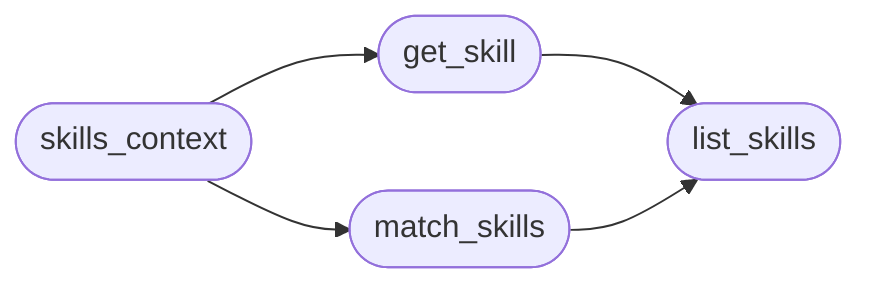

# `modules.lazy_skills`

> Source: [modules/lazy_skills.py:1](../../modules/lazy_skills.py#L1) | language `py` | coverage 100.0% | [API index](../index.md)

Skill context injection for planner/worker prompts.

Scans the repository ``skills/`` tree for SKILL.md documents (and loose
markdown guides), matches them against the task goal with keyword
scoring and feeds bounded excerpts into `build_prompt_context`,
so the autonomous LLM agents inherit operator playbooks without a
separate tool call.

Selection contract:
    ``lazy_skill inject <name> --task T`` pins a skill in the task
    record; auto-matching stays on unless ``lazy_skill auto off``.

## Contents

- **Functions:** [`list_skills`](#list_skills), [`get_skill`](#get_skill), [`match_skills`](#match_skills), [`skills_context`](#skills_context)
- **Constants:** [`SKILLS_DIR`](#skills_dir), [`MAX_SKILLS`](#max_skills), [`EXCERPT_CHARS`](#excerpt_chars)

## Call Graph

Solid arrows stay in this module, dashed arrows leave it.



## Functions

<a id="list_skills"></a>

### `list_skills`

`function` | [modules/lazy_skills.py:85](../../modules/lazy_skills.py#L85)

```python
def list_skills() -> list[dict]
```

Return every parsed skill sorted by name.

**Returns:** `list[dict]`

*Called by:* [`LazyCommandSet.do_lazy_skill`](cli.commands.lazyops.py.md#lazycommandset-do_lazy_skill), [`get_skill`](#get_skill), [`match_skills`](#match_skills)

---

<a id="get_skill"></a>

### `get_skill`

`function` | [modules/lazy_skills.py:91](../../modules/lazy_skills.py#L91)

```python
def get_skill(name: str) -> dict | None
```

Find one skill by exact or case-insensitive name.

**Parameters**

| Name | Type | Default | Description |
|---|---|---|---|
| `name` | `str` |  |  |

**Returns:** `dict | None`

*Calls:* [`list_skills`](#list_skills)

*Called by:* [`LazyCommandSet.do_lazy_skill`](cli.commands.lazyops.py.md#lazycommandset-do_lazy_skill), [`skills_context`](#skills_context)

---

<a id="match_skills"></a>

### `match_skills`

`function` | [modules/lazy_skills.py:102](../../modules/lazy_skills.py#L102)

```python
def match_skills(text: str, limit: int = MAX_SKILLS) -> list[dict]
```

Rank skills whose keywords appear in the text, best first.

**Parameters**

| Name | Type | Default | Description |
|---|---|---|---|
| `text` | `str` |  |  |
| `limit` | `int` | `MAX_SKILLS` |  |

**Returns:** `list[dict]`

*Calls:* [`list_skills`](#list_skills)

*Called by:* [`skills_context`](#skills_context)

---

<a id="skills_context"></a>

### `skills_context`

`function` | [modules/lazy_skills.py:118](../../modules/lazy_skills.py#L118)

```python
def skills_context(text: str = '', explicit: list[str] | None = None, auto: bool = True, budget: int = 800) -> str
```

Render pinned plus auto-matched skills as one prompt section.

**Parameters**

| Name | Type | Default | Description |
|---|---|---|---|
| `text` | `str` | `''` | Goal/intent text used for auto matching. |
| `explicit` | `list[str] \| None` | `None` | Skill names pinned on the task record. |
| `auto` | `bool` | `True` | Whether keyword auto-matching runs. |
| `budget` | `int` | `800` | Max characters of the rendered section. |

**Returns:** `str` - ``Skills: name :: excerpt | ...`` or an empty string.

*Calls:* [`get_skill`](#get_skill), [`match_skills`](#match_skills)

*Called by:* [`LazyCommandSet.do_lazy_skill`](cli.commands.lazyops.py.md#lazycommandset-do_lazy_skill)

---

## Constants

<a id="skills_dir"></a>

### `SKILLS_DIR`

`constant` | [modules/lazy_skills.py:20](../../modules/lazy_skills.py#L20)

```python
SKILLS_DIR = BASE_DIR / 'skills'
```

---

<a id="max_skills"></a>

### `MAX_SKILLS`

`constant` | [modules/lazy_skills.py:21](../../modules/lazy_skills.py#L21)

```python
MAX_SKILLS = 3
```

---

<a id="excerpt_chars"></a>

### `EXCERPT_CHARS`

`constant` | [modules/lazy_skills.py:22](../../modules/lazy_skills.py#L22)

```python
EXCERPT_CHARS = 600
```

---
