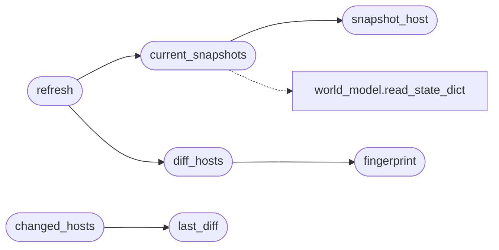

# `modules.lazy_surface_diff`

> Source: [modules/lazy_surface_diff.py:1](../../modules/lazy_surface_diff.py#L1) | language `py` | coverage 100.0% | [API index](../index.md)

Surface snapshot and diff: what changed about a host since last look.

Host/service rows in the world model are rewritten in place by every
scan, so "the previous scan's rows" is not a previous snapshot. Each
host therefore carries its own canonical snapshot; a refresh diffs the
current view against the stored one, appends the differences to a
change log, and replaces the snapshot. Downstream consumers read:

- ``sessions/lazy/surface_state.json`` — snapshot + last diff;
- node markers on the intel/attack graph (`[`changed`](modules.LazyOwnExplorer.py.md#autocompleteentry-changed)` attribute);
- the loop planner (a surface change re-arms discovery intents).

Every evaluator is a pure function so each diff rule is unit-testable
without files. Stdlib only; never raises into the caller.

## Contents

- **Functions:** [`snapshot_host`](#snapshot_host), [`fingerprint`](#fingerprint), [`diff_hosts`](#diff_hosts), [`current_snapshots`](#current_snapshots), [`refresh`](#refresh), [`last_diff`](#last_diff), [`changed_hosts`](#changed_hosts)
- **Constants:** [`STATE_FILENAME`](#state_filename), [`CHANGE_KINDS`](#change_kinds)

## Call Graph

Solid arrows stay in this module, dashed arrows leave it.



## Functions

<a id="snapshot_host"></a>

### `snapshot_host`

`function` | [modules/lazy_surface_diff.py:52](../../modules/lazy_surface_diff.py#L52)

```python
def snapshot_host(host: dict) -> dict
```

Canonical snapshot of one host row.

**Parameters**

| Name | Type | Default | Description |
|---|---|---|---|
| `host` | `dict` |  | World-model host dict with ``services``/``os_hint``. |

**Returns:** `dict` - ``{"ports": {"443/tcp": {service, product, version}}, "os": str}``.
Only open ports count.

*Called by:* [`current_snapshots`](#current_snapshots)

---

<a id="fingerprint"></a>

### `fingerprint`

`function` | [modules/lazy_surface_diff.py:79](../../modules/lazy_surface_diff.py#L79)

```python
def fingerprint(state: dict) -> str
```

Hash of the canonical snapshot; os text normalised case-insensitively.

**Parameters**

| Name | Type | Default | Description |
|---|---|---|---|
| `state` | `dict` |  |  |

**Returns:** `str`

*Called by:* [`diff_hosts`](#diff_hosts)

---

<a id="diff_hosts"></a>

### `diff_hosts`

`function` | [modules/lazy_surface_diff.py:93](../../modules/lazy_surface_diff.py#L93)

```python
def diff_hosts(before: dict, after: dict) -> list[tuple]
```

Pure diff of two host snapshot maps.

**Parameters**

| Name | Type | Default | Description |
|---|---|---|---|
| `before` | `dict` |  | ``{host: snapshot}`` previous state. |
| `after` | `dict` |  | ``{host: snapshot}`` current state. |

**Returns:** `list[tuple]` - List of ``(kind, host, port, detail)`` tuples sorted host/port
first. A host that vanished and came back reads as
``host_returned``; a product appearing where none was recorded
is enrichment, not a change.

*Calls:* [`fingerprint`](#fingerprint)

*Called by:* [`refresh`](#refresh)

---

<a id="current_snapshots"></a>

### `current_snapshots`

`function` | [modules/lazy_surface_diff.py:160](../../modules/lazy_surface_diff.py#L160)

```python
def current_snapshots(world: dict | None = None) -> dict[str, dict]
```

Snapshot every host of the current world model view.

**Parameters**

| Name | Type | Default | Description |
|---|---|---|---|
| `world` | `dict \| None` | `None` | Preloaded world-model dict; read from disk when None. |

**Returns:** `dict[str, dict]` - ``{host: snapshot}``.

*Calls:* [`snapshot_host`](#snapshot_host), [`read_state_dict`](modules.world_model.py.md#read_state_dict)

*Called by:* [`refresh`](#refresh)

---

<a id="refresh"></a>

### `refresh`

`function` | [modules/lazy_surface_diff.py:186](../../modules/lazy_surface_diff.py#L186)

```python
def refresh(world: dict | None = None, sessions_dir: str | Path = SESSIONS_DIR) -> dict
```

Diff the current surface against the stored snapshot and persist.

**Parameters**

| Name | Type | Default | Description |
|---|---|---|---|
| `world` | `dict \| None` | `None` | Optional preloaded world-model dict. |
| `sessions_dir` | `str \| Path` | `SESSIONS_DIR` | Sessions directory holding the state file. |

**Returns:** `dict` - ``{"changes": [...], "added": int, "removed": int, "changed": bool,
"hosts": int, "ts": float}``; empty diff on any error.

*Calls:* [`current_snapshots`](#current_snapshots), [`diff_hosts`](#diff_hosts)

---

<a id="last_diff"></a>

### `last_diff`

`function` | [modules/lazy_surface_diff.py:234](../../modules/lazy_surface_diff.py#L234)

```python
def last_diff(sessions_dir: str | Path = SESSIONS_DIR) -> dict
```

Read the last stored diff without recomputing.

**Parameters**

| Name | Type | Default | Description |
|---|---|---|---|
| `sessions_dir` | `str \| Path` | `SESSIONS_DIR` | Sessions directory holding the state file. |

**Returns:** `dict` - The stored `[`last_diff`](#last_diff)` payload or ``{"changes": []}``.

*Called by:* [`changed_hosts`](#changed_hosts)

---

<a id="changed_hosts"></a>

### `changed_hosts`

`function` | [modules/lazy_surface_diff.py:253](../../modules/lazy_surface_diff.py#L253)

```python
def changed_hosts(limit: int = 100, sessions_dir: str | Path = SESSIONS_DIR) -> list[str]
```

Distinct hosts touched by the last diff, most-recent first.

**Parameters**

| Name | Type | Default | Description |
|---|---|---|---|
| `limit` | `int` | `100` | Row cap. |
| `sessions_dir` | `str \| Path` | `SESSIONS_DIR` | Sessions directory holding the state file. |

**Returns:** `list[str]` - List of host addresses.

*Calls:* [`last_diff`](#last_diff)

---

## Constants

<a id="state_filename"></a>

### `STATE_FILENAME`

`constant` | [modules/lazy_surface_diff.py:26](../../modules/lazy_surface_diff.py#L26)

```python
STATE_FILENAME = 'surface_state.json'
```

---

<a id="change_kinds"></a>

### `CHANGE_KINDS`

`constant` | [modules/lazy_surface_diff.py:40](../../modules/lazy_surface_diff.py#L40)

```python
CHANGE_KINDS
```

---
