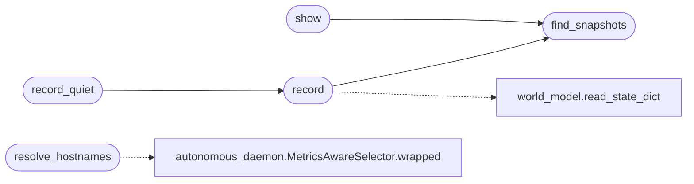

# `modules.lazy_timeline`

> Source: [modules/lazy_timeline.py:1](../../modules/lazy_timeline.py#L1) | language `py` | coverage 100.0% | [API index](../index.md)

Lazy engagement timeline for LazyOwn.

Snapshots the world model between rounds and diffs them: new hosts, gone
hosts, opened ports, closed ports, version changes and state changes.
When a DNS name stops resolving while the host still answers, the diff
flags a zombie host (retired infrastructure that kept serving), which in
an engagement is signal worth reading first.

Snapshots live under ``sessions/timeline/`` with bounded retention.
Stdlib only; every entry point degrades to an empty result on errors.

## Contents

- **Functions:** [`resolve_hostnames`](#resolve_hostnames), [`record`](#record), [`record_quiet`](#record_quiet), [`find_snapshots`](#find_snapshots), [`diff`](#diff), [`show`](#show)
- **Constants:** [`SNAPSHOT_DIR`](#snapshot_dir), [`KEEP_SNAPSHOTS`](#keep_snapshots), [`KIND_HOST_NEW`](#kind_host_new), [`KIND_HOST_GONE`](#kind_host_gone), [`KIND_PORT_OPENED`](#kind_port_opened), [`KIND_PORT_CLOSED`](#kind_port_closed), [`KIND_VERSION_CHANGED`](#kind_version_changed), [`KIND_STATE_CHANGED`](#kind_state_changed), [`RECENT_CHANGE_KINDS`](#recent_change_kinds)

## Call Graph

Solid arrows stay in this module, dashed arrows leave it.



## Functions

<a id="resolve_hostnames"></a>

### `resolve_hostnames`

`function` | [modules/lazy_timeline.py:36](../../modules/lazy_timeline.py#L36)

```python
def resolve_hostnames(names: list[str], resolver=None) -> dict[str, str]
```

Resolve candidate hostnames for the snapshot DNS record.

**Parameters**

| Name | Type | Default | Description |
|---|---|---|---|
| `names` | `list[str]` |  | Hostnames or FQDNs to track. |
| `resolver` |  | `None` | Optional ``name -> ip or ''`` override for tests. |

**Returns:** `dict[str, str]` - ``{name: ip}`` for the names that resolved, empty string entry
for the rest.

*Calls:* [`MetricsAwareSelector.wrapped`](skills.autonomous_daemon.py.md#metricsawareselector-wrapped)

---

<a id="record"></a>

### `record`

`function` | [modules/lazy_timeline.py:66](../../modules/lazy_timeline.py#L66)

```python
def record(state_path: str | Path | None = None, snaps_dir: str | Path | None = None, keep: int = KEEP_SNAPSHOTS, dns: dict[str, str] | None = None) -> dict
```

Snapshot the current world model (internally, never raises).

**Parameters**

| Name | Type | Default | Description |
|---|---|---|---|
| `state_path` | `str \| Path \| None` | `None` | Optional world model state path override. |
| `snaps_dir` | `str \| Path \| None` | `None` | Optional snapshot directory override. |
| `keep` | `int` | `KEEP_SNAPSHOTS` | Maximum snapshots retained (oldest pruned). |
| `dns` | `dict[str, str] \| None` | `None` | Optional ``{name: ip}`` map from [`resolve_hostnames`](#resolve_hostnames). |

**Returns:** `dict` - ``{"path": path written or None, "hosts": n, "dns": recorded map}``;
a dict with a None path records nothing.

*Calls:* [`find_snapshots`](#find_snapshots), [`read_state_dict`](modules.world_model.py.md#read_state_dict)

*Called by:* [`record_quiet`](#record_quiet)

---

<a id="record_quiet"></a>

### `record_quiet`

`function` | [modules/lazy_timeline.py:111](../../modules/lazy_timeline.py#L111)

```python
def record_quiet(state_path: str | Path | None = None, snaps_dir: str | Path | None = None, keep: int = KEEP_SNAPSHOTS, dns: dict[str, str] | None = None) -> dict
```

Snapshot for the autonomous loop: same as record(), never raises.

**Parameters**

| Name | Type | Default | Description |
|---|---|---|---|
| `state_path` | `str \| Path \| None` | `None` | Optional world model state path override. |
| `snaps_dir` | `str \| Path \| None` | `None` | Optional snapshot directory override. |
| `keep` | `int` | `KEEP_SNAPSHOTS` | Maximum snapshots retained (oldest pruned). |
| `dns` | `dict[str, str] \| None` | `None` | Optional ``{name: ip}`` map from [`resolve_hostnames`](#resolve_hostnames). |

**Returns:** `dict` - The [`record`](#record) result dict, or ``{"path": None, "hosts": 0,
"dns": {}}`` when anything failed.

*Calls:* [`record`](#record)

---

<a id="find_snapshots"></a>

### `find_snapshots`

`function` | [modules/lazy_timeline.py:135](../../modules/lazy_timeline.py#L135)

```python
def find_snapshots(snaps_dir: str | Path | None = None) -> list[Path]
```

List snapshot files oldest first.

**Parameters**

| Name | Type | Default | Description |
|---|---|---|---|
| `snaps_dir` | `str \| Path \| None` | `None` | Optional directory override. |

**Returns:** `list[Path]` - Sorted snapshot paths (empty when none).

*Called by:* [`record`](#record), [`show`](#show)

---

<a id="diff"></a>

### `diff`

`function` | [modules/lazy_timeline.py:151](../../modules/lazy_timeline.py#L151)

```python
def diff(_old: dict | Path | str, _new: dict | Path | str) -> dict
```

Diff two world-model snapshots.

**Parameters**

| Name | Type | Default | Description |
|---|---|---|---|
| `_old` | `dict \| Path \| str` |  | Earlier snapshot dict or file path. |
| `_new` | `dict \| Path \| str` |  | Later snapshot dict or file path. |

**Returns:** `dict` - ``{"changes": [{"kind", "host", "port", "detail"}...] (oldest
steady order), "zombies": [ip], "a_ts", "b_ts"}``. Unreadable
inputs degrade to empty results.

---

<a id="show"></a>

### `show`

`function` | [modules/lazy_timeline.py:180](../../modules/lazy_timeline.py#L180)

```python
def show(snaps_dir: str | Path | None = None, last: int = 3) -> list[dict]
```

Summarize the newest snapshots.

**Parameters**

| Name | Type | Default | Description |
|---|---|---|---|
| `snaps_dir` | `str \| Path \| None` | `None` | Optional directory override. |
| `last` | `int` | `3` | How many recent snapshots to summarize. |

**Returns:** `list[dict]` - One summary dict per snapshot: ``{"path", "ts", "hosts", "services"}``.

*Calls:* [`find_snapshots`](#find_snapshots)

---

## Constants

<a id="snapshot_dir"></a>

### `SNAPSHOT_DIR`

`constant` | [modules/lazy_timeline.py:23](../../modules/lazy_timeline.py#L23)

```python
SNAPSHOT_DIR = BASE_DIR / 'sessions' / 'timeline'
```

---

<a id="keep_snapshots"></a>

### `KEEP_SNAPSHOTS`

`constant` | [modules/lazy_timeline.py:24](../../modules/lazy_timeline.py#L24)

```python
KEEP_SNAPSHOTS = 20
```

---

<a id="kind_host_new"></a>

### `KIND_HOST_NEW`

`constant` | [modules/lazy_timeline.py:26](../../modules/lazy_timeline.py#L26)

```python
KIND_HOST_NEW = 'host_new'
```

---

<a id="kind_host_gone"></a>

### `KIND_HOST_GONE`

`constant` | [modules/lazy_timeline.py:27](../../modules/lazy_timeline.py#L27)

```python
KIND_HOST_GONE = 'host_gone'
```

---

<a id="kind_port_opened"></a>

### `KIND_PORT_OPENED`

`constant` | [modules/lazy_timeline.py:28](../../modules/lazy_timeline.py#L28)

```python
KIND_PORT_OPENED = 'port_opened'
```

---

<a id="kind_port_closed"></a>

### `KIND_PORT_CLOSED`

`constant` | [modules/lazy_timeline.py:29](../../modules/lazy_timeline.py#L29)

```python
KIND_PORT_CLOSED = 'port_closed'
```

---

<a id="kind_version_changed"></a>

### `KIND_VERSION_CHANGED`

`constant` | [modules/lazy_timeline.py:30](../../modules/lazy_timeline.py#L30)

```python
KIND_VERSION_CHANGED = 'version_changed'
```

---

<a id="kind_state_changed"></a>

### `KIND_STATE_CHANGED`

`constant` | [modules/lazy_timeline.py:31](../../modules/lazy_timeline.py#L31)

```python
KIND_STATE_CHANGED = 'state_changed'
```

---

<a id="recent_change_kinds"></a>

### `RECENT_CHANGE_KINDS`

`constant` | [modules/lazy_timeline.py:33](../../modules/lazy_timeline.py#L33)

```python
RECENT_CHANGE_KINDS = (KIND_PORT_OPENED, KIND_VERSION_CHANGED, KIND_STATE_CHANGED)
```

---
