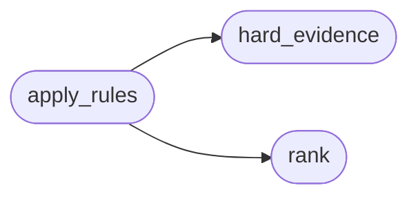

# `modules.lazy_triage`

> Source: [modules/lazy_triage.py:1](../../modules/lazy_triage.py#L1) | language `py` | coverage 100.0% | [API index](../index.md)

Triage doctrine: evidence floors, verdict algebra and signature dedup.

Deterministic pre-LLM classification of one finding so the model can
never invent proof. Rules:

- A classification may never fall below what the hard evidence sets
  (the floor table); the model can only raise, never lower beyond it.
- ``version_unknown`` stays immovable both ways: unknown versions read
  as needing validation with a capped score, never as confirmed.
- A model `[`confirmed`](modules.world_model.py.md#credentialentry-confirmed)` without any hard evidence demotes to ``likely``.
- One AI call per evidence signature: the sha1 covers the rule identity
  and the evidence-bearing fields, never the host, so fifty affected
  assets share one call and a re-probe re-asks without noise.

## Contents

- **Classes:** [`SignatureStore`](#signaturestore)
- **Functions:** [`rank`](#rank), [`hard_evidence`](#hard_evidence), [`apply_rules`](#apply_rules), [`signature_for`](#signature_for)
- **Constants:** [`CONFIRMED`](#confirmed), [`LIKELY`](#likely), [`NEEDS_VALIDATION`](#needs_validation), [`VERSION_UNKNOWN`](#version_unknown), [`LIKELY_FALSE_POSITIVE`](#likely_false_positive), [`SIGNATURE_STORE_FILENAME`](#signature_store_filename)

## Call Graph

Solid arrows stay in this module, dashed arrows leave it.



## Classes

<a id="signaturestore"></a>

### `SignatureStore`

`class` | [modules/lazy_triage.py:135](../../modules/lazy_triage.py#L135)

```python
class SignatureStore
```

Bounded TTL store of already-answered evidence signatures.

**Members**

| Member | Kind | Summary |
|---|---|---|
| [`__init__`](#signaturestore-__init__) | constructor | Bind the store file under sessions/lazy. |
| [`fresh_signature`](#signaturestore-fresh_signature) | method | Return the previous signature row when it is inside the TTL window. |
| [`reset`](#signaturestore-reset) | method | Drop every signature row. |

<a id="signaturestore-__init__"></a>

#### `SignatureStore.__init__`

`constructor` | [modules/lazy_triage.py:138](../../modules/lazy_triage.py#L138)

```python
def __init__(self, sessions_dir: str | Path | None = None, ttl: float = _SIGNITURE_TTL_SEC) -> None
```

Bind the store file under sessions/lazy.

**Parameters**

| Name | Type | Default | Description |
|---|---|---|---|
| `sessions_dir` | `str \| Path \| None` | `None` |  |
| `ttl` | `float` | `_SIGNITURE_TTL_SEC` |  |

<a id="signaturestore-fresh_signature"></a>

#### `SignatureStore.fresh_signature`

`method` | [modules/lazy_triage.py:144](../../modules/lazy_triage.py#L144)

```python
def fresh_signature(self, signature: str, now: float) -> str | None
```

Return the previous signature row when it is inside the TTL window.

Marks the signature seen afterwards, so callers reserve one
answer per window in a single check-and-mark step.

**Parameters**

| Name | Type | Default | Description |
|---|---|---|---|
| `signature` | `str` |  |  |
| `now` | `float` |  |  |

**Returns:** `str | None`

<a id="signaturestore-reset"></a>

#### `SignatureStore.reset`

`method` | [modules/lazy_triage.py:162](../../modules/lazy_triage.py#L162)

```python
def reset(self) -> None
```

Drop every signature row.

---

## Functions

<a id="rank"></a>

### `rank`

`function` | [modules/lazy_triage.py:42](../../modules/lazy_triage.py#L42)

```python
def rank(verdict: str) -> int
```

Return the comparison rank of a triage verdict.

**Parameters**

| Name | Type | Default | Description |
|---|---|---|---|
| `verdict` | `str` |  |  |

**Returns:** `int`

*Called by:* [`apply_rules`](#apply_rules)

---

<a id="hard_evidence"></a>

### `hard_evidence`

`function` | [modules/lazy_triage.py:47](../../modules/lazy_triage.py#L47)

```python
def hard_evidence(kind: str, facts: dict[str, Any]) -> str
```

Classify one finding from its deterministic evidence floor.

The floor table maps an outcome kind onto the strongest verdict its
evidence already proves without any model. Nothing raises a verdict
here above what the facts carry.

**Parameters**

| Name | Type | Default | Description |
|---|---|---|---|
| `kind` | `str` |  | Outcome kind (exploit, chain, emulation, nuclei, ...). |
| `facts` | `dict[str, Any]` |  | Evidence-bearing fields (success, shell, version, cve...). |

**Returns:** `str` - One of CONFIRMED, LIKELY, NEEDS_VALIDATION or VERSION_UNKNOWN.

*Called by:* [`apply_rules`](#apply_rules)

---

<a id="apply_rules"></a>

### `apply_rules`

`function` | [modules/lazy_triage.py:80](../../modules/lazy_triage.py#L80)

```python
def apply_rules(verdict: str, kind: str, facts: dict[str, Any]) -> str
```

Constrain a (model or operator) verdict by the evidence floor.

**Parameters**

| Name | Type | Default | Description |
|---|---|---|---|
| `verdict` | `str` |  | Proposed verdict, lowercased by the caller or not. |
| `kind` | `str` |  | Outcome kind feeding the floor. |
| `facts` | `dict[str, Any]` |  | Evidence-bearing fields. |

**Returns:** `str` - The constrained verdict, never below the floor: unbacked
`[`confirmed`](modules.world_model.py.md#credentialentry-confirmed)` demotes to ``likely`` and ``version_unknown`` is
immovable in both directions.

*Calls:* [`hard_evidence`](#hard_evidence), [`rank`](#rank)

---

<a id="signature_for"></a>

### `signature_for`

`function` | [modules/lazy_triage.py:108](../../modules/lazy_triage.py#L108)

```python
def signature_for(kind: str, fields: dict[str, Any]) -> str
```

Return the evidence signature of one classification request.

The signature covers the rule identity and evidence-bearing fields
only: asset identifiers (hosts, ports, task ids) are dropped because
two hosts carrying the same evidence ask the same question.

**Parameters**

| Name | Type | Default | Description |
|---|---|---|---|
| `kind` | `str` |  | Classification rule identity (floor table family). |
| `fields` | `dict[str, Any]` |  | Evidence fields about to steer the call. |

**Returns:** `str` - Hex digest string.

---

## Constants

<a id="confirmed"></a>

### `CONFIRMED`

`constant` | [modules/lazy_triage.py:23](../../modules/lazy_triage.py#L23)

```python
CONFIRMED = 'confirmed'
```

---

<a id="likely"></a>

### `LIKELY`

`constant` | [modules/lazy_triage.py:24](../../modules/lazy_triage.py#L24)

```python
LIKELY = 'likely'
```

---

<a id="needs_validation"></a>

### `NEEDS_VALIDATION`

`constant` | [modules/lazy_triage.py:25](../../modules/lazy_triage.py#L25)

```python
NEEDS_VALIDATION = 'needs_validation'
```

---

<a id="version_unknown"></a>

### `VERSION_UNKNOWN`

`constant` | [modules/lazy_triage.py:26](../../modules/lazy_triage.py#L26)

```python
VERSION_UNKNOWN = 'version_unknown'
```

---

<a id="likely_false_positive"></a>

### `LIKELY_FALSE_POSITIVE`

`constant` | [modules/lazy_triage.py:27](../../modules/lazy_triage.py#L27)

```python
LIKELY_FALSE_POSITIVE = 'likely_false_positive'
```

---

<a id="signature_store_filename"></a>

### `SIGNATURE_STORE_FILENAME`

`constant` | [modules/lazy_triage.py:38](../../modules/lazy_triage.py#L38)

```python
SIGNATURE_STORE_FILENAME = 'triage_signatures.json'
```

---
