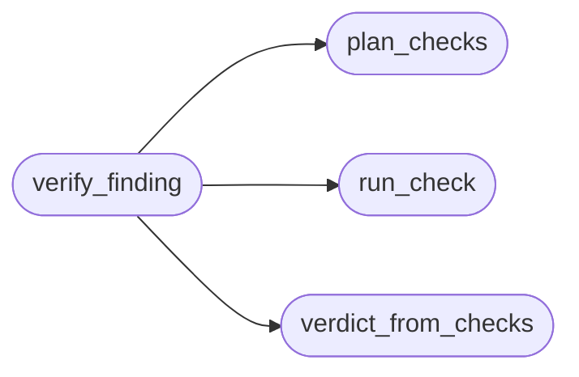

# `modules.lazy_verify`

> Source: [modules/lazy_verify.py:1](../../modules/lazy_verify.py#L1) | language `py` | coverage 100.0% | [API index](../index.md)

Structured read-only verification of loop findings.

Replaces the old substring-grep retest verdicts with a small fixed set
of read-only checks whose verdict rules are deterministic:

  http_probe   one HEAD (GET only when the server answers 405 to HEAD),
               no cookies, no credentials, no redirects, body discarded
  tcp_probe    one socket connect against the single named port
  banner_probe one connect that reads a banner and matches it against
               the finding's needle
  nmap_sv      ``nmap -sV`` against the single port the finding names
               (only when the nmap binary exists)

Verdict rules, faithful to the reference discipline:

- a check that reproduces the finding marks the finding **reproduced**;
- a check that did not reproduce it NEVER proves it fixed (a template
  can miss: a WAF, a virtual host, a different path) — the verdict
  stays inconclusive and a retry is scheduled;
- every check records exactly the command it ran and a capped evidence
  snippet, so the finding carries what actually happened.

Stdlib only; every check is bounded and non-fatal.

## Contents

- **Functions:** [`plan_checks`](#plan_checks), [`run_check`](#run_check), [`verdict_from_checks`](#verdict_from_checks), [`verify_finding`](#verify_finding)
- **Constants:** [`CHECK_KINDS`](#check_kinds), [`EVIDENCE_CAP`](#evidence_cap)

## Call Graph

Solid arrows stay in this module, dashed arrows leave it.



## Functions

<a id="plan_checks"></a>

### `plan_checks`

`function` | [modules/lazy_verify.py:84](../../modules/lazy_verify.py#L84)

```python
def plan_checks(finding_text: str, poc: str = '') -> list[dict]
```

Build the read-only check list for one finding.

**Parameters**

| Name | Type | Default | Description |
|---|---|---|---|
| `finding_text` | `str` |  | Finding title/summary text. |
| `poc` | `str` | `''` | Stored proof-of-concept (first line names the replay command). |

**Returns:** `list[dict]` - List of check dicts ``{"kind", "command", "host", "port", "needle"}``,
at most `MAX_CHECKS`.

*Called by:* [`verify_finding`](#verify_finding)

---

<a id="run_check"></a>

### `run_check`

`function` | [modules/lazy_verify.py:143](../../modules/lazy_verify.py#L143)

```python
def run_check(check: dict, executor=None) -> dict
```

Run one read-only check and classify its result.

**Parameters**

| Name | Type | Default | Description |
|---|---|---|---|
| `check` | `dict` |  | One check dict from [`plan_checks`](#plan_checks). |
| `executor` |  | `None` | Optional callable running a shell line and returning output. |

**Returns:** `dict` - ``{"kind", "command", "verdict", "evidence"}`` where verdict is
``hit``/``miss``/``error``.

*Called by:* [`verify_finding`](#verify_finding)

---

<a id="verdict_from_checks"></a>

### `verdict_from_checks`

`function` | [modules/lazy_verify.py:214](../../modules/lazy_verify.py#L214)

```python
def verdict_from_checks(checks_results: list[dict]) -> str
```

Deterministic verdict from a list of check results.

Any hit reproduces; misses never prove fixed; everything else stays
inconclusive so a retry is scheduled later.

**Parameters**

| Name | Type | Default | Description |
|---|---|---|---|
| `checks_results` | `list[dict]` |  | Results from [`run_check`](#run_check). |

**Returns:** `str` - `[`reproduced`](modules.progress_ledger.py.md#roundsignals-reproduced)` or ``inconclusive``.

*Called by:* [`verify_finding`](#verify_finding)

---

<a id="verify_finding"></a>

### `verify_finding`

`function` | [modules/lazy_verify.py:232](../../modules/lazy_verify.py#L232)

```python
def verify_finding(finding_text: str, poc: str = '', executor=None) -> dict
```

Plan, run and judge the read-only checks for one finding.

**Parameters**

| Name | Type | Default | Description |
|---|---|---|---|
| `finding_text` | `str` |  | Finding title/summary text. |
| `poc` | `str` | `''` | Stored proof-of-concept. |
| `executor` |  | `None` | Optional callable running a shell line. |

**Returns:** `dict` - ``{"verdict", "checks": [run_check results]}``.

*Calls:* [`plan_checks`](#plan_checks), [`run_check`](#run_check), [`verdict_from_checks`](#verdict_from_checks)

---

## Constants

<a id="check_kinds"></a>

### `CHECK_KINDS`

`constant` | [modules/lazy_verify.py:35](../../modules/lazy_verify.py#L35)

```python
CHECK_KINDS = ('http_probe', 'tcp_probe', 'banner_probe', 'nmap_sv')
```

---

<a id="evidence_cap"></a>

### `EVIDENCE_CAP`

`constant` | [modules/lazy_verify.py:36](../../modules/lazy_verify.py#L36)

```python
EVIDENCE_CAP = 2048
```

---
