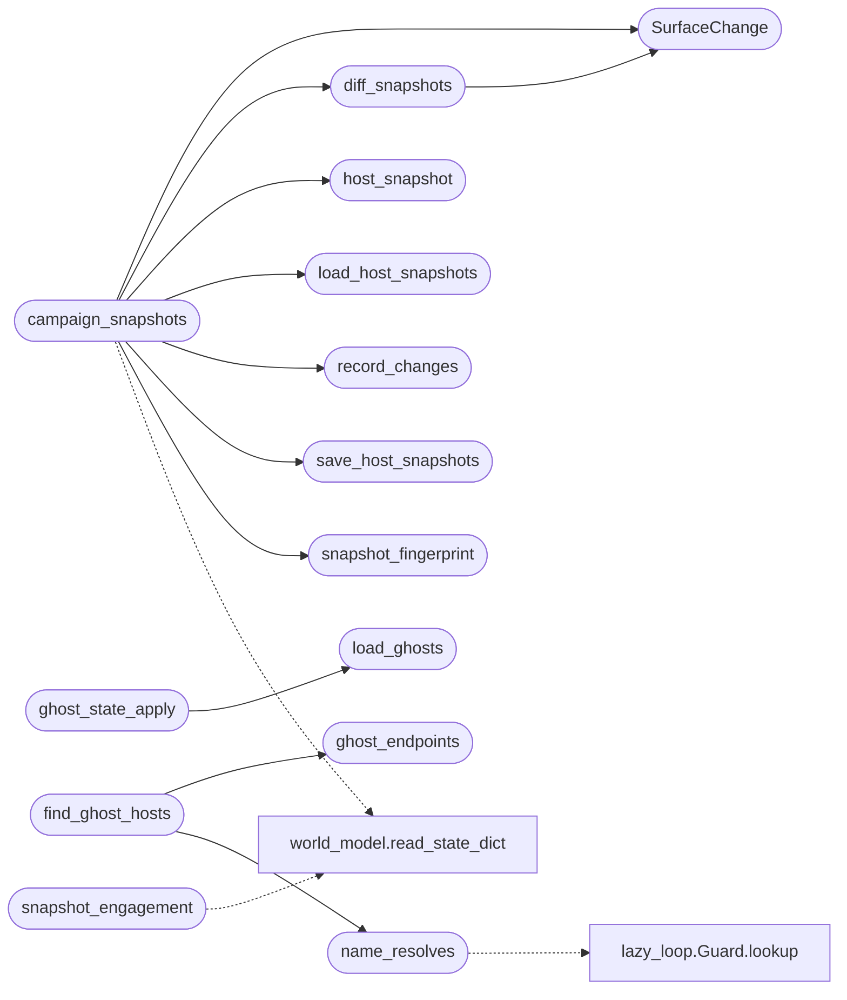

# `modules.lazy_world_diff`

> Source: [modules/lazy_world_diff.py:1](../../modules/lazy_world_diff.py#L1) | language `py` | coverage 100.0% | [API index](../index.md)

World-surface diff: host snapshots, change detection, ghost liveness.

The world model stores the *current* campaign truth; this module stores
what a host looked like last time we looked and reports the difference:

- `[`host_snapshot`](#host_snapshot)` reads one host out of a world-model dict as a plain,
  canonical snapshot (open services only).
- `[`snapshot_fingerprint`](#snapshot_fingerprint)` hashes a snapshot so an unchanged host never
  re-triggers.
- `[`diff_snapshots`](#diff_snapshots)` returns the deterministic change list between two
  snapshots. A product appearing where there was none is nmap
  enrichment, not a change; a flip of an existing identity is.
- Changes append to ``sessions/lazy_changes.jsonl`` (bounded per host,
  prunable) so the report and the loop can read *what moved*.
- Ghost liveness: a host whose name no longer resolves but whose last
  known address still answers is recorded in ``sessions/lazy_ghosts.json``
  so the operator sees the asset is not gone, only unnamed. The probe is
  injectable and every check is read-only.
- `[`snapshot_engagement`](#snapshot_engagement)` appends a daily point-in-time campaign snapshot
  to ``sessions/lazy_stats_history.jsonl``.

Stdlib only. Every entry point degrades silently on missing data and
never raises on untrusted input.

## Contents

- **Classes:** [`SurfaceChange`](#surfacechange)
- **Functions:** [`host_snapshot`](#host_snapshot), [`snapshot_fingerprint`](#snapshot_fingerprint), [`diff_snapshots`](#diff_snapshots), [`record_changes`](#record_changes), [`recent_changes`](#recent_changes), [`prune_changes`](#prune_changes), [`load_host_snapshots`](#load_host_snapshots), [`save_host_snapshots`](#save_host_snapshots), [`campaign_snapshots`](#campaign_snapshots), [`ghost_endpoints`](#ghost_endpoints), [`name_resolves`](#name_resolves), [`load_ghosts`](#load_ghosts), [`ghost_state_apply`](#ghost_state_apply), [`find_ghost_hosts`](#find_ghost_hosts), [`snapshot_engagement`](#snapshot_engagement)
- **Constants:** [`BASE_DIR`](#base_dir), [`CHANGES_FILENAME`](#changes_filename), [`SNAPSHOTS_FILENAME`](#snapshots_filename), [`GHOSTS_FILENAME`](#ghosts_filename), [`STATS_FILENAME`](#stats_filename), [`HOST_NEW`](#host_new), [`HOST_RETURNED`](#host_returned), [`HOST_RETIRED`](#host_retired), [`PORT_OPENED`](#port_opened), [`PORT_CLOSED`](#port_closed), [`SERVICE_CHANGED`](#service_changed), [`OS_CHANGED`](#os_changed), [`GHOST_ENDPOINT_LIMIT`](#ghost_endpoint_limit)

## Call Graph

Solid arrows stay in this module, dashed arrows leave it.



## Classes

<a id="surfacechange"></a>

### `SurfaceChange`

`class` `dataclass` | [modules/lazy_world_diff.py:65](../../modules/lazy_world_diff.py#L65)

Decorators: `@dataclass(frozen=True)`

```python
class SurfaceChange
```

One deterministic difference between two host snapshots.

**Attributes**

| Name | Type | Default | Description |
|---|---|---|---|
| [`kind`](#surfacechange-kind) | `str` |  |  |
| [`ip`](#surfacechange-ip) | `str` |  |  |
| [`port`](#surfacechange-port) | `int` |  |  |
| [`before`](#surfacechange-before) | `dict \| None` |  |  |
| [`after`](#surfacechange-after) | `dict \| None` |  |  |

---

## Functions

<a id="host_snapshot"></a>

### `host_snapshot`

`function` | [modules/lazy_world_diff.py:78](../../modules/lazy_world_diff.py#L78)

```python
def host_snapshot(world: dict, ip: str) -> dict
```

Read one host out of a world-model dict as a canonical snapshot.

Only open services enter the snapshot so a port that closed is a
diffable event instead of vanishing silently.

**Parameters**

| Name | Type | Default | Description |
|---|---|---|---|
| `world` | `dict` |  | World-model dict with a `[`hosts`](modules.state_manager.py.md#sessionsnapshot-hosts)` mapping (dict or list form). |
| `ip` | `str` |  | Host address to snapshot. |

**Returns:** `dict` - ``{"ip", "state", "os", "ports": {"p/proto": {...}}}``; empty
dict when the host is absent.

*Called by:* [`campaign_snapshots`](#campaign_snapshots)

---

<a id="snapshot_fingerprint"></a>

### `snapshot_fingerprint`

`function` | [modules/lazy_world_diff.py:119](../../modules/lazy_world_diff.py#L119)

```python
def snapshot_fingerprint(state: dict) -> str
```

Hash one snapshot canonically; key order never matters.

**Parameters**

| Name | Type | Default | Description |
|---|---|---|---|
| `state` | `dict` |  |  |

**Returns:** `str`

*Called by:* [`campaign_snapshots`](#campaign_snapshots)

---

<a id="diff_snapshots"></a>

### `diff_snapshots`

`function` | [modules/lazy_world_diff.py:131](../../modules/lazy_world_diff.py#L131)

```python
def diff_snapshots(before: dict, after: dict) -> list[SurfaceChange]
```

Deterministic change list between two host snapshots.

**Parameters**

| Name | Type | Default | Description |
|---|---|---|---|
| `before` | `dict` |  | Prior snapshot (possibly empty). |
| `after` | `dict` |  | Current snapshot. |

**Returns:** `list[SurfaceChange]` - List of [`SurfaceChange`](#surfacechange) sorted by port number.

*Calls:* [`SurfaceChange`](#surfacechange)

*Called by:* [`campaign_snapshots`](#campaign_snapshots), [`apply`](modules.sinks.world_diff.py.md#apply)

---

<a id="record_changes"></a>

### `record_changes`

`function` | [modules/lazy_world_diff.py:200](../../modules/lazy_world_diff.py#L200)

```python
def record_changes(changes: list[SurfaceChange], sessions_dir: str | Path, now: float | None = None) -> int
```

Append changes to the campaign change log, deduped and bounded.

An entry identical to the host's most recent one is skipped, and a
host cannot hold more than ``HOST_CHANGES_PER_HOST`` rows.

**Parameters**

| Name | Type | Default | Description |
|---|---|---|---|
| `changes` | `list[SurfaceChange]` |  | Diffs from [`diff_snapshots`](#diff_snapshots) (or equivalent tuples). |
| `sessions_dir` | `str \| Path` |  | Sessions directory holding the log. |
| `now` | `float \| None` | `None` | Override timestamp (epoch seconds). |

**Returns:** `int` - How many rows were actually written.

*Called by:* [`campaign_snapshots`](#campaign_snapshots), [`apply`](modules.sinks.world_diff.py.md#apply)

---

<a id="recent_changes"></a>

### `recent_changes`

`function` | [modules/lazy_world_diff.py:260](../../modules/lazy_world_diff.py#L260)

```python
def recent_changes(sessions_dir: str | Path, days: int = RECENT_WINDOW_DAYS, host: str = '') -> list[dict]
```

Change rows newest-first within the window, optionally per host.

**Parameters**

| Name | Type | Default | Description |
|---|---|---|---|
| `sessions_dir` | `str \| Path` |  |  |
| `days` | `int` | `RECENT_WINDOW_DAYS` |  |
| `host` | `str` | `''` |  |

**Returns:** `list[dict]`

---

<a id="prune_changes"></a>

### `prune_changes`

`function` | [modules/lazy_world_diff.py:270](../../modules/lazy_world_diff.py#L270)

```python
def prune_changes(sessions_dir: str | Path, keep_days: int = CHANGES_KEEP_DAYS) -> int
```

Drop change rows older than ``keep_days``; returns how many.

**Parameters**

| Name | Type | Default | Description |
|---|---|---|---|
| `sessions_dir` | `str \| Path` |  |  |
| `keep_days` | `int` | `CHANGES_KEEP_DAYS` |  |

**Returns:** `int`

---

<a id="load_host_snapshots"></a>

### `load_host_snapshots`

`function` | [modules/lazy_world_diff.py:290](../../modules/lazy_world_diff.py#L290)

```python
def load_host_snapshots(sessions_dir: str | Path) -> dict[str, dict]
```

Stored per-host snapshots keyed by ip.

**Parameters**

| Name | Type | Default | Description |
|---|---|---|---|
| `sessions_dir` | `str \| Path` |  |  |

**Returns:** `dict[str, dict]`

*Called by:* [`campaign_snapshots`](#campaign_snapshots)

---

<a id="save_host_snapshots"></a>

### `save_host_snapshots`

`function` | [modules/lazy_world_diff.py:301](../../modules/lazy_world_diff.py#L301)

```python
def save_host_snapshots(snapshots: dict[str, dict], sessions_dir: str | Path) -> bool
```

Persist per-host snapshots atomically-enough (best effort).

**Parameters**

| Name | Type | Default | Description |
|---|---|---|---|
| `snapshots` | `dict[str, dict]` |  |  |
| `sessions_dir` | `str \| Path` |  |  |

**Returns:** `bool`

*Called by:* [`campaign_snapshots`](#campaign_snapshots)

---

<a id="campaign_snapshots"></a>

### `campaign_snapshots`

`function` | [modules/lazy_world_diff.py:312](../../modules/lazy_world_diff.py#L312)

```python
def campaign_snapshots(sessions_dir: str | Path) -> dict[str, dict]
```

Snapshot every world-model host, then diff against stored ones.

One pass computes current snapshots, diffs them against the stored
prior snapshots, records the changes and replaces the store.

**Parameters**

| Name | Type | Default | Description |
|---|---|---|---|
| `sessions_dir` | `str \| Path` |  | Sessions directory (world model + stores). |

**Returns:** `dict[str, dict]` - ``{"changed": int, "changes": [SurfaceChange-like dicts],
"snapshots": current snapshots}``.

*Calls:* [`SurfaceChange`](#surfacechange), [`diff_snapshots`](#diff_snapshots), [`host_snapshot`](#host_snapshot), [`load_host_snapshots`](#load_host_snapshots), [`record_changes`](#record_changes), [`save_host_snapshots`](#save_host_snapshots), [`snapshot_fingerprint`](#snapshot_fingerprint), [`read_state_dict`](modules.world_model.py.md#read_state_dict)

---

<a id="ghost_endpoints"></a>

### `ghost_endpoints`

`function` | [modules/lazy_world_diff.py:366](../../modules/lazy_world_diff.py#L366)

```python
def ghost_endpoints(snapshot: dict, limit: int = GHOST_ENDPOINT_LIMIT) -> list[tuple[str, int, str]]
```

Web endpoints (ip, port, scheme) a snapshot last had open.

443 first, then 80, then the rest ascending; non-web ports are not
probed (the check is an HTTP GET).

**Parameters**

| Name | Type | Default | Description |
|---|---|---|---|
| `snapshot` | `dict` |  | Snapshot from [`host_snapshot`](#host_snapshot). |
| `limit` | `int` | `GHOST_ENDPOINT_LIMIT` | Maximum endpoints returned. |

**Returns:** `list[tuple[str, int, str]]` - List of ``(ip, port, scheme)`` triples.

*Called by:* [`find_ghost_hosts`](#find_ghost_hosts)

---

<a id="name_resolves"></a>

### `name_resolves`

`function` | [modules/lazy_world_diff.py:395](../../modules/lazy_world_diff.py#L395)

```python
def name_resolves(host: str, resolver: callable | None = None) -> bool
```

Whether a hostname still resolves (injectable for tests).

**Parameters**

| Name | Type | Default | Description |
|---|---|---|---|
| `host` | `str` |  |  |
| `resolver` | `callable \| None` | `None` |  |

**Returns:** `bool`

*Calls:* [`Guard.lookup`](modules.lazy_loop.py.md#guard-lookup)

*Called by:* [`find_ghost_hosts`](#find_ghost_hosts)

---

<a id="load_ghosts"></a>

### `load_ghosts`

`function` | [modules/lazy_world_diff.py:435](../../modules/lazy_world_diff.py#L435)

```python
def load_ghosts(sessions_dir: str | Path) -> dict
```

The ghost store ``{"hosts": {...}}`` tolerant of corruption.

**Parameters**

| Name | Type | Default | Description |
|---|---|---|---|
| `sessions_dir` | `str \| Path` |  |  |

**Returns:** `dict`

*Called by:* [`ghost_state_apply`](#ghost_state_apply)

---

<a id="ghost_state_apply"></a>

### `ghost_state_apply`

`function` | [modules/lazy_world_diff.py:447](../../modules/lazy_world_diff.py#L447)

```python
def ghost_state_apply(host: str, answers: list[str], sessions_dir: str | Path, now: float | None = None) -> dict
```

Record one ghost observation and return the host's ghost record.

Answers keep it ghost (`[`since`](modules.traffic_recorder.py.md#trafficrecorder-since)` preserved), no answers clear it
(``cleared_at`` set). Never raises; empty hosts are ignored.

**Parameters**

| Name | Type | Default | Description |
|---|---|---|---|
| `host` | `str` |  | Hostname that stopped resolving. |
| `answers` | `list[str]` |  | ``ip:port`` strings that still answered. |
| `sessions_dir` | `str \| Path` |  | Sessions directory holding the store. |
| `now` | `float \| None` | `None` | Override timestamp. |

**Returns:** `dict` - The updated record for ``host``.

*Calls:* [`load_ghosts`](#load_ghosts)

---

<a id="find_ghost_hosts"></a>

### `find_ghost_hosts`

`function` | [modules/lazy_world_diff.py:489](../../modules/lazy_world_diff.py#L489)

```python
def find_ghost_hosts(candidates: list[str], snapshots: dict[str, dict], checker: callable | None = None, resolver: callable | None = None, cap: int = GHOST_MAX_HOSTS) -> dict[str, list[str]]
```

Which candidate hostnames are ghosts: unresolvable yet answering.

**Parameters**

| Name | Type | Default | Description |
|---|---|---|---|
| `candidates` | `list[str]` |  | Hostnames to inspect (from the world model). |
| `snapshots` | `dict[str, dict]` |  | Current snapshots by ip. |
| `checker` | `callable \| None` | `None` | ``(ip, port, scheme, host) -> bool`` probe override. |
| `resolver` | `callable \| None` | `None` | ``(host) -> bool`` DNS override. |
| `cap` | `int` | `GHOST_MAX_HOSTS` | Maximum hosts probed per pass. |

**Returns:** `dict[str, list[str]]` - ``{host: ["ip:port", ...]}`` for the hosts still answering.

*Calls:* [`ghost_endpoints`](#ghost_endpoints), [`name_resolves`](#name_resolves)

---

<a id="snapshot_engagement"></a>

### `snapshot_engagement`

`function` | [modules/lazy_world_diff.py:528](../../modules/lazy_world_diff.py#L528)

```python
def snapshot_engagement(sessions_dir: str | Path, now: float | None = None, world: dict | None = None) -> dict | None
```

Append one daily campaign snapshot when the cooldown allows.

**Parameters**

| Name | Type | Default | Description |
|---|---|---|---|
| `sessions_dir` | `str \| Path` |  | Sessions directory holding the history file. |
| `now` | `float \| None` | `None` | Override timestamp. |
| `world` | `dict \| None` | `None` | Pre-loaded world-model dict override. |

**Returns:** `dict | None` - The snapshot written, or None when one was taken recently.

*Calls:* [`read_state_dict`](modules.world_model.py.md#read_state_dict)

---

## Constants

<a id="base_dir"></a>

### `BASE_DIR`

`constant` | [modules/lazy_world_diff.py:34](../../modules/lazy_world_diff.py#L34)

```python
BASE_DIR = Path(__file__).resolve().parent.parent
```

---

<a id="changes_filename"></a>

### `CHANGES_FILENAME`

`constant` | [modules/lazy_world_diff.py:37](../../modules/lazy_world_diff.py#L37)

```python
CHANGES_FILENAME = 'lazy_changes.jsonl'
```

---

<a id="snapshots_filename"></a>

### `SNAPSHOTS_FILENAME`

`constant` | [modules/lazy_world_diff.py:38](../../modules/lazy_world_diff.py#L38)

```python
SNAPSHOTS_FILENAME = 'lazy_host_snapshots.json'
```

---

<a id="ghosts_filename"></a>

### `GHOSTS_FILENAME`

`constant` | [modules/lazy_world_diff.py:39](../../modules/lazy_world_diff.py#L39)

```python
GHOSTS_FILENAME = 'lazy_ghosts.json'
```

---

<a id="stats_filename"></a>

### `STATS_FILENAME`

`constant` | [modules/lazy_world_diff.py:40](../../modules/lazy_world_diff.py#L40)

```python
STATS_FILENAME = 'lazy_stats_history.jsonl'
```

---

<a id="host_new"></a>

### `HOST_NEW`

`constant` | [modules/lazy_world_diff.py:42](../../modules/lazy_world_diff.py#L42)

```python
HOST_NEW = 'host_new'
```

---

<a id="host_returned"></a>

### `HOST_RETURNED`

`constant` | [modules/lazy_world_diff.py:43](../../modules/lazy_world_diff.py#L43)

```python
HOST_RETURNED = 'host_returned'
```

---

<a id="host_retired"></a>

### `HOST_RETIRED`

`constant` | [modules/lazy_world_diff.py:44](../../modules/lazy_world_diff.py#L44)

```python
HOST_RETIRED = 'host_retired'
```

---

<a id="port_opened"></a>

### `PORT_OPENED`

`constant` | [modules/lazy_world_diff.py:45](../../modules/lazy_world_diff.py#L45)

```python
PORT_OPENED = 'port_opened'
```

---

<a id="port_closed"></a>

### `PORT_CLOSED`

`constant` | [modules/lazy_world_diff.py:46](../../modules/lazy_world_diff.py#L46)

```python
PORT_CLOSED = 'port_closed'
```

---

<a id="service_changed"></a>

### `SERVICE_CHANGED`

`constant` | [modules/lazy_world_diff.py:47](../../modules/lazy_world_diff.py#L47)

```python
SERVICE_CHANGED = 'service_changed'
```

---

<a id="os_changed"></a>

### `OS_CHANGED`

`constant` | [modules/lazy_world_diff.py:48](../../modules/lazy_world_diff.py#L48)

```python
OS_CHANGED = 'os_changed'
```

---

<a id="ghost_endpoint_limit"></a>

### `GHOST_ENDPOINT_LIMIT`

`constant` | [modules/lazy_world_diff.py:54](../../modules/lazy_world_diff.py#L54)

```python
GHOST_ENDPOINT_LIMIT = 3
```

---
