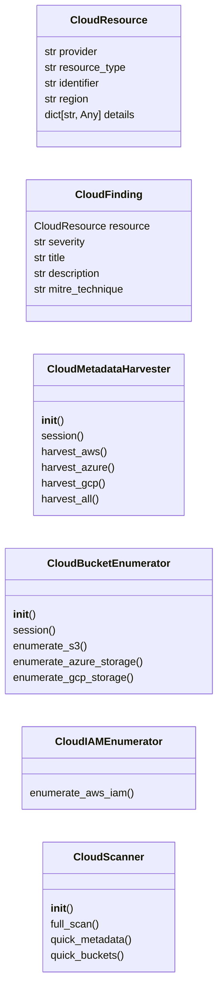
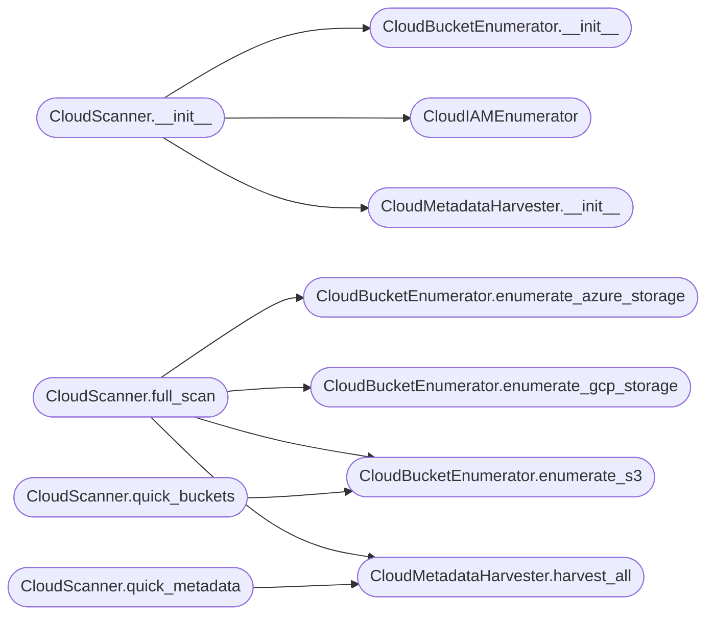

# `modules.lazycloud`

> Source: [modules/lazycloud.py:1](../../modules/lazycloud.py#L1) | language `py` | coverage 78.3% | [API index](../index.md)

Cloud-native attack module for AWS, Azure, and GCP.

Provides enumeration, misconfiguration detection, credential harvesting,
and privilege escalation techniques for the three major cloud providers.
All operations are read-only by default — destructive flags are explicit.

## Contents

- **Classes:** [`CloudResource`](#cloudresource), [`CloudFinding`](#cloudfinding), [`CloudMetadataHarvester`](#cloudmetadataharvester), [`CloudBucketEnumerator`](#cloudbucketenumerator), [`CloudIAMEnumerator`](#cloudiamenumerator), [`CloudScanner`](#cloudscanner)

## Type Diagram



## Call Graph

Solid arrows stay in this module, dashed arrows leave it.



## Classes

<a id="cloudresource"></a>

### `CloudResource`

`class` `dataclass` | [modules/lazycloud.py:87](../../modules/lazycloud.py#L87)

Decorators: `@dataclass`

```python
class CloudResource
```

A discovered cloud resource.

**Attributes**

| Name | Type | Default | Description |
|---|---|---|---|
| [`provider`](#cloudresource-provider) | `str` |  |  |
| [`resource_type`](#cloudresource-resource_type) | `str` |  |  |
| [`identifier`](#cloudresource-identifier) | `str` |  |  |
| [`region`](#cloudresource-region) | `str` | `''` |  |
| [`details`](#cloudresource-details) | `dict[str, Any]` | `field(default_factory=dict)` |  |

---

<a id="cloudfinding"></a>

### `CloudFinding`

`class` `dataclass` | [modules/lazycloud.py:98](../../modules/lazycloud.py#L98)

Decorators: `@dataclass`

```python
class CloudFinding
```

A security finding for a cloud resource.

**Attributes**

| Name | Type | Default | Description |
|---|---|---|---|
| [`resource`](#cloudfinding-resource) | `CloudResource` |  |  |
| [`severity`](#cloudfinding-severity) | `str` |  |  |
| [`title`](#cloudfinding-title) | `str` |  |  |
| [`description`](#cloudfinding-description) | `str` |  |  |
| [`mitre_technique`](#cloudfinding-mitre_technique) | `str` | `''` |  |

---

<a id="cloudmetadataharvester"></a>

### `CloudMetadataHarvester`

`class` | [modules/lazycloud.py:108](../../modules/lazycloud.py#L108)

```python
class CloudMetadataHarvester
```

Harvest credentials and configuration from cloud instance metadata.

**Members**

| Member | Kind | Summary |
|---|---|---|
| [`__init__`](#cloudmetadataharvester-__init__) | constructor |  |
| [`session`](#cloudmetadataharvester-session) | property |  |
| [`harvest_aws`](#cloudmetadataharvester-harvest_aws) | method | Harvest AWS EC2 instance metadata (IMDSv2 capable). |
| [`harvest_azure`](#cloudmetadataharvester-harvest_azure) | method | Harvest Azure instance metadata. |
| [`harvest_gcp`](#cloudmetadataharvester-harvest_gcp) | method | Harvest GCP instance metadata. |
| [`harvest_all`](#cloudmetadataharvester-harvest_all) | method | Try all three cloud providers sequentially. |

<a id="cloudmetadataharvester-__init__"></a>

#### `CloudMetadataHarvester.__init__`

`constructor` | [modules/lazycloud.py:111](../../modules/lazycloud.py#L111)

```python
def __init__(self, timeout: float = 5.0) -> None
```

**Parameters**

| Name | Type | Default | Description |
|---|---|---|---|
| `timeout` | `float` | `5.0` |  |

*Called by:* [`CloudScanner.__init__`](#cloudscanner-__init__)

<a id="cloudmetadataharvester-session"></a>

#### `CloudMetadataHarvester.session`

`property` | [modules/lazycloud.py:116](../../modules/lazycloud.py#L116)

Decorators: `@property`

```python
def session(self) -> Any
```

**Returns:** `Any`

<a id="cloudmetadataharvester-harvest_aws"></a>

#### `CloudMetadataHarvester.harvest_aws`

`method` | [modules/lazycloud.py:139](../../modules/lazycloud.py#L139)

```python
def harvest_aws(self) -> dict[str, Any]
```

Harvest AWS EC2 instance metadata (IMDSv2 capable).

**Returns:** `dict[str, Any]`

<a id="cloudmetadataharvester-harvest_azure"></a>

#### `CloudMetadataHarvester.harvest_azure`

`method` | [modules/lazycloud.py:184](../../modules/lazycloud.py#L184)

```python
def harvest_azure(self) -> dict[str, Any]
```

Harvest Azure instance metadata.

**Returns:** `dict[str, Any]`

<a id="cloudmetadataharvester-harvest_gcp"></a>

#### `CloudMetadataHarvester.harvest_gcp`

`method` | [modules/lazycloud.py:208](../../modules/lazycloud.py#L208)

```python
def harvest_gcp(self) -> dict[str, Any]
```

Harvest GCP instance metadata.

**Returns:** `dict[str, Any]`

<a id="cloudmetadataharvester-harvest_all"></a>

#### `CloudMetadataHarvester.harvest_all`

`method` | [modules/lazycloud.py:231](../../modules/lazycloud.py#L231)

```python
def harvest_all(self) -> list[dict[str, Any]]
```

Try all three cloud providers sequentially.

**Returns:** `list[dict[str, Any]]`

*Called by:* [`CloudScanner.full_scan`](#cloudscanner-full_scan), [`CloudScanner.quick_metadata`](#cloudscanner-quick_metadata)

---

<a id="cloudbucketenumerator"></a>

### `CloudBucketEnumerator`

`class` | [modules/lazycloud.py:248](../../modules/lazycloud.py#L248)

```python
class CloudBucketEnumerator
```

Enumerate cloud storage buckets for misconfigurations.

**Members**

| Member | Kind | Summary |
|---|---|---|
| [`__init__`](#cloudbucketenumerator-__init__) | constructor |  |
| [`session`](#cloudbucketenumerator-session) | property |  |
| [`enumerate_s3`](#cloudbucketenumerator-enumerate_s3) | method | Enumerate S3 buckets derived from a prefix. |
| [`enumerate_azure_storage`](#cloudbucketenumerator-enumerate_azure_storage) | method | Enumerate Azure Blob Storage accounts. |
| [`enumerate_gcp_storage`](#cloudbucketenumerator-enumerate_gcp_storage) | method | Enumerate GCP Storage buckets. |

<a id="cloudbucketenumerator-__init__"></a>

#### `CloudBucketEnumerator.__init__`

`constructor` | [modules/lazycloud.py:251](../../modules/lazycloud.py#L251)

```python
def __init__(self, timeout: float = 5.0) -> None
```

**Parameters**

| Name | Type | Default | Description |
|---|---|---|---|
| `timeout` | `float` | `5.0` |  |

*Called by:* [`CloudScanner.__init__`](#cloudscanner-__init__)

<a id="cloudbucketenumerator-session"></a>

#### `CloudBucketEnumerator.session`

`property` | [modules/lazycloud.py:256](../../modules/lazycloud.py#L256)

Decorators: `@property`

```python
def session(self) -> Any
```

**Returns:** `Any`

<a id="cloudbucketenumerator-enumerate_s3"></a>

#### `CloudBucketEnumerator.enumerate_s3`

`method` | [modules/lazycloud.py:278](../../modules/lazycloud.py#L278)

```python
def enumerate_s3(self, prefix: str, buckets: list[str] | None = None) -> list[dict[str, Any]]
```

Enumerate S3 buckets derived from a prefix.

**Parameters**

| Name | Type | Default | Description |
|---|---|---|---|
| `prefix` | `str` |  |  |
| `buckets` | `list[str] \| None` | `None` |  |

**Returns:** `list[dict[str, Any]]`

*Called by:* [`CloudScanner.full_scan`](#cloudscanner-full_scan), [`CloudScanner.quick_buckets`](#cloudscanner-quick_buckets)

<a id="cloudbucketenumerator-enumerate_azure_storage"></a>

#### `CloudBucketEnumerator.enumerate_azure_storage`

`method` | [modules/lazycloud.py:303](../../modules/lazycloud.py#L303)

```python
def enumerate_azure_storage(self, prefix: str, accounts: list[str] | None = None) -> list[dict[str, Any]]
```

Enumerate Azure Blob Storage accounts.

**Parameters**

| Name | Type | Default | Description |
|---|---|---|---|
| `prefix` | `str` |  |  |
| `accounts` | `list[str] \| None` | `None` |  |

**Returns:** `list[dict[str, Any]]`

*Called by:* [`CloudScanner.full_scan`](#cloudscanner-full_scan)

<a id="cloudbucketenumerator-enumerate_gcp_storage"></a>

#### `CloudBucketEnumerator.enumerate_gcp_storage`

`method` | [modules/lazycloud.py:321](../../modules/lazycloud.py#L321)

```python
def enumerate_gcp_storage(self, prefix: str, buckets: list[str] | None = None) -> list[dict[str, Any]]
```

Enumerate GCP Storage buckets.

**Parameters**

| Name | Type | Default | Description |
|---|---|---|---|
| `prefix` | `str` |  |  |
| `buckets` | `list[str] \| None` | `None` |  |

**Returns:** `list[dict[str, Any]]`

*Called by:* [`CloudScanner.full_scan`](#cloudscanner-full_scan)

---

<a id="cloudiamenumerator"></a>

### `CloudIAMEnumerator`

`class` | [modules/lazycloud.py:342](../../modules/lazycloud.py#L342)

```python
class CloudIAMEnumerator
```

Enumerate IAM roles, users, and policies across cloud providers.

**Members**

| Member | Kind | Summary |
|---|---|---|
| [`enumerate_aws_iam`](#cloudiamenumerator-enumerate_aws_iam) | method | Enumerate AWS IAM (requires valid credentials). |

<a id="cloudiamenumerator-enumerate_aws_iam"></a>

#### `CloudIAMEnumerator.enumerate_aws_iam`

`method` | [modules/lazycloud.py:345](../../modules/lazycloud.py#L345)

```python
def enumerate_aws_iam(self, access_key: str = '', secret_key: str = '', session_token: str = '') -> list[dict[str, Any]]
```

Enumerate AWS IAM (requires valid credentials).

**Parameters**

| Name | Type | Default | Description |
|---|---|---|---|
| `access_key` | `str` | `''` |  |
| `secret_key` | `str` | `''` |  |
| `session_token` | `str` | `''` |  |

**Returns:** `list[dict[str, Any]]`

---

<a id="cloudscanner"></a>

### `CloudScanner`

`class` | [modules/lazycloud.py:390](../../modules/lazycloud.py#L390)

```python
class CloudScanner
```

End-to-end cloud security scanner combining all three providers.

**Members**

| Member | Kind | Summary |
|---|---|---|
| [`__init__`](#cloudscanner-__init__) | constructor |  |
| [`full_scan`](#cloudscanner-full_scan) | method | Perform a comprehensive cloud security scan. |
| [`quick_metadata`](#cloudscanner-quick_metadata) | method | Fast metadata-only harvest (no bucket enumeration). |
| [`quick_buckets`](#cloudscanner-quick_buckets) | method | Fast S3-only bucket check. |

<a id="cloudscanner-__init__"></a>

#### `CloudScanner.__init__`

`constructor` | [modules/lazycloud.py:393](../../modules/lazycloud.py#L393)

```python
def __init__(self, target_domain: str = '', timeout: float = 5.0) -> None
```

**Parameters**

| Name | Type | Default | Description |
|---|---|---|---|
| `target_domain` | `str` | `''` |  |
| `timeout` | `float` | `5.0` |  |

*Calls:* [`CloudBucketEnumerator.__init__`](#cloudbucketenumerator-__init__), [`CloudIAMEnumerator`](#cloudiamenumerator), [`CloudMetadataHarvester.__init__`](#cloudmetadataharvester-__init__)

<a id="cloudscanner-full_scan"></a>

#### `CloudScanner.full_scan`

`method` | [modules/lazycloud.py:400](../../modules/lazycloud.py#L400)

```python
def full_scan(self, target_prefix: str = '', sessions_dir: str = 'sessions') -> dict[str, Any]
```

Perform a comprehensive cloud security scan.

**Parameters**

| Name | Type | Default | Description |
|---|---|---|---|
| `target_prefix` | `str` | `''` | Company name or prefix for bucket enumeration. |
| `sessions_dir` | `str` | `'sessions'` | Directory to write results. |

**Returns:** `dict[str, Any]` - Aggregated scan results.

*Calls:* [`CloudBucketEnumerator.enumerate_azure_storage`](#cloudbucketenumerator-enumerate_azure_storage), [`CloudBucketEnumerator.enumerate_gcp_storage`](#cloudbucketenumerator-enumerate_gcp_storage), [`CloudBucketEnumerator.enumerate_s3`](#cloudbucketenumerator-enumerate_s3), [`CloudMetadataHarvester.harvest_all`](#cloudmetadataharvester-harvest_all)

<a id="cloudscanner-quick_metadata"></a>

#### `CloudScanner.quick_metadata`

`method` | [modules/lazycloud.py:456](../../modules/lazycloud.py#L456)

```python
def quick_metadata(self) -> list[dict[str, Any]]
```

Fast metadata-only harvest (no bucket enumeration).

**Returns:** `list[dict[str, Any]]`

*Calls:* [`CloudMetadataHarvester.harvest_all`](#cloudmetadataharvester-harvest_all)

<a id="cloudscanner-quick_buckets"></a>

#### `CloudScanner.quick_buckets`

`method` | [modules/lazycloud.py:460](../../modules/lazycloud.py#L460)

```python
def quick_buckets(self, prefix: str) -> list[dict[str, Any]]
```

Fast S3-only bucket check.

**Parameters**

| Name | Type | Default | Description |
|---|---|---|---|
| `prefix` | `str` |  |  |

**Returns:** `list[dict[str, Any]]`

*Calls:* [`CloudBucketEnumerator.enumerate_s3`](#cloudbucketenumerator-enumerate_s3)

---
