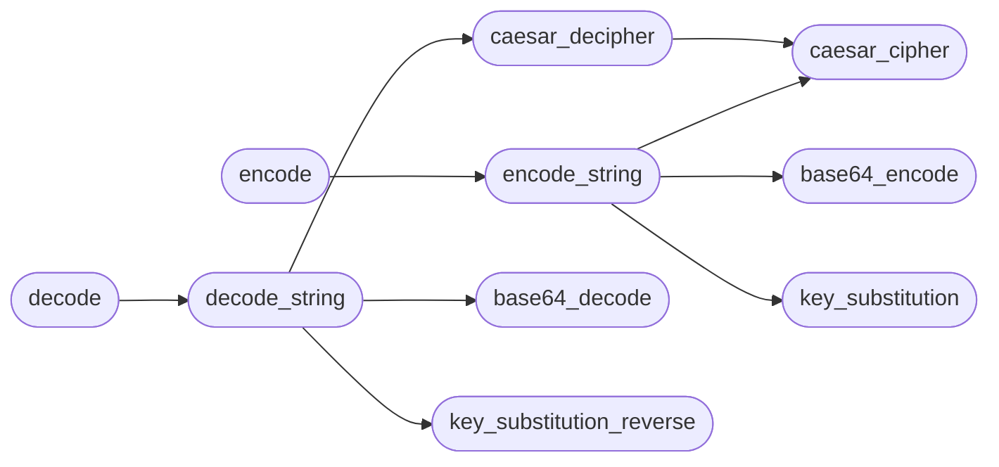

# `modules.lazyencoder_decoder`

> Source: [modules/lazyencoder_decoder.py:1](../../modules/lazyencoder_decoder.py#L1) | language `py` | coverage 0.0% | [API index](../index.md)

## Contents

- **Functions:** [`base64_encode`](#base64_encode), [`base64_decode`](#base64_decode), [`caesar_cipher`](#caesar_cipher), [`caesar_decipher`](#caesar_decipher), [`key_substitution`](#key_substitution), [`key_substitution_reverse`](#key_substitution_reverse), [`encode`](#encode), [`encode_string`](#encode_string), [`decode`](#decode), [`decode_string`](#decode_string)

## Call Graph

Solid arrows stay in this module, dashed arrows leave it.



## Functions

<a id="base64_encode"></a>

### `base64_encode`

`function` | [modules/lazyencoder_decoder.py:4](../../modules/lazyencoder_decoder.py#L4)

```python
def base64_encode(data)
```

**Parameters**

| Name | Type | Default | Description |
|---|---|---|---|
| `data` |  |  |  |

*Called by:* [`encode_string`](#encode_string)

---

<a id="base64_decode"></a>

### `base64_decode`

`function` | [modules/lazyencoder_decoder.py:8](../../modules/lazyencoder_decoder.py#L8)

```python
def base64_decode(data)
```

**Parameters**

| Name | Type | Default | Description |
|---|---|---|---|
| `data` |  |  |  |

*Called by:* [`decode_string`](#decode_string)

---

<a id="caesar_cipher"></a>

### `caesar_cipher`

`function` | [modules/lazyencoder_decoder.py:13](../../modules/lazyencoder_decoder.py#L13)

```python
def caesar_cipher(text, shift)
```

**Parameters**

| Name | Type | Default | Description |
|---|---|---|---|
| `text` |  |  |  |
| `shift` |  |  |  |

*Called by:* [`caesar_decipher`](#caesar_decipher), [`encode_string`](#encode_string)

---

<a id="caesar_decipher"></a>

### `caesar_decipher`

`function` | [modules/lazyencoder_decoder.py:27](../../modules/lazyencoder_decoder.py#L27)

```python
def caesar_decipher(text, shift)
```

**Parameters**

| Name | Type | Default | Description |
|---|---|---|---|
| `text` |  |  |  |
| `shift` |  |  |  |

*Calls:* [`caesar_cipher`](#caesar_cipher)

*Called by:* [`decode_string`](#decode_string)

---

<a id="key_substitution"></a>

### `key_substitution`

`function` | [modules/lazyencoder_decoder.py:31](../../modules/lazyencoder_decoder.py#L31)

```python
def key_substitution(text, key)
```

**Parameters**

| Name | Type | Default | Description |
|---|---|---|---|
| `text` |  |  |  |
| `key` |  |  |  |

*Called by:* [`encode_string`](#encode_string)

---

<a id="key_substitution_reverse"></a>

### `key_substitution_reverse`

`function` | [modules/lazyencoder_decoder.py:47](../../modules/lazyencoder_decoder.py#L47)

```python
def key_substitution_reverse(text, key)
```

**Parameters**

| Name | Type | Default | Description |
|---|---|---|---|
| `text` |  |  |  |
| `key` |  |  |  |

*Called by:* [`decode_string`](#decode_string)

---

<a id="encode"></a>

### `encode`

`function` | [modules/lazyencoder_decoder.py:63](../../modules/lazyencoder_decoder.py#L63)

```python
def encode(data, shift, key)
```

**Parameters**

| Name | Type | Default | Description |
|---|---|---|---|
| `data` |  |  |  |
| `shift` |  |  |  |
| `key` |  |  |  |

**Raises**

- `TypeError`: (raised in the body, not documented)

*Calls:* [`encode_string`](#encode_string)

---

<a id="encode_string"></a>

### `encode_string`

`function` | [modules/lazyencoder_decoder.py:75](../../modules/lazyencoder_decoder.py#L75)

```python
def encode_string(data, shift, key)
```

**Parameters**

| Name | Type | Default | Description |
|---|---|---|---|
| `data` |  |  |  |
| `shift` |  |  |  |
| `key` |  |  |  |

*Calls:* [`base64_encode`](#base64_encode), [`caesar_cipher`](#caesar_cipher), [`key_substitution`](#key_substitution)

*Called by:* [`encode`](#encode)

---

<a id="decode"></a>

### `decode`

`function` | [modules/lazyencoder_decoder.py:82](../../modules/lazyencoder_decoder.py#L82)

```python
def decode(data, shift, key)
```

**Parameters**

| Name | Type | Default | Description |
|---|---|---|---|
| `data` |  |  |  |
| `shift` |  |  |  |
| `key` |  |  |  |

**Raises**

- `TypeError`: (raised in the body, not documented)

*Calls:* [`decode_string`](#decode_string)

---

<a id="decode_string"></a>

### `decode_string`

`function` | [modules/lazyencoder_decoder.py:94](../../modules/lazyencoder_decoder.py#L94)

```python
def decode_string(data, shift, key)
```

**Parameters**

| Name | Type | Default | Description |
|---|---|---|---|
| `data` |  |  |  |
| `shift` |  |  |  |
| `key` |  |  |  |

*Calls:* [`base64_decode`](#base64_decode), [`caesar_decipher`](#caesar_decipher), [`key_substitution_reverse`](#key_substitution_reverse)

*Called by:* [`decode`](#decode)

---
