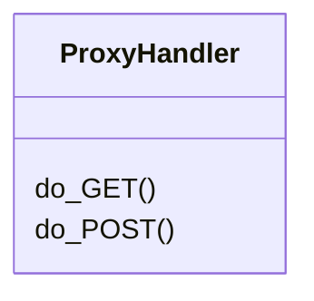
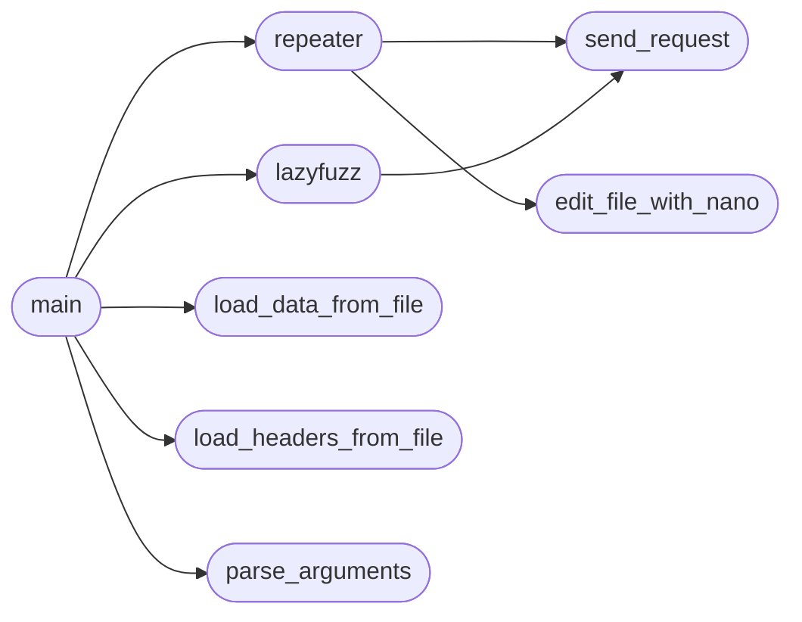

# `modules.lazyown_bprfuzzer`

> Source: [modules/lazyown_bprfuzzer.py:1](../../modules/lazyown_bprfuzzer.py#L1) | language `py` | coverage 35.7% | [API index](../index.md)

main.py

Autor: Gris Iscomeback
Correo electrónico: grisiscomeback[at]gmail[dot]com
Fecha de creación: 09/06/2024
Licencia: AGPL v3

Descripción: Lazy Burp-Like Fuzzer con Proxy y Repeater

██╗      █████╗ ███████╗██╗   ██╗ ██████╗ ██╗    ██╗███╗   ██╗
██║     ██╔══██╗╚══███╔╝╚██╗ ██╔╝██╔═══██╗██║    ██║████╗  ██║
██║     ███████║  ███╔╝  ╚████╔╝ ██║   ██║██║ █╗ ██║██╔██╗ ██║
██║     ██╔══██║ ███╔╝    ╚██╔╝  ██║   ██║██║███╗██║██║╚██╗██║
███████╗██║  ██║███████╗   ██║   ╚██████╔╝╚███╔███╔╝██║ ╚████║
╚══════╝╚═╝  ╚═╝╚══════╝   ╚═╝    ╚═════╝  ╚══╝╚══╝ ╚═╝  ╚═══╝

## Contents

- **Classes:** [`ProxyHandler`](#proxyhandler)
- **Functions:** [`load_headers_from_file`](#load_headers_from_file), [`load_data_from_file`](#load_data_from_file), [`signal_handler`](#signal_handler), [`run_proxy`](#run_proxy), [`edit_file_with_nano`](#edit_file_with_nano), [`send_request`](#send_request), [`repeater`](#repeater), [`lazyfuzz`](#lazyfuzz), [`parse_arguments`](#parse_arguments), [`main`](#main)
- **Constants:** [`BANNER`](#banner)

## Type Diagram



## Call Graph

Solid arrows stay in this module, dashed arrows leave it.



## Classes

<a id="proxyhandler"></a>

### `ProxyHandler`

`class` | [modules/lazyown_bprfuzzer.py:114](../../modules/lazyown_bprfuzzer.py#L114)

```python
class ProxyHandler(BaseHTTPRequestHandler)
```

Bases: `BaseHTTPRequestHandler`

**Members**

| Member | Kind | Summary |
|---|---|---|
| [`do_GET`](#proxyhandler-do_get) | method |  |
| [`do_POST`](#proxyhandler-do_post) | method |  |

<a id="proxyhandler-do_get"></a>

#### `ProxyHandler.do_GET`

`method` | [modules/lazyown_bprfuzzer.py:115](../../modules/lazyown_bprfuzzer.py#L115)

```python
def do_GET(self)
```

<a id="proxyhandler-do_post"></a>

#### `ProxyHandler.do_POST`

`method` | [modules/lazyown_bprfuzzer.py:118](../../modules/lazyown_bprfuzzer.py#L118)

```python
def do_POST(self)
```

---

## Functions

<a id="load_headers_from_file"></a>

### `load_headers_from_file`

`function` | [modules/lazyown_bprfuzzer.py:93](../../modules/lazyown_bprfuzzer.py#L93)

```python
def load_headers_from_file(file_path)
```

**Parameters**

| Name | Type | Default | Description |
|---|---|---|---|
| `file_path` |  |  |  |

*Called by:* [`main`](#main)

---

<a id="load_data_from_file"></a>

### `load_data_from_file`

`function` | [modules/lazyown_bprfuzzer.py:99](../../modules/lazyown_bprfuzzer.py#L99)

```python
def load_data_from_file(file_path)
```

**Parameters**

| Name | Type | Default | Description |
|---|---|---|---|
| `file_path` |  |  |  |

*Called by:* [`main`](#main)

---

<a id="signal_handler"></a>

### `signal_handler`

`function` | [modules/lazyown_bprfuzzer.py:105](../../modules/lazyown_bprfuzzer.py#L105)

```python
def signal_handler(sig, frame)
```

**Parameters**

| Name | Type | Default | Description |
|---|---|---|---|
| `sig` |  |  |  |
| `frame` |  |  |  |

---

<a id="run_proxy"></a>

### `run_proxy`

`function` | [modules/lazyown_bprfuzzer.py:162](../../modules/lazyown_bprfuzzer.py#L162)

```python
def run_proxy(port)
```

**Parameters**

| Name | Type | Default | Description |
|---|---|---|---|
| `port` |  |  |  |

---

<a id="edit_file_with_nano"></a>

### `edit_file_with_nano`

`function` | [modules/lazyown_bprfuzzer.py:169](../../modules/lazyown_bprfuzzer.py#L169)

```python
def edit_file_with_nano(content)
```

**Parameters**

| Name | Type | Default | Description |
|---|---|---|---|
| `content` |  |  |  |

*Called by:* [`repeater`](#repeater)

---

<a id="send_request"></a>

### `send_request`

`function` | [modules/lazyown_bprfuzzer.py:179](../../modules/lazyown_bprfuzzer.py#L179)

```python
def send_request(url, method='GET', headers=None, params=None, data=None, json_data=None, proxies=None, hide_code=None)
```

Envía una solicitud HTTP y devuelve la respuesta.

**Parameters**

| Name | Type | Default | Description |
|---|---|---|---|
| `url` |  |  |  |
| `method` |  | `'GET'` |  |
| `headers` |  | `None` |  |
| `params` |  | `None` |  |
| `data` |  | `None` |  |
| `json_data` |  | `None` |  |
| `proxies` |  | `None` |  |
| `hide_code` |  | `None` |  |

*Called by:* [`lazyfuzz`](#lazyfuzz), [`repeater`](#repeater)

---

<a id="repeater"></a>

### `repeater`

`function` | [modules/lazyown_bprfuzzer.py:203](../../modules/lazyown_bprfuzzer.py#L203)

```python
def repeater(url, method, headers, params, data, json_data, proxies, hide_code)
```

Funcionalidad de Repeater que permite enviar solicitudes múltiples veces con posibilidad de modificación.

**Parameters**

| Name | Type | Default | Description |
|---|---|---|---|
| `url` |  |  |  |
| `method` |  |  |  |
| `headers` |  |  |  |
| `params` |  |  |  |
| `data` |  |  |  |
| `json_data` |  |  |  |
| `proxies` |  |  |  |
| `hide_code` |  |  |  |

*Calls:* [`edit_file_with_nano`](#edit_file_with_nano), [`send_request`](#send_request)

*Called by:* [`main`](#main)

---

<a id="lazyfuzz"></a>

### `lazyfuzz`

`function` | [modules/lazyown_bprfuzzer.py:233](../../modules/lazyown_bprfuzzer.py#L233)

```python
def lazyfuzz(url, method, headers, params, data, json_data, proxies, wordlist_path, hide_code)
```

Funcionalidad de fuzzing que reemplaza LAZYFUZZ con palabras de una wordlist.

**Parameters**

| Name | Type | Default | Description |
|---|---|---|---|
| `url` |  |  |  |
| `method` |  |  |  |
| `headers` |  |  |  |
| `params` |  |  |  |
| `data` |  |  |  |
| `json_data` |  |  |  |
| `proxies` |  |  |  |
| `wordlist_path` |  |  |  |
| `hide_code` |  |  |  |

*Calls:* [`send_request`](#send_request)

*Called by:* [`main`](#main)

---

<a id="parse_arguments"></a>

### `parse_arguments`

`function` | [modules/lazyown_bprfuzzer.py:278](../../modules/lazyown_bprfuzzer.py#L278)

```python
def parse_arguments()
```

Parsear los argumentos de la línea de comandos.

*Called by:* [`main`](#main)

---

<a id="main"></a>

### `main`

`function` | [modules/lazyown_bprfuzzer.py:302](../../modules/lazyown_bprfuzzer.py#L302)

```python
def main()
```

*Calls:* [`lazyfuzz`](#lazyfuzz), [`load_data_from_file`](#load_data_from_file), [`load_headers_from_file`](#load_headers_from_file), [`parse_arguments`](#parse_arguments), [`repeater`](#repeater)

---

## Constants

<a id="banner"></a>

### `BANNER`

`constant` | [modules/lazyown_bprfuzzer.py:69](../../modules/lazyown_bprfuzzer.py#L69)

```python
BANNER
```

---
