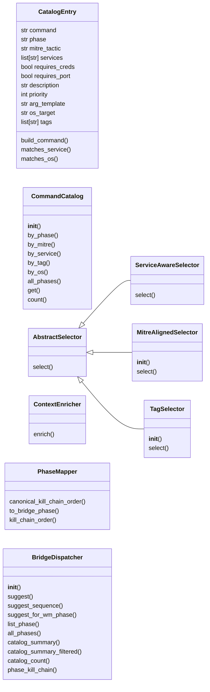
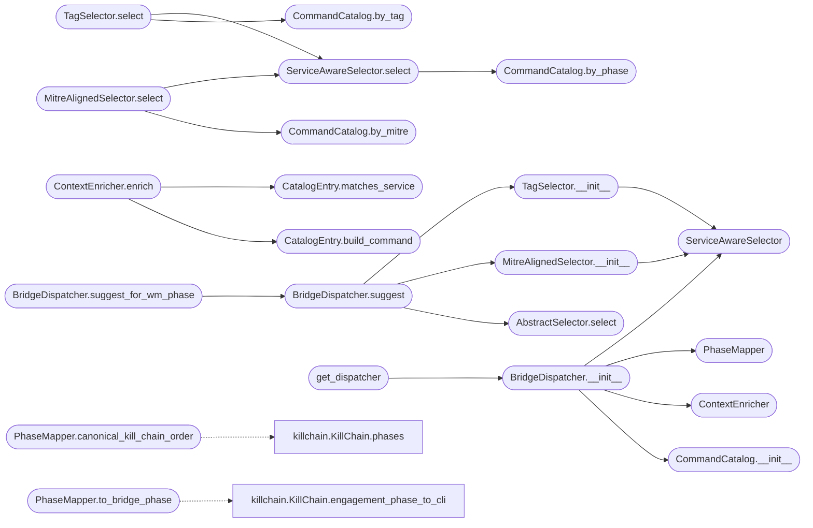

# `modules.lazyown_bridge`

> Source: [modules/lazyown_bridge.py:1](../../modules/lazyown_bridge.py#L1) | language `py` | coverage 34.9% | [API index](../index.md)

modules/lazyown_bridge.py ========================== Full-coverage structured catalog of all LazyOwn do_ commands mapped to attack phases, MITRE ATT&CK tactics, and discovered service types.

Integrates with the MCP auto_loop to provide phase-aware, service-matched
command selection without modifying lazyown.py.

Design (SOLID)
--------------
- Single Responsibility : CommandCatalog owns only the command registry;
                          PhaseSelector owns only phase-to-command resolution;
                          ServiceMatcher owns only service-type detection;
                          ContextEnricher owns only arg substitution.
- Open/Closed           : add new phases/tactics via CatalogEntry, no edits needed.
- Liskov                : all Selector subclasses honour Optional[CatalogEntry] contract.
- Interface Segregation : BridgeDispatcher exposes only what auto_loop needs.
- Dependency Inversion  : BridgeDispatcher depends on AbstractSelector abstraction.

Phases
------
recon       -> 01. Reconnaissance
enum        -> 02. Scanning & Enumeration
exploit     -> 03. Exploitation
postexp     -> 04. Post-Exploitation
persist     -> 05. Persistence
privesc     -> 06. Privilege Escalation
cred        -> 07. Credential Access
lateral     -> 08. Lateral Movement
exfil       -> 09. Data Exfiltration
c2          -> 10. Command & Control
report      -> 11. Reporting

## Contents

- **Classes:** [`CatalogEntry`](#catalogentry), [`CommandCatalog`](#commandcatalog), [`AbstractSelector`](#abstractselector), [`ServiceAwareSelector`](#serviceawareselector), [`MitreAlignedSelector`](#mitrealignedselector), [`TagSelector`](#tagselector), [`ContextEnricher`](#contextenricher), [`PhaseMapper`](#phasemapper), [`BridgeDispatcher`](#bridgedispatcher)
- **Functions:** [`get_dispatcher`](#get_dispatcher)

## Type Diagram



## Call Graph

Solid arrows stay in this module, dashed arrows leave it.



## Classes

<a id="catalogentry"></a>

### `CatalogEntry`

`class` `dataclass` | [modules/lazyown_bridge.py:48](../../modules/lazyown_bridge.py#L48)

Decorators: `@dataclass`

```python
class CatalogEntry
```

A single LazyOwn command with metadata for intelligent selection.

**Attributes**

| Name | Type | Default | Description |
|---|---|---|---|
| [`command`](#catalogentry-command) | `str` |  |  |
| [`phase`](#catalogentry-phase) | `str` |  |  |
| [`mitre_tactic`](#catalogentry-mitre_tactic) | `str` |  |  |
| [`services`](#catalogentry-services) | `list[str]` | `field(default_factory=list)` |  |
| [`requires_creds`](#catalogentry-requires_creds) | `bool` | `False` |  |
| [`requires_port`](#catalogentry-requires_port) | `bool` | `False` |  |
| [`description`](#catalogentry-description) | `str` | `''` |  |
| [`priority`](#catalogentry-priority) | `int` | `5` |  |
| [`arg_template`](#catalogentry-arg_template) | `str` | `''` |  |
| [`os_target`](#catalogentry-os_target) | `str` | `'any'` |  |
| [`tags`](#catalogentry-tags) | `list[str]` | `field(default_factory=list)` |  |

**Members**

| Member | Kind | Summary |
|---|---|---|
| [`build_command`](#catalogentry-build_command) | method | Return 'command [args]' with known values substituted. |
| [`matches_service`](#catalogentry-matches_service) | method |  |
| [`matches_os`](#catalogentry-matches_os) | method |  |

<a id="catalogentry-build_command"></a>

#### `CatalogEntry.build_command`

`method` | [modules/lazyown_bridge.py:63](../../modules/lazyown_bridge.py#L63)

```python
def build_command(self, target: str = '', port: str = '', user: str = '', password: str = '', domain: str = '', url: str = '', wordlist: str = '', lhost: str = '', lport: str = '') -> str
```

Return 'command [args]' with known values substituted.

**Parameters**

| Name | Type | Default | Description |
|---|---|---|---|
| `target` | `str` | `''` |  |
| `port` | `str` | `''` |  |
| `user` | `str` | `''` |  |
| `password` | `str` | `''` |  |
| `domain` | `str` | `''` |  |
| `url` | `str` | `''` |  |
| `wordlist` | `str` | `''` |  |
| `lhost` | `str` | `''` |  |
| `lport` | `str` | `''` |  |

**Returns:** `str`

*Called by:* [`ContextEnricher.enrich`](#contextenricher-enrich)

<a id="catalogentry-matches_service"></a>

#### `CatalogEntry.matches_service`

`method` | [modules/lazyown_bridge.py:94](../../modules/lazyown_bridge.py#L94)

```python
def matches_service(self, services: list[str]) -> bool
```

**Parameters**

| Name | Type | Default | Description |
|---|---|---|---|
| `services` | `list[str]` |  |  |

**Returns:** `bool`

*Called by:* [`ContextEnricher.enrich`](#contextenricher-enrich)

<a id="catalogentry-matches_os"></a>

#### `CatalogEntry.matches_os`

`method` | [modules/lazyown_bridge.py:104](../../modules/lazyown_bridge.py#L104)

```python
def matches_os(self, os_hint: str) -> bool
```

**Parameters**

| Name | Type | Default | Description |
|---|---|---|---|
| `os_hint` | `str` |  |  |

**Returns:** `bool`

---

<a id="commandcatalog"></a>

### `CommandCatalog`

`class` | [modules/lazyown_bridge.py:115](../../modules/lazyown_bridge.py#L115)

```python
class CommandCatalog
```

Full registry of CatalogEntry objects for all LazyOwn phases.

**Members**

| Member | Kind | Summary |
|---|---|---|
| [`__init__`](#commandcatalog-__init__) | constructor |  |
| [`by_phase`](#commandcatalog-by_phase) | method |  |
| [`by_mitre`](#commandcatalog-by_mitre) | method |  |
| [`by_service`](#commandcatalog-by_service) | method |  |
| [`by_tag`](#commandcatalog-by_tag) | method |  |
| [`by_os`](#commandcatalog-by_os) | method |  |
| [`all_phases`](#commandcatalog-all_phases) | method |  |
| [`get`](#commandcatalog-get) | method |  |
| [`count`](#commandcatalog-count) | method |  |

<a id="commandcatalog-__init__"></a>

#### `CommandCatalog.__init__`

`constructor` | [modules/lazyown_bridge.py:118](../../modules/lazyown_bridge.py#L118)

```python
def __init__(self) -> None
```

*Called by:* [`BridgeDispatcher.__init__`](#bridgedispatcher-__init__)

<a id="commandcatalog-by_phase"></a>

#### `CommandCatalog.by_phase`

`method` | [modules/lazyown_bridge.py:3946](../../modules/lazyown_bridge.py#L3946)

```python
def by_phase(self, phase: str) -> list[CatalogEntry]
```

**Parameters**

| Name | Type | Default | Description |
|---|---|---|---|
| `phase` | `str` |  |  |

**Returns:** `list[CatalogEntry]`

*Called by:* [`ServiceAwareSelector.select`](#serviceawareselector-select)

<a id="commandcatalog-by_mitre"></a>

#### `CommandCatalog.by_mitre`

`method` | [modules/lazyown_bridge.py:3952](../../modules/lazyown_bridge.py#L3952)

```python
def by_mitre(self, technique_id: str) -> list[CatalogEntry]
```

**Parameters**

| Name | Type | Default | Description |
|---|---|---|---|
| `technique_id` | `str` |  |  |

**Returns:** `list[CatalogEntry]`

*Called by:* [`MitreAlignedSelector.select`](#mitrealignedselector-select)

<a id="commandcatalog-by_service"></a>

#### `CommandCatalog.by_service`

`method` | [modules/lazyown_bridge.py:3956](../../modules/lazyown_bridge.py#L3956)

```python
def by_service(self, service_name: str) -> list[CatalogEntry]
```

**Parameters**

| Name | Type | Default | Description |
|---|---|---|---|
| `service_name` | `str` |  |  |

**Returns:** `list[CatalogEntry]`

<a id="commandcatalog-by_tag"></a>

#### `CommandCatalog.by_tag`

`method` | [modules/lazyown_bridge.py:3960](../../modules/lazyown_bridge.py#L3960)

```python
def by_tag(self, tag: str) -> list[CatalogEntry]
```

**Parameters**

| Name | Type | Default | Description |
|---|---|---|---|
| `tag` | `str` |  |  |

**Returns:** `list[CatalogEntry]`

*Called by:* [`TagSelector.select`](#tagselector-select)

<a id="commandcatalog-by_os"></a>

#### `CommandCatalog.by_os`

`method` | [modules/lazyown_bridge.py:3963](../../modules/lazyown_bridge.py#L3963)

```python
def by_os(self, os_hint: str) -> list[CatalogEntry]
```

**Parameters**

| Name | Type | Default | Description |
|---|---|---|---|
| `os_hint` | `str` |  |  |

**Returns:** `list[CatalogEntry]`

<a id="commandcatalog-all_phases"></a>

#### `CommandCatalog.all_phases`

`method` | [modules/lazyown_bridge.py:3966](../../modules/lazyown_bridge.py#L3966)

```python
def all_phases(self) -> set[str]
```

**Returns:** `set[str]`

<a id="commandcatalog-get"></a>

#### `CommandCatalog.get`

`method` | [modules/lazyown_bridge.py:3969](../../modules/lazyown_bridge.py#L3969)

```python
def get(self, command: str) -> CatalogEntry | None
```

**Parameters**

| Name | Type | Default | Description |
|---|---|---|---|
| `command` | `str` |  |  |

**Returns:** `CatalogEntry | None`

<a id="commandcatalog-count"></a>

#### `CommandCatalog.count`

`method` | [modules/lazyown_bridge.py:3975](../../modules/lazyown_bridge.py#L3975)

```python
def count(self) -> int
```

**Returns:** `int`

---

<a id="abstractselector"></a>

### `AbstractSelector`

`class` `abstract` | [modules/lazyown_bridge.py:3984](../../modules/lazyown_bridge.py#L3984)

```python
class AbstractSelector(ABC)
```

Bases: `ABC`

Subclasses: [`MitreAlignedSelector`](#mitrealignedselector), [`ServiceAwareSelector`](#serviceawareselector), [`TagSelector`](#tagselector)

**Members**

| Member | Kind | Summary |
|---|---|---|
| [`select`](#abstractselector-select) | method |  |

<a id="abstractselector-select"></a>

#### `AbstractSelector.select`

`method` `abstract` | [modules/lazyown_bridge.py:3986](../../modules/lazyown_bridge.py#L3986)

Decorators: `@abstractmethod`

```python
def select(self, catalog: CommandCatalog, phase: str, services: list[str], has_creds: bool, excluded: set[str], os_hint: str = 'any') -> CatalogEntry | None
```

**Parameters**

| Name | Type | Default | Description |
|---|---|---|---|
| `catalog` | `CommandCatalog` |  |  |
| `phase` | `str` |  |  |
| `services` | `list[str]` |  |  |
| `has_creds` | `bool` |  |  |
| `excluded` | `set[str]` |  |  |
| `os_hint` | `str` | `'any'` |  |

**Returns:** `CatalogEntry | None`

*Called by:* [`BridgeDispatcher.suggest`](#bridgedispatcher-suggest)

---

<a id="serviceawareselector"></a>

### `ServiceAwareSelector`

`class` | [modules/lazyown_bridge.py:4002](../../modules/lazyown_bridge.py#L4002)

```python
class ServiceAwareSelector(AbstractSelector)
```

Bases: [`AbstractSelector`](#abstractselector)

Priority + service matching selector with credential gate.

**Members**

| Member | Kind | Summary |
|---|---|---|
| [`select`](#serviceawareselector-select) | method |  |

<a id="serviceawareselector-select"></a>

#### `ServiceAwareSelector.select`

`method` | [modules/lazyown_bridge.py:4005](../../modules/lazyown_bridge.py#L4005)

```python
def select(self, catalog: CommandCatalog, phase: str, services: list[str], has_creds: bool, excluded: set[str], os_hint: str = 'any') -> CatalogEntry | None
```

**Parameters**

| Name | Type | Default | Description |
|---|---|---|---|
| `catalog` | `CommandCatalog` |  |  |
| `phase` | `str` |  |  |
| `services` | `list[str]` |  |  |
| `has_creds` | `bool` |  |  |
| `excluded` | `set[str]` |  |  |
| `os_hint` | `str` | `'any'` |  |

**Returns:** `CatalogEntry | None`

*Calls:* [`CommandCatalog.by_phase`](#commandcatalog-by_phase)

*Called by:* [`MitreAlignedSelector.select`](#mitrealignedselector-select), [`TagSelector.select`](#tagselector-select)

---

<a id="mitrealignedselector"></a>

### `MitreAlignedSelector`

`class` | [modules/lazyown_bridge.py:4042](../../modules/lazyown_bridge.py#L4042)

```python
class MitreAlignedSelector(AbstractSelector)
```

Bases: [`AbstractSelector`](#abstractselector)

Prefer MITRE-matching commands; fall back to ServiceAwareSelector.

**Members**

| Member | Kind | Summary |
|---|---|---|
| [`__init__`](#mitrealignedselector-__init__) | constructor |  |
| [`select`](#mitrealignedselector-select) | method |  |

<a id="mitrealignedselector-__init__"></a>

#### `MitreAlignedSelector.__init__`

`constructor` | [modules/lazyown_bridge.py:4045](../../modules/lazyown_bridge.py#L4045)

```python
def __init__(self, technique_id: str) -> None
```

**Parameters**

| Name | Type | Default | Description |
|---|---|---|---|
| `technique_id` | `str` |  |  |

*Calls:* [`ServiceAwareSelector`](#serviceawareselector)

*Called by:* [`BridgeDispatcher.suggest`](#bridgedispatcher-suggest)

<a id="mitrealignedselector-select"></a>

#### `MitreAlignedSelector.select`

`method` | [modules/lazyown_bridge.py:4049](../../modules/lazyown_bridge.py#L4049)

```python
def select(self, catalog: CommandCatalog, phase: str, services: list[str], has_creds: bool, excluded: set[str], os_hint: str = 'any') -> CatalogEntry | None
```

**Parameters**

| Name | Type | Default | Description |
|---|---|---|---|
| `catalog` | `CommandCatalog` |  |  |
| `phase` | `str` |  |  |
| `services` | `list[str]` |  |  |
| `has_creds` | `bool` |  |  |
| `excluded` | `set[str]` |  |  |
| `os_hint` | `str` | `'any'` |  |

**Returns:** `CatalogEntry | None`

*Calls:* [`CommandCatalog.by_mitre`](#commandcatalog-by_mitre), [`ServiceAwareSelector.select`](#serviceawareselector-select)

---

<a id="tagselector"></a>

### `TagSelector`

`class` | [modules/lazyown_bridge.py:4071](../../modules/lazyown_bridge.py#L4071)

```python
class TagSelector(AbstractSelector)
```

Bases: [`AbstractSelector`](#abstractselector)

Select commands by tag (e.g.

'kerberos', 'web', 'impacket').

**Members**

| Member | Kind | Summary |
|---|---|---|
| [`__init__`](#tagselector-__init__) | constructor |  |
| [`select`](#tagselector-select) | method |  |

<a id="tagselector-__init__"></a>

#### `TagSelector.__init__`

`constructor` | [modules/lazyown_bridge.py:4074](../../modules/lazyown_bridge.py#L4074)

```python
def __init__(self, tag: str) -> None
```

**Parameters**

| Name | Type | Default | Description |
|---|---|---|---|
| `tag` | `str` |  |  |

*Calls:* [`ServiceAwareSelector`](#serviceawareselector)

*Called by:* [`BridgeDispatcher.suggest`](#bridgedispatcher-suggest)

<a id="tagselector-select"></a>

#### `TagSelector.select`

`method` | [modules/lazyown_bridge.py:4078](../../modules/lazyown_bridge.py#L4078)

```python
def select(self, catalog: CommandCatalog, phase: str, services: list[str], has_creds: bool, excluded: set[str], os_hint: str = 'any') -> CatalogEntry | None
```

**Parameters**

| Name | Type | Default | Description |
|---|---|---|---|
| `catalog` | `CommandCatalog` |  |  |
| `phase` | `str` |  |  |
| `services` | `list[str]` |  |  |
| `has_creds` | `bool` |  |  |
| `excluded` | `set[str]` |  |  |
| `os_hint` | `str` | `'any'` |  |

**Returns:** `CatalogEntry | None`

*Calls:* [`CommandCatalog.by_tag`](#commandcatalog-by_tag), [`ServiceAwareSelector.select`](#serviceawareselector-select)

---

<a id="contextenricher"></a>

### `ContextEnricher`

`class` | [modules/lazyown_bridge.py:4103](../../modules/lazyown_bridge.py#L4103)

```python
class ContextEnricher
```

Builds final command strings from CatalogEntry + WorldModel facts.

**Members**

| Member | Kind | Summary |
|---|---|---|
| [`enrich`](#contextenricher-enrich) | method |  |

<a id="contextenricher-enrich"></a>

#### `ContextEnricher.enrich`

`method` | [modules/lazyown_bridge.py:4106](../../modules/lazyown_bridge.py#L4106)

```python
def enrich(self, entry: CatalogEntry, target: str, world_snapshot: dict | None = None) -> str
```

**Parameters**

| Name | Type | Default | Description |
|---|---|---|---|
| `entry` | `CatalogEntry` |  |  |
| `target` | `str` |  |  |
| `world_snapshot` | `dict \| None` | `None` |  |

**Returns:** `str`

*Calls:* [`CatalogEntry.build_command`](#catalogentry-build_command), [`CatalogEntry.matches_service`](#catalogentry-matches_service)

---

<a id="phasemapper"></a>

### `PhaseMapper`

`class` | [modules/lazyown_bridge.py:4153](../../modules/lazyown_bridge.py#L4153)

```python
class PhaseMapper
```

Maps WorldModel EngagementPhase values to bridge phase strings.

Delegates core engagement-to-CLI mapping to [`modules.killchain.KillChain`](modules.killchain.py.md#killchain)
as the single source of truth for canonical phases. The bridge maintains its
own extended namespace (postexp, cred, persist, c2) for tool categorization
that extends beyond the canonical 8-phase kill chain.

**Members**

| Member | Kind | Summary |
|---|---|---|
| [`canonical_kill_chain_order`](#phasemapper-canonical_kill_chain_order) | staticmethod | Return the canonical 8-phase order from KillChain (single source of truth). |
| [`to_bridge_phase`](#phasemapper-to_bridge_phase) | method |  |
| [`kill_chain_order`](#phasemapper-kill_chain_order) | method | Ordered list of bridge phases following the kill chain. |

<a id="phasemapper-canonical_kill_chain_order"></a>

#### `PhaseMapper.canonical_kill_chain_order`

`staticmethod` | [modules/lazyown_bridge.py:4204](../../modules/lazyown_bridge.py#L4204)

Decorators: `@staticmethod`

```python
def canonical_kill_chain_order() -> list[str]
```

Return the canonical 8-phase order from KillChain (single source of truth).

**Returns:** `list[str]`

*Calls:* [`KillChain.phases`](modules.killchain.py.md#killchain-phases)

<a id="phasemapper-to_bridge_phase"></a>

#### `PhaseMapper.to_bridge_phase`

`method` | [modules/lazyown_bridge.py:4210](../../modules/lazyown_bridge.py#L4210)

```python
def to_bridge_phase(self, wm_phase: str) -> str
```

**Parameters**

| Name | Type | Default | Description |
|---|---|---|---|
| `wm_phase` | `str` |  |  |

**Returns:** `str`

*Calls:* [`KillChain.engagement_phase_to_cli`](modules.killchain.py.md#killchain-engagement_phase_to_cli)

<a id="phasemapper-kill_chain_order"></a>

#### `PhaseMapper.kill_chain_order`

`method` | [modules/lazyown_bridge.py:4223](../../modules/lazyown_bridge.py#L4223)

```python
def kill_chain_order(self) -> list[str]
```

Ordered list of bridge phases following the kill chain.

**Returns:** `list[str]`

---

<a id="bridgedispatcher"></a>

### `BridgeDispatcher`

`class` | [modules/lazyown_bridge.py:4233](../../modules/lazyown_bridge.py#L4233)

```python
class BridgeDispatcher
```

Public facade used by the MCP auto_loop and MCP tool handlers.

Combines catalog + selector + enricher into a single suggest() call.

**Members**

| Member | Kind | Summary |
|---|---|---|
| [`__init__`](#bridgedispatcher-__init__) | constructor |  |
| [`suggest`](#bridgedispatcher-suggest) | method | Return (command_string, entry) or None. |
| [`suggest_sequence`](#bridgedispatcher-suggest_sequence) | method | Return up to `limit` non-excluded suggestions for the phase. |
| [`suggest_for_wm_phase`](#bridgedispatcher-suggest_for_wm_phase) | method |  |
| [`list_phase`](#bridgedispatcher-list_phase) | method |  |
| [`all_phases`](#bridgedispatcher-all_phases) | method |  |
| [`catalog_summary`](#bridgedispatcher-catalog_summary) | method |  |
| [`catalog_summary_filtered`](#bridgedispatcher-catalog_summary_filtered) | method | Return a kill-chain summary restricted to a phase and target OS. |
| [`catalog_count`](#bridgedispatcher-catalog_count) | method |  |
| [`phase_kill_chain`](#bridgedispatcher-phase_kill_chain) | method |  |

<a id="bridgedispatcher-__init__"></a>

#### `BridgeDispatcher.__init__`

`constructor` | [modules/lazyown_bridge.py:4239](../../modules/lazyown_bridge.py#L4239)

```python
def __init__(self, catalog: CommandCatalog | None = None, selector: AbstractSelector | None = None, enricher: ContextEnricher | None = None, phase_mapper: PhaseMapper | None = None) -> None
```

**Parameters**

| Name | Type | Default | Description |
|---|---|---|---|
| `catalog` | `CommandCatalog \| None` | `None` |  |
| `selector` | `AbstractSelector \| None` | `None` |  |
| `enricher` | `ContextEnricher \| None` | `None` |  |
| `phase_mapper` | `PhaseMapper \| None` | `None` |  |

*Calls:* [`CommandCatalog.__init__`](#commandcatalog-__init__), [`ContextEnricher`](#contextenricher), [`PhaseMapper`](#phasemapper), [`ServiceAwareSelector`](#serviceawareselector)

*Called by:* [`get_dispatcher`](#get_dispatcher), [`LazyownBridgeBackend.route`](modules.unified_bridge.py.md#lazyownbridgebackend-route)

<a id="bridgedispatcher-suggest"></a>

#### `BridgeDispatcher.suggest`

`method` | [modules/lazyown_bridge.py:4251](../../modules/lazyown_bridge.py#L4251)

```python
def suggest(self, phase: str, target: str = '', services: list[str] | None = None, has_creds: bool = False, excluded: set[str] | None = None, world_snapshot: dict | None = None, mitre_hint: str = '', tag_hint: str = '', os_hint: str = 'any') -> tuple[str, CatalogEntry] | None
```

Return (command_string, entry) or None.

**Parameters**

| Name | Type | Default | Description |
|---|---|---|---|
| `phase` | `str` |  |  |
| `target` | `str` | `''` |  |
| `services` | `list[str] \| None` | `None` |  |
| `has_creds` | `bool` | `False` |  |
| `excluded` | `set[str] \| None` | `None` |  |
| `world_snapshot` | `dict \| None` | `None` |  |
| `mitre_hint` | `str` | `''` |  |
| `tag_hint` | `str` | `''` |  |
| `os_hint` | `str` | `'any'` |  |

**Returns:** `tuple[str, CatalogEntry] | None`

*Calls:* [`AbstractSelector.select`](#abstractselector-select), [`MitreAlignedSelector.__init__`](#mitrealignedselector-__init__), [`TagSelector.__init__`](#tagselector-__init__)

*Called by:* [`BridgeDispatcher.suggest_for_wm_phase`](#bridgedispatcher-suggest_for_wm_phase)

<a id="bridgedispatcher-suggest_sequence"></a>

#### `BridgeDispatcher.suggest_sequence`

`method` | [modules/lazyown_bridge.py:4296](../../modules/lazyown_bridge.py#L4296)

```python
def suggest_sequence(self, phase: str, target: str = '', services: list[str] | None = None, has_creds: bool = False, excluded: set[str] | None = None, world_snapshot: dict | None = None, limit: int = 5) -> list[tuple[str, CatalogEntry]]
```

Return up to `limit` non-excluded suggestions for the phase.

**Parameters**

| Name | Type | Default | Description |
|---|---|---|---|
| `phase` | `str` |  |  |
| `target` | `str` | `''` |  |
| `services` | `list[str] \| None` | `None` |  |
| `has_creds` | `bool` | `False` |  |
| `excluded` | `set[str] \| None` | `None` |  |
| `world_snapshot` | `dict \| None` | `None` |  |
| `limit` | `int` | `5` |  |

**Returns:** `list[tuple[str, CatalogEntry]]`

<a id="bridgedispatcher-suggest_for_wm_phase"></a>

#### `BridgeDispatcher.suggest_for_wm_phase`

`method` | [modules/lazyown_bridge.py:4325](../../modules/lazyown_bridge.py#L4325)

```python
def suggest_for_wm_phase(self, wm_phase_value: str, target: str = '', services: list[str] | None = None, has_creds: bool = False, excluded: set[str] | None = None, world_snapshot: dict | None = None) -> tuple[str, CatalogEntry] | None
```

**Parameters**

| Name | Type | Default | Description |
|---|---|---|---|
| `wm_phase_value` | `str` |  |  |
| `target` | `str` | `''` |  |
| `services` | `list[str] \| None` | `None` |  |
| `has_creds` | `bool` | `False` |  |
| `excluded` | `set[str] \| None` | `None` |  |
| `world_snapshot` | `dict \| None` | `None` |  |

**Returns:** `tuple[str, CatalogEntry] | None`

*Calls:* [`BridgeDispatcher.suggest`](#bridgedispatcher-suggest)

<a id="bridgedispatcher-list_phase"></a>

#### `BridgeDispatcher.list_phase`

`method` | [modules/lazyown_bridge.py:4343](../../modules/lazyown_bridge.py#L4343)

```python
def list_phase(self, phase: str) -> list[CatalogEntry]
```

**Parameters**

| Name | Type | Default | Description |
|---|---|---|---|
| `phase` | `str` |  |  |

**Returns:** `list[CatalogEntry]`

<a id="bridgedispatcher-all_phases"></a>

#### `BridgeDispatcher.all_phases`

`method` | [modules/lazyown_bridge.py:4347](../../modules/lazyown_bridge.py#L4347)

```python
def all_phases(self) -> set[str]
```

**Returns:** `set[str]`

<a id="bridgedispatcher-catalog_summary"></a>

#### `BridgeDispatcher.catalog_summary`

`method` | [modules/lazyown_bridge.py:4350](../../modules/lazyown_bridge.py#L4350)

```python
def catalog_summary(self) -> dict[str, list[str]]
```

**Returns:** `dict[str, list[str]]`

<a id="bridgedispatcher-catalog_summary_filtered"></a>

#### `BridgeDispatcher.catalog_summary_filtered`

`method` | [modules/lazyown_bridge.py:4358](../../modules/lazyown_bridge.py#L4358)

```python
def catalog_summary_filtered(self, phase: str | None = None, os_hint: str = 'any') -> dict[str, list[str]]
```

Return a kill-chain summary restricted to a phase and target OS.

**Parameters**

| Name | Type | Default | Description |
|---|---|---|---|
| `phase` | `str \| None` | `None` | Optional WorldModel-or-bridge phase identifier. When provided the summary contains only that phase (translated through [`PhaseMapper`](#phasemapper)). When ``None`` every phase in the kill-chain order is included. |
| `os_hint` | `str` | `'any'` | Target OS filter (``"any"``, ``"linux"``, ``"windows"``). Entries are kept when [`CatalogEntry.matches_os`](#catalogentry-matches_os) returns ``True``. The value ``"any"`` disables the filter. |

**Returns:** `dict[str, list[str]]` - Mapping of phase identifier to the ordered list of command
names that survived the filters. Empty phases are omitted so
agents do not waste tokens on blank sections.

<a id="bridgedispatcher-catalog_count"></a>

#### `BridgeDispatcher.catalog_count`

`method` | [modules/lazyown_bridge.py:4395](../../modules/lazyown_bridge.py#L4395)

```python
def catalog_count(self) -> int
```

**Returns:** `int`

<a id="bridgedispatcher-phase_kill_chain"></a>

#### `BridgeDispatcher.phase_kill_chain`

`method` | [modules/lazyown_bridge.py:4398](../../modules/lazyown_bridge.py#L4398)

```python
def phase_kill_chain(self) -> list[str]
```

**Returns:** `list[str]`

---

## Functions

<a id="get_dispatcher"></a>

### `get_dispatcher`

`function` | [modules/lazyown_bridge.py:4409](../../modules/lazyown_bridge.py#L4409)

```python
def get_dispatcher() -> BridgeDispatcher
```

**Returns:** `BridgeDispatcher`

*Calls:* [`BridgeDispatcher.__init__`](#bridgedispatcher-__init__)

---
