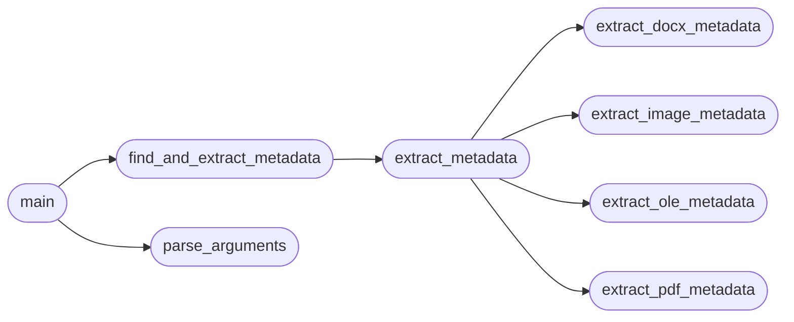

# `modules.lazyown_metaextract0r`

> Source: [modules/lazyown_metaextract0r.py:1](../../modules/lazyown_metaextract0r.py#L1) | language `py` | coverage 20.0% | [API index](../index.md)

main.py

Autor: Gris Iscomeback
Correo electrónico: grisiscomeback[at]gmail[dot]com
Fecha de creación: 09/06/2024
Licencia: AGPL v3

Descripción: Extractor de metadata inspirado en la FOCA

██╗      █████╗ ███████╗██╗   ██╗ ██████╗ ██╗    ██╗███╗   ██╗
██║     ██╔══██╗╚══███╔╝╚██╗ ██╔╝██╔═══██╗██║    ██║████╗  ██║
██║     ███████║  ███╔╝  ╚████╔╝ ██║   ██║██║ █╗ ██║██╔██╗ ██║
██║     ██╔══██║ ███╔╝    ╚██╔╝  ██║   ██║██║███╗██║██║╚██╗██║
███████╗██║  ██║███████╗   ██║   ╚██████╔╝╚███╔███╔╝██║ ╚████║
╚══════╝╚═╝  ╚═╝╚══════╝   ╚═╝    ╚═════╝  ╚══╝╚══╝ ╚═╝  ╚═══╝

## Contents

- **Functions:** [`signal_handler`](#signal_handler), [`extract_pdf_metadata`](#extract_pdf_metadata), [`extract_docx_metadata`](#extract_docx_metadata), [`extract_ole_metadata`](#extract_ole_metadata), [`extract_image_metadata`](#extract_image_metadata), [`extract_metadata`](#extract_metadata), [`find_and_extract_metadata`](#find_and_extract_metadata), [`parse_arguments`](#parse_arguments), [`main`](#main)
- **Constants:** [`BANNER`](#banner)

## Call Graph

Solid arrows stay in this module, dashed arrows leave it.



## Functions

<a id="signal_handler"></a>

### `signal_handler`

`function` | [modules/lazyown_metaextract0r.py:42](../../modules/lazyown_metaextract0r.py#L42)

```python
def signal_handler(sig, frame)
```

**Parameters**

| Name | Type | Default | Description |
|---|---|---|---|
| `sig` |  |  |  |
| `frame` |  |  |  |

---

<a id="extract_pdf_metadata"></a>

### `extract_pdf_metadata`

`function` | [modules/lazyown_metaextract0r.py:51](../../modules/lazyown_metaextract0r.py#L51)

```python
def extract_pdf_metadata(file_path)
```

**Parameters**

| Name | Type | Default | Description |
|---|---|---|---|
| `file_path` |  |  |  |

*Called by:* [`extract_metadata`](#extract_metadata)

---

<a id="extract_docx_metadata"></a>

### `extract_docx_metadata`

`function` | [modules/lazyown_metaextract0r.py:62](../../modules/lazyown_metaextract0r.py#L62)

```python
def extract_docx_metadata(file_path)
```

**Parameters**

| Name | Type | Default | Description |
|---|---|---|---|
| `file_path` |  |  |  |

*Called by:* [`extract_metadata`](#extract_metadata)

---

<a id="extract_ole_metadata"></a>

### `extract_ole_metadata`

`function` | [modules/lazyown_metaextract0r.py:73](../../modules/lazyown_metaextract0r.py#L73)

```python
def extract_ole_metadata(file_path)
```

**Parameters**

| Name | Type | Default | Description |
|---|---|---|---|
| `file_path` |  |  |  |

*Called by:* [`extract_metadata`](#extract_metadata)

---

<a id="extract_image_metadata"></a>

### `extract_image_metadata`

`function` | [modules/lazyown_metaextract0r.py:85](../../modules/lazyown_metaextract0r.py#L85)

```python
def extract_image_metadata(file_path)
```

**Parameters**

| Name | Type | Default | Description |
|---|---|---|---|
| `file_path` |  |  |  |

*Called by:* [`extract_metadata`](#extract_metadata)

---

<a id="extract_metadata"></a>

### `extract_metadata`

`function` | [modules/lazyown_metaextract0r.py:96](../../modules/lazyown_metaextract0r.py#L96)

```python
def extract_metadata(file_path)
```

**Parameters**

| Name | Type | Default | Description |
|---|---|---|---|
| `file_path` |  |  |  |

*Calls:* [`extract_docx_metadata`](#extract_docx_metadata), [`extract_image_metadata`](#extract_image_metadata), [`extract_ole_metadata`](#extract_ole_metadata), [`extract_pdf_metadata`](#extract_pdf_metadata)

*Called by:* [`find_and_extract_metadata`](#find_and_extract_metadata)

---

<a id="find_and_extract_metadata"></a>

### `find_and_extract_metadata`

`function` | [modules/lazyown_metaextract0r.py:109](../../modules/lazyown_metaextract0r.py#L109)

```python
def find_and_extract_metadata(directory, output_file)
```

**Parameters**

| Name | Type | Default | Description |
|---|---|---|---|
| `directory` |  |  |  |
| `output_file` |  |  |  |

*Calls:* [`extract_metadata`](#extract_metadata)

*Called by:* [`main`](#main)

---

<a id="parse_arguments"></a>

### `parse_arguments`

`function` | [modules/lazyown_metaextract0r.py:130](../../modules/lazyown_metaextract0r.py#L130)

```python
def parse_arguments()
```

Parse command-line arguments.

*Called by:* [`main`](#main)

---

<a id="main"></a>

### `main`

`function` | [modules/lazyown_metaextract0r.py:140](../../modules/lazyown_metaextract0r.py#L140)

```python
def main()
```

*Calls:* [`find_and_extract_metadata`](#find_and_extract_metadata), [`parse_arguments`](#parse_arguments)

---

## Constants

<a id="banner"></a>

### `BANNER`

`constant` | [modules/lazyown_metaextract0r.py:30](../../modules/lazyown_metaextract0r.py#L30)

```python
BANNER
```

---
