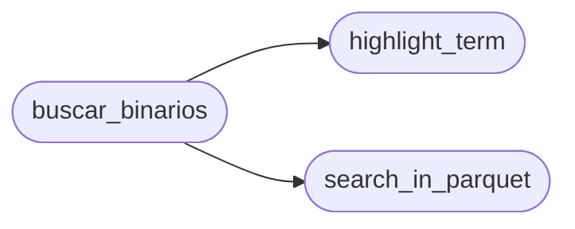

# `modules.lazyown_parquet_tool`

> Source: [modules/lazyown_parquet_tool.py:1](../../modules/lazyown_parquet_tool.py#L1) | language `py` | coverage 100.0% | [API index](../index.md)

main.py

Autor: Gris Iscomeback
Correo electrónico: grisiscomeback[at]gmail[dot]com
Fecha de creación: 09/06/2024
Licencia: GPL v3

Descripción: LazyOwn Binary find in gtofbins db

██╗      █████╗ ███████╗██╗   ██╗ ██████╗ ██╗    ██╗███╗   ██╗
██║     ██╔══██╗╚══███╔╝╚██╗ ██╔╝██╔═══██╗██║    ██║████╗  ██║
██║     ███████║  ███╔╝  ╚████╔╝ ██║   ██║██║ █╗ ██║██╔██╗ ██║
██║     ██╔══██║ ███╔╝    ╚██╔╝  ██║   ██║██║███╗██║██║╚██╗██║
███████╗██║  ██║███████╗   ██║   ╚██████╔╝╚███╔███╔╝██║ ╚████║
╚══════╝╚═╝  ╚═╝╚══════╝   ╚═╝    ╚═════╝  ╚══╝╚══╝ ╚═╝  ╚═══╝

## Contents

- **Functions:** [`highlight_term`](#highlight_term), [`search_in_parquet`](#search_in_parquet), [`buscar_binarios`](#buscar_binarios), [`ejecutar_opciones`](#ejecutar_opciones)

## Call Graph

Solid arrows stay in this module, dashed arrows leave it.



## Functions

<a id="highlight_term"></a>

### `highlight_term`

`function` | [modules/lazyown_parquet_tool.py:34](../../modules/lazyown_parquet_tool.py#L34)

```python
def highlight_term(text, term)
```

Highlight the search term in the given text.

**Parameters**

| Name | Type | Default | Description |
|---|---|---|---|
| `text` |  |  |  |
| `term` |  |  |  |

*Called by:* [`buscar_binarios`](#buscar_binarios)

---

<a id="search_in_parquet"></a>

### `search_in_parquet`

`function` | [modules/lazyown_parquet_tool.py:39](../../modules/lazyown_parquet_tool.py#L39)

```python
def search_in_parquet(term, parquet_files)
```

Search for a term in the given Parquet files and return matching rows.

**Parameters**

| Name | Type | Default | Description |
|---|---|---|---|
| `term` |  |  |  |
| `parquet_files` |  |  |  |

*Called by:* [`buscar_binarios`](#buscar_binarios)

---

<a id="buscar_binarios"></a>

### `buscar_binarios`

`function` | [modules/lazyown_parquet_tool.py:53](../../modules/lazyown_parquet_tool.py#L53)

```python
def buscar_binarios(args)
```

Search for binaries with special permissions and generate a results CSV.

**Parameters**

| Name | Type | Default | Description |
|---|---|---|---|
| `args` |  |  |  |

*Calls:* [`highlight_term`](#highlight_term), [`search_in_parquet`](#search_in_parquet)

---

<a id="ejecutar_opciones"></a>

### `ejecutar_opciones`

`function` | [modules/lazyown_parquet_tool.py:136](../../modules/lazyown_parquet_tool.py#L136)

```python
def ejecutar_opciones()
```

Execute options based on the found data.

---
