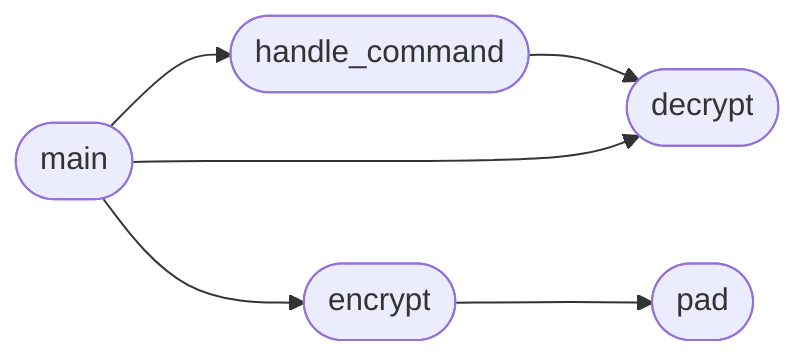

# `modules.lazyownclient`

> Source: [modules/lazyownclient.py:1](../../modules/lazyownclient.py#L1) | language `py` | coverage 14.3% | [API index](../index.md)

main.py

Autor: Gris Iscomeback
Correo electrónico: grisiscomeback[at]gmail[dot]com
Fecha de creación: 09/06/2024
Licencia: AGPL v3

Descripción: Cliente LazyOwn Rat

██╗      █████╗ ███████╗██╗   ██╗ ██████╗ ██╗    ██╗███╗   ██╗
██║     ██╔══██╗╚══███╔╝╚██╗ ██╔╝██╔═══██╗██║    ██║████╗  ██║
██║     ███████║  ███╔╝  ╚████╔╝ ██║   ██║██║ █╗ ██║██╔██╗ ██║
██║     ██╔══██║ ███╔╝    ╚██╔╝  ██║   ██║██║███╗██║██║╚██╗██║
███████╗██║  ██║███████╗   ██║   ╚██████╔╝╚███╔███╔╝██║ ╚████║
╚══════╝╚═╝  ╚═╝╚══════╝   ╚═╝    ╚═════╝  ╚══╝╚══╝ ╚═╝  ╚═══╝

## Contents

- **Functions:** [`signal_handler`](#signal_handler), [`pad`](#pad), [`encrypt`](#encrypt), [`decrypt`](#decrypt), [`handle_command`](#handle_command), [`main`](#main)

## Call Graph

Solid arrows stay in this module, dashed arrows leave it.



## Functions

<a id="signal_handler"></a>

### `signal_handler`

`function` | [modules/lazyownclient.py:34](../../modules/lazyownclient.py#L34)

```python
def signal_handler(sig, frame)
```

**Parameters**

| Name | Type | Default | Description |
|---|---|---|---|
| `sig` |  |  |  |
| `frame` |  |  |  |

---

<a id="pad"></a>

### `pad`

`function` | [modules/lazyownclient.py:51](../../modules/lazyownclient.py#L51)

```python
def pad(s)
```

**Parameters**

| Name | Type | Default | Description |
|---|---|---|---|
| `s` |  |  |  |

*Called by:* [`encrypt`](#encrypt)

---

<a id="encrypt"></a>

### `encrypt`

`function` | [modules/lazyownclient.py:55](../../modules/lazyownclient.py#L55)

```python
def encrypt(plaintext, key)
```

**Parameters**

| Name | Type | Default | Description |
|---|---|---|---|
| `plaintext` |  |  |  |
| `key` |  |  |  |

*Calls:* [`pad`](#pad)

*Called by:* [`main`](#main)

---

<a id="decrypt"></a>

### `decrypt`

`function` | [modules/lazyownclient.py:62](../../modules/lazyownclient.py#L62)

```python
def decrypt(ciphertext, key)
```

**Parameters**

| Name | Type | Default | Description |
|---|---|---|---|
| `ciphertext` |  |  |  |
| `key` |  |  |  |

*Called by:* [`handle_command`](#handle_command), [`main`](#main)

---

<a id="handle_command"></a>

### `handle_command`

`function` | [modules/lazyownclient.py:69](../../modules/lazyownclient.py#L69)

```python
def handle_command(cmd, key)
```

**Parameters**

| Name | Type | Default | Description |
|---|---|---|---|
| `cmd` |  |  |  |
| `key` |  |  |  |

*Calls:* [`decrypt`](#decrypt)

*Called by:* [`main`](#main)

---

<a id="main"></a>

### `main`

`function` | [modules/lazyownclient.py:198](../../modules/lazyownclient.py#L198)

```python
def main()
```

*Calls:* [`decrypt`](#decrypt), [`encrypt`](#encrypt), [`handle_command`](#handle_command)

---
