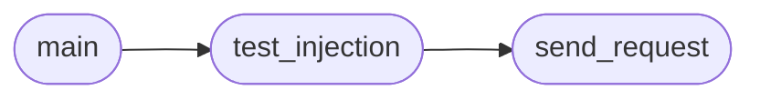

# `modules.lazyownerweb`

> Source: [modules/lazyownerweb.py:1](../../modules/lazyownerweb.py#L1) | language `py` | coverage 0.0% | [API index](../index.md)

## Contents

- **Functions:** [`send_request`](#send_request), [`test_injection`](#test_injection), [`main`](#main)
- **Constants:** [`TARGET_URL`](#target_url), [`ENDPOINTS`](#endpoints), [`PAYLOADS`](#payloads), [`TIMEOUT`](#timeout)

## Call Graph

Solid arrows stay in this module, dashed arrows leave it.



## Functions

<a id="send_request"></a>

### `send_request`

`function` | [modules/lazyownerweb.py:36](../../modules/lazyownerweb.py#L36)

```python
def send_request(url, params, method='GET')
```

**Parameters**

| Name | Type | Default | Description |
|---|---|---|---|
| `url` |  |  |  |
| `params` |  |  |  |
| `method` |  | `'GET'` |  |

*Called by:* [`test_injection`](#test_injection)

---

<a id="test_injection"></a>

### `test_injection`

`function` | [modules/lazyownerweb.py:49](../../modules/lazyownerweb.py#L49)

```python
def test_injection(url, payloads, param_name, detection_strings, method='GET')
```

**Parameters**

| Name | Type | Default | Description |
|---|---|---|---|
| `url` |  |  |  |
| `payloads` |  |  |  |
| `param_name` |  |  |  |
| `detection_strings` |  |  |  |
| `method` |  | `'GET'` |  |

*Calls:* [`send_request`](#send_request)

*Called by:* [`main`](#main)

---

<a id="main"></a>

### `main`

`function` | [modules/lazyownerweb.py:59](../../modules/lazyownerweb.py#L59)

```python
def main()
```

*Calls:* [`test_injection`](#test_injection)

---

## Constants

<a id="target_url"></a>

### `TARGET_URL`

`constant` | [modules/lazyownerweb.py:15](../../modules/lazyownerweb.py#L15)

```python
TARGET_URL = 'http://127.0.0.1'
```

---

<a id="endpoints"></a>

### `ENDPOINTS`

`constant` | [modules/lazyownerweb.py:18](../../modules/lazyownerweb.py#L18)

```python
ENDPOINTS = ['/', '/login', '/search', '/profile', '/upload']
```

---

<a id="payloads"></a>

### `PAYLOADS`

`constant` | [modules/lazyownerweb.py:21](../../modules/lazyownerweb.py#L21)

```python
PAYLOADS
```

---

<a id="timeout"></a>

### `TIMEOUT`

`constant` | [modules/lazyownerweb.py:33](../../modules/lazyownerweb.py#L33)

```python
TIMEOUT = 5
```

---
