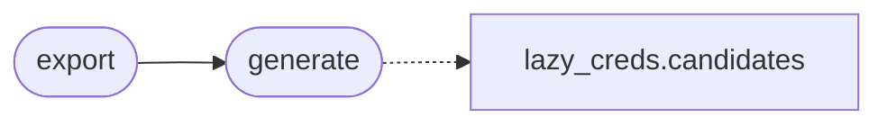

# `modules.lazypassgen`

> Source: [modules/lazypassgen.py:1](../../modules/lazypassgen.py#L1) | language `py` | coverage 100.0% | [API index](../index.md)

LazyPassGen: target-aware weak-password generator for LazyOwn.

Synthesises candidate password lists around one target entity (company or
host name) and seeds them with the local default-credential knowledge base
(`[`modules.lazy_creds`](modules.lazy_creds.py.md)`) plus common suffix/leetspeak mutations, seasons and
recent years. Pure in-memory generation writing one text artefact; no
network, no shell.

**Example**

```pycon
>>> from modules import lazypassgen
>>> "acme2025" in lazypassgen.generate("acme")["passwords"]
True
```

## Contents

- **Functions:** [`generate`](#generate), [`export`](#export)
- **Constants:** [`MAX_DEFAULT_SEEDS`](#max_default_seeds), [`MAX_MUTATIONS`](#max_mutations)

## Call Graph

Solid arrows stay in this module, dashed arrows leave it.



## Functions

<a id="generate"></a>

### `generate`

`function` | [modules/lazypassgen.py:115](../../modules/lazypassgen.py#L115)

```python
def generate(target: str) -> dict[str, Any]
```

Generate the candidate set for one target entity.

**Parameters**

| Name | Type | Default | Description |
|---|---|---|---|
| `target` | `str` |  | Target company/host name used for seed mutations. |

**Returns:** `dict[str, Any]` - Mapping with ``passwords`` (mutation tuple), ``frequent_seeds``
(default-credential pairs) and ``total``; empty when ``target``
is empty.

*Calls:* [`candidates`](modules.lazy_creds.py.md#candidates)

*Called by:* [`export`](#export)

---

<a id="export"></a>

### `export`

`function` | [modules/lazypassgen.py:135](../../modules/lazypassgen.py#L135)

```python
def export(target: str, path: Path | str) -> dict[str, Any]
```

Write the generated wordlist as one password per line.

**Parameters**

| Name | Type | Default | Description |
|---|---|---|---|
| `target` | `str` |  | Target entity name. |
| `path` | `Path \| str` |  | Destination file (created/overwritten). |

**Returns:** `dict[str, Any]` - Mapping with ``written`` and ``error``.

*Calls:* [`generate`](#generate)

---

## Constants

<a id="max_default_seeds"></a>

### `MAX_DEFAULT_SEEDS`

`constant` | [modules/lazypassgen.py:21](../../modules/lazypassgen.py#L21)

```python
MAX_DEFAULT_SEEDS = 64
```

---

<a id="max_mutations"></a>

### `MAX_MUTATIONS`

`constant` | [modules/lazypassgen.py:22](../../modules/lazypassgen.py#L22)

```python
MAX_MUTATIONS = 4096
```

---
