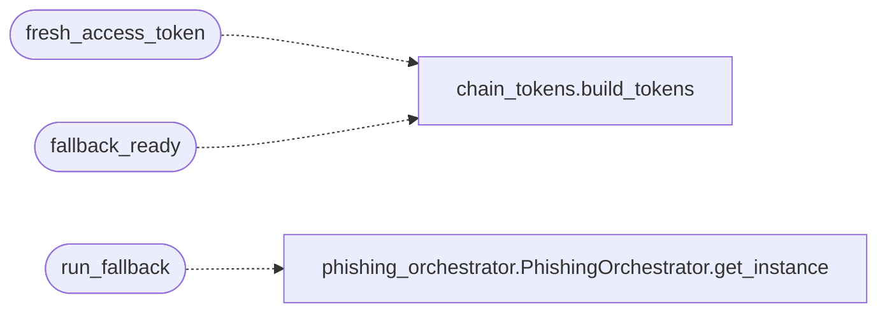

# `modules.lazypoophish`

> Source: [modules/lazypoophish.py:1](../../modules/lazypoophish.py#L1) | language `py` | coverage 100.0% | [API index](../index.md)

LazyPoophish: phishing fallback delivery for the LazyOwn autonomous loop.

When the loop finishes without a foothold (no access token beyond ``none``
in the fact store), this module stages a client-subject delivery as the
next move: it launches a campaign through
[`modules.phishing_orchestrator.PhishingOrchestrator`](modules.phishing_orchestrator.py.md#phishingorchestrator), optionally
rewrites the lure link through [`modules.lazyshortener`](modules.lazyshortener.py.md), and records
the handoff plus URLs into ``sessions/phishing_fallback_<campaign>.json``.
Sending real email only happens when SMTP credentials already live in
``payload.json``; otherwise the campaign stays offline (preview emails
only), so the fallback is safe by default.

**Example**

```pycon
>>> from modules import lazypoophish
>>> lazypoophish.MODES
('credential_harvest', 'payload_delivery', 'callback_beacon')
```

## Contents

- **Functions:** [`fresh_access_token`](#fresh_access_token), [`fallback_ready`](#fallback_ready), [`run_fallback`](#run_fallback)
- **Constants:** [`SESSIONS_DIR`](#sessions_dir), [`FALLBACK_ARTIFACT_PREFIX`](#fallback_artifact_prefix), [`FALLBACK_ACCESS_VALUES`](#fallback_access_values), [`DEFAULT_TEMPLATE`](#default_template), [`DEFAULT_SHORTENER_PROVIDER`](#default_shortener_provider), [`MODES`](#modes)

## Call Graph

Solid arrows stay in this module, dashed arrows leave it.



## Functions

<a id="fresh_access_token"></a>

### `fresh_access_token`

`function` | [modules/lazypoophish.py:34](../../modules/lazypoophish.py#L34)

```python
def fresh_access_token(target: str) -> str
```

Return the current access level token for a target.

**Parameters**

| Name | Type | Default | Description |
|---|---|---|---|
| `target` | `str` |  | Engaged host address (empty disables resolution). |

**Returns:** `str` - Access string such as ``none``, `[`shell`](lazyc2.state.py.md#shell)`, `[`root`](modules.workspace.py.md#root)`; ``none``
when facts are unavailable or the host is unknown.

*Calls:* [`build_tokens`](modules.chain_tokens.py.md#build_tokens)

---

<a id="fallback_ready"></a>

### `fallback_ready`

`function` | [modules/lazypoophish.py:52](../../modules/lazypoophish.py#L52)

```python
def fallback_ready(target: str) -> bool
```

Return True when the target still lacks a foothold.

**Parameters**

| Name | Type | Default | Description |
|---|---|---|---|
| `target` | `str` |  | Engaged host address. |

**Returns:** `bool` - True when the fact-store access level is absent or ``none``;
False once any sessionAccessType exists.

*Calls:* [`build_tokens`](modules.chain_tokens.py.md#build_tokens)

---

<a id="run_fallback"></a>

### `run_fallback`

`function` | [modules/lazypoophish.py:71](../../modules/lazypoophish.py#L71)

```python
def run_fallback(target: str, params: dict[str, Any] | None = None, template: str = DEFAULT_TEMPLATE, mode: str = MODES[0], targets_file: str = '', provider: str = DEFAULT_SHORTENER_PROVIDER, shorten: bool = True) -> dict[str, Any]
```

Stage the phishing-fallback handoff for one failed loop run.

Launches the campaign (offline previews unless SMTP exists in
``payload.json``), rewrites the lure link through the keyless
shortener and writes the handoff artefact.

**Parameters**

| Name | Type | Default | Description |
|---|---|---|---|
| `target` | `str` |  | Engaged host (informational in the artefact). |
| `params` | `dict[str, Any] \| None` | `None` | Payload mapping forwarded to the campaign. |
| `template` | `str` | `DEFAULT_TEMPLATE` | Phishing template name. |
| `mode` | `str` | `MODES[0]` | One of [`MODES`](#modes). |
| `targets_file` | `str` | `''` | Optional targets CSV for explicit recipient scope. |
| `provider` | `str` | `DEFAULT_SHORTENER_PROVIDER` | Shortener provider key. |
| `shorten` | `bool` | `True` | When False the raw campaign URL stays in the lure. |

**Returns:** `dict[str, Any]` - Summary mapping with ``campaign_id``, `[`ok`](scripts.top_tier_check.py.md#ok)`, ``short_url``,
``artifact`` and ``error``; never raises.

*Calls:* [`PhishingOrchestrator.get_instance`](modules.phishing_orchestrator.py.md#phishingorchestrator-get_instance)

---

## Constants

<a id="sessions_dir"></a>

### `SESSIONS_DIR`

`constant` | [modules/lazypoophish.py:25](../../modules/lazypoophish.py#L25)

```python
SESSIONS_DIR = Path('sessions')
```

---

<a id="fallback_artifact_prefix"></a>

### `FALLBACK_ARTIFACT_PREFIX`

`constant` | [modules/lazypoophish.py:26](../../modules/lazypoophish.py#L26)

```python
FALLBACK_ARTIFACT_PREFIX = 'phishing_fallback_'
```

---

<a id="fallback_access_values"></a>

### `FALLBACK_ACCESS_VALUES`

`constant` | [modules/lazypoophish.py:27](../../modules/lazypoophish.py#L27)

```python
FALLBACK_ACCESS_VALUES = ('none', '')
```

---

<a id="default_template"></a>

### `DEFAULT_TEMPLATE`

`constant` | [modules/lazypoophish.py:28](../../modules/lazypoophish.py#L28)

```python
DEFAULT_TEMPLATE = 'microsoft_365_login'
```

---

<a id="default_shortener_provider"></a>

### `DEFAULT_SHORTENER_PROVIDER`

`constant` | [modules/lazypoophish.py:29](../../modules/lazypoophish.py#L29)

```python
DEFAULT_SHORTENER_PROVIDER = 'isgd'
```

---

<a id="modes"></a>

### `MODES`

`constant` | [modules/lazypoophish.py:31](../../modules/lazypoophish.py#L31)

```python
MODES = ('credential_harvest', 'payload_delivery', 'callback_beacon')
```

---
