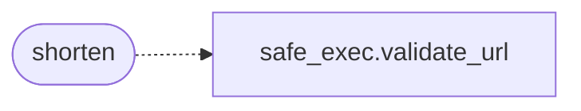

# `modules.lazyshortener`

> Source: [modules/lazyshortener.py:1](../../modules/lazyshortener.py#L1) | language `py` | coverage 100.0% | [API index](../index.md)

LazyShortener: URL shortener bridge for LazyOwn phishing delivery.

Calls keyless public shortener APIs (is.gd and v.gd) over HTTPS with a
validated URL, returning the short link written into lure emails when the
autonomous loop falls back to client-subject delivery. Single outbound
HTTP GET; no shell, no binaries, no secrets.

**Example**

```pycon
>>> from modules import lazyshortener
>>> bool(lazyshortener.PROVIDERS)
True
```

## Contents

- **Functions:** [`providers`](#providers), [`shorten`](#shorten)
- **Constants:** [`DEFAULT_TIMEOUT_SEC`](#default_timeout_sec), [`DEFAULT_PROVIDER`](#default_provider), [`PROVIDERS`](#providers)

## Call Graph

Solid arrows stay in this module, dashed arrows leave it.



## Functions

<a id="providers"></a>

### `providers`

`function` | [modules/lazyshortener.py:30](../../modules/lazyshortener.py#L30)

```python
def providers() -> tuple[str, ...]
```

Return every supported shortener provider key.

**Returns:** `tuple[str, ...]`

---

<a id="shorten"></a>

### `shorten`

`function` | [modules/lazyshortener.py:35](../../modules/lazyshortener.py#L35)

```python
def shorten(url: str, provider: str = DEFAULT_PROVIDER, timeout: float = DEFAULT_TIMEOUT_SEC) -> dict[str, Any]
```

Shorten one URL through a keyless public provider.

**Parameters**

| Name | Type | Default | Description |
|---|---|---|---|
| `url` | `str` |  | Absolute http/https URL to shorten. |
| `provider` | `str` | `DEFAULT_PROVIDER` | One of [`providers`](#providers) (default ``isgd``). |
| `timeout` | `float` | `DEFAULT_TIMEOUT_SEC` | HTTP timeout in seconds. |

**Returns:** `dict[str, Any]` - Mapping with `[`ok`](scripts.top_tier_check.py.md#ok)`, ``short_url``, `[`provider`](modules.lazycloud.py.md#cloudresource-provider)` and ``error``.

*Calls:* [`validate_url`](core.safe_exec.py.md#validate_url)

---

## Constants

<a id="default_timeout_sec"></a>

### `DEFAULT_TIMEOUT_SEC`

`constant` | [modules/lazyshortener.py:21](../../modules/lazyshortener.py#L21)

```python
DEFAULT_TIMEOUT_SEC = 15.0
```

---

<a id="default_provider"></a>

### `DEFAULT_PROVIDER`

`constant` | [modules/lazyshortener.py:22](../../modules/lazyshortener.py#L22)

```python
DEFAULT_PROVIDER = 'isgd'
```

---

<a id="providers"></a>

### `PROVIDERS`

`constant` | [modules/lazyshortener.py:24](../../modules/lazyshortener.py#L24)

```python
PROVIDERS: dict[str, str] = {'isgd': 'https://is.gd/create.php', 'vgd': 'https://v.gd/create.php'}
```

---
