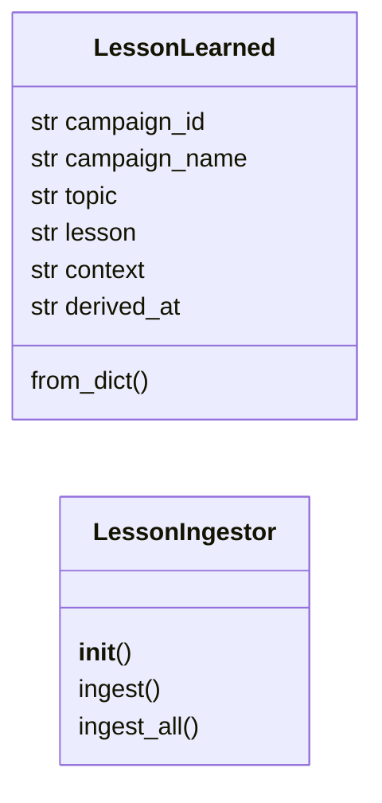
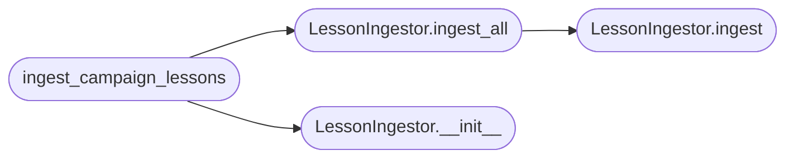

# `modules.lesson_ingestor`

> Source: [modules/lesson_ingestor.py:1](../../modules/lesson_ingestor.py#L1) | language `py` | coverage 75.0% | [API index](../index.md)

Lesson ingestion bridge between EpisodeReflectionEngine and MoERouter.

After a campaign completes, [`EpisodeReflectionEngine`](skills.lazyown_campaign.py.md#episodereflectionengine) in
``skills/lazyown_campaign.py`` extracts [`LessonLearned`](#lessonlearned) records and
persists them to ``sessions/campaign_lessons.jsonl`` and Hive Memory
(ChromaDB).  However, those lessons were never fed back into the MoE router
or RL trainer to influence future expert selection.

This module closes that gap.  [`LessonIngestor`](#lessoningestor) reads lessons and
applies lightweight adjustments to:

1. `[`ExpertPerformanceStore`](modules.moe_router.py.md#expertperformancestore)` — boosts the EMA reward for experts that
   executed techniques matching the lesson's topic.
2. `[`RLTrainer`](modules.rl_trainer.py.md#rltrainer)` — applies a small positive reward to the
   ``(task_type, expert)`` Q-entry so the epsilon-greedy policy prefers
   that expert for the same task type in future campaigns.

Design (SOLID)
--------------
- Single Responsibility : lesson → expert mapping + weight adjustment only.
- Open/Closed           : new lesson topics added to ``_LESSON_TO_EXPERT``.
- Dependency Inversion  : depends on `[`get_router`](modules.moe_router.py.md#get_router)` / `[`get_trainer`](modules.rl_trainer.py.md#get_trainer)`
  factory functions, not concrete classes.

## Contents

- **Classes:** [`LessonLearned`](#lessonlearned), [`LessonIngestor`](#lessoningestor)
- **Functions:** [`ingest_campaign_lessons`](#ingest_campaign_lessons)

## Type Diagram



## Call Graph

Solid arrows stay in this module, dashed arrows leave it.



## Classes

<a id="lessonlearned"></a>

### `LessonLearned`

`class` `dataclass` | [modules/lesson_ingestor.py:55](../../modules/lesson_ingestor.py#L55)

Decorators: `@dataclass`

```python
class LessonLearned
```

Minimal representation of a campaign lesson for ingestion.

**Attributes**

| Name | Type | Default | Description |
|---|---|---|---|
| [`campaign_id`](#lessonlearned-campaign_id) | `str` |  |  |
| [`campaign_name`](#lessonlearned-campaign_name) | `str` |  |  |
| [`topic`](#lessonlearned-topic) | `str` |  |  |
| [`lesson`](#lessonlearned-lesson) | `str` |  |  |
| [`context`](#lessonlearned-context) | `str` |  |  |
| [`derived_at`](#lessonlearned-derived_at) | `str` | `''` |  |

**Members**

| Member | Kind | Summary |
|---|---|---|
| [`from_dict`](#lessonlearned-from_dict) | classmethod |  |

<a id="lessonlearned-from_dict"></a>

#### `LessonLearned.from_dict`

`classmethod` | [modules/lesson_ingestor.py:66](../../modules/lesson_ingestor.py#L66)

Decorators: `@classmethod`

```python
def from_dict(cls, d: dict[str, Any]) -> LessonLearned
```

**Parameters**

| Name | Type | Default | Description |
|---|---|---|---|
| `d` | `dict[str, Any]` |  |  |

**Returns:** `LessonLearned`

---

<a id="lessoningestor"></a>

### `LessonIngestor`

`class` | [modules/lesson_ingestor.py:77](../../modules/lesson_ingestor.py#L77)

```python
class LessonIngestor
```

Bridge between post-campaign lessons and the MoE/RL routing layer.

Reads lessons from ``sessions/campaign_lessons.jsonl`` (or an explicit
list) and applies small reward boosts to the RL Q-table and the MoE
performance store so that experts which previously succeeded for a
given topic are preferred in future campaigns.

**Members**

| Member | Kind | Summary |
|---|---|---|
| [`__init__`](#lessoningestor-__init__) | constructor |  |
| [`ingest`](#lessoningestor-ingest) | method | Apply a single lesson to the MoE performance store and RL Q-table. |
| [`ingest_all`](#lessoningestor-ingest_all) | method | Ingest a batch of lessons. |

<a id="lessoningestor-__init__"></a>

#### `LessonIngestor.__init__`

`constructor` | [modules/lesson_ingestor.py:86](../../modules/lesson_ingestor.py#L86)

```python
def __init__(self, lessons_file: Path | None = None, router: Any | None = None, trainer: Any | None = None, boost_reward: float = _BOOST_REWARD) -> None
```

**Parameters**

| Name | Type | Default | Description |
|---|---|---|---|
| `lessons_file` | `Path \| None` | `None` |  |
| `router` | `Any \| None` | `None` |  |
| `trainer` | `Any \| None` | `None` |  |
| `boost_reward` | `float` | `_BOOST_REWARD` |  |

*Called by:* [`ingest_campaign_lessons`](#ingest_campaign_lessons)

<a id="lessoningestor-ingest"></a>

#### `LessonIngestor.ingest`

`method` | [modules/lesson_ingestor.py:125](../../modules/lesson_ingestor.py#L125)

```python
def ingest(self, lesson: LessonLearned) -> bool
```

Apply a single lesson to the MoE performance store and RL Q-table.

**Parameters**

| Name | Type | Default | Description |
|---|---|---|---|
| `lesson` | `LessonLearned` |  | A [`LessonLearned`](#lessonlearned) record. |

**Returns:** `bool` - ``True`` when at least one backend was updated, ``False`` when
the lesson topic was unmapped or no backend was available.

*Called by:* [`LessonIngestor.ingest_all`](#lessoningestor-ingest_all)

<a id="lessoningestor-ingest_all"></a>

#### `LessonIngestor.ingest_all`

`method` | [modules/lesson_ingestor.py:185](../../modules/lesson_ingestor.py#L185)

```python
def ingest_all(self, lessons: list[LessonLearned] | None = None) -> int
```

Ingest a batch of lessons.

When *lessons* is ``None``, reads from the lessons JSONL file.

**Parameters**

| Name | Type | Default | Description |
|---|---|---|---|
| `lessons` | `list[LessonLearned] \| None` | `None` |  |

**Returns:** `int` - Number of lessons successfully ingested.

*Calls:* [`LessonIngestor.ingest`](#lessoningestor-ingest)

*Called by:* [`ingest_campaign_lessons`](#ingest_campaign_lessons)

---

## Functions

<a id="ingest_campaign_lessons"></a>

### `ingest_campaign_lessons`

`function` | [modules/lesson_ingestor.py:222](../../modules/lesson_ingestor.py#L222)

```python
def ingest_campaign_lessons(lessons_file: Path | None = None) -> int
```

Module-level convenience function to ingest all campaign lessons.

**Parameters**

| Name | Type | Default | Description |
|---|---|---|---|
| `lessons_file` | `Path \| None` | `None` | Optional path to a lessons JSONL file. |

**Returns:** `int` - Number of lessons successfully ingested.

*Calls:* [`LessonIngestor.__init__`](#lessoningestor-__init__), [`LessonIngestor.ingest_all`](#lessoningestor-ingest_all)

---
