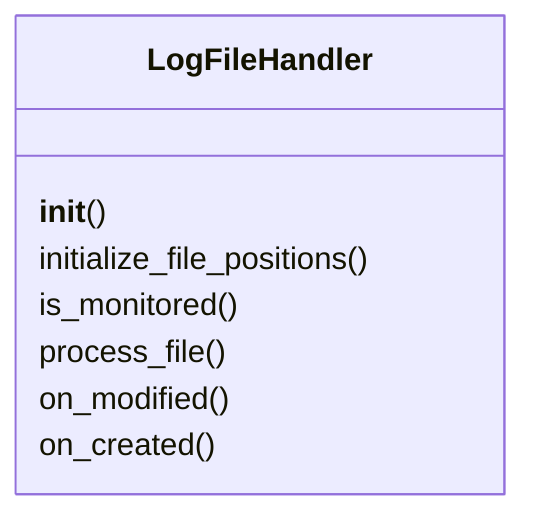
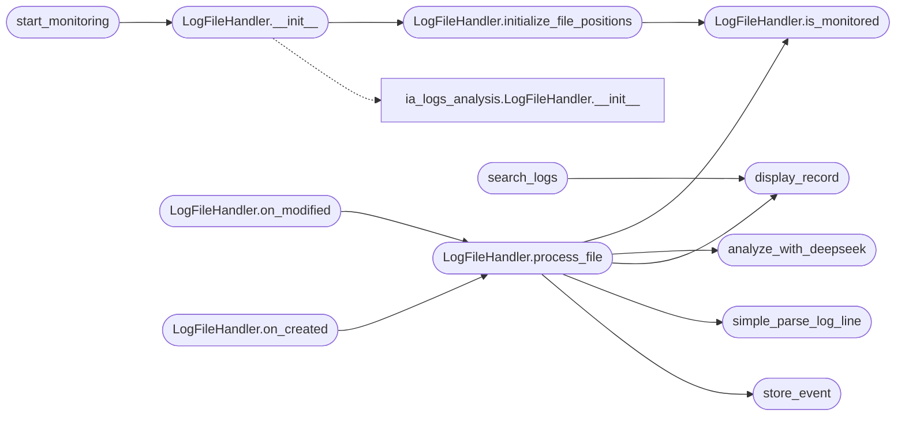

# `modules.lilsplunky`

> Source: [modules/lilsplunky.py:1](../../modules/lilsplunky.py#L1) | language `py` | coverage 86.7% | [API index](../index.md)

log_monitor_bot_v2_monolithic.py

Author: Your Name
Email: youremail@example.com
Creation Date: 14/04/2025
License: AGPL v3

Description: Real-time log monitoring bot for Linux systems (Monolithic Test Version).
             Monitors logs, performs basic parsing, uses DeepSeek for analysis per line,
             and stores structured results locally.

## Contents

- **Classes:** [`LogFileHandler`](#logfilehandler)
- **Functions:** [`simple_parse_log_line`](#simple_parse_log_line), [`store_event`](#store_event), [`analyze_with_deepseek`](#analyze_with_deepseek), [`display_record`](#display_record), [`search_logs`](#search_logs), [`start_monitoring`](#start_monitoring), [`parse_args`](#parse_args)
- **Constants:** [`LOG_FILE`](#log_file), [`OUTPUT_EVENTS_FILE`](#output_events_file), [`DEEPSEEK_API_URL`](#deepseek_api_url), [`DEEPSEEK_MODEL`](#deepseek_model), [`REQUEST_TIMEOUT`](#request_timeout), [`MONITOR_INTERVAL`](#monitor_interval), [`TEXT_LOG_FILES_PATTERNS`](#text_log_files_patterns), [`HOSTNAME`](#hostname)

## Type Diagram



## Call Graph

Solid arrows stay in this module, dashed arrows leave it.



## Classes

<a id="logfilehandler"></a>

### `LogFileHandler`

`class` | [modules/lilsplunky.py:217](../../modules/lilsplunky.py#L217)

```python
class LogFileHandler(FileSystemEventHandler)
```

Bases: `FileSystemEventHandler`

Handles file system events, reads new lines using position tracking, parses, analyzes, and stores them.

**Members**

| Member | Kind | Summary |
|---|---|---|
| [`__init__`](#logfilehandler-__init__) | constructor |  |
| [`initialize_file_positions`](#logfilehandler-initialize_file_positions) | method | Set initial position to the end of all currently monitored files. |
| [`is_monitored`](#logfilehandler-is_monitored) | method | Check if the file path matches any of the monitored patterns. |
| [`process_file`](#logfilehandler-process_file) | method | Reads new lines from a file since the last known position. |
| [`on_modified`](#logfilehandler-on_modified) | method | Triggered when a file or directory is modified. |
| [`on_created`](#logfilehandler-on_created) | method | Triggered when a file or directory is created. |

<a id="logfilehandler-__init__"></a>

#### `LogFileHandler.__init__`

`constructor` | [modules/lilsplunky.py:223](../../modules/lilsplunky.py#L223)

```python
def __init__(self, log_dir, mode='console')
```

**Parameters**

| Name | Type | Default | Description |
|---|---|---|---|
| `log_dir` |  |  |  |
| `mode` |  | `'console'` |  |

*Calls:* [`LogFileHandler.__init__`](modules.ia_logs_analysis.py.md#logfilehandler-__init__), [`LogFileHandler.initialize_file_positions`](#logfilehandler-initialize_file_positions)

*Called by:* [`start_monitoring`](#start_monitoring)

<a id="logfilehandler-initialize_file_positions"></a>

#### `LogFileHandler.initialize_file_positions`

`method` | [modules/lilsplunky.py:229](../../modules/lilsplunky.py#L229)

```python
def initialize_file_positions(self)
```

Set initial position to the end of all currently monitored files.

*Calls:* [`LogFileHandler.is_monitored`](#logfilehandler-is_monitored)

*Called by:* [`LogFileHandler.__init__`](#logfilehandler-__init__)

<a id="logfilehandler-is_monitored"></a>

#### `LogFileHandler.is_monitored`

`method` | [modules/lilsplunky.py:245](../../modules/lilsplunky.py#L245)

```python
def is_monitored(self, file_path)
```

Check if the file path matches any of the monitored patterns.

**Parameters**

| Name | Type | Default | Description |
|---|---|---|---|
| `file_path` |  |  |  |

*Called by:* [`LogFileHandler.initialize_file_positions`](#logfilehandler-initialize_file_positions), [`LogFileHandler.process_file`](#logfilehandler-process_file)

<a id="logfilehandler-process_file"></a>

#### `LogFileHandler.process_file`

`method` | [modules/lilsplunky.py:257](../../modules/lilsplunky.py#L257)

```python
def process_file(self, file_path)
```

Reads new lines from a file since the last known position.

**Parameters**

| Name | Type | Default | Description |
|---|---|---|---|
| `file_path` |  |  |  |

*Calls:* [`LogFileHandler.is_monitored`](#logfilehandler-is_monitored), [`analyze_with_deepseek`](#analyze_with_deepseek), [`display_record`](#display_record), [`simple_parse_log_line`](#simple_parse_log_line), [`store_event`](#store_event)

*Called by:* [`LogFileHandler.on_created`](#logfilehandler-on_created), [`LogFileHandler.on_modified`](#logfilehandler-on_modified)

<a id="logfilehandler-on_modified"></a>

#### `LogFileHandler.on_modified`

`method` | [modules/lilsplunky.py:331](../../modules/lilsplunky.py#L331)

```python
def on_modified(self, event)
```

Triggered when a file or directory is modified.

**Parameters**

| Name | Type | Default | Description |
|---|---|---|---|
| `event` |  |  |  |

*Calls:* [`LogFileHandler.process_file`](#logfilehandler-process_file)

<a id="logfilehandler-on_created"></a>

#### `LogFileHandler.on_created`

`method` | [modules/lilsplunky.py:336](../../modules/lilsplunky.py#L336)

```python
def on_created(self, event)
```

Triggered when a file or directory is created.

**Parameters**

| Name | Type | Default | Description |
|---|---|---|---|
| `event` |  |  |  |

*Calls:* [`LogFileHandler.process_file`](#logfilehandler-process_file)

---

## Functions

<a id="simple_parse_log_line"></a>

### `simple_parse_log_line`

`function` | [modules/lilsplunky.py:69](../../modules/lilsplunky.py#L69)

```python
def simple_parse_log_line(line, file_path)
```

Intenta extraer información básica de una línea de log.

Esto es MUY básico, idealmente se usarían regex más específicos por tipo de log.

**Parameters**

| Name | Type | Default | Description |
|---|---|---|---|
| `line` |  |  |  |
| `file_path` |  |  |  |

*Called by:* [`LogFileHandler.process_file`](#logfilehandler-process_file)

---

<a id="store_event"></a>

### `store_event`

`function` | [modules/lilsplunky.py:108](../../modules/lilsplunky.py#L108)

```python
def store_event(event_data)
```

Almacena el evento procesado (diccionario Python) como una línea JSON en el archivo de salida.

**Parameters**

| Name | Type | Default | Description |
|---|---|---|---|
| `event_data` |  |  |  |

*Called by:* [`LogFileHandler.process_file`](#logfilehandler-process_file)

---

<a id="analyze_with_deepseek"></a>

### `analyze_with_deepseek`

`function` | [modules/lilsplunky.py:123](../../modules/lilsplunky.py#L123)

```python
def analyze_with_deepseek(log_entry_data)
```

Sends a single log entry to DeepSeek for analysis.

Returns the analysis result as a Python dictionary or None if error.

**Parameters**

| Name | Type | Default | Description |
|---|---|---|---|
| `log_entry_data` |  |  |  |

*Called by:* [`LogFileHandler.process_file`](#logfilehandler-process_file)

---

<a id="display_record"></a>

### `display_record`

`function` | [modules/lilsplunky.py:346](../../modules/lilsplunky.py#L346)

```python
def display_record(record)
```

Muestra un registro procesado de forma atractiva en la consola.

**Parameters**

| Name | Type | Default | Description |
|---|---|---|---|
| `record` |  |  |  |

*Called by:* [`LogFileHandler.process_file`](#logfilehandler-process_file), [`search_logs`](#search_logs)

---

<a id="search_logs"></a>

### `search_logs`

`function` | [modules/lilsplunky.py:382](../../modules/lilsplunky.py#L382)

```python
def search_logs(query, file_path=OUTPUT_EVENTS_FILE)
```

Busca en el archivo de eventos JSONL registros que coincidan (búsqueda simple de substring).

**Parameters**

| Name | Type | Default | Description |
|---|---|---|---|
| `query` |  |  |  |
| `file_path` |  | `OUTPUT_EVENTS_FILE` |  |

*Calls:* [`display_record`](#display_record)

---

<a id="start_monitoring"></a>

### `start_monitoring`

`function` | [modules/lilsplunky.py:413](../../modules/lilsplunky.py#L413)

```python
def start_monitoring(log_dir='/var/log', mode='console')
```

Starts monitoring the specified log directory.

**Parameters**

| Name | Type | Default | Description |
|---|---|---|---|
| `log_dir` |  | `'/var/log'` |  |
| `mode` |  | `'console'` |  |

*Calls:* [`LogFileHandler.__init__`](#logfilehandler-__init__)

---

<a id="parse_args"></a>

### `parse_args`

`function` | [modules/lilsplunky.py:446](../../modules/lilsplunky.py#L446)

```python
def parse_args()
```

---

## Constants

<a id="log_file"></a>

### `LOG_FILE`

`constant` | [modules/lilsplunky.py:32](../../modules/lilsplunky.py#L32)

```python
LOG_FILE = 'log_monitor_bot.log'
```

---

<a id="output_events_file"></a>

### `OUTPUT_EVENTS_FILE`

`constant` | [modules/lilsplunky.py:33](../../modules/lilsplunky.py#L33)

```python
OUTPUT_EVENTS_FILE = 'processed_events.jsonl'
```

---

<a id="deepseek_api_url"></a>

### `DEEPSEEK_API_URL`

`constant` | [modules/lilsplunky.py:34](../../modules/lilsplunky.py#L34)

```python
DEEPSEEK_API_URL = 'http://localhost:11434/api/generate'
```

---

<a id="deepseek_model"></a>

### `DEEPSEEK_MODEL`

`constant` | [modules/lilsplunky.py:35](../../modules/lilsplunky.py#L35)

```python
DEEPSEEK_MODEL = 'deepseek-r1:1.5b'
```

---

<a id="request_timeout"></a>

### `REQUEST_TIMEOUT`

`constant` | [modules/lilsplunky.py:36](../../modules/lilsplunky.py#L36)

```python
REQUEST_TIMEOUT = 60
```

---

<a id="monitor_interval"></a>

### `MONITOR_INTERVAL`

`constant` | [modules/lilsplunky.py:37](../../modules/lilsplunky.py#L37)

```python
MONITOR_INTERVAL = 1.0
```

---

<a id="text_log_files_patterns"></a>

### `TEXT_LOG_FILES_PATTERNS`

`constant` | [modules/lilsplunky.py:41](../../modules/lilsplunky.py#L41)

```python
TEXT_LOG_FILES_PATTERNS
```

---

<a id="hostname"></a>

### `HOSTNAME`

`constant` | [modules/lilsplunky.py:63](../../modules/lilsplunky.py#L63)

```python
HOSTNAME = socket.gethostname()
```

---
