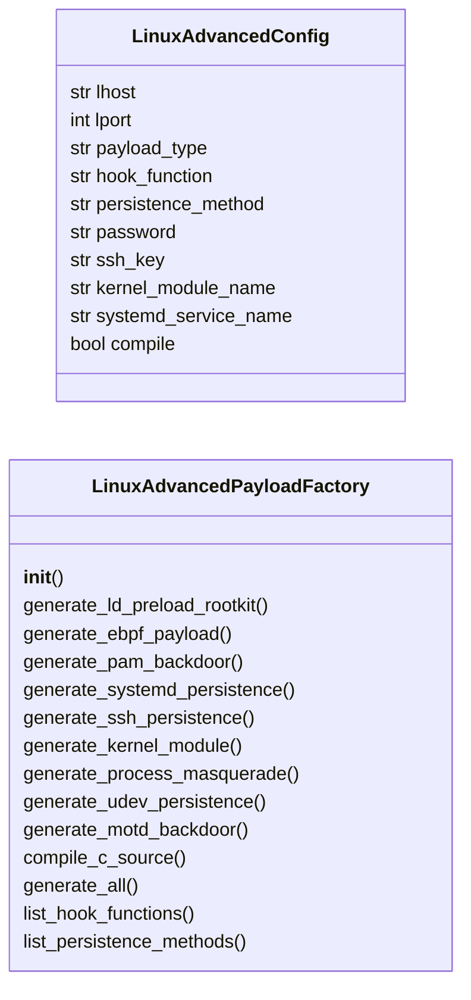
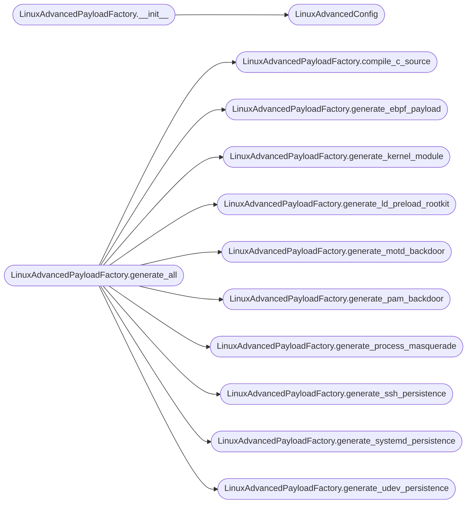

# `modules.linux_advanced_payloads`

> Source: [modules/linux_advanced_payloads.py:1](../../modules/linux_advanced_payloads.py#L1) | language `py` | coverage 82.4% | [API index](../index.md)

Advanced Linux payloads — LD_PRELOAD rootkits, eBPF, PAM backdoors, kernel implants.

Generates Linux-native payloads for persistence, privilege escalation, and
stealth. Covers LD_PRELOAD hooking, eBPF payloads, systemd timer persistence,
PAM backdoor modules, SSH authorized_keys injection, process masquerading,
and kernel module implants.

All payloads are self-contained — templates compile to functional binaries
or scripts with no external dependencies beyond standard system tools.

## Contents

- **Classes:** [`LinuxAdvancedConfig`](#linuxadvancedconfig), [`LinuxAdvancedPayloadFactory`](#linuxadvancedpayloadfactory)
- **Constants:** [`SESSIONS_DIR`](#sessions_dir), [`LD_PRELOAD_FUNCTIONS`](#ld_preload_functions), [`PERSISTENCE_METHODS_LINUX`](#persistence_methods_linux)

## Type Diagram



## Call Graph

Solid arrows stay in this module, dashed arrows leave it.



## Classes

<a id="linuxadvancedconfig"></a>

### `LinuxAdvancedConfig`

`class` `dataclass` | [modules/linux_advanced_payloads.py:64](../../modules/linux_advanced_payloads.py#L64)

Decorators: `@dataclass`

```python
class LinuxAdvancedConfig
```

Configuration for advanced Linux payload generation.

**Attributes**

| Name | Type | Default | Description |
|---|---|---|---|
| [`lhost`](#linuxadvancedconfig-lhost) | `str` | `''` | Attacker IP for reverse connections. |
| [`lport`](#linuxadvancedconfig-lport) | `int` | `443` | Listener port. |
| [`payload_type`](#linuxadvancedconfig-payload_type) | `str` | `'reverse_shell'` | generated payload category. |
| [`hook_function`](#linuxadvancedconfig-hook_function) | `str` | `'accept'` | LD_PRELOAD function to hook. |
| [`persistence_method`](#linuxadvancedconfig-persistence_method) | `str` | `'systemd_timer'` | How to persist on the target. |
| [`password`](#linuxadvancedconfig-password) | `str` | `'lazyown'` | Backdoor password for PAM / SSH access. |
| [`ssh_key`](#linuxadvancedconfig-ssh_key) | `str` | `''` | Public SSH key for authorized_keys persistence. |
| [`kernel_module_name`](#linuxadvancedconfig-kernel_module_name) | `str` | `'lazy_mod'` | Name for kernel module implants. |
| [`systemd_service_name`](#linuxadvancedconfig-systemd_service_name) | `str` | `'systemd-helper'` | Systemd service unit name. |
| [`compile`](#linuxadvancedconfig-compile) | `bool` | `True` | Attempt on-the-fly gcc compilation for C payloads. |

---

<a id="linuxadvancedpayloadfactory"></a>

### `LinuxAdvancedPayloadFactory`

`class` | [modules/linux_advanced_payloads.py:92](../../modules/linux_advanced_payloads.py#L92)

```python
class LinuxAdvancedPayloadFactory
```

Generate advanced Linux payloads for persistence, evasion, and escalation.

Produces LD_PRELOAD rootkits, eBPF programs, PAM backdoors, systemd timers,
SSH persistence, kernel modules, and process masquerading scripts.

**Members**

| Member | Kind | Summary |
|---|---|---|
| [`__init__`](#linuxadvancedpayloadfactory-__init__) | constructor |  |
| [`generate_ld_preload_rootkit`](#linuxadvancedpayloadfactory-generate_ld_preload_rootkit) | method | Generate a C source file for an LD_PRELOAD rootkit. |
| [`generate_ebpf_payload`](#linuxadvancedpayloadfactory-generate_ebpf_payload) | method | Generate an eBPF C program for network manipulation. |
| [`generate_pam_backdoor`](#linuxadvancedpayloadfactory-generate_pam_backdoor) | method | Generate a PAM (Pluggable Authentication Module) backdoor. |
| [`generate_systemd_persistence`](#linuxadvancedpayloadfactory-generate_systemd_persistence) | method | Generate systemd service and timer units for persistent callbacks. |
| [`generate_ssh_persistence`](#linuxadvancedpayloadfactory-generate_ssh_persistence) | method | Generate an SSH persistence script for authorized_keys injection. |
| [`generate_kernel_module`](#linuxadvancedpayloadfactory-generate_kernel_module) | method | Generate a Linux kernel module (LKM) rootkit. |
| [`generate_process_masquerade`](#linuxadvancedpayloadfactory-generate_process_masquerade) | method | Generate a process masquerading script. |
| [`generate_udev_persistence`](#linuxadvancedpayloadfactory-generate_udev_persistence) | method | Generate a udev rule for persistence on USB/device events. |
| [`generate_motd_backdoor`](#linuxadvancedpayloadfactory-generate_motd_backdoor) | method | Generate a Message of the Day (motd) hook for persistence. |
| [`compile_c_source`](#linuxadvancedpayloadfactory-compile_c_source) | method | Compile C source code to a binary or shared library. |
| [`generate_all`](#linuxadvancedpayloadfactory-generate_all) | method | Generate all Linux advanced payload artifacts. |
| [`list_hook_functions`](#linuxadvancedpayloadfactory-list_hook_functions) | staticmethod |  |
| [`list_persistence_methods`](#linuxadvancedpayloadfactory-list_persistence_methods) | staticmethod |  |

<a id="linuxadvancedpayloadfactory-__init__"></a>

#### `LinuxAdvancedPayloadFactory.__init__`

`constructor` | [modules/linux_advanced_payloads.py:105](../../modules/linux_advanced_payloads.py#L105)

```python
def __init__(self, config: LinuxAdvancedConfig | None = None, output_dir: Path | None = None)
```

**Parameters**

| Name | Type | Default | Description |
|---|---|---|---|
| `config` | `LinuxAdvancedConfig \| None` | `None` |  |
| `output_dir` | `Path \| None` | `None` |  |

*Calls:* [`LinuxAdvancedConfig`](#linuxadvancedconfig)

*Called by:* [`PayloadArsenalCommandSet.do_arsenal_show`](cli.commands.payload_arsenal.py.md#payloadarsenalcommandset-do_arsenal_show), [`PayloadArsenalCommandSet.do_linux_advanced_payload`](cli.commands.payload_arsenal.py.md#payloadarsenalcommandset-do_linux_advanced_payload)

<a id="linuxadvancedpayloadfactory-generate_ld_preload_rootkit"></a>

#### `LinuxAdvancedPayloadFactory.generate_ld_preload_rootkit`

`method` | [modules/linux_advanced_payloads.py:110](../../modules/linux_advanced_payloads.py#L110)

```python
def generate_ld_preload_rootkit(self) -> str
```

Generate a C source file for an LD_PRELOAD rootkit.

Hooks a specified libc function to execute malicious code before
calling the real function. Common hooks: accept (backdoor listener),
access (hide files), getdents (hide processes/files).

**Returns:** `str` - C source code for the LD_PRELOAD shared library.

*Called by:* [`PayloadArsenalCommandSet.do_linux_advanced_payload`](cli.commands.payload_arsenal.py.md#payloadarsenalcommandset-do_linux_advanced_payload), [`LinuxAdvancedPayloadFactory.generate_all`](#linuxadvancedpayloadfactory-generate_all)

<a id="linuxadvancedpayloadfactory-generate_ebpf_payload"></a>

#### `LinuxAdvancedPayloadFactory.generate_ebpf_payload`

`method` | [modules/linux_advanced_payloads.py:235](../../modules/linux_advanced_payloads.py#L235)

```python
def generate_ebpf_payload(self) -> str
```

Generate an eBPF C program for network manipulation.

Creates an eBPF program that intercepts and modifies network traffic,
useful for covert C2 channels, traffic hiding, or packet injection.

**Returns:** `str` - eBPF C source code.

*Called by:* [`PayloadArsenalCommandSet.do_linux_advanced_payload`](cli.commands.payload_arsenal.py.md#payloadarsenalcommandset-do_linux_advanced_payload), [`LinuxAdvancedPayloadFactory.generate_all`](#linuxadvancedpayloadfactory-generate_all)

<a id="linuxadvancedpayloadfactory-generate_pam_backdoor"></a>

#### `LinuxAdvancedPayloadFactory.generate_pam_backdoor`

`method` | [modules/linux_advanced_payloads.py:311](../../modules/linux_advanced_payloads.py#L311)

```python
def generate_pam_backdoor(self) -> str
```

Generate a PAM (Pluggable Authentication Module) backdoor.

Creates a shared object that hooks pam_sm_authenticate to accept
a magic password for any user. Drop into /lib/security/ and add
to the PAM stack in /etc/pam.d/common-auth or /etc/pam.d/sshd.

**Returns:** `str` - C source code for the PAM module.

*Called by:* [`PayloadArsenalCommandSet.do_linux_advanced_payload`](cli.commands.payload_arsenal.py.md#payloadarsenalcommandset-do_linux_advanced_payload), [`LinuxAdvancedPayloadFactory.generate_all`](#linuxadvancedpayloadfactory-generate_all)

<a id="linuxadvancedpayloadfactory-generate_systemd_persistence"></a>

#### `LinuxAdvancedPayloadFactory.generate_systemd_persistence`

`method` | [modules/linux_advanced_payloads.py:398](../../modules/linux_advanced_payloads.py#L398)

```python
def generate_systemd_persistence(self) -> dict[str, str]
```

Generate systemd service and timer units for persistent callbacks.

**Returns:** `dict[str, str]` - Dict with service_unit and timer_unit content strings.

*Called by:* [`PayloadArsenalCommandSet.do_linux_advanced_payload`](cli.commands.payload_arsenal.py.md#payloadarsenalcommandset-do_linux_advanced_payload), [`LinuxAdvancedPayloadFactory.generate_all`](#linuxadvancedpayloadfactory-generate_all)

<a id="linuxadvancedpayloadfactory-generate_ssh_persistence"></a>

#### `LinuxAdvancedPayloadFactory.generate_ssh_persistence`

`method` | [modules/linux_advanced_payloads.py:458](../../modules/linux_advanced_payloads.py#L458)

```python
def generate_ssh_persistence(self) -> str
```

Generate an SSH persistence script for authorized_keys injection.

**Returns:** `str` - Shell script for SSH key injection across multiple user accounts.

*Called by:* [`PayloadArsenalCommandSet.do_linux_advanced_payload`](cli.commands.payload_arsenal.py.md#payloadarsenalcommandset-do_linux_advanced_payload), [`LinuxAdvancedPayloadFactory.generate_all`](#linuxadvancedpayloadfactory-generate_all)

<a id="linuxadvancedpayloadfactory-generate_kernel_module"></a>

#### `LinuxAdvancedPayloadFactory.generate_kernel_module`

`method` | [modules/linux_advanced_payloads.py:519](../../modules/linux_advanced_payloads.py#L519)

```python
def generate_kernel_module(self) -> str
```

Generate a Linux kernel module (LKM) rootkit.

Creates a minimal kernel module that hides itself from lsmod,
hides files with a magic prefix, and provides a reverse shell
trigger via magic packet on the configured port.

**Returns:** `str` - C source code for the kernel module.

*Called by:* [`PayloadArsenalCommandSet.do_linux_advanced_payload`](cli.commands.payload_arsenal.py.md#payloadarsenalcommandset-do_linux_advanced_payload), [`LinuxAdvancedPayloadFactory.generate_all`](#linuxadvancedpayloadfactory-generate_all)

<a id="linuxadvancedpayloadfactory-generate_process_masquerade"></a>

#### `LinuxAdvancedPayloadFactory.generate_process_masquerade`

`method` | [modules/linux_advanced_payloads.py:632](../../modules/linux_advanced_payloads.py#L632)

```python
def generate_process_masquerade(self) -> str
```

Generate a process masquerading script.

Renames the process in /proc and argv to blend in with legitimate
system processes. Useful for long-running beacons.

**Returns:** `str` - Shell script for process masquerading.

*Called by:* [`LinuxAdvancedPayloadFactory.generate_all`](#linuxadvancedpayloadfactory-generate_all)

<a id="linuxadvancedpayloadfactory-generate_udev_persistence"></a>

#### `LinuxAdvancedPayloadFactory.generate_udev_persistence`

`method` | [modules/linux_advanced_payloads.py:676](../../modules/linux_advanced_payloads.py#L676)

```python
def generate_udev_persistence(self) -> str
```

Generate a udev rule for persistence on USB/device events.

**Returns:** `str` - Udev rule content string.

*Called by:* [`PayloadArsenalCommandSet.do_linux_advanced_payload`](cli.commands.payload_arsenal.py.md#payloadarsenalcommandset-do_linux_advanced_payload), [`LinuxAdvancedPayloadFactory.generate_all`](#linuxadvancedpayloadfactory-generate_all)

<a id="linuxadvancedpayloadfactory-generate_motd_backdoor"></a>

#### `LinuxAdvancedPayloadFactory.generate_motd_backdoor`

`method` | [modules/linux_advanced_payloads.py:689](../../modules/linux_advanced_payloads.py#L689)

```python
def generate_motd_backdoor(self) -> str
```

Generate a Message of the Day (motd) hook for persistence.

Executes on every SSH login by appending to /etc/update-motd.d/
or /etc/profile.d/. Triggers reverse shell in background.

**Returns:** `str` - Shell script for motd/profiled persistence.

*Called by:* [`PayloadArsenalCommandSet.do_linux_advanced_payload`](cli.commands.payload_arsenal.py.md#payloadarsenalcommandset-do_linux_advanced_payload), [`LinuxAdvancedPayloadFactory.generate_all`](#linuxadvancedpayloadfactory-generate_all)

<a id="linuxadvancedpayloadfactory-compile_c_source"></a>

#### `LinuxAdvancedPayloadFactory.compile_c_source`

`method` | [modules/linux_advanced_payloads.py:707](../../modules/linux_advanced_payloads.py#L707)

```python
def compile_c_source(self, source: str, output_name: str, shared: bool = False) -> Path | None
```

Compile C source code to a binary or shared library.

**Parameters**

| Name | Type | Default | Description |
|---|---|---|---|
| `source` | `str` |  | C source code. |
| `output_name` | `str` |  | Output filename (without extension). |
| `shared` | `bool` | `False` | Compile as shared library (.so) instead of executable. |

**Returns:** `Path | None` - Path to compiled binary, or None if compilation fails.

*Called by:* [`PayloadArsenalCommandSet.do_linux_advanced_payload`](cli.commands.payload_arsenal.py.md#payloadarsenalcommandset-do_linux_advanced_payload), [`LinuxAdvancedPayloadFactory.generate_all`](#linuxadvancedpayloadfactory-generate_all)

<a id="linuxadvancedpayloadfactory-generate_all"></a>

#### `LinuxAdvancedPayloadFactory.generate_all`

`method` | [modules/linux_advanced_payloads.py:749](../../modules/linux_advanced_payloads.py#L749)

```python
def generate_all(self) -> dict[str, Any]
```

Generate all Linux advanced payload artifacts.

**Returns:** `dict[str, Any]` - Dict with all generated payloads, compiled binaries, and install instructions.

*Calls:* [`LinuxAdvancedPayloadFactory.compile_c_source`](#linuxadvancedpayloadfactory-compile_c_source), [`LinuxAdvancedPayloadFactory.generate_ebpf_payload`](#linuxadvancedpayloadfactory-generate_ebpf_payload), [`LinuxAdvancedPayloadFactory.generate_kernel_module`](#linuxadvancedpayloadfactory-generate_kernel_module), [`LinuxAdvancedPayloadFactory.generate_ld_preload_rootkit`](#linuxadvancedpayloadfactory-generate_ld_preload_rootkit), [`LinuxAdvancedPayloadFactory.generate_motd_backdoor`](#linuxadvancedpayloadfactory-generate_motd_backdoor), [`LinuxAdvancedPayloadFactory.generate_pam_backdoor`](#linuxadvancedpayloadfactory-generate_pam_backdoor), [`LinuxAdvancedPayloadFactory.generate_process_masquerade`](#linuxadvancedpayloadfactory-generate_process_masquerade), [`LinuxAdvancedPayloadFactory.generate_ssh_persistence`](#linuxadvancedpayloadfactory-generate_ssh_persistence), [`LinuxAdvancedPayloadFactory.generate_systemd_persistence`](#linuxadvancedpayloadfactory-generate_systemd_persistence), [`LinuxAdvancedPayloadFactory.generate_udev_persistence`](#linuxadvancedpayloadfactory-generate_udev_persistence)

*Called by:* [`PayloadArsenalCommandSet.do_linux_advanced_payload`](cli.commands.payload_arsenal.py.md#payloadarsenalcommandset-do_linux_advanced_payload)

<a id="linuxadvancedpayloadfactory-list_hook_functions"></a>

#### `LinuxAdvancedPayloadFactory.list_hook_functions`

`staticmethod` | [modules/linux_advanced_payloads.py:793](../../modules/linux_advanced_payloads.py#L793)

Decorators: `@staticmethod`

```python
def list_hook_functions() -> list[str]
```

**Returns:** `list[str]`

*Called by:* [`PayloadArsenalCommandSet.do_arsenal_show`](cli.commands.payload_arsenal.py.md#payloadarsenalcommandset-do_arsenal_show)

<a id="linuxadvancedpayloadfactory-list_persistence_methods"></a>

#### `LinuxAdvancedPayloadFactory.list_persistence_methods`

`staticmethod` | [modules/linux_advanced_payloads.py:797](../../modules/linux_advanced_payloads.py#L797)

Decorators: `@staticmethod`

```python
def list_persistence_methods() -> list[str]
```

**Returns:** `list[str]`

*Called by:* [`PayloadArsenalCommandSet.do_arsenal_show`](cli.commands.payload_arsenal.py.md#payloadarsenalcommandset-do_arsenal_show)

---

## Constants

<a id="sessions_dir"></a>

### `SESSIONS_DIR`

`constant` | [modules/linux_advanced_payloads.py:22](../../modules/linux_advanced_payloads.py#L22)

```python
SESSIONS_DIR = Path(__file__).resolve().parent.parent / 'sessions'
```

---

<a id="ld_preload_functions"></a>

### `LD_PRELOAD_FUNCTIONS`

`constant` | [modules/linux_advanced_payloads.py:24](../../modules/linux_advanced_payloads.py#L24)

```python
LD_PRELOAD_FUNCTIONS
```

---

<a id="persistence_methods_linux"></a>

### `PERSISTENCE_METHODS_LINUX`

`constant` | [modules/linux_advanced_payloads.py:47](../../modules/linux_advanced_payloads.py#L47)

```python
PERSISTENCE_METHODS_LINUX
```

---
