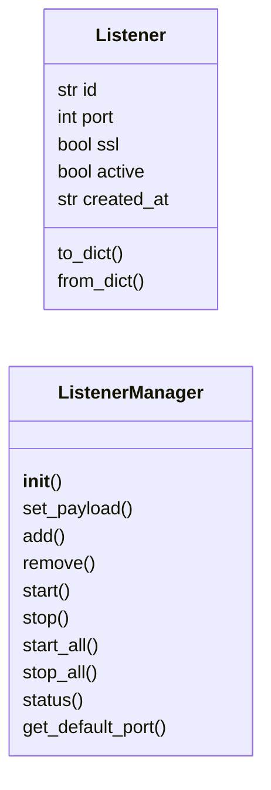
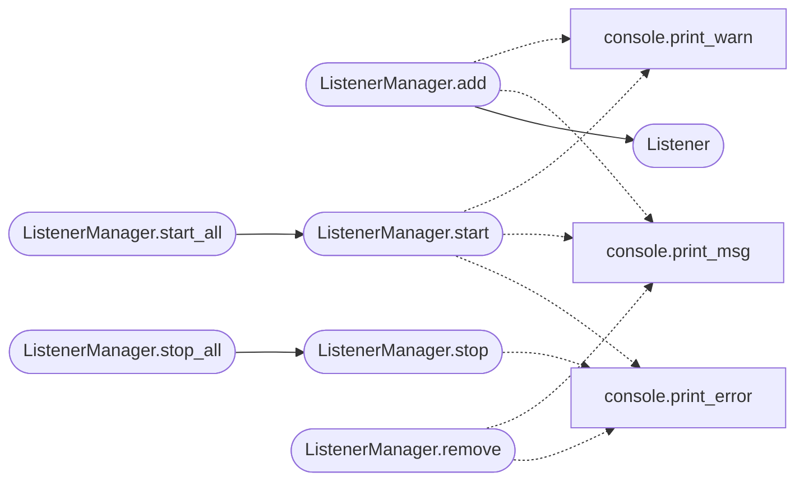

# `modules.listener_manager`

> Source: [modules/listener_manager.py:1](../../modules/listener_manager.py#L1) | language `py` | coverage 80.0% | [API index](../index.md)

Multi-listener manager for LazyOwn C2.

Allows the C2 to listen on multiple ports simultaneously, each serving the
same Flask application.  Beacons/implants can connect to any listener and
share the same global state (commands, results, connected_clients).

Persistence: ``sessions/listeners.json`` stores the listener configuration.

Bind address: never hardcoded. The address comes from ``payload.json``
via ``c2_bind_address`` or ``lhost``. Wildcard literals (``""``,
``"0.0.0.0"``, ``"::"``) are rejected at the bind site; if the operator
wants to expose the listener on a network interface they must put that
interface's specific IP in ``payload.json``.

## Contents

- **Classes:** [`Listener`](#listener), [`ListenerManager`](#listenermanager)

## Type Diagram



## Call Graph

Solid arrows stay in this module, dashed arrows leave it.



## Classes

<a id="listener"></a>

### `Listener`

`class` `dataclass` | [modules/listener_manager.py:141](../../modules/listener_manager.py#L141)

Decorators: `@dataclass`

```python
class Listener
```

A single C2 listener endpoint.

**Attributes**

| Name | Type | Default | Description |
|---|---|---|---|
| [`id`](#listener-id) | `str` |  |  |
| [`port`](#listener-port) | `int` |  |  |
| [`ssl`](#listener-ssl) | `bool` | `False` |  |
| [`active`](#listener-active) | `bool` | `True` |  |
| [`created_at`](#listener-created_at) | `str` | `field(default_factory=lambda: time.strftime('%Y-%m-%dT%H:%M:%S'))` |  |

**Members**

| Member | Kind | Summary |
|---|---|---|
| [`to_dict`](#listener-to_dict) | method |  |
| [`from_dict`](#listener-from_dict) | classmethod |  |

<a id="listener-to_dict"></a>

#### `Listener.to_dict`

`method` | [modules/listener_manager.py:152](../../modules/listener_manager.py#L152)

```python
def to_dict(self) -> dict[str, Any]
```

**Returns:** `dict[str, Any]`

<a id="listener-from_dict"></a>

#### `Listener.from_dict`

`classmethod` | [modules/listener_manager.py:162](../../modules/listener_manager.py#L162)

Decorators: `@classmethod`

```python
def from_dict(cls, data: dict[str, Any]) -> Listener
```

**Parameters**

| Name | Type | Default | Description |
|---|---|---|---|
| `data` | `dict[str, Any]` |  |  |

**Returns:** `Listener`

---

<a id="listenermanager"></a>

### `ListenerManager`

`class` | [modules/listener_manager.py:172](../../modules/listener_manager.py#L172)

```python
class ListenerManager
```

Manage multiple C2 listener ports.

``app`` may be ``None`` when used from the CLI for config-only operations
(add, remove, list).  Start/stop require a live Flask application instance.

**Members**

| Member | Kind | Summary |
|---|---|---|
| [`__init__`](#listenermanager-__init__) | constructor |  |
| [`set_payload`](#listenermanager-set_payload) | method | Update the payload mapping used to resolve the bind address. |
| [`add`](#listenermanager-add) | method | Register a new listener configuration (does not start it). |
| [`remove`](#listenermanager-remove) | method | Remove a listener configuration. |
| [`start`](#listenermanager-start) | method | Start a single listener. |
| [`stop`](#listenermanager-stop) | method | Stop a single listener. |
| [`start_all`](#listenermanager-start_all) | method | Start every listener marked as active. |
| [`stop_all`](#listenermanager-stop_all) | method | Stop every running listener. |
| [`status`](#listenermanager-status) | method | Return status of all listeners. |
| [`get_default_port`](#listenermanager-get_default_port) | method | Return the port of the first active listener, or fallback. |

<a id="listenermanager-__init__"></a>

#### `ListenerManager.__init__`

`constructor` | [modules/listener_manager.py:179](../../modules/listener_manager.py#L179)

```python
def __init__(self, app: Any = None, sessions_dir: str = 'sessions', payload: dict[str, Any] | None = None)
```

**Parameters**

| Name | Type | Default | Description |
|---|---|---|---|
| `app` | `Any` | `None` |  |
| `sessions_dir` | `str` | `'sessions'` |  |
| `payload` | `dict[str, Any] \| None` | `None` |  |

*Called by:* [`CommandAndControlMigratedCommandSet.do_listener`](cli.commands.command_and_control_migrated.py.md#commandandcontrolmigratedcommandset-do_listener)

<a id="listenermanager-set_payload"></a>

#### `ListenerManager.set_payload`

`method` | [modules/listener_manager.py:187](../../modules/listener_manager.py#L187)

```python
def set_payload(self, payload: dict[str, Any] | None) -> None
```

Update the payload mapping used to resolve the bind address.

**Parameters**

| Name | Type | Default | Description |
|---|---|---|---|
| `payload` | `dict[str, Any] \| None` |  |  |

<a id="listenermanager-add"></a>

#### `ListenerManager.add`

`method` | [modules/listener_manager.py:229](../../modules/listener_manager.py#L229)

```python
def add(self, port: int, ssl: bool = False, listener_id: str | None = None) -> Listener
```

Register a new listener configuration (does not start it).

**Parameters**

| Name | Type | Default | Description |
|---|---|---|---|
| `port` | `int` |  |  |
| `ssl` | `bool` | `False` |  |
| `listener_id` | `str \| None` | `None` |  |

**Returns:** `Listener`

*Calls:* [`print_msg`](core.console.py.md#print_msg), [`print_warn`](core.console.py.md#print_warn), [`Listener`](#listener)

*Called by:* [`CommandAndControlMigratedCommandSet.do_listener`](cli.commands.command_and_control_migrated.py.md#commandandcontrolmigratedcommandset-do_listener)

<a id="listenermanager-remove"></a>

#### `ListenerManager.remove`

`method` | [modules/listener_manager.py:242](../../modules/listener_manager.py#L242)

```python
def remove(self, listener_id: str) -> bool
```

Remove a listener configuration.

**Parameters**

| Name | Type | Default | Description |
|---|---|---|---|
| `listener_id` | `str` |  |  |

**Returns:** `bool`

*Calls:* [`print_error`](core.console.py.md#print_error), [`print_msg`](core.console.py.md#print_msg)

*Called by:* [`CommandAndControlMigratedCommandSet.do_listener`](cli.commands.command_and_control_migrated.py.md#commandandcontrolmigratedcommandset-do_listener)

<a id="listenermanager-start"></a>

#### `ListenerManager.start`

`method` | [modules/listener_manager.py:255](../../modules/listener_manager.py#L255)

```python
def start(self, listener_id: str) -> bool
```

Start a single listener.

Requires a live Flask ``app`` instance.  Returns ``False`` immediately
when called without one (CLI config-only mode).

**Parameters**

| Name | Type | Default | Description |
|---|---|---|---|
| `listener_id` | `str` |  |  |

**Returns:** `bool`

*Calls:* [`print_error`](core.console.py.md#print_error), [`print_msg`](core.console.py.md#print_msg), [`print_warn`](core.console.py.md#print_warn)

*Called by:* [`ListenerManager.start_all`](#listenermanager-start_all)

<a id="listenermanager-stop"></a>

#### `ListenerManager.stop`

`method` | [modules/listener_manager.py:335](../../modules/listener_manager.py#L335)

```python
def stop(self, listener_id: str) -> bool
```

Stop a single listener.

**Parameters**

| Name | Type | Default | Description |
|---|---|---|---|
| `listener_id` | `str` |  |  |

**Returns:** `bool`

*Calls:* [`print_error`](core.console.py.md#print_error)

*Called by:* [`ListenerManager.stop_all`](#listenermanager-stop_all)

<a id="listenermanager-start_all"></a>

#### `ListenerManager.start_all`

`method` | [modules/listener_manager.py:356](../../modules/listener_manager.py#L356)

```python
def start_all(self) -> None
```

Start every listener marked as active.

*Calls:* [`ListenerManager.start`](#listenermanager-start)

<a id="listenermanager-stop_all"></a>

#### `ListenerManager.stop_all`

`method` | [modules/listener_manager.py:362](../../modules/listener_manager.py#L362)

```python
def stop_all(self) -> None
```

Stop every running listener.

*Calls:* [`ListenerManager.stop`](#listenermanager-stop)

<a id="listenermanager-status"></a>

#### `ListenerManager.status`

`method` | [modules/listener_manager.py:367](../../modules/listener_manager.py#L367)

```python
def status(self) -> list[dict[str, Any]]
```

Return status of all listeners.

**Returns:** `list[dict[str, Any]]`

*Called by:* [`CommandAndControlMigratedCommandSet.do_listener`](cli.commands.command_and_control_migrated.py.md#commandandcontrolmigratedcommandset-do_listener)

<a id="listenermanager-get_default_port"></a>

#### `ListenerManager.get_default_port`

`method` | [modules/listener_manager.py:379](../../modules/listener_manager.py#L379)

```python
def get_default_port(self, fallback: int = 4444) -> int
```

Return the port of the first active listener, or fallback.

**Parameters**

| Name | Type | Default | Description |
|---|---|---|---|
| `fallback` | `int` | `4444` |  |

**Returns:** `int`

---
