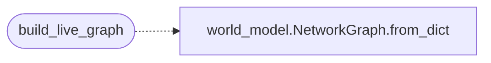

# `modules.live_surface`

> Source: [modules/live_surface.py:1](../../modules/live_surface.py#L1) | language `py` | coverage 100.0% | [API index](../index.md)

Live attack-surface graph derived from the world model.

The static ``templates/graph.html`` is a one-off pyvis export with hardcoded
nodes; it cannot reflect an engagement in progress. This module builds a
*live* graph instead, straight from ``sessions/world_model.json`` (the
authoritative campaign state written by the autonomous daemon and the CLI).

The output is a vis-network-friendly payload — ``nodes``, ``edges`` and a
`[`stats`](modules.verb_catalog.py.md#stats)` block — that the ``/surface_live`` page polls on an interval so the
topology updates as hosts move from *unscanned* to *owned*. Compromised hosts
and high-centrality pivot points are flagged with ``pulse`` so the front end
can animate them.

Centrality is computed with the existing [`modules.world_model.NetworkGraph`](modules.world_model.py.md#networkgraph)
(normalized degree centrality), so this module adds presentation only and never
re-implements graph reasoning. It imports nothing from ``lazyc2.py`` and is a
pure transformation, which keeps it unit-testable.

## Contents

- **Functions:** [`build_live_graph`](#build_live_graph)
- **Constants:** [`HOST_PREFIX`](#host_prefix), [`SERVICE_PREFIX`](#service_prefix), [`GROUP_HOST`](#group_host), [`GROUP_SERVICE`](#group_service), [`GROUP_OTHER`](#group_other), [`COMPROMISED_STATES`](#compromised_states), [`NODE_VALUE_BASE`](#node_value_base), [`NODE_VALUE_CENTRALITY_SCALE`](#node_value_centrality_scale), [`PULSE_CENTRALITY_THRESHOLD`](#pulse_centrality_threshold), [`PIVOT_TOP_K`](#pivot_top_k), [`RUNS_SERVICE_RELATION`](#runs_service_relation)

## Call Graph

Solid arrows stay in this module, dashed arrows leave it.



## Functions

<a id="build_live_graph"></a>

### `build_live_graph`

`function` | [modules/live_surface.py:72](../../modules/live_surface.py#L72)

```python
def build_live_graph(world: dict[str, Any]) -> dict[str, Any]
```

Build a live vis-network payload from a world-model snapshot.

**Parameters**

| Name | Type | Default | Description |
|---|---|---|---|
| `world` | `dict[str, Any]` |  | Parsed ``world_model.json`` content. Missing or malformed sections degrade gracefully to an empty graph. |

**Returns:** `dict[str, Any]` - A dictionary with ``nodes``, ``edges`` and `[`stats`](modules.verb_catalog.py.md#stats)` keys. Each node
carries ``id``, ``label``, `[`group`](cli.banner_config.py.md#segmentspec-group)`, ``state``, ``centrality``,
``value``, ``pulse`` and ``title``. Each edge carries ``from``, ``to``,
``relation`` and ``value``.

*Calls:* [`NetworkGraph.from_dict`](modules.world_model.py.md#networkgraph-from_dict)

---

## Constants

<a id="host_prefix"></a>

### `HOST_PREFIX`

`constant` | [modules/live_surface.py:29](../../modules/live_surface.py#L29)

```python
HOST_PREFIX: str = 'host:'
```

---

<a id="service_prefix"></a>

### `SERVICE_PREFIX`

`constant` | [modules/live_surface.py:30](../../modules/live_surface.py#L30)

```python
SERVICE_PREFIX: str = 'service:'
```

---

<a id="group_host"></a>

### `GROUP_HOST`

`constant` | [modules/live_surface.py:32](../../modules/live_surface.py#L32)

```python
GROUP_HOST: str = 'host'
```

---

<a id="group_service"></a>

### `GROUP_SERVICE`

`constant` | [modules/live_surface.py:33](../../modules/live_surface.py#L33)

```python
GROUP_SERVICE: str = 'service'
```

---

<a id="group_other"></a>

### `GROUP_OTHER`

`constant` | [modules/live_surface.py:34](../../modules/live_surface.py#L34)

```python
GROUP_OTHER: str = 'node'
```

---

<a id="compromised_states"></a>

### `COMPROMISED_STATES`

`constant` | [modules/live_surface.py:36](../../modules/live_surface.py#L36)

```python
COMPROMISED_STATES: frozenset[str] = frozenset({'exploited', 'owned'})
```

---

<a id="node_value_base"></a>

### `NODE_VALUE_BASE`

`constant` | [modules/live_surface.py:38](../../modules/live_surface.py#L38)

```python
NODE_VALUE_BASE: int = 4
```

---

<a id="node_value_centrality_scale"></a>

### `NODE_VALUE_CENTRALITY_SCALE`

`constant` | [modules/live_surface.py:39](../../modules/live_surface.py#L39)

```python
NODE_VALUE_CENTRALITY_SCALE: int = 20
```

---

<a id="pulse_centrality_threshold"></a>

### `PULSE_CENTRALITY_THRESHOLD`

`constant` | [modules/live_surface.py:40](../../modules/live_surface.py#L40)

```python
PULSE_CENTRALITY_THRESHOLD: float = 0.25
```

---

<a id="pivot_top_k"></a>

### `PIVOT_TOP_K`

`constant` | [modules/live_surface.py:41](../../modules/live_surface.py#L41)

```python
PIVOT_TOP_K: int = 5
```

---

<a id="runs_service_relation"></a>

### `RUNS_SERVICE_RELATION`

`constant` | [modules/live_surface.py:42](../../modules/live_surface.py#L42)

```python
RUNS_SERVICE_RELATION: str = 'runs_service'
```

---
