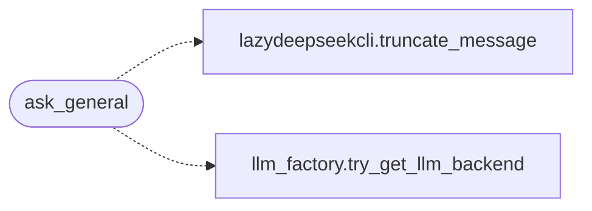

# `modules.llm_adapter`

> Source: [modules/llm_adapter.py:1](../../modules/llm_adapter.py#L1) | language `py` | coverage 100.0% | [API index](../index.md)

LLM adapter facade — single import point for all LLM backends used by lazyc2.

Consolidates the scattered LLM module imports into one adapter and preserves
every original function signature for backward compatibility with the C2
dashboard. The Groq ``process_prompt_*`` family is implemented here directly on
the canonical prompt/knowledge contract ([`modules.llm_prompts`](modules.llm_prompts.py.md)) and no
longer depends on the retired ``modules.legacy.lazygptcli*`` scripts.

The three streaming local helpers (`[`process_prompt_local`](contrib.legacy.lazydeepseekcli.py.md#process_prompt_local)`,
`[`process_prompt_localreport`](contrib.legacy.lazydeepseekcli.py.md#process_prompt_localreport)` and `[`process_prompt_local_yaml`](contrib.legacy.lazyphishingai.py.md#process_prompt_local_yaml)`) are retained
as re-exports from their Ollama-specific legacy modules until those endpoints
migrate onto the factory-backed streaming path.

Usage::

    from modules.llm_adapter import (
        Groq, safe_groq_client,
        process_prompt, process_prompt_script, process_prompt_adversary,
        process_prompt_general, process_prompt_task, process_prompt_vuln,
        process_prompt_redop, process_prompt_search,
    )

## Contents

- **Functions:** [`safe_groq_client`](#safe_groq_client), [`process_prompt`](#process_prompt), [`process_prompt_script`](#process_prompt_script), [`process_prompt_adversary`](#process_prompt_adversary), [`process_prompt_general`](#process_prompt_general), [`process_prompt_search`](#process_prompt_search), [`process_prompt_task`](#process_prompt_task), [`process_prompt_vuln`](#process_prompt_vuln), [`process_prompt_redop`](#process_prompt_redop), [`ask_general`](#ask_general)

## Call Graph

Solid arrows stay in this module, dashed arrows leave it.



## Functions

<a id="safe_groq_client"></a>

### `safe_groq_client`

`function` | [modules/llm_adapter.py:48](../../modules/llm_adapter.py#L48)

```python
def safe_groq_client(api_key: str | None) -> Any | None
```

Create a Groq client, returning None when no key is provided.

**Parameters**

| Name | Type | Default | Description |
|---|---|---|---|
| `api_key` | `str \| None` |  | Groq API key or None. |

**Returns:** `Any | None` - Groq client instance or None.

*Called by:* [`analyze_behavioral_data`](lazyc2.py.md#analyze_behavioral_data), [`analyze_campaign_progress`](lazyc2.py.md#analyze_campaign_progress)

---

<a id="process_prompt"></a>

### `process_prompt`

`function` | [modules/llm_adapter.py:119](../../modules/llm_adapter.py#L119)

```python
def process_prompt(client: Any, prompt: str, debug: bool = False) -> str
```

Generate a single-line shell command from a user prompt.

**Parameters**

| Name | Type | Default | Description |
|---|---|---|---|
| `client` | `Any` |  | Groq-style chat completion client. |
| `prompt` | `str` |  | Operator goal text. |
| `debug` | `bool` | `False` | Enable debug logging. |

**Returns:** `str` - Generated single-line command.

*Called by:* [`chatbot`](lazyc2.py.md#chatbot)

---

<a id="process_prompt_script"></a>

### `process_prompt_script`

`function` | [modules/llm_adapter.py:133](../../modules/llm_adapter.py#L133)

```python
def process_prompt_script(client: Any, prompt: str, debug: bool = False) -> str
```

Generate a full script from a user prompt.

**Parameters**

| Name | Type | Default | Description |
|---|---|---|---|
| `client` | `Any` |  | Groq-style chat completion client. |
| `prompt` | `str` |  | Script requirements text. |
| `debug` | `bool` | `False` | Enable debug logging. |

**Returns:** `str` - Generated script text.

*Called by:* [`script`](lazyc2.py.md#script)

---

<a id="process_prompt_adversary"></a>

### `process_prompt_adversary`

`function` | [modules/llm_adapter.py:147](../../modules/llm_adapter.py#L147)

```python
def process_prompt_adversary(client: Any, prompt: str, debug: bool = False) -> str
```

Answer questions about MITRE ATT&CK techniques and Atomic Red Team.

**Parameters**

| Name | Type | Default | Description |
|---|---|---|---|
| `client` | `Any` |  | Groq-style chat completion client. |
| `prompt` | `str` |  | Adversary technique query. |
| `debug` | `bool` | `False` | Enable debug logging. |

**Returns:** `str` - Technique analysis text.

*Called by:* [`adversary`](lazyc2.py.md#adversary)

---

<a id="process_prompt_general"></a>

### `process_prompt_general`

`function` | [modules/llm_adapter.py:161](../../modules/llm_adapter.py#L161)

```python
def process_prompt_general(client: Any, prompt: str, debug: bool = False) -> str
```

Answer as a general red-team assistant with payload.json context.

**Parameters**

| Name | Type | Default | Description |
|---|---|---|---|
| `client` | `Any` |  | Groq-style chat completion client. |
| `prompt` | `str` |  | Operator question. |
| `debug` | `bool` | `False` | Enable debug logging. |

**Returns:** `str` - Assistance text.

*Called by:* [`generalbot`](lazyc2.py.md#generalbot)

---

<a id="process_prompt_search"></a>

### `process_prompt_search`

`function` | [modules/llm_adapter.py:175](../../modules/llm_adapter.py#L175)

```python
def process_prompt_search(client: Any, prompt: str, debug: bool = False) -> str
```

Perform research and threat-intelligence analysis.

**Parameters**

| Name | Type | Default | Description |
|---|---|---|---|
| `client` | `Any` |  | Groq-style chat completion client. |
| `prompt` | `str` |  | Research topic. |
| `debug` | `bool` | `False` | Enable debug logging. |

**Returns:** `str` - Analysis text.

*Called by:* [`search`](lazyc2.py.md#search)

---

<a id="process_prompt_task"></a>

### `process_prompt_task`

`function` | [modules/llm_adapter.py:189](../../modules/llm_adapter.py#L189)

```python
def process_prompt_task(client: Any, prompt: str, debug: bool = False) -> str
```

Analyze a task-assessment JSON file for completion status.

**Parameters**

| Name | Type | Default | Description |
|---|---|---|---|
| `client` | `Any` |  | Groq-style chat completion client. |
| `prompt` | `str` |  | Path to the task JSON file. |
| `debug` | `bool` | `False` | Enable debug logging. |

**Returns:** `str` - Task analysis, or an error message when the file cannot be read.

*Called by:* [`taskbot`](lazyc2.py.md#taskbot)

---

<a id="process_prompt_vuln"></a>

### `process_prompt_vuln`

`function` | [modules/llm_adapter.py:206](../../modules/llm_adapter.py#L206)

```python
def process_prompt_vuln(client: Any, prompt: str, debug: bool = False, event: str = '') -> str
```

Analyze Nmap output for vulnerabilities and propose an action plan.

**Parameters**

| Name | Type | Default | Description |
|---|---|---|---|
| `client` | `Any` |  | Groq-style chat completion client. |
| `prompt` | `str` |  | Path to the Nmap output file. |
| `debug` | `bool` | `False` | Enable debug logging. |
| `event` | `str` | `''` | Optional event name whose tool output is appended. |

**Returns:** `str` - Vulnerability assessment, or an error message when the file cannot be
read.

*Called by:* [`vuln`](lazyc2.py.md#vuln)

---

<a id="process_prompt_redop"></a>

### `process_prompt_redop`

`function` | [modules/llm_adapter.py:237](../../modules/llm_adapter.py#L237)

```python
def process_prompt_redop(client: Any, prompt: str, debug: bool = False) -> str
```

Evaluate a red-team operation status from a JSON database file.

**Parameters**

| Name | Type | Default | Description |
|---|---|---|---|
| `client` | `Any` |  | Groq-style chat completion client. |
| `prompt` | `str` |  | Path to the operation JSON file. |
| `debug` | `bool` | `False` | Enable debug logging. |

**Returns:** `str` - Operation evaluation, or an error message when the file cannot be read.

*Called by:* [`redop`](lazyc2.py.md#redop)

---

<a id="ask_general"></a>

### `ask_general`

`function` | [modules/llm_adapter.py:254](../../modules/llm_adapter.py#L254)

```python
def ask_general(prompt: str, debug: bool = False) -> str
```

Answer through the configured LLM backend, regardless of provider.

Resolves the backend from ``payload.json`` via
[`modules.llm_factory.try_get_llm_backend`](modules.llm_factory.py.md#try_get_llm_backend), renders the canonical
general-assistant template with knowledge-base context, and persists
successful answers. This is the single provider-agnostic entry point
every bot (Slack, Telegram, Discord) uses.

**Parameters**

| Name | Type | Default | Description |
|---|---|---|---|
| `prompt` | `str` |  | Operator question or tool output to analyze. |
| `debug` | `bool` | `False` | Enable debug logging. |

**Returns:** `str` - Assistance text, or an error message when no backend is available.

*Calls:* [`truncate_message`](contrib.legacy.lazydeepseekcli.py.md#truncate_message), [`try_get_llm_backend`](modules.llm_factory.py.md#try_get_llm_backend)

*Called by:* [`AiCommandSet.do_ask`](cli.commands.ai.py.md#aicommandset-do_ask), [`exce_cmd`](discord_c2.py.md#exce_cmd), [`handle_message`](slack_c2_bot.py.md#handle_message), [`exce_cmd`](telegram_c2.py.md#exce_cmd)

---
