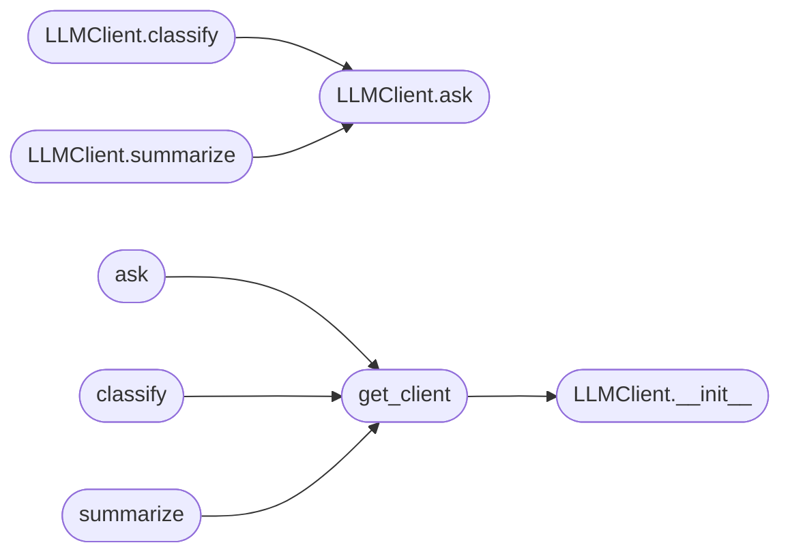

# `modules.llm_client`

> Source: [modules/llm_client.py:1](../../modules/llm_client.py#L1) | language `py` | coverage 100.0% | [API index](../index.md)

LazyOwn Unified LLM Client ============================ Single interface for all LLM providers used in LazyOwn: - Groq (cloud, fast inference) - Ollama (local models) - DeepSeek via Ollama - Fallback chain: Groq → Ollama → static message

Usage:
    from modules.llm_client import LLMClient

    client = LLMClient()
    response = client.ask("Explain this nmap output: ...", provider="groq")
    response = client.ask("Suggest next steps", provider="ollama", model="qwen3.5:0.8b")
    response = client.ask("Classify this output", provider="auto")   # tries groq then ollama

## Contents

- **Classes:** [`LLMClient`](#llmclient)
- **Functions:** [`get_client`](#get_client), [`ask`](#ask), [`classify`](#classify), [`summarize`](#summarize)
- **Constants:** [`GROQ_API_URL`](#groq_api_url), [`GROQ_DEFAULT_MODEL`](#groq_default_model), [`GROQ_FAST_MODEL`](#groq_fast_model), [`OLLAMA_HOST`](#ollama_host), [`OLLAMA_PORT`](#ollama_port), [`OLLAMA_DEFAULT_MODEL`](#ollama_default_model), [`OLLAMA_LARGE_MODEL`](#ollama_large_model), [`DEFAULT_TIMEOUT`](#default_timeout), [`DEFAULT_MAX_TOKENS`](#default_max_tokens)

## Call Graph

Solid arrows stay in this module, dashed arrows leave it.



## Classes

<a id="llmclient"></a>

### `LLMClient`

`class` | [modules/llm_client.py:45](../../modules/llm_client.py#L45)

```python
class LLMClient
```

Unified LLM client with automatic fallback.

**Parameters**

| Name | Type | Default | Description |
|---|---|---|---|
| `api_key` | `str` |  | Groq API key. Falls back to GROQ_API_KEY env var. |
| `groq_model` | `str` |  | Default Groq model name. |
| `ollama_model` | `str` |  | Default Ollama model name. |
| `timeout` | `int` |  | HTTP request timeout in seconds. |
| `max_tokens` | `int` |  | Max tokens in response. |

**Members**

| Member | Kind | Summary |
|---|---|---|
| [`__init__`](#llmclient-__init__) | constructor |  |
| [`ask`](#llmclient-ask) | method | Send a prompt and return the text response. |
| [`classify`](#llmclient-classify) | method | Short classification prompt. |
| [`summarize`](#llmclient-summarize) | method | Summarize a block of text (e.g. nmap output, tool output). |

<a id="llmclient-__init__"></a>

#### `LLMClient.__init__`

`constructor` | [modules/llm_client.py:63](../../modules/llm_client.py#L63)

```python
def __init__(self, api_key: str = '', groq_model: str = GROQ_DEFAULT_MODEL, ollama_model: str = OLLAMA_DEFAULT_MODEL, timeout: int = DEFAULT_TIMEOUT, max_tokens: int = DEFAULT_MAX_TOKENS) -> None
```

**Parameters**

| Name | Type | Default | Description |
|---|---|---|---|
| `api_key` | `str` | `''` | Groq API key. Falls back to GROQ_API_KEY env var. |
| `groq_model` | `str` | `GROQ_DEFAULT_MODEL` | Default Groq model name. |
| `ollama_model` | `str` | `OLLAMA_DEFAULT_MODEL` | Default Ollama model name. |
| `timeout` | `int` | `DEFAULT_TIMEOUT` | HTTP request timeout in seconds. |
| `max_tokens` | `int` | `DEFAULT_MAX_TOKENS` | Max tokens in response. |

*Called by:* [`main`](contrib.legacy.lazyaddon_creator.py.md#main), [`get_client`](#get_client)

<a id="llmclient-ask"></a>

#### `LLMClient.ask`

`method` | [modules/llm_client.py:79](../../modules/llm_client.py#L79)

```python
def ask(self, prompt: str, *, provider: str = 'auto', model: str | None = None, system: str = 'You are a helpful penetration testing assistant.', temperature: float = 0.7) -> str
```

Send a prompt and return the text response.

**Parameters**

| Name | Type | Default | Description |
|---|---|---|---|
| `prompt` | `str` |  | The user prompt. |
| `provider` | `str` | `'auto'` | One of: "groq", "ollama", "auto". "auto" tries groq first, falls back to ollama, then returns static msg. |
| `model` | `str \| None` | `None` | Override the default model for the selected provider. |
| `system` | `str` | `'You are a helpful penetration testing assistant.'` | System prompt / persona. |
| `temperature` | `float` | `0.7` | Sampling temperature (0.0–2.0). |

**Returns:** `str` - The model's response text, or an error message prefixed with "[LLM error]".

*Called by:* [`main`](contrib.legacy.lazyaddon_creator.py.md#main), [`LLMClient.classify`](#llmclient-classify), [`LLMClient.summarize`](#llmclient-summarize)

<a id="llmclient-classify"></a>

#### `LLMClient.classify`

`method` | [modules/llm_client.py:125](../../modules/llm_client.py#L125)

```python
def classify(self, output: str, *, question: str = 'Did this command succeed? Answer only: success, failure, or partial.', provider: str = 'auto', model: str | None = None) -> str
```

Short classification prompt.

Returns a single word: success / failure / partial. Uses the faster/cheaper model by default.

**Parameters**

| Name | Type | Default | Description |
|---|---|---|---|
| `output` | `str` |  |  |
| `question` | `str` | `'Did this command succeed? Answer only: success, failure, or partial.'` |  |
| `provider` | `str` | `'auto'` |  |
| `model` | `str \| None` | `None` |  |

**Returns:** `str`

*Calls:* [`LLMClient.ask`](#llmclient-ask)

<a id="llmclient-summarize"></a>

#### `LLMClient.summarize`

`method` | [modules/llm_client.py:154](../../modules/llm_client.py#L154)

```python
def summarize(self, text: str, *, max_chars: int = 6000, provider: str = 'auto', model: str | None = None) -> str
```

Summarize a block of text (e.g. nmap output, tool output).

**Parameters**

| Name | Type | Default | Description |
|---|---|---|---|
| `text` | `str` |  |  |
| `max_chars` | `int` | `6000` |  |
| `provider` | `str` | `'auto'` |  |
| `model` | `str \| None` | `None` |  |

**Returns:** `str`

*Calls:* [`LLMClient.ask`](#llmclient-ask)

---

## Functions

<a id="get_client"></a>

### `get_client`

`function` | [modules/llm_client.py:243](../../modules/llm_client.py#L243)

```python
def get_client(api_key: str = '') -> LLMClient
```

Return (or create) the module-level singleton LLMClient.

**Parameters**

| Name | Type | Default | Description |
|---|---|---|---|
| `api_key` | `str` | `''` |  |

**Returns:** `LLMClient`

*Calls:* [`LLMClient.__init__`](#llmclient-__init__)

*Called by:* [`ask`](#ask), [`classify`](#classify), [`summarize`](#summarize)

---

<a id="ask"></a>

### `ask`

`function` | [modules/llm_client.py:251](../../modules/llm_client.py#L251)

```python
def ask(prompt: str, *, provider: str = 'auto', model: str | None = None, api_key: str = '', system: str = 'You are a helpful penetration testing assistant.') -> str
```

Module-level convenience wrapper.

**Parameters**

| Name | Type | Default | Description |
|---|---|---|---|
| `prompt` | `str` |  |  |
| `provider` | `str` | `'auto'` |  |
| `model` | `str \| None` | `None` |  |
| `api_key` | `str` | `''` |  |
| `system` | `str` | `'You are a helpful penetration testing assistant.'` |  |

**Returns:** `str`

*Calls:* [`get_client`](#get_client)

---

<a id="classify"></a>

### `classify`

`function` | [modules/llm_client.py:263](../../modules/llm_client.py#L263)

```python
def classify(output: str, *, provider: str = 'auto', api_key: str = '') -> str
```

Module-level convenience wrapper.

**Parameters**

| Name | Type | Default | Description |
|---|---|---|---|
| `output` | `str` |  |  |
| `provider` | `str` | `'auto'` |  |
| `api_key` | `str` | `''` |  |

**Returns:** `str`

*Calls:* [`get_client`](#get_client)

---

<a id="summarize"></a>

### `summarize`

`function` | [modules/llm_client.py:268](../../modules/llm_client.py#L268)

```python
def summarize(text: str, *, provider: str = 'auto', api_key: str = '') -> str
```

Module-level convenience wrapper.

**Parameters**

| Name | Type | Default | Description |
|---|---|---|---|
| `text` | `str` |  |  |
| `provider` | `str` | `'auto'` |  |
| `api_key` | `str` | `''` |  |

**Returns:** `str`

*Calls:* [`get_client`](#get_client)

---

## Constants

<a id="groq_api_url"></a>

### `GROQ_API_URL`

`constant` | [modules/llm_client.py:32](../../modules/llm_client.py#L32)

```python
GROQ_API_URL = 'https://api.groq.com/openai/v1/chat/completions'
```

---

<a id="groq_default_model"></a>

### `GROQ_DEFAULT_MODEL`

`constant` | [modules/llm_client.py:33](../../modules/llm_client.py#L33)

```python
GROQ_DEFAULT_MODEL = 'llama3-8b-8192'
```

---

<a id="groq_fast_model"></a>

### `GROQ_FAST_MODEL`

`constant` | [modules/llm_client.py:34](../../modules/llm_client.py#L34)

```python
GROQ_FAST_MODEL = 'llama-3.1-8b-instant'
```

---

<a id="ollama_host"></a>

### `OLLAMA_HOST`

`constant` | [modules/llm_client.py:36](../../modules/llm_client.py#L36)

```python
OLLAMA_HOST = os.environ.get('OLLAMA_HOST', '127.0.0.1')
```

---

<a id="ollama_port"></a>

### `OLLAMA_PORT`

`constant` | [modules/llm_client.py:37](../../modules/llm_client.py#L37)

```python
OLLAMA_PORT = int(os.environ.get('OLLAMA_PORT', '11434'))
```

---

<a id="ollama_default_model"></a>

### `OLLAMA_DEFAULT_MODEL`

`constant` | [modules/llm_client.py:38](../../modules/llm_client.py#L38)

```python
OLLAMA_DEFAULT_MODEL = os.environ.get('OLLAMA_MODEL', 'qwen3.5:0.8b')
```

---

<a id="ollama_large_model"></a>

### `OLLAMA_LARGE_MODEL`

`constant` | [modules/llm_client.py:39](../../modules/llm_client.py#L39)

```python
OLLAMA_LARGE_MODEL = os.environ.get('OLLAMA_LARGE_MODEL', 'llama3.2')
```

---

<a id="default_timeout"></a>

### `DEFAULT_TIMEOUT`

`constant` | [modules/llm_client.py:41](../../modules/llm_client.py#L41)

```python
DEFAULT_TIMEOUT = int(os.environ.get('LLM_TIMEOUT', '90'))
```

---

<a id="default_max_tokens"></a>

### `DEFAULT_MAX_TOKENS`

`constant` | [modules/llm_client.py:42](../../modules/llm_client.py#L42)

```python
DEFAULT_MAX_TOKENS = int(os.environ.get('LLM_MAX_TOKENS', '1024'))
```

---
