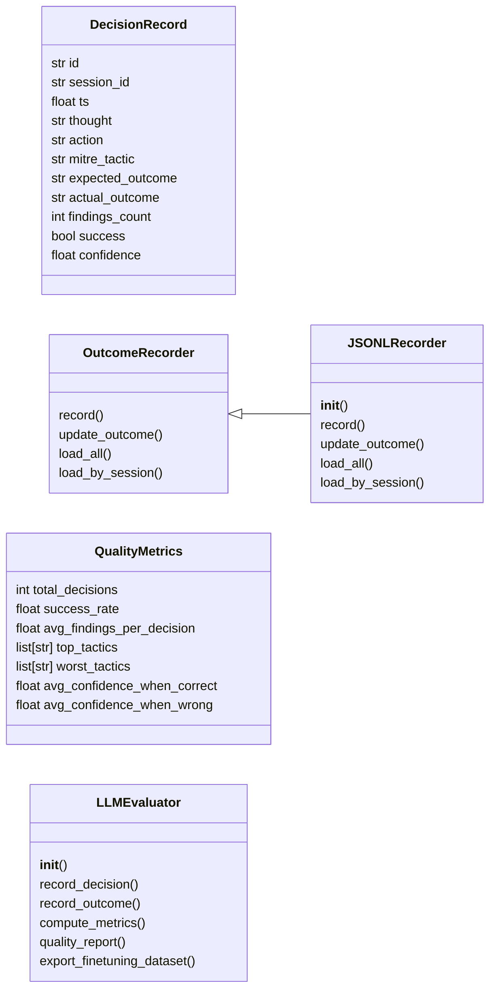
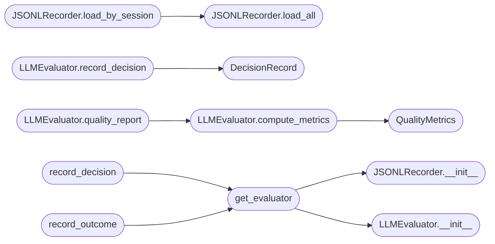

# `modules.llm_evaluator`

> Source: [modules/llm_evaluator.py:1](../../modules/llm_evaluator.py#L1) | language `py` | coverage 4.2% | [API index](../index.md)

llm_evaluator.py — Records LLM decisions and their outcomes, computes quality metrics, and exports fine-tuning datasets for the LazyOwn auto_loop.

## Contents

- **Classes:** [`DecisionRecord`](#decisionrecord), [`OutcomeRecorder`](#outcomerecorder), [`JSONLRecorder`](#jsonlrecorder), [`QualityMetrics`](#qualitymetrics), [`LLMEvaluator`](#llmevaluator)
- **Functions:** [`get_evaluator`](#get_evaluator), [`record_decision`](#record_decision), [`record_outcome`](#record_outcome)

## Type Diagram



## Call Graph

Solid arrows stay in this module, dashed arrows leave it.



## Classes

<a id="decisionrecord"></a>

### `DecisionRecord`

`class` `dataclass` | [modules/llm_evaluator.py:21](../../modules/llm_evaluator.py#L21)

Decorators: `@dataclass`

```python
class DecisionRecord
```

**Attributes**

| Name | Type | Default | Description |
|---|---|---|---|
| [`id`](#decisionrecord-id) | `str` |  |  |
| [`session_id`](#decisionrecord-session_id) | `str` |  |  |
| [`ts`](#decisionrecord-ts) | `float` |  |  |
| [`thought`](#decisionrecord-thought) | `str` |  |  |
| [`action`](#decisionrecord-action) | `str` |  |  |
| [`mitre_tactic`](#decisionrecord-mitre_tactic) | `str` |  |  |
| [`expected_outcome`](#decisionrecord-expected_outcome) | `str` |  |  |
| [`actual_outcome`](#decisionrecord-actual_outcome) | `str` |  |  |
| [`findings_count`](#decisionrecord-findings_count) | `int` |  |  |
| [`success`](#decisionrecord-success) | `bool` |  |  |
| [`confidence`](#decisionrecord-confidence) | `float` |  |  |

---

<a id="outcomerecorder"></a>

### `OutcomeRecorder`

`class` `abstract` | [modules/llm_evaluator.py:55](../../modules/llm_evaluator.py#L55)

```python
class OutcomeRecorder(ABC)
```

Bases: `ABC`

Subclasses: [`JSONLRecorder`](#jsonlrecorder)

**Members**

| Member | Kind | Summary |
|---|---|---|
| [`record`](#outcomerecorder-record) | method |  |
| [`update_outcome`](#outcomerecorder-update_outcome) | method |  |
| [`load_all`](#outcomerecorder-load_all) | method |  |
| [`load_by_session`](#outcomerecorder-load_by_session) | method |  |

<a id="outcomerecorder-record"></a>

#### `OutcomeRecorder.record`

`method` `abstract` | [modules/llm_evaluator.py:57](../../modules/llm_evaluator.py#L57)

Decorators: `@abstractmethod`

```python
def record(self, decision: DecisionRecord) -> None
```

**Parameters**

| Name | Type | Default | Description |
|---|---|---|---|
| `decision` | `DecisionRecord` |  |  |

<a id="outcomerecorder-update_outcome"></a>

#### `OutcomeRecorder.update_outcome`

`method` `abstract` | [modules/llm_evaluator.py:60](../../modules/llm_evaluator.py#L60)

Decorators: `@abstractmethod`

```python
def update_outcome(self, decision_id: str, actual: str, findings_count: int, success: bool) -> None
```

**Parameters**

| Name | Type | Default | Description |
|---|---|---|---|
| `decision_id` | `str` |  |  |
| `actual` | `str` |  |  |
| `findings_count` | `int` |  |  |
| `success` | `bool` |  |  |

<a id="outcomerecorder-load_all"></a>

#### `OutcomeRecorder.load_all`

`method` `abstract` | [modules/llm_evaluator.py:69](../../modules/llm_evaluator.py#L69)

Decorators: `@abstractmethod`

```python
def load_all(self) -> list[DecisionRecord]
```

**Returns:** `list[DecisionRecord]`

<a id="outcomerecorder-load_by_session"></a>

#### `OutcomeRecorder.load_by_session`

`method` `abstract` | [modules/llm_evaluator.py:72](../../modules/llm_evaluator.py#L72)

Decorators: `@abstractmethod`

```python
def load_by_session(self, session_id: str) -> list[DecisionRecord]
```

**Parameters**

| Name | Type | Default | Description |
|---|---|---|---|
| `session_id` | `str` |  |  |

**Returns:** `list[DecisionRecord]`

---

<a id="jsonlrecorder"></a>

### `JSONLRecorder`

`class` | [modules/llm_evaluator.py:75](../../modules/llm_evaluator.py#L75)

```python
class JSONLRecorder(OutcomeRecorder)
```

Bases: [`OutcomeRecorder`](#outcomerecorder)

**Members**

| Member | Kind | Summary |
|---|---|---|
| [`__init__`](#jsonlrecorder-__init__) | constructor |  |
| [`record`](#jsonlrecorder-record) | method |  |
| [`update_outcome`](#jsonlrecorder-update_outcome) | method |  |
| [`load_all`](#jsonlrecorder-load_all) | method |  |
| [`load_by_session`](#jsonlrecorder-load_by_session) | method |  |

<a id="jsonlrecorder-__init__"></a>

#### `JSONLRecorder.__init__`

`constructor` | [modules/llm_evaluator.py:76](../../modules/llm_evaluator.py#L76)

```python
def __init__(self, path: Path = _JSONL_PATH) -> None
```

**Parameters**

| Name | Type | Default | Description |
|---|---|---|---|
| `path` | `Path` | `_JSONL_PATH` |  |

*Called by:* [`get_evaluator`](#get_evaluator)

<a id="jsonlrecorder-record"></a>

#### `JSONLRecorder.record`

`method` | [modules/llm_evaluator.py:81](../../modules/llm_evaluator.py#L81)

```python
def record(self, decision: DecisionRecord) -> None
```

**Parameters**

| Name | Type | Default | Description |
|---|---|---|---|
| `decision` | `DecisionRecord` |  |  |

<a id="jsonlrecorder-update_outcome"></a>

#### `JSONLRecorder.update_outcome`

`method` | [modules/llm_evaluator.py:86](../../modules/llm_evaluator.py#L86)

```python
def update_outcome(self, decision_id: str, actual: str, findings_count: int, success: bool) -> None
```

**Parameters**

| Name | Type | Default | Description |
|---|---|---|---|
| `decision_id` | `str` |  |  |
| `actual` | `str` |  |  |
| `findings_count` | `int` |  |  |
| `success` | `bool` |  |  |

<a id="jsonlrecorder-load_all"></a>

#### `JSONLRecorder.load_all`

`method` | [modules/llm_evaluator.py:120](../../modules/llm_evaluator.py#L120)

```python
def load_all(self) -> list[DecisionRecord]
```

**Returns:** `list[DecisionRecord]`

*Called by:* [`JSONLRecorder.load_by_session`](#jsonlrecorder-load_by_session)

<a id="jsonlrecorder-load_by_session"></a>

#### `JSONLRecorder.load_by_session`

`method` | [modules/llm_evaluator.py:135](../../modules/llm_evaluator.py#L135)

```python
def load_by_session(self, session_id: str) -> list[DecisionRecord]
```

**Parameters**

| Name | Type | Default | Description |
|---|---|---|---|
| `session_id` | `str` |  |  |

**Returns:** `list[DecisionRecord]`

*Calls:* [`JSONLRecorder.load_all`](#jsonlrecorder-load_all)

---

<a id="qualitymetrics"></a>

### `QualityMetrics`

`class` `dataclass` | [modules/llm_evaluator.py:140](../../modules/llm_evaluator.py#L140)

Decorators: `@dataclass`

```python
class QualityMetrics
```

**Attributes**

| Name | Type | Default | Description |
|---|---|---|---|
| [`total_decisions`](#qualitymetrics-total_decisions) | `int` |  |  |
| [`success_rate`](#qualitymetrics-success_rate) | `float` |  |  |
| [`avg_findings_per_decision`](#qualitymetrics-avg_findings_per_decision) | `float` |  |  |
| [`top_tactics`](#qualitymetrics-top_tactics) | `list[str]` |  |  |
| [`worst_tactics`](#qualitymetrics-worst_tactics) | `list[str]` |  |  |
| [`avg_confidence_when_correct`](#qualitymetrics-avg_confidence_when_correct) | `float` |  |  |
| [`avg_confidence_when_wrong`](#qualitymetrics-avg_confidence_when_wrong) | `float` |  |  |

---

<a id="llmevaluator"></a>

### `LLMEvaluator`

`class` | [modules/llm_evaluator.py:161](../../modules/llm_evaluator.py#L161)

```python
class LLMEvaluator
```

**Members**

| Member | Kind | Summary |
|---|---|---|
| [`__init__`](#llmevaluator-__init__) | constructor |  |
| [`record_decision`](#llmevaluator-record_decision) | method |  |
| [`record_outcome`](#llmevaluator-record_outcome) | method |  |
| [`compute_metrics`](#llmevaluator-compute_metrics) | method |  |
| [`quality_report`](#llmevaluator-quality_report) | method |  |
| [`export_finetuning_dataset`](#llmevaluator-export_finetuning_dataset) | method |  |

<a id="llmevaluator-__init__"></a>

#### `LLMEvaluator.__init__`

`constructor` | [modules/llm_evaluator.py:162](../../modules/llm_evaluator.py#L162)

```python
def __init__(self, recorder: OutcomeRecorder) -> None
```

**Parameters**

| Name | Type | Default | Description |
|---|---|---|---|
| `recorder` | `OutcomeRecorder` |  |  |

*Called by:* [`get_evaluator`](#get_evaluator)

<a id="llmevaluator-record_decision"></a>

#### `LLMEvaluator.record_decision`

`method` | [modules/llm_evaluator.py:165](../../modules/llm_evaluator.py#L165)

```python
def record_decision(self, session_id: str, thought: str, action: str, mitre_tactic: str, expected_outcome: str, confidence: float) -> str
```

**Parameters**

| Name | Type | Default | Description |
|---|---|---|---|
| `session_id` | `str` |  |  |
| `thought` | `str` |  |  |
| `action` | `str` |  |  |
| `mitre_tactic` | `str` |  |  |
| `expected_outcome` | `str` |  |  |
| `confidence` | `float` |  |  |

**Returns:** `str`

*Calls:* [`DecisionRecord`](#decisionrecord)

<a id="llmevaluator-record_outcome"></a>

#### `LLMEvaluator.record_outcome`

`method` | [modules/llm_evaluator.py:191](../../modules/llm_evaluator.py#L191)

```python
def record_outcome(self, decision_id: str, actual_outcome: str, findings_count: int, success: bool) -> None
```

**Parameters**

| Name | Type | Default | Description |
|---|---|---|---|
| `decision_id` | `str` |  |  |
| `actual_outcome` | `str` |  |  |
| `findings_count` | `int` |  |  |
| `success` | `bool` |  |  |

<a id="llmevaluator-compute_metrics"></a>

#### `LLMEvaluator.compute_metrics`

`method` | [modules/llm_evaluator.py:200](../../modules/llm_evaluator.py#L200)

```python
def compute_metrics(self, session_id: str | None = None) -> QualityMetrics
```

**Parameters**

| Name | Type | Default | Description |
|---|---|---|---|
| `session_id` | `str \| None` | `None` |  |

**Returns:** `QualityMetrics`

*Calls:* [`QualityMetrics`](#qualitymetrics)

*Called by:* [`LLMEvaluator.quality_report`](#llmevaluator-quality_report)

<a id="llmevaluator-quality_report"></a>

#### `LLMEvaluator.quality_report`

`method` | [modules/llm_evaluator.py:241](../../modules/llm_evaluator.py#L241)

```python
def quality_report(self, session_id: str | None = None) -> str
```

**Parameters**

| Name | Type | Default | Description |
|---|---|---|---|
| `session_id` | `str \| None` | `None` |  |

**Returns:** `str`

*Calls:* [`LLMEvaluator.compute_metrics`](#llmevaluator-compute_metrics)

<a id="llmevaluator-export_finetuning_dataset"></a>

#### `LLMEvaluator.export_finetuning_dataset`

`method` | [modules/llm_evaluator.py:256](../../modules/llm_evaluator.py#L256)

```python
def export_finetuning_dataset(self, path: Path | None = None) -> Path
```

**Parameters**

| Name | Type | Default | Description |
|---|---|---|---|
| `path` | `Path \| None` | `None` |  |

**Returns:** `Path`

---

## Functions

<a id="get_evaluator"></a>

### `get_evaluator`

`function` | [modules/llm_evaluator.py:293](../../modules/llm_evaluator.py#L293)

```python
def get_evaluator() -> LLMEvaluator
```

**Returns:** `LLMEvaluator`

*Calls:* [`JSONLRecorder.__init__`](#jsonlrecorder-__init__), [`LLMEvaluator.__init__`](#llmevaluator-__init__)

*Called by:* [`record_decision`](#record_decision), [`record_outcome`](#record_outcome)

---

<a id="record_decision"></a>

### `record_decision`

`function` | [modules/llm_evaluator.py:302](../../modules/llm_evaluator.py#L302)

```python
def record_decision(session_id: str, thought: str, action: str, mitre_tactic: str, expected_outcome: str, confidence: float) -> str
```

**Parameters**

| Name | Type | Default | Description |
|---|---|---|---|
| `session_id` | `str` |  |  |
| `thought` | `str` |  |  |
| `action` | `str` |  |  |
| `mitre_tactic` | `str` |  |  |
| `expected_outcome` | `str` |  |  |
| `confidence` | `float` |  |  |

**Returns:** `str`

*Calls:* [`get_evaluator`](#get_evaluator)

---

<a id="record_outcome"></a>

### `record_outcome`

`function` | [modules/llm_evaluator.py:313](../../modules/llm_evaluator.py#L313)

```python
def record_outcome(decision_id: str, actual_outcome: str, findings_count: int, success: bool) -> None
```

**Parameters**

| Name | Type | Default | Description |
|---|---|---|---|
| `decision_id` | `str` |  |  |
| `actual_outcome` | `str` |  |  |
| `findings_count` | `int` |  |  |
| `success` | `bool` |  |  |

*Calls:* [`get_evaluator`](#get_evaluator)

---
