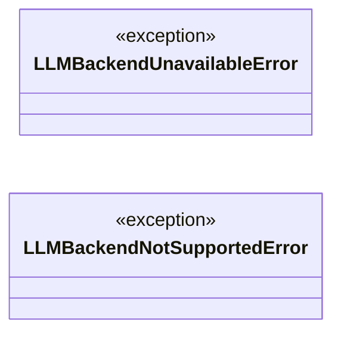
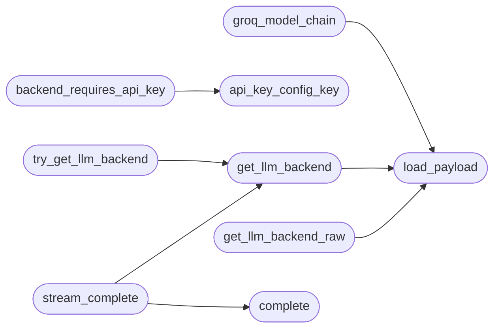

# `modules.llm_factory`

> Source: [modules/llm_factory.py:1](../../modules/llm_factory.py#L1) | language `py` | coverage 100.0% | [API index](../index.md)

LLM backend factory and selection utilities.

This module centralizes language model instantiation so that every caller
in the framework reads its provider, model name, host, and credentials
from a single source: ``payload.json``. The factory removes hardcoded
model strings duplicated across six callers and enforces the
Dependency Inversion Principle by returning the abstract [`AIModel`](modules.ai_model.py.md#aimodel)
type while keeping the concrete backend choice under operator control.

Adding a new backend means implementing [`AIModel`](modules.ai_model.py.md#aimodel) and registering
its identifier in [`SUPPORTED_BACKENDS`](#supported_backends). No other module needs to
change.

The factory wraps every returned backend with the
[`core.llm_budget.BudgetedBackend`](core.llm_budget.py.md#budgetedbackend) proxy so the daily cost cap
and the per call token cap are enforced at the single chokepoint the
framework uses. Callers that want the raw backend for testing can
call [`get_llm_backend_raw`](#get_llm_backend_raw) instead.

## Contents

- **Exceptions:** [`LLMBackendUnavailableError`](#llmbackendunavailableerror), [`LLMBackendNotSupportedError`](#llmbackendnotsupportederror)
- **Functions:** [`is_model_missing_error`](#is_model_missing_error), [`groq_model_chain`](#groq_model_chain), [`default_model_for`](#default_model_for), [`model_config_key`](#model_config_key), [`api_key_config_key`](#api_key_config_key), [`backend_requires_api_key`](#backend_requires_api_key), [`load_payload`](#load_payload), [`get_llm_backend`](#get_llm_backend), [`get_llm_backend_raw`](#get_llm_backend_raw), [`try_get_llm_backend`](#try_get_llm_backend), [`stream_complete`](#stream_complete), [`complete`](#complete)
- **Constants:** [`BACKEND_GROQ`](#backend_groq), [`BACKEND_OLLAMA`](#backend_ollama), [`BACKEND_OPENAI`](#backend_openai), [`BACKEND_ANTHROPIC`](#backend_anthropic), [`BACKEND_DEEPSEEK`](#backend_deepseek), [`BACKEND_LLAMACPP`](#backend_llamacpp), [`BACKEND_AUTO`](#backend_auto), [`SUPPORTED_BACKENDS`](#supported_backends), [`CONFIG_KEY_BACKEND`](#config_key_backend), [`CONFIG_KEY_MODEL_GROQ`](#config_key_model_groq), [`CONFIG_KEY_MODEL_OLLAMA`](#config_key_model_ollama), [`CONFIG_KEY_MODEL_OPENAI`](#config_key_model_openai), [`CONFIG_KEY_MODEL_ANTHROPIC`](#config_key_model_anthropic), [`CONFIG_KEY_MODEL_DEEPSEEK`](#config_key_model_deepseek), [`CONFIG_KEY_MODEL_LLAMACPP`](#config_key_model_llamacpp), [`CONFIG_KEY_OLLAMA_HOST`](#config_key_ollama_host), [`CONFIG_KEY_LLAMACPP_HOST`](#config_key_llamacpp_host), [`CONFIG_KEY_API_KEY`](#config_key_api_key), [`CONFIG_KEY_OPENAI_API_KEY`](#config_key_openai_api_key), [`CONFIG_KEY_ANTHROPIC_API_KEY`](#config_key_anthropic_api_key), [`CONFIG_KEY_DEEPSEEK_API_KEY`](#config_key_deepseek_api_key), [`DEFAULT_BACKEND`](#default_backend), [`DEFAULT_GROQ_MODEL`](#default_groq_model), [`ENV_GROQ_MODEL`](#env_groq_model), [`GROQ_MODEL_FALLBACKS`](#groq_model_fallbacks), [`DEFAULT_OLLAMA_MODEL`](#default_ollama_model), [`DEFAULT_OLLAMA_HOST`](#default_ollama_host), [`DEFAULT_OPENAI_MODEL`](#default_openai_model), [`DEFAULT_ANTHROPIC_MODEL`](#default_anthropic_model), [`DEFAULT_DEEPSEEK_MODEL`](#default_deepseek_model), [`DEFAULT_LLAMACPP_MODEL`](#default_llamacpp_model), [`DEFAULT_LLAMACPP_HOST`](#default_llamacpp_host), [`ENV_GROQ_API_KEY`](#env_groq_api_key), [`ENV_OPENAI_API_KEY`](#env_openai_api_key), [`ENV_ANTHROPIC_API_KEY`](#env_anthropic_api_key), [`ENV_DEEPSEEK_API_KEY`](#env_deepseek_api_key)

## Type Diagram



## Call Graph

Solid arrows stay in this module, dashed arrows leave it.



## Exceptions

<a id="llmbackendunavailableerror"></a>

### `LLMBackendUnavailableError`

`exception` | [modules/llm_factory.py:190](../../modules/llm_factory.py#L190)

```python
class LLMBackendUnavailableError(RuntimeError)
```

Bases: `RuntimeError`

Raised when no LLM backend can be instantiated from the current config.

---

<a id="llmbackendnotsupportederror"></a>

### `LLMBackendNotSupportedError`

`exception` | [modules/llm_factory.py:194](../../modules/llm_factory.py#L194)

```python
class LLMBackendNotSupportedError(ValueError)
```

Bases: `ValueError`

Raised when the requested backend identifier is unknown.

---

## Functions

<a id="is_model_missing_error"></a>

### `is_model_missing_error`

`function` | [modules/llm_factory.py:121](../../modules/llm_factory.py#L121)

```python
def is_model_missing_error(message: object) -> bool
```

Return True when an error text means the model id is unavailable.

**Parameters**

| Name | Type | Default | Description |
|---|---|---|---|
| `message` | `object` |  | Exception instance, error string, or API payload text. |

**Returns:** `bool` - ``True`` for 404/model_not_found style replies from OpenAI-compatible
APIs, so callers can fail over to another model id.

*Called by:* [`GroqModel.generate`](modules.ai_model.py.md#groqmodel-generate), [`GroqModel.stream_generate`](modules.ai_model.py.md#groqmodel-stream_generate)

---

<a id="groq_model_chain"></a>

### `groq_model_chain`

`function` | [modules/llm_factory.py:141](../../modules/llm_factory.py#L141)

```python
def groq_model_chain(config: Mapping[str, Any] | None = None) -> tuple[str, ...]
```

Return the ordered Groq model ids to try, configured model first.

Resolution order per slot: ``LAZYOWN_GROQ_MODEL`` env var, the provided
config mapping, ``payload.json`` key ``llm_model_groq``, then the default.
Known-good fallbacks follow so an account without access to the default
model still gets a working backend.

**Parameters**

| Name | Type | Default | Description |
|---|---|---|---|
| `config` | `Mapping[str, Any] \| None` | `None` | Optional pre-loaded payload mapping. |

**Returns:** `tuple[str, ...]` - Tuple of unique, non-empty model ids in try order.

*Calls:* [`load_payload`](#load_payload)

---

<a id="default_model_for"></a>

### `default_model_for`

`function` | [modules/llm_factory.py:224](../../modules/llm_factory.py#L224)

```python
def default_model_for(backend: str | None) -> str
```

Return the default model identifier for a backend.

``"auto"`` resolves to the Groq default because the auto chain tries
the Groq cloud leg first.

**Parameters**

| Name | Type | Default | Description |
|---|---|---|---|
| `backend` | `str \| None` |  | Backend identifier or None (treated as ``"auto"``). |

**Returns:** `str` - Default model identifier.

**Raises**

- [`LLMBackendNotSupportedError`](#llmbackendnotsupportederror): When the identifier is not supported.

---

<a id="model_config_key"></a>

### `model_config_key`

`function` | [modules/llm_factory.py:245](../../modules/llm_factory.py#L245)

```python
def model_config_key(backend: str | None) -> str
```

Return the ``payload.json`` key holding a backend's model override.

``"auto"`` maps to the Groq model slot because the auto chain tries
the Groq cloud leg first.

**Parameters**

| Name | Type | Default | Description |
|---|---|---|---|
| `backend` | `str \| None` |  | Backend identifier or None (treated as ``"auto"``). |

**Returns:** `str` - Config key for the model override.

**Raises**

- [`LLMBackendNotSupportedError`](#llmbackendnotsupportederror): When the identifier is not supported.

---

<a id="api_key_config_key"></a>

### `api_key_config_key`

`function` | [modules/llm_factory.py:266](../../modules/llm_factory.py#L266)

```python
def api_key_config_key(backend: str | None) -> str | None
```

Return the ``payload.json`` key holding a backend's API key slot.

Returns ``None`` for Ollama (keyless local daemon). ``"auto"`` maps
to the Groq key slot because the auto chain tries Groq first.

**Parameters**

| Name | Type | Default | Description |
|---|---|---|---|
| `backend` | `str \| None` |  | Backend identifier or None (treated as ``"auto"``). |

**Returns:** `str | None` - Config key for the API key, or None when no key is needed.

**Raises**

- [`LLMBackendNotSupportedError`](#llmbackendnotsupportederror): When the identifier is not supported.

*Called by:* [`backend_requires_api_key`](#backend_requires_api_key)

---

<a id="backend_requires_api_key"></a>

### `backend_requires_api_key`

`function` | [modules/llm_factory.py:291](../../modules/llm_factory.py#L291)

```python
def backend_requires_api_key(backend: str | None) -> bool
```

Report whether a backend needs an API key to operate.

Only Ollama runs keyless. ``"auto"`` reports True because its cloud
leg needs a key (it still degrades to keyless Ollama without one).

**Parameters**

| Name | Type | Default | Description |
|---|---|---|---|
| `backend` | `str \| None` |  | Backend identifier or None (treated as ``"auto"``). |

**Returns:** `bool` - True when an API key is required, False for Ollama.

**Raises**

- [`LLMBackendNotSupportedError`](#llmbackendnotsupportederror): When the identifier is not supported.

*Calls:* [`api_key_config_key`](#api_key_config_key)

---

<a id="load_payload"></a>

### `load_payload`

`function` | [modules/llm_factory.py:309](../../modules/llm_factory.py#L309)

```python
def load_payload(payload_path: str | None = None) -> dict[str, Any]
```

Read ``payload.json`` from disk and return it as a dictionary.

**Parameters**

| Name | Type | Default | Description |
|---|---|---|---|
| `payload_path` | `str \| None` | `None` | Optional explicit path. Defaults to the repository's ``payload.json`` resolved relative to this module's parent. |

**Returns:** `dict[str, Any]` - The parsed payload mapping, or an empty dictionary if the file
is missing or unreadable. Errors are swallowed so the factory
can fall back to environment variables and defaults.

*Called by:* [`get_llm_backend`](#get_llm_backend), [`get_llm_backend_raw`](#get_llm_backend_raw), [`groq_model_chain`](#groq_model_chain)

---

<a id="get_llm_backend"></a>

### `get_llm_backend`

`function` | [modules/llm_factory.py:633](../../modules/llm_factory.py#L633)

```python
def get_llm_backend(config: Mapping[str, Any] | None = None, backend: str | None = None) -> AIModel
```

Return a concrete [`AIModel`](modules.ai_model.py.md#aimodel) selected by configuration.

The selection order is:

1. Explicit ``backend`` argument when provided.
2. `[`llm_backend`](skills.claude_md_orchestrator.config.py.md#config-llm_backend)` key from ``config`` (or loaded ``payload.json``).
3. [`DEFAULT_BACKEND`](#default_backend) (``"auto"``).

When the resolved backend is ``"auto"`` the factory tries Groq first
(if an API key is available) and falls back to Ollama. Any other
explicit selection is honoured strictly: callers receive
[`LLMBackendUnavailableError`](#llmbackendunavailableerror) rather than a silent fallback so
they can decide whether to degrade or raise.

The returned backend is wrapped with the budget proxy so the daily
cost cap and the per call token cap are enforced at the single
chokepoint the framework uses. Use [`get_llm_backend_raw`](#get_llm_backend_raw) to
bypass the wrapper for tests that need a raw backend.

**Parameters**

| Name | Type | Default | Description |
|---|---|---|---|
| `config` | `Mapping[str, Any] \| None` | `None` | Optional pre-loaded payload mapping. When ``None`` the payload is read from disk. |
| `backend` | `str \| None` | `None` | Optional override for the backend identifier. Takes precedence over the configuration value. |

**Returns:** `AIModel` - A configured [`AIModel`](modules.ai_model.py.md#aimodel) instance that also structurally
satisfies [`core.protocols.LLMBackend`](core.protocols.py.md#llmbackend), ready for either
``generate`` or `[`complete`](#complete)` calls.

**Raises**

- [`LLMBackendNotSupportedError`](#llmbackendnotsupportederror): When an unsupported identifier is requested.
- [`LLMBackendUnavailableError`](#llmbackendunavailableerror): When the requested backend cannot
be constructed from the current environment (for example,
Groq selected with no API key).

*Calls:* [`load_payload`](#load_payload)

*Called by:* [`AiCommandSet.do_groq`](cli.commands.ai.py.md#aicommandset-do_groq), [`AiCommandSet.do_poolcheck`](cli.commands.ai.py.md#aicommandset-do_poolcheck), [`stream_complete`](#stream_complete), [`try_get_llm_backend`](#try_get_llm_backend)

---

<a id="get_llm_backend_raw"></a>

### `get_llm_backend_raw`

`function` | [modules/llm_factory.py:729](../../modules/llm_factory.py#L729)

```python
def get_llm_backend_raw(config: Mapping[str, Any] | None = None, backend: str | None = None) -> AIModel
```

Return a raw [`AIModel`](modules.ai_model.py.md#aimodel) without the budget wrapper.

Tests and the CLI command ``llm_budget`` itself use this entry
point so the budget proxy never recurses into itself. Production
callers should keep using [`get_llm_backend`](#get_llm_backend).

**Parameters**

| Name | Type | Default | Description |
|---|---|---|---|
| `config` | `Mapping[str, Any] \| None` | `None` | Optional pre-loaded payload mapping. |
| `backend` | `str \| None` | `None` | Optional explicit backend identifier. |

**Returns:** `AIModel` - The raw concrete backend.

*Calls:* [`load_payload`](#load_payload)

*Called by:* [`resolve_agentic_model`](modules.lazy_agent.py.md#resolve_agentic_model)

---

<a id="try_get_llm_backend"></a>

### `try_get_llm_backend`

`function` | [modules/llm_factory.py:751](../../modules/llm_factory.py#L751)

```python
def try_get_llm_backend(config: Mapping[str, Any] | None = None, backend: str | None = None) -> AIModel | None
```

Return a backend or ``None`` if construction fails for any reason.

Wraps [`get_llm_backend`](#get_llm_backend) so call sites that prefer to degrade
gracefully (CLI assistants, opportunistic enrichers) can keep
working when no LLM is reachable.

**Parameters**

| Name | Type | Default | Description |
|---|---|---|---|
| `config` | `Mapping[str, Any] \| None` | `None` | Optional pre-loaded payload mapping. |
| `backend` | `str \| None` | `None` | Optional explicit backend identifier. |

**Returns:** `AIModel | None` - A configured [`AIModel`](modules.ai_model.py.md#aimodel), or ``None`` when no backend is
available.

*Calls:* [`get_llm_backend`](#get_llm_backend)

*Called by:* [`ask_general`](modules.llm_adapter.py.md#ask_general)

---

<a id="stream_complete"></a>

### `stream_complete`

`function` | [modules/llm_factory.py:828](../../modules/llm_factory.py#L828)

```python
def stream_complete(model: str, prompt: str, max_tokens: int = 800, on_delta: Callable[[str], None] | None = None) -> str
```

Completion that reports incremental deltas while it arrives.

Streams through the configured backend's ``stream_generate`` when the
provider supports it and silently falls back to [`complete`](#complete) on
any error, so a backend without streaming never breaks a caller.

**Parameters**

| Name | Type | Default | Description |
|---|---|---|---|
| `model` | `str` |  | Model spec, same syntax as [`complete`](#complete). |
| `prompt` | `str` |  | Prompt text (truncated to 6000 chars like the pool path). |
| `max_tokens` | `int` | `800` | Upper bound hint for the provider. |
| `on_delta` | `Callable[[str], None] \| None` | `None` | Optional callback invoked with each text fragment. |

**Returns:** `str` - The complete reply text.

*Calls:* [`complete`](#complete), [`get_llm_backend`](#get_llm_backend)

---

<a id="complete"></a>

### `complete`

`function` | [modules/llm_factory.py:899](../../modules/llm_factory.py#L899)

```python
def complete(model: str, prompt: str, max_tokens: int = 800) -> str
```

Complete a prompt through one model spec; raise when unanswered.

The ``model`` spec accepts an optional ``backend:`` prefix selecting
the leg: ``groq:``, ``ollama:``, ``llamacpp:``, ``pi:`` (local pi agent,
keyless), ``auto:`` (groq first, then ollama)
or ``toposwarm:`` (local agentic router, keyless). A bare model name
resolves through the `[`auto`](modules.atomic_exploit_bridge.py.md#auto)` chain. Empty prompt returns empty
string; any backend outage raises so pool callers can fail over to
the next leg and finally to the heuristic path.

**Parameters**

| Name | Type | Default | Description |
|---|---|---|---|
| `model` | `str` |  | Model spec, optionally prefixed with backend. |
| `prompt` | `str` |  | User prompt text. |
| `max_tokens` | `int` | `800` | Response token cap. |

**Returns:** `str` - Response text, never empty on success.

**Raises**

- `RuntimeError`: When no leg answers.

*Called by:* [`stream_complete`](#stream_complete)

---

## Constants

<a id="backend_groq"></a>

### `BACKEND_GROQ`

`constant` | [modules/llm_factory.py:76](../../modules/llm_factory.py#L76)

```python
BACKEND_GROQ = 'groq'
```

---

<a id="backend_ollama"></a>

### `BACKEND_OLLAMA`

`constant` | [modules/llm_factory.py:77](../../modules/llm_factory.py#L77)

```python
BACKEND_OLLAMA = 'ollama'
```

---

<a id="backend_openai"></a>

### `BACKEND_OPENAI`

`constant` | [modules/llm_factory.py:78](../../modules/llm_factory.py#L78)

```python
BACKEND_OPENAI = 'openai'
```

---

<a id="backend_anthropic"></a>

### `BACKEND_ANTHROPIC`

`constant` | [modules/llm_factory.py:79](../../modules/llm_factory.py#L79)

```python
BACKEND_ANTHROPIC = 'anthropic'
```

---

<a id="backend_deepseek"></a>

### `BACKEND_DEEPSEEK`

`constant` | [modules/llm_factory.py:80](../../modules/llm_factory.py#L80)

```python
BACKEND_DEEPSEEK = 'deepseek'
```

---

<a id="backend_llamacpp"></a>

### `BACKEND_LLAMACPP`

`constant` | [modules/llm_factory.py:81](../../modules/llm_factory.py#L81)

```python
BACKEND_LLAMACPP = 'llamacpp'
```

---

<a id="backend_auto"></a>

### `BACKEND_AUTO`

`constant` | [modules/llm_factory.py:82](../../modules/llm_factory.py#L82)

```python
BACKEND_AUTO = 'auto'
```

---

<a id="supported_backends"></a>

### `SUPPORTED_BACKENDS`

`constant` | [modules/llm_factory.py:84](../../modules/llm_factory.py#L84)

```python
SUPPORTED_BACKENDS
```

---

<a id="config_key_backend"></a>

### `CONFIG_KEY_BACKEND`

`constant` | [modules/llm_factory.py:94](../../modules/llm_factory.py#L94)

```python
CONFIG_KEY_BACKEND = 'llm_backend'
```

---

<a id="config_key_model_groq"></a>

### `CONFIG_KEY_MODEL_GROQ`

`constant` | [modules/llm_factory.py:95](../../modules/llm_factory.py#L95)

```python
CONFIG_KEY_MODEL_GROQ = 'llm_model_groq'
```

---

<a id="config_key_model_ollama"></a>

### `CONFIG_KEY_MODEL_OLLAMA`

`constant` | [modules/llm_factory.py:96](../../modules/llm_factory.py#L96)

```python
CONFIG_KEY_MODEL_OLLAMA = 'llm_model_ollama'
```

---

<a id="config_key_model_openai"></a>

### `CONFIG_KEY_MODEL_OPENAI`

`constant` | [modules/llm_factory.py:97](../../modules/llm_factory.py#L97)

```python
CONFIG_KEY_MODEL_OPENAI = 'llm_model_openai'
```

---

<a id="config_key_model_anthropic"></a>

### `CONFIG_KEY_MODEL_ANTHROPIC`

`constant` | [modules/llm_factory.py:98](../../modules/llm_factory.py#L98)

```python
CONFIG_KEY_MODEL_ANTHROPIC = 'llm_model_anthropic'
```

---

<a id="config_key_model_deepseek"></a>

### `CONFIG_KEY_MODEL_DEEPSEEK`

`constant` | [modules/llm_factory.py:99](../../modules/llm_factory.py#L99)

```python
CONFIG_KEY_MODEL_DEEPSEEK = 'llm_model_deepseek'
```

---

<a id="config_key_model_llamacpp"></a>

### `CONFIG_KEY_MODEL_LLAMACPP`

`constant` | [modules/llm_factory.py:100](../../modules/llm_factory.py#L100)

```python
CONFIG_KEY_MODEL_LLAMACPP = 'llm_model_llamacpp'
```

---

<a id="config_key_ollama_host"></a>

### `CONFIG_KEY_OLLAMA_HOST`

`constant` | [modules/llm_factory.py:101](../../modules/llm_factory.py#L101)

```python
CONFIG_KEY_OLLAMA_HOST = 'ollama_host'
```

---

<a id="config_key_llamacpp_host"></a>

### `CONFIG_KEY_LLAMACPP_HOST`

`constant` | [modules/llm_factory.py:102](../../modules/llm_factory.py#L102)

```python
CONFIG_KEY_LLAMACPP_HOST = 'llamacpp_host'
```

---

<a id="config_key_api_key"></a>

### `CONFIG_KEY_API_KEY`

`constant` | [modules/llm_factory.py:103](../../modules/llm_factory.py#L103)

```python
CONFIG_KEY_API_KEY = 'api_key'
```

---

<a id="config_key_openai_api_key"></a>

### `CONFIG_KEY_OPENAI_API_KEY`

`constant` | [modules/llm_factory.py:105](../../modules/llm_factory.py#L105)

```python
CONFIG_KEY_OPENAI_API_KEY = 'openai_api_key'
```

---

<a id="config_key_anthropic_api_key"></a>

### `CONFIG_KEY_ANTHROPIC_API_KEY`

`constant` | [modules/llm_factory.py:106](../../modules/llm_factory.py#L106)

```python
CONFIG_KEY_ANTHROPIC_API_KEY = 'anthropic_api_key'
```

---

<a id="config_key_deepseek_api_key"></a>

### `CONFIG_KEY_DEEPSEEK_API_KEY`

`constant` | [modules/llm_factory.py:107](../../modules/llm_factory.py#L107)

```python
CONFIG_KEY_DEEPSEEK_API_KEY = 'deepseek_api_key'
```

---

<a id="default_backend"></a>

### `DEFAULT_BACKEND`

`constant` | [modules/llm_factory.py:109](../../modules/llm_factory.py#L109)

```python
DEFAULT_BACKEND = BACKEND_AUTO
```

---

<a id="default_groq_model"></a>

### `DEFAULT_GROQ_MODEL`

`constant` | [modules/llm_factory.py:110](../../modules/llm_factory.py#L110)

```python
DEFAULT_GROQ_MODEL = 'llama-3.3-70b-versatile'
```

---

<a id="env_groq_model"></a>

### `ENV_GROQ_MODEL`

`constant` | [modules/llm_factory.py:112](../../modules/llm_factory.py#L112)

```python
ENV_GROQ_MODEL = 'LAZYOWN_GROQ_MODEL'
```

---

<a id="groq_model_fallbacks"></a>

### `GROQ_MODEL_FALLBACKS`

`constant` | [modules/llm_factory.py:114](../../modules/llm_factory.py#L114)

```python
GROQ_MODEL_FALLBACKS: tuple[str, ...] = ('llama-3.1-8b-instant', 'openai/gpt-oss-120b', 'gemma2-9b-it')
```

---

<a id="default_ollama_model"></a>

### `DEFAULT_OLLAMA_MODEL`

`constant` | [modules/llm_factory.py:172](../../modules/llm_factory.py#L172)

```python
DEFAULT_OLLAMA_MODEL = 'deepseek-r1:1.5b'
```

---

<a id="default_ollama_host"></a>

### `DEFAULT_OLLAMA_HOST`

`constant` | [modules/llm_factory.py:173](../../modules/llm_factory.py#L173)

```python
DEFAULT_OLLAMA_HOST = 'http://localhost:11434'
```

---

<a id="default_openai_model"></a>

### `DEFAULT_OPENAI_MODEL`

`constant` | [modules/llm_factory.py:174](../../modules/llm_factory.py#L174)

```python
DEFAULT_OPENAI_MODEL = 'gpt-4o'
```

---

<a id="default_anthropic_model"></a>

### `DEFAULT_ANTHROPIC_MODEL`

`constant` | [modules/llm_factory.py:175](../../modules/llm_factory.py#L175)

```python
DEFAULT_ANTHROPIC_MODEL = 'claude-sonnet-4-20250514'
```

---

<a id="default_deepseek_model"></a>

### `DEFAULT_DEEPSEEK_MODEL`

`constant` | [modules/llm_factory.py:176](../../modules/llm_factory.py#L176)

```python
DEFAULT_DEEPSEEK_MODEL = 'deepseek-chat'
```

---

<a id="default_llamacpp_model"></a>

### `DEFAULT_LLAMACPP_MODEL`

`constant` | [modules/llm_factory.py:177](../../modules/llm_factory.py#L177)

```python
DEFAULT_LLAMACPP_MODEL = 'local-model'
```

---

<a id="default_llamacpp_host"></a>

### `DEFAULT_LLAMACPP_HOST`

`constant` | [modules/llm_factory.py:178](../../modules/llm_factory.py#L178)

```python
DEFAULT_LLAMACPP_HOST = 'http://127.0.0.1:8080'
```

---

<a id="env_groq_api_key"></a>

### `ENV_GROQ_API_KEY`

`constant` | [modules/llm_factory.py:184](../../modules/llm_factory.py#L184)

```python
ENV_GROQ_API_KEY = 'GROQ_API_KEY'
```

---

<a id="env_openai_api_key"></a>

### `ENV_OPENAI_API_KEY`

`constant` | [modules/llm_factory.py:185](../../modules/llm_factory.py#L185)

```python
ENV_OPENAI_API_KEY = 'OPENAI_API_KEY'
```

---

<a id="env_anthropic_api_key"></a>

### `ENV_ANTHROPIC_API_KEY`

`constant` | [modules/llm_factory.py:186](../../modules/llm_factory.py#L186)

```python
ENV_ANTHROPIC_API_KEY = 'ANTHROPIC_API_KEY'
```

---

<a id="env_deepseek_api_key"></a>

### `ENV_DEEPSEEK_API_KEY`

`constant` | [modules/llm_factory.py:187](../../modules/llm_factory.py#L187)

```python
ENV_DEEPSEEK_API_KEY = 'DEEPSEEK_API_KEY'
```

---
