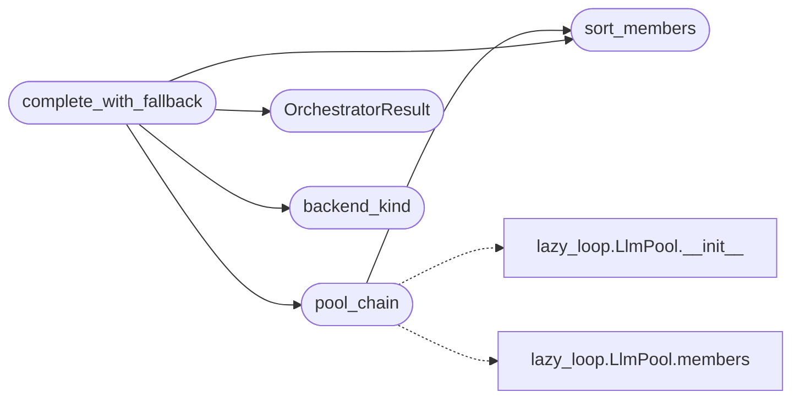

# `modules.llm_orchestrator`

> Source: [modules/llm_orchestrator.py:1](../../modules/llm_orchestrator.py#L1) | language `py` | coverage 100.0% | [API index](../index.md)

Orchestrator-governed LLM failover chain for every AI module.

Single entry point the framework's AI consumers use to reach a language
model. The failover chain is owned by ``lazy_orchestrator`` (the Models
tab) and persisted in ``sessions/lazy/llm_pool.json``; member priority
acts as the weight deciding the try order. Each leg executes through the
`[`modules.llm_factory`](modules.llm_factory.py.md)` model-spec executor (``groq:``, ``ollama:``,
``llamacpp:``, ``pi:``, ``toposwarm:``), so a dead Groq key, an exhausted
quota or a missing API key degrades to the next member instead of
breaking the caller. The chain never raises: total exhaustion returns a
help message the caller can display.

Contracts
---------
* [`pool_chain`](#pool_chain) — ordered members read from the lazy_orchestrator pool.
* [`sort_members`](#sort_members) — weight-sorted defensive copy of a member list.
* [`backend_kind`](#backend_kind) — provider prefix derived from a model spec.
* [`complete_with_fallback`](#complete_with_fallback) — the failover walk returning an
  [`OrchestratorResult`](#orchestratorresult) with a fallback notice when the primary
  failed.
* [`HELP_MESSAGE`](#help_message) — the final-resort guidance text.

Usage::

    from modules.llm_orchestrator import complete_with_fallback

    result = complete_with_fallback("summarize the nmap output", max_tokens=800)
    if result.ok:
        print(result.display_text)

## Contents

- **Classes:** [`OrchestratorResult`](#orchestratorresult)
- **Functions:** [`sort_members`](#sort_members), [`pool_chain`](#pool_chain), [`backend_kind`](#backend_kind), [`complete_with_fallback`](#complete_with_fallback)
- **Constants:** [`HELP_MESSAGE`](#help_message)

## Call Graph

Solid arrows stay in this module, dashed arrows leave it.



## Classes

<a id="orchestratorresult"></a>

### `OrchestratorResult`

`class` `dataclass` | [modules/llm_orchestrator.py:92](../../modules/llm_orchestrator.py#L92)

Decorators: `@dataclass`

```python
class OrchestratorResult
```

Outcome of one orchestrator chain walk.

**Attributes**

| Name | Type | Default | Description |
|---|---|---|---|
| [`text`](#orchestratorresult-text) | `str` |  | Clean model answer; the help message on total failure. |
| [`member`](#orchestratorresult-member) | `str` | `''` | Name of the serving pool member (empty on failure). |
| [`model`](#orchestratorresult-model) | `str` | `''` | Full model spec of the serving member (empty on failure). |
| [`model_name`](#orchestratorresult-model_name) | `str` | `''` | Model spec without the provider prefix. |
| [`backend`](#orchestratorresult-backend) | `str` | `'error'` | Provider prefix of the serving member or ``"error"``. |
| [`fallback_used`](#orchestratorresult-fallback_used) | `bool` | `False` | True when anything but the primary served. |
| [`notice`](#orchestratorresult-notice) | `str` | `''` | Operator-facing message naming failures and the server; empty when the primary succeeded. |
| [`attempts`](#orchestratorresult-attempts) | `list[tuple[str, str]]` | `field(default_factory=list)` | ``(member, error)`` pairs for every failed attempt. |
| [`attempted_specs`](#orchestratorresult-attempted_specs) | `list[str]` | `field(default_factory=list)` |  |

**Members**

| Member | Kind | Summary |
|---|---|---|
| [`ok`](#orchestratorresult-ok) | property | Return True when a chain member served the answer. |
| [`display_text`](#orchestratorresult-display_text) | property | Return the notice-prefixed answer for operator-facing surfaces. |

<a id="orchestratorresult-ok"></a>

#### `OrchestratorResult.ok`

`property` | [modules/llm_orchestrator.py:118](../../modules/llm_orchestrator.py#L118)

Decorators: `@property`

```python
def ok(self) -> bool
```

Return True when a chain member served the answer.

**Returns:** `bool`

<a id="orchestratorresult-display_text"></a>

#### `OrchestratorResult.display_text`

`property` | [modules/llm_orchestrator.py:123](../../modules/llm_orchestrator.py#L123)

Decorators: `@property`

```python
def display_text(self) -> str
```

Return the notice-prefixed answer for operator-facing surfaces.

**Returns:** `str`

---

## Functions

<a id="sort_members"></a>

### `sort_members`

`function` | [modules/llm_orchestrator.py:130](../../modules/llm_orchestrator.py#L130)

```python
def sort_members(members: list[dict]) -> list[dict]
```

Return a weight-sorted defensive copy of a member list.

**Parameters**

| Name | Type | Default | Description |
|---|---|---|---|
| `members` | `list[dict]` |  | Pool member mappings with ``priority`` keys. |

**Returns:** `list[dict]` - New list ordered by descending priority weight.

*Called by:* [`complete_with_fallback`](#complete_with_fallback), [`pool_chain`](#pool_chain)

---

<a id="pool_chain"></a>

### `pool_chain`

`function` | [modules/llm_orchestrator.py:148](../../modules/llm_orchestrator.py#L148)

```python
def pool_chain() -> list[dict]
```

Return the failover chain governed by lazy_orchestrator.

Members come from the persistent pool store managed by the
lazy_orchestrator Models tab (``sessions/lazy/llm_pool.json``) and are
weight-sorted by descending priority. Members without a model spec
are dropped.

**Returns:** `list[dict]` - Ordered member mappings; empty when the pool is unreadable.

*Calls:* [`LlmPool.__init__`](modules.lazy_loop.py.md#llmpool-__init__), [`LlmPool.members`](modules.lazy_loop.py.md#llmpool-members), [`sort_members`](#sort_members)

*Called by:* [`complete_with_fallback`](#complete_with_fallback)

---

<a id="backend_kind"></a>

### `backend_kind`

`function` | [modules/llm_orchestrator.py:175](../../modules/llm_orchestrator.py#L175)

```python
def backend_kind(model_spec: str) -> str
```

Return the provider prefix of a model spec.

**Parameters**

| Name | Type | Default | Description |
|---|---|---|---|
| `model_spec` | `str` |  | Spec such as ``groq:llama-3.3-70b-versatile`` or a bare model name. |

**Returns:** `str` - The prefix before the first colon, or ``"auto"`` when the spec
carries no recognizable prefix.

*Called by:* [`complete_with_fallback`](#complete_with_fallback)

---

<a id="complete_with_fallback"></a>

### `complete_with_fallback`

`function` | [modules/llm_orchestrator.py:349](../../modules/llm_orchestrator.py#L349)

```python
def complete_with_fallback(prompt: str, system: str = '', max_tokens: int = 800, api_key: str = '', members: list[dict] | None = None, executor: Executor | None = None, health: Any | None = None, record: bool = True) -> OrchestratorResult
```

Complete a prompt through the lazy_orchestrator chain with failover.

The chain is the priority-sorted member list from the
lazy_orchestrator pool unless an override list is supplied. Members
parked by the shared health breaker are skipped while any healthy
member remains and retried as a last resort when none is. A member
fails when the executor raises, returns blank text, or returns an
error banner; the walk continues until one member serves. The
function never raises.

**Parameters**

| Name | Type | Default | Description |
|---|---|---|---|
| `prompt` | `str` |  | User prompt text. |
| `system` | `str` | `''` | Optional system prompt prepended to the user prompt. |
| `max_tokens` | `int` | `800` | Response token cap forwarded to each leg. |
| `api_key` | `str` | `''` | Explicit Groq key published to the environment for the ``groq:`` legs; empty resolves the key from ``payload.json``. |
| `members` | `list[dict] \| None` | `None` | Optional chain override (tests, per-task chains). |
| `executor` | `Executor \| None` | `None` | Optional leg executor override; defaults to the `[`modules.llm_factory`](modules.llm_factory.py.md)` spec executor. |
| `health` | `Any \| None` | `None` | Optional breaker registry override; defaults to the shared `[`modules.llm_pool`](modules.llm_pool.py.md)` registry. |
| `record` | `bool` | `True` | When True, append outcomes to the pool usage ledger. |

**Returns:** `OrchestratorResult` - An [`OrchestratorResult`](#orchestratorresult); `[`ok`](scripts.top_tier_check.py.md#ok)` is False with the help
message in `[`text`](#orchestratorresult-text)` when every member failed.

*Calls:* [`OrchestratorResult`](#orchestratorresult), [`backend_kind`](#backend_kind), [`pool_chain`](#pool_chain), [`sort_members`](#sort_members)

*Called by:* [`analyze_behavioral_data`](lazyc2.py.md#analyze_behavioral_data), [`analyze_campaign_progress`](lazyc2.py.md#analyze_campaign_progress), [`call`](modules.ai_fallback.py.md#call), [`ask_general`](modules.llm_adapter.py.md#ask_general)

---

## Constants

<a id="help_message"></a>

### `HELP_MESSAGE`

`constant` | [modules/llm_orchestrator.py:78](../../modules/llm_orchestrator.py#L78)

```python
HELP_MESSAGE
```

---
