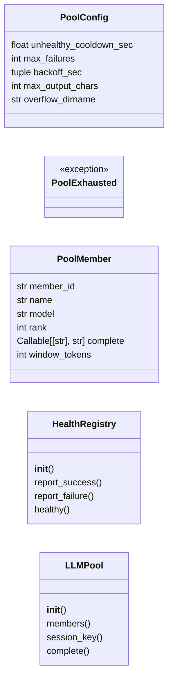
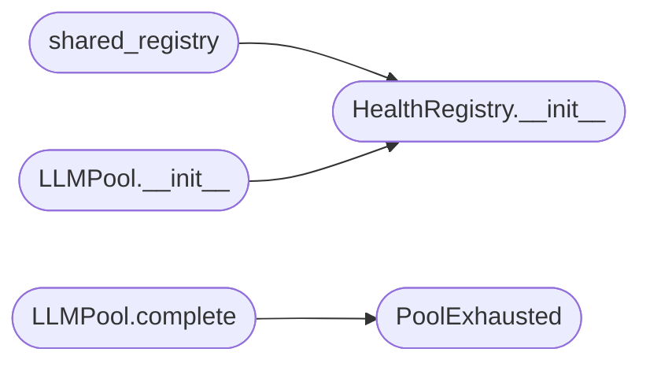

# `modules.llm_pool`

> Source: [modules/llm_pool.py:1](../../modules/llm_pool.py#L1) | language `py` | coverage 100.0% | [API index](../index.md)

Ordered LLM failover pool with health-aware skipping.

Ports the LAZY llmpool contract. Members form a priority chain with
the active profile heading. Failover happens only before the first
token. Mid-stream failures surface unchanged for harness resume.

## Contents

- **Classes:** [`PoolConfig`](#poolconfig), [`PoolMember`](#poolmember), [`HealthRegistry`](#healthregistry), [`LLMPool`](#llmpool)
- **Exceptions:** [`PoolExhausted`](#poolexhausted)
- **Functions:** [`shared_registry`](#shared_registry)
- **Constants:** [`CONFIG`](#config)

## Type Diagram



## Call Graph

Solid arrows stay in this module, dashed arrows leave it.



## Classes

<a id="poolconfig"></a>

### `PoolConfig`

`class` `dataclass` | [modules/llm_pool.py:29](../../modules/llm_pool.py#L29)

Decorators: `@dataclass(frozen=True, slots=True)`

```python
class PoolConfig
```

Centralized constants for pool behavior (LAZY llmpool parity).

**Attributes**

| Name | Type | Default | Description |
|---|---|---|---|
| [`unhealthy_cooldown_sec`](#poolconfig-unhealthy_cooldown_sec) | `float` | `300.0` |  |
| [`max_failures`](#poolconfig-max_failures) | `int` | `3` |  |
| [`backoff_sec`](#poolconfig-backoff_sec) | `tuple` | `(60.0, 300.0, 1800.0)` |  |
| [`max_output_chars`](#poolconfig-max_output_chars) | `int` | `30000` |  |
| [`overflow_dirname`](#poolconfig-overflow_dirname) | `str` | `'cmd-output'` |  |

---

<a id="poolmember"></a>

### `PoolMember`

`class` `dataclass` | [modules/llm_pool.py:64](../../modules/llm_pool.py#L64)

Decorators: `@dataclass`

```python
class PoolMember
```

Single provider in the failover chain.

**Attributes**

| Name | Type | Default | Description |
|---|---|---|---|
| [`member_id`](#poolmember-member_id) | `str` |  |  |
| [`name`](#poolmember-name) | `str` |  |  |
| [`model`](#poolmember-model) | `str` |  |  |
| [`rank`](#poolmember-rank) | `int` |  |  |
| [`complete`](#poolmember-complete) | `Callable[[str], str]` | `field(repr=False, compare=False)` |  |
| [`window_tokens`](#poolmember-window_tokens) | `int` | `0` |  |

---

<a id="healthregistry"></a>

### `HealthRegistry`

`class` | [modules/llm_pool.py:75](../../modules/llm_pool.py#L75)

```python
class HealthRegistry
```

Failure counting registry with tiered backoff (LAZY parity).

Soft trips after max_failures transient errors; auth errors
(401/402/quota) trip immediately. Backoff tiers are 1m/5m/30m.
State persists to disk so the breaker survives process restarts.

**Members**

| Member | Kind | Summary |
|---|---|---|
| [`__init__`](#healthregistry-__init__) | constructor | Initialize counters from the persisted breaker state. |
| [`report_success`](#healthregistry-report_success) | method | Clear failure state for a member. |
| [`report_failure`](#healthregistry-report_failure) | method | Record a failure; auth/quota errors trip immediately. |
| [`healthy`](#healthregistry-healthy) | method | Return True when a member may serve traffic. |

<a id="healthregistry-__init__"></a>

#### `HealthRegistry.__init__`

`constructor` | [modules/llm_pool.py:83](../../modules/llm_pool.py#L83)

```python
def __init__(self, config: PoolConfig = CONFIG) -> None
```

Initialize counters from the persisted breaker state.

**Parameters**

| Name | Type | Default | Description |
|---|---|---|---|
| `config` | `PoolConfig` | `CONFIG` |  |

*Called by:* [`LLMPool.__init__`](#llmpool-__init__), [`shared_registry`](#shared_registry)

<a id="healthregistry-report_success"></a>

#### `HealthRegistry.report_success`

`method` | [modules/llm_pool.py:135](../../modules/llm_pool.py#L135)

```python
def report_success(self, member_id: str) -> None
```

Clear failure state for a member.

**Parameters**

| Name | Type | Default | Description |
|---|---|---|---|
| `member_id` | `str` |  |  |

<a id="healthregistry-report_failure"></a>

#### `HealthRegistry.report_failure`

`method` | [modules/llm_pool.py:143](../../modules/llm_pool.py#L143)

```python
def report_failure(self, member_id: str, error: str = '') -> None
```

Record a failure; auth/quota errors trip immediately.

**Parameters**

| Name | Type | Default | Description |
|---|---|---|---|
| `member_id` | `str` |  |  |
| `error` | `str` | `''` |  |

<a id="healthregistry-healthy"></a>

#### `HealthRegistry.healthy`

`method` | [modules/llm_pool.py:163](../../modules/llm_pool.py#L163)

```python
def healthy(self, member_id: str) -> bool
```

Return True when a member may serve traffic.

**Parameters**

| Name | Type | Default | Description |
|---|---|---|---|
| `member_id` | `str` |  |  |

**Returns:** `bool`

---

<a id="llmpool"></a>

### `LLMPool`

`class` | [modules/llm_pool.py:176](../../modules/llm_pool.py#L176)

```python
class LLMPool
```

Failover chain over ordered pool members with RR intra-rank.

**Members**

| Member | Kind | Summary |
|---|---|---|
| [`__init__`](#llmpool-__init__) | constructor | Order members by descending rank (RR within equal rank). |
| [`members`](#llmpool-members) | property | Return chain members in order. |
| [`session_key`](#llmpool-session_key) | method | Build a sticky session header (LAZY session_header parity). |
| [`complete`](#llmpool-complete) | method | Complete a prompt with pre-token failover across members. |

<a id="llmpool-__init__"></a>

#### `LLMPool.__init__`

`constructor` | [modules/llm_pool.py:179](../../modules/llm_pool.py#L179)

```python
def __init__(self, members: list[PoolMember], health: HealthRegistry | None = None, config: PoolConfig = CONFIG) -> None
```

Order members by descending rank (RR within equal rank).

**Parameters**

| Name | Type | Default | Description |
|---|---|---|---|
| `members` | `list[PoolMember]` |  |  |
| `health` | `HealthRegistry \| None` | `None` |  |
| `config` | `PoolConfig` | `CONFIG` |  |

**Raises**

- `ValueError`: (raised in the body, not documented)

*Calls:* [`HealthRegistry.__init__`](#healthregistry-__init__)

*Called by:* [`AiCommandSet.do_poolcheck`](cli.commands.ai.py.md#aicommandset-do_poolcheck)

<a id="llmpool-members"></a>

#### `LLMPool.members`

`property` | [modules/llm_pool.py:192](../../modules/llm_pool.py#L192)

Decorators: `@property`

```python
def members(self) -> list[PoolMember]
```

Return chain members in order.

**Returns:** `list[PoolMember]`

<a id="llmpool-session_key"></a>

#### `LLMPool.session_key`

`method` | [modules/llm_pool.py:196](../../modules/llm_pool.py#L196)

```python
def session_key(self, conversation_id: str = '', role: str = 'worker', index: int = 0) -> str
```

Build a sticky session header (LAZY session_header parity).

**Parameters**

| Name | Type | Default | Description |
|---|---|---|---|
| `conversation_id` | `str` | `''` |  |
| `role` | `str` | `'worker'` |  |
| `index` | `int` | `0` |  |

**Returns:** `str`

<a id="llmpool-complete"></a>

#### `LLMPool.complete`

`method` | [modules/llm_pool.py:237](../../modules/llm_pool.py#L237)

```python
def complete(self, prompt: str, max_tokens: int = 0, session_key: str = '', overflow_dir: str = '') -> str
```

Complete a prompt with pre-token failover across members.

**Parameters**

| Name | Type | Default | Description |
|---|---|---|---|
| `prompt` | `str` |  |  |
| `max_tokens` | `int` | `0` |  |
| `session_key` | `str` | `''` |  |
| `overflow_dir` | `str` | `''` |  |

**Returns:** `str`

**Raises**

- [`PoolExhausted`](#poolexhausted): (raised in the body, not documented)

*Calls:* [`PoolExhausted`](#poolexhausted)

*Called by:* [`AiCommandSet.do_poolcheck`](cli.commands.ai.py.md#aicommandset-do_poolcheck)

---

## Exceptions

<a id="poolexhausted"></a>

### `PoolExhausted`

`exception` | [modules/llm_pool.py:42](../../modules/llm_pool.py#L42)

```python
class PoolExhausted(RuntimeError)
```

Bases: `RuntimeError`

Raised when every pool member fails a request.

---

## Functions

<a id="shared_registry"></a>

### `shared_registry`

`function` | [modules/llm_pool.py:50](../../modules/llm_pool.py#L50)

```python
def shared_registry(config: PoolConfig = CONFIG) -> HealthRegistry
```

Return the process-wide health registry (LAZY Registry parity).

Breaker state survives pool rebuilds so repeated failures across
suggestions trip the breaker instead of resetting each call.

**Parameters**

| Name | Type | Default | Description |
|---|---|---|---|
| `config` | `PoolConfig` | `CONFIG` |  |

**Returns:** `HealthRegistry`

*Calls:* [`HealthRegistry.__init__`](#healthregistry-__init__)

*Called by:* [`AiCommandSet.do_poolcheck`](cli.commands.ai.py.md#aicommandset-do_poolcheck)

---

## Constants

<a id="config"></a>

### `CONFIG`

`constant` | [modules/llm_pool.py:39](../../modules/llm_pool.py#L39)

```python
CONFIG = PoolConfig()
```

---
